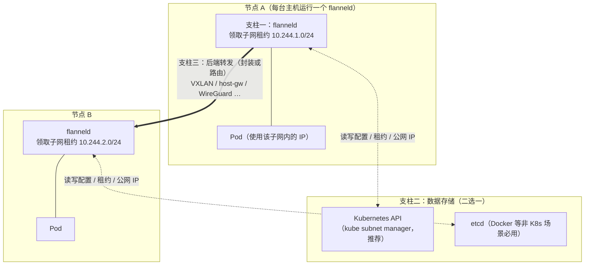

flannel 是一个为 Kubernetes 设计的、简单易用的**三层（Layer 3）网络织物**。它只用一个单二进制守护进程 `flanneld`，就能让集群中任意节点上的 Pod 相互通信，而无需你手工维护任何路由表或隧道配置。本页是整个文档站的起点：我们将用最小的认知成本，讲清 flannel "是什么"、"为什么需要它"、"它靠哪三根支柱工作"，并给出一份后续深入学习的路线图。

Sources: [README.md](README.md#L8-L14)

## 为什么需要 flannel：Kubernetes 的网络前提

Kubernetes 这类平台有一个基本假设：**集群中的每个容器（Pod）都拥有一个唯一、可路由的 IP 地址**。这个模型的好处是彻底摆脱了"多容器共享一个主机 IP"所带来的端口映射复杂性——Pod 之间就像局域网里的普通机器一样直接对话。但 Kubernetes 本身只定义了这个"契约"，并不负责实现它，把跨节点的流量真正送达目的地，正是 flannel 这类 CNI（容器网络接口）方案存在的意义。

Sources: [README.md](README.md#L16-L21)

值得初学者特别注意 flannel 的**职责边界**：它负责提供集群中多个节点之间的三层 IPv4 网络，但**不控制容器如何接入主机网络**，只负责主机之间的流量如何传输；同时 `flanneld` 本身也不强制执行 Network Policy（网络策略），不过项目通过 Helm Chart 的 `netpol.enabled` 选项或搭配 Calico/Cilium 等第三方控制器，提供了补充策略能力的路径。

Sources: [README.md](README.md#L21-L32)

## 核心工作原理：三根支柱

flannel 的全部魔力可以浓缩为三件事，这也是理解整个项目的概念骨架：

1. **子网租约分配**：`flanneld` 在每台主机上运行，从一个预先配置好的大网段（如默认的 `10.244.0.0/16`）中，为每台主机切分并"租借"一小段子网（通常是 /24）；
2. **集中式数据存储**：网络配置、已分配的子网、主机公网 IP 等辅助数据，要么存进 Kubernetes API（官方推荐的模式，称为 *kube subnet manager*，可省去单独部署 etcd），要么直接使用 etcd；
3. **可插拔的后端转发**：跨主机的数据包通过多种后端机制之一进行转发，包括内核 VXLAN 封装、主机路由，以及各类云平台集成。

Sources: [README.md](README.md#L12-L14), [README.md](README.md#L38-L38)

下面的架构图展示了这三根支柱如何协作：每台节点的 flanneld 从同一存储领取租约，再依据所选后端在主机网络之上建立数据通路。

Sources: [README.md](README.md#L10-L14)

## 从源码视角看启动主线

对初学者而言，`main.go` 是阅读 flannel 源码的最佳入口，它的 `main()` 函数几乎逐条对应上面的概念骨架。程序首先根据 `--kube-subnet-mgr` 参数决定创建 kube 还是 etcd 版的子网管理器；随后拉取网络配置、检查 `br_netfilter` 内核模块、确定用于主机间通信的外部网卡与公网 IP；接着由后端管理器按配置中的 `BackendType` 实例化具体后端并注册网络；再初始化 iptables 或 nftables 流量管理器并配置伪装（masquerade）与转发规则；最后把分配结果写入 `subnet.env` 文件（写完即宣告 ready），转入后台持续运行并完成租约续约。

Sources: [main.go](main.go#L244-L414), [main.go](main.go#L477-L513)

其中有一个对理解代码非常关键的细节：所有后端都以**空白导入**（`_ import`）的方式在 `main.go` 顶部引入，仅为了让各自的 `init()` 函数执行并把构造器注册进全局映射；后端管理器随后的 `GetBackend` 调用只是在这个 `constructors` 映射里查找对应类型。这是 Go 语言中经典的插件注册模式，也是 flannel "简易"哲学在代码层面的体现。

Sources: [main.go](main.go#L48-L60), [pkg/backend/manager.go](pkg/backend/manager.go#L50-L93)

## 后端矩阵：一张表看懂转发选项

flannel 把"数据包如何在主机间穿越"完全抽象为后端插件。官方文档明确给出选型建议：**VXLAN 是推荐选择**；host-gw 适合追求性能、且基础设施支持二层直连（通常是自建机房而非公有云）的有经验用户；UDP 仅建议用于调试或极老的内核。下表汇总了各后端的核心特征：

| 后端 | 工作原理 | 是否加密 | 状态与定位 |
|------|---------|---------|-----------|
| **VXLAN** | 使用内核 VXLAN 设备封装数据包（UDP 8472 端口） | 否 | **推荐**，通用性最好 |
| **host-gw** | 直接创建以远端主机 IP 为网关的 IP 路由，要求主机间二层直连 | 否 | 推荐，性能好、依赖少 |
| **WireGuard** | 使用内核 WireGuard 封装并加密数据包（默认 UDP 51820） | **是** | 推荐，需要加密时首选 |
| **UDP** | 用户态 UDP 封装（默认端口 8285） | 否 | 仅用于调试或极老内核 |
| **IPIP** | 内核 IPIP 隧道，开销最低，但只能封装 IPv4 单播 | 否 | 实验性 |
| **IPsec** | 内核 IPsec 加密，配合 Strongswan 完成 IKEv2 密钥协商 | **是** | 实验性 |
| **alloc** | 只做子网分配，不转发任何数据包 | — | 实验性 |
| **tencent-vpc** | 借助腾讯云 VPC 路由表转发，无需独立 flannel 接口 | 否 | 实验性，限腾讯云 CVM |

Sources: [Documentation/backends.md](Documentation/backends.md#L5-L12), [Documentation/backends.md](Documentation/backends.md#L14-L101), [Documentation/backends.md](Documentation/backends.md#L106-L119)

值得说明的是，若配置中完全未指定 `Backend`，解析器会保守地回退到 `udp` 类型；同时网络配置支持 IPv4/IPv6 双栈开关以及 nftables 选项，这些都收敛在同一个 `Config` 结构体中。

Sources: [pkg/subnet/config.go](pkg/subnet/config.go#L26-L54)

## 部署形态：一份清单解决五件事

在 Kubernetes 上，官方推荐用一条 `kubectl apply` 或 Helm 命令部署。`kube-flannel.yml` 这份清单定义了五个组成部分：一个开启 `privileged` Pod 安全级别的 `kube-flannel` 命名空间、RBAC 所需的 ClusterRole 与 ClusterRoleBinding、供 flannel 使用的 ServiceAccount、一个同时承载 CNI 配置与 flannel 配置的 ConfigMap（后端类型也在这里选择，默认 VXLAN），以及按 CPU 架构部署的 DaemonSet——每个 Pod 含两个容器，分别是 flannel 守护进程本身和一个负责把 CNI 配置投递到 kubelet 可读位置的 initContainer。部署完成后，所有 Pod 都会从 pod 网络 CIDR 中获得 IP，无论落在哪个节点都能互通。

Sources: [README.md](README.md#L46-L65), [Documentation/kubernetes.md](Documentation/kubernetes.md#L7-L16)

在 Kubernetes 之外（例如纯 Docker 环境），flannel 同样被广泛使用，此时 **etcd 恒定作为数据存储**。

Sources: [README.md](README.md#L85-L87)

## 代码地图：目录导航

最后给出一张仓库目录地图，帮助你把概念映射到代码位置：

| 目录/文件 | 对应概念 |
|----------|---------|
| `main.go` | 程序入口，命令行参数与启动主线 |
| `pkg/subnet/` | 支柱一与支柱二：配置解析、租约抽象 |
| `pkg/subnet/kube/` | kube subnet manager（基于 Node 注解与 informer） |
| `pkg/subnet/etcd/` | etcd 存储模式的实现 |
| `pkg/backend/` | 支柱三：后端管理器与各后端实现（`vxlan/`、`hostgw/`、`wireguard/` 等） |
| `pkg/trafficmngr/` | iptables 与 nftables 双实现的流量规则管理 |
| `pkg/ipmatch/` | 外部网卡与公网 IP 的选择逻辑 |
| `Documentation/` | 官方文档（后端、配置、运行、排障） |

其中 kube subnet manager 的实现依托 client-go 的 informer 机制监控 Node 对象，并通过注解存取租约信息。

Sources: [pkg/subnet/kube/kube.go](pkg/subnet/kube/kube.go#L63-L79)

## 下一步阅读路线

理解了"三根支柱"之后，建议按以下顺序深入：

1. **动手部署**：跟随 [快速开始：在 Kubernetes 集群中一键部署 flannel](2-kuai-su-kai-shi-zai-kubernetes-ji-qun-zhong-jian-bu-shu-flannel) 在真实集群中跑起来；
2. **吃透架构**：阅读 [flanneld 架构总览：启动流程与组件协作全解](6-flanneld-jia-gou-zong-lan-qi-dong-liu-cheng-yu-zu-jian-xie-zuo-quan-jie)，本页只给了主线鸟瞰，该页逐段拆解；
3. **理解租约**：进入 [子网租约机制：从全局大网段到主机子网的分配与续约](7-zi-wang-zu-yue-ji-zhi-cong-quan-ju-da-wang-duan-dao-zhu-ji-zi-wang-de-fen-pei-yu-xu-yue)；
4. **掌握插件模式**：学习 [后端插件注册模式：基于 init() 与构造器映射的扩展点设计](8-hou-duan-cha-jian-zhu-ce-mo-shi-ji-yu-init-yu-gou-zao-qi-ying-she-de-kuo-zhan-dian-she-jie)；
5. **选型后端**：结合 [推荐后端对比：VXLAN、host-gw 与 WireGuard 选型](10-tui-jian-hou-duan-dui-bi-vxlan-host-gw-yu-wireguard-xuan-xing) 为你的环境做出正确选择。