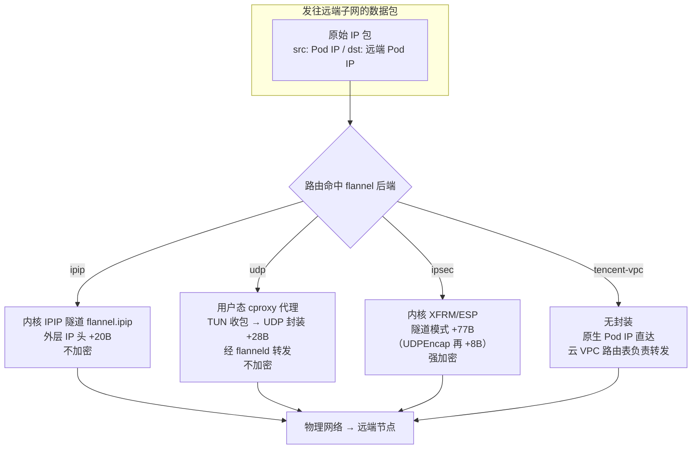
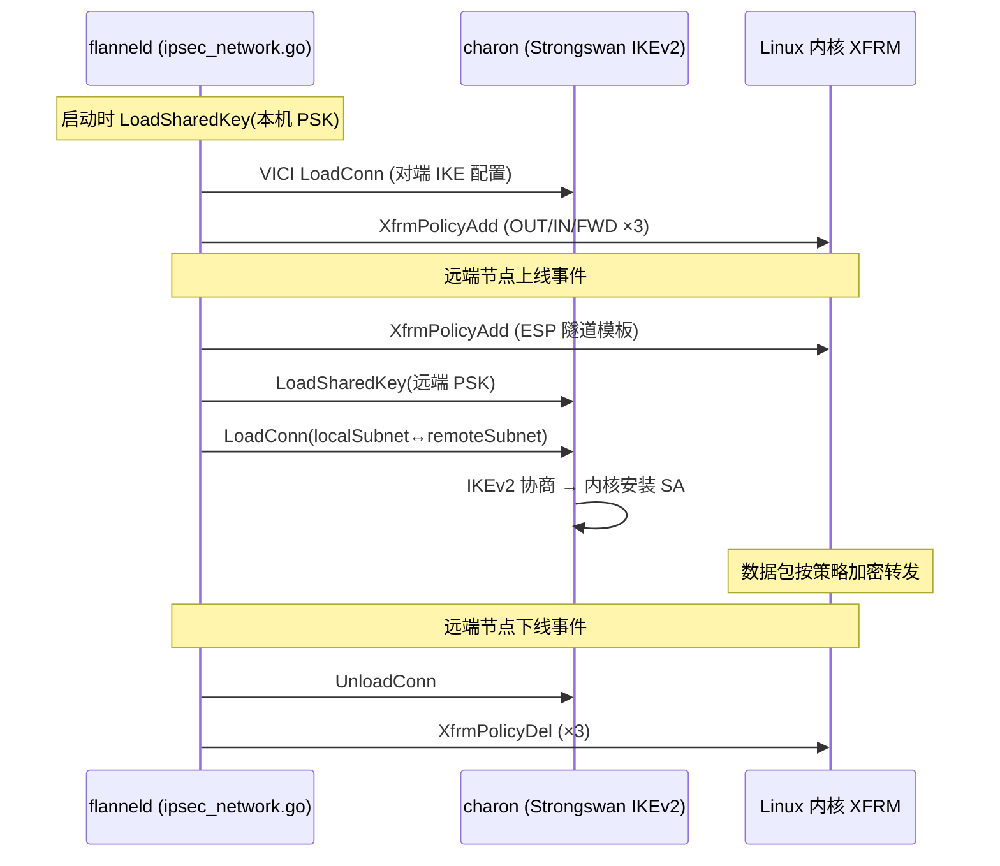

本文深入 flannel 四个非主流数据面后端的实现机制：提供加密能力的 **IPsec**、以最低开销封装流量的 **IPIP**、仅用于调试的 **UDP** 用户态后端，以及把数据面"外包"给云厂商控制器的 **腾讯云 VPC** 后端。它们与 VXLAN、host-gw、WireGuard 等推荐后端共享同一套插件框架，但在封装位置、加密能力与运维复杂度上差异显著。阅读本文前建议先了解[后端插件注册模式](8-hou-duan-cha-jian-zhu-ce-mo-shi-ji-yu-init-yu-gou-zao-qi-ying-she-de-kuo-zhan-dian-she-ji)中的 `init()` 注册机制，本文聚焦这四个后端各自的内部实现。

Sources: [backends.md](Documentation/backends.md#L78-L80)

## 四个后端的共同骨架

四个后端都以相同的姿势接入 flannel：在包的 `init()` 函数中调用 `backend.Register`，把构造函数写入全局 `constructors` 映射。此后每当 `Manager.GetBackend` 按 `Type` 字符串查找时，即可实例化对应实现。`Backend` 接口只有一个方法 `RegisterNetwork`，它接收子网管理器与外部接口信息（`ExternalInterface` 中的物理网卡、内网 IP、公网 IP），返回一个具备 `Lease()/MTU()/Run()` 三个方法的 `Network` 对象。

Sources: [manager.go](pkg/backend/manager.go#L26-L31), [common.go](pkg/backend/common.go#L39-L50)

在 `Network` 层面，四个后端复用了两个基类：`SimpleNetwork` 提供租约与外部接口的默认持有实现（其 `Run` 只是阻塞等待 ctx 取消）；`RouteNetwork` 在此之上增加了租约事件驱动的路由增删逻辑，通过 `GetRoute` 回调函数让子类决定"到某个远端子网的路由长什么样"。IPIP 直接继承 `RouteNetwork`，而 IPsec 与 UDP 则各自实现了独立的事件循环。

Sources: [simple_network.go](pkg/backend/simple_network.go#L23-L39), [route_network.go](pkg/backend/route_network.go#L37-L51)

值得注意的是，四个后端的 Linux 实现文件全部携带 `//go:build !windows` 构建标签，而对应的 `*_windows.go` 文件只包含空的 package 声明——这意味着这四个后端在 Windows 节点上完全没有实现（UDP 更进一步，在非 amd64 架构上直接返回"not supported on this architecture"错误）。这是它们与支持 Windows 的 VXLAN 后端的一个重要差异。

Sources: [ipip_windows.go](pkg/backend/ipip/ipip_windows.go#L14-L18), [udp.go](pkg/backend/udp/udp.go#L14-L33)

上图概括了四条数据路径的本质分野：IPIP 与 IPsec 是**内核态隧道**（前者最薄、后者加密），UDP 是唯一在**用户态**搬运数据包的后端，tencent-vpc 则干脆**不封装**——它只负责把"Pod 子网 → 本机公网 IP"这类路由条目写进云厂商的路由表，让底层网络原生转发。

Sources: [ipip.go](pkg/backend/ipip/ipip.go#L35-L42), [udp_network_amd64.go](pkg/backend/udp/udp_network_amd64.go#L36-L38), [ipsec_network.go](pkg/backend/ipsec/ipsec_network.go#L33-L48), [tencentvpc.go](pkg/backend/tencentvpc/tencentvpc.go#L215-L219)

## IPIP：开销最低的内核封装

IPIP 后端注册名为 `"ipip"`，它创建的隧道设备名为 `flannel.ipip`。`RegisterNetwork` 的流程遵循标准模式：解析配置 → 获取子网租约 → 构造 `RouteNetwork` → 创建隧道设备。其唯一可配置项是 `DirectRouting`（默认 `false`）：启用后，若对端主机公网 IP 与本机在同一二层子网内（可直达），则直接在物理网卡上添加 `host-gw` 风格的路由，绕过隧道封装；否则仍走 IPIP 隧道。

Sources: [ipip.go](pkg/backend/ipip/ipip.go#L35-L42), [ipip.go](pkg/backend/ipip/ipip.go#L57-L123)

`GetRoute` 回调生成的路由是理解 IPIP 数据面的关键：目标为远端子网，网关为远端 `PublicIP`，出接口是 `flannel.ipip`，并携带 `FLAG_ONLINK` 标志（因为网关不在本地子网内）。内核收到这样的包后，会套上一个新的 IP 头（外层源/目的即两端 `PublicIP`），这就是 IPIP 封装的全部——因此开销仅 **20 字节**，是所有隧道后端中最低的，但代价是只能封装 IPv4 单播流量，无法承载 OSPF、RIP 等组播协议。

Sources: [ipip.go](pkg/backend/ipip/ipip.go#L101-L123), [backends.md](Documentation/backends.md#L106-L114)

设备创建逻辑处理了一个容易被误认为 bug 的现象：加载 `ipip` 内核模块时，每个网络命名空间都会自动出现一个 `tunl0` 设备，它是 `local=any, remote=any` 的兜底设备——当内核收到 IPIP 协议包而找不到更精确匹配 `local/remote` 属性的设备时，会交给 `tunl0` 处理。flannel 的注释解释了设计权衡：不能确定 `tunl0` 是否被用户占用，因此选择**新建** `flannel.ipip` 并显式设置 `local` 属性来实现一对多的隧道拓扑。若设备已存在但类型不是 ipip、或 `local/remote` 属性与本机接口不符（例如用户改过接口配置），flannel 会要求删除或自动重建该设备，而不是默默沿用一个属性错误的设备。

Sources: [ipip.go](pkg/backend/ipip/ipip.go#L128-L176), [backends.md](Documentation/backends.md#L116-L119)

MTU 管理上，`configureIPIPDevice` 将 `flannel.ipip` 的 MTU 设为物理网卡 MTU 减 20，并把该值写入后续生成的 `subnet.env`；同时隧道地址使用 **/32** 掩码——注释明确说明这是为了避免产生广播路由，该地址仅作为 host-to-workload 流量的回程源地址。物理网卡 MTU 不足 21 字节时会直接报错拒绝启动。

Sources: [ipip.go](pkg/backend/ipip/ipip.go#L178-L208)

## UDP：被时代定格的用户态后端

UDP 后端是 flannel 最早的封装修补方式，如今官方文档的定位非常明确：**仅用于调试，或内核老到连 VXLAN 都不支持的极端场景**。它的架构在四个后端中独树一帜——数据包完全在用户态搬运，因此性能是所有后端中最差的。

Sources: [backends.md](Documentation/backends.md#L5), [backends.md](Documentation/backends.md#L70-L76)

其数据路径由三部分组成：一个名为 `flannel%d` 的 TUN 设备（注意其地址配置为整个 overlay 网段而非 /24 主机子网）、一个绑定在外部接口 `8285` 端口（可通过 `Port` 配置）的 UDP socket，以及一个用 C 语言编写的转发代理 `cproxy`。Go 侧通过 cgo 调用 `C.run_proxy`，把 TUN fd、UDP socket fd、控制 socket fd 一并交给 C 循环，由后者以 `sendto` 方式完成"从 TUN 读包 → 按 tuntun IP 查路由表 → 加 UDP 头发往对端"的全程。

Sources: [udp_amd64.go](pkg/backend/udp/udp_amd64.go#L52-L90), [udp_network_amd64.go](pkg/backend/udp/udp_network_amd64.go#L51-L79), [cproxy_amd64.go](pkg/backend/udp/cproxy_amd64.go#L31-L57)

Go 与 C 两个世界之间通过一对 `AF_UNIX` `SOCK_SEQPACKET` socketpair 传递控制命令。命令结构体只有五个字段（命令类型、目标网段、前缀长度、下一跳 IP、下一跳端口），支持三个操作：`CMD_SET_ROUTE`、`CMD_DEL_ROUTE`、`CMD_STOP`。当租约事件到达时，Go 侧的 `processSubnetEvents` 把远端子网到远端公网 IP 的映射以 `setRoute` 命令写入 C 代理的内部路由表——这正是 UDP 后端事件处理的全部内容，没有比这更复杂的状态。

Sources: [udp_network_amd64.go](pkg/backend/udp/udp_network_amd64.go#L121-L145), [proxy_amd64.h](pkg/backend/udp/proxy_amd64.h#L27-L37), [cproxy_amd64.go](pkg/backend/udp/cproxy_amd64.go#L69-L97)

MTU 开销为 28 字节（外层 IP 头 20 + UDP 头 8），TUN 设备同样使用 /32 地址避免广播路由。此外，整条数据路径（`udp_amd64.go`、`udp_network_amd64.go`、`cproxy_amd64.go`）仅在 **amd64** 架构上编译；其他架构上 `New` 直接报错，这也是它在多架构集群中不可用的原因。

Sources: [udp_network_amd64.go](pkg/backend/udp/udp_network_amd64.go#L132-L134), [udp_network_amd64.go](pkg/backend/udp/udp_network_amd64.go#L160-L199), [udp.go](pkg/backend/udp/udp.go#L26-L33)

## IPsec：Strongswan 密钥交换 + 内核加密

IPsec 是本文四个后端中实现最复杂的，官方将其归入 experimental 且不受支持。其架构是一个清晰的分工模型：**charon 守护进程负责 IKEv2 密钥交换与密钥轮换，Linux 内核 XFRM 子系统负责实际加解密**。flannel 以子进程方式启动 Strongswan 的 charon，通过 VICI Unix socket（`/var/run/charon.vici`）与之通信；容器镜像中预装了 strongswan 软件包，并附带 `swanctl` 工具用于调试。

Sources: [ipsec.go](pkg/backend/ipsec/ipsec.go#L32-L47), [handle_charon.go](pkg/backend/ipsec/handle_charon.go#L45-L79), [Dockerfile](images/Dockerfile#L41-L44)

配置层面有三个参数：`PSK`（**必填**且不少于 96 字符，源码中硬编码校验 `minPasswordLength`）、`UDPEncap`（默认 `false`，用于穿越某些 NAT 网关时强制 UDP 封装 ESP）、`ESPProposal`（默认 `aes128gcm16-sha256-prfsha256-ecp256`）。仓库中的 `dist/ipsec` 文件即是一份可直接用于 etcd 模式的完整配置示例。

Sources: [ipsec.go](pkg/backend/ipsec/ipsec.go#L49-L93), [dist/ipsec](dist/ipsec#L1-L8), [backends.md](Documentation/backends.md#L121-L131)

事件处理逻辑在 `ipsec_network.go` 中展开：收到 `EventAdded` 时，先为远端子网添加 XFRM 策略，再把 PSK 与连接配置加载进 charon；收到 `EventRemoved` 时反向卸载。连接命名规则为 `本机公网IP-本机子网-远端子网-远端公网IP`，IKE 配置使用 `aes256-sha256-modp4096` 提案、IKEv2 版本、`KeyingTries=0`（无限重试）；Child SA 配置中 `RekeyTime=1h` 让 charon 每小时轮换密钥，`InstallPolicy=no` 则把策略安装权完全留给 flannel 自己——这是一个容易忽略的细节：charon 只管 SA，策略由 flannel 直接操作内核。

Sources: [ipsec_network.go](pkg/backend/ipsec/ipsec_network.go#L108-L159), [handle_charon.go](pkg/backend/ipsec/handle_charon.go#L155-L220), [handle_charon.go](pkg/backend/ipsec/handle_charon.go#L250-L257)

内核侧的策略管理封装在 `handle_xfrm.go`：每对主机之间 flannel 安装 **OUT、IN、FWD 三个方向**的 XFRM 策略，隧道模板指定 `ESP` 协议、`tunnel` 模式、`reqid=11`。添加前会先 `XfrmPolicyGet` 探测，不存在则 `Add`、已存在则 `Update`。MTU 计算基于一个逐字节注释的开销常量：新 IP 头 20 + SPI 4 + 序列号 4 + AES IV 16 + 填充 0-15 + 填充长度 1 + Next Header 1 + SHA-256 ICV 16 = **77 字节**，启用 UDPEncap 时再减 8。

Sources: [handle_xfrm.go](pkg/backend/ipsec/handle_xfrm.go#L30-L102), [ipsec_network.go](pkg/backend/ipsec/ipsec_network.go#L33-L48), [ipsec_network.go](pkg/backend/ipsec/ipsec_network.go#L162-L188)

运维上有三点必须牢记。其一，防火墙需放行 **协议 50（ESP）、UDP 500（IKE）、UDP 4500（NAT-T）** 三个端口。其二，排障工具链：`ip xfrm state` 查看内核 SA 数据库确认对端是否成功建立连接，`ip xfrm policy` 查看已安装策略（每个对端三条），charon 日志会同时写到 flannel 进程的 stdout。其三，flannel **不会恢复**被手动删除的策略，也**不会在启动时清理**陈旧策略——需要用 `ip xfrm state flush && ip xfrm policy flush` 手动复位后重启 flannel。

Sources: [backends.md](Documentation/backends.md#L133-L145)

charon 的可执行文件查找覆盖了五大发行版家族的路径（PATH、alpine/arch、debian/ubuntu、centos/rhel、opensuse/sles），找到任一即可启动；charon 进程设置了 `Pdeathsig: SIGTERM`，确保 flanneld 异常退出时 IKE 守护进程不至沦为孤儿。

Sources: [handle_charon.go](pkg/backend/ipsec/handle_charon.go#L259-L279), [handle_charon.go](pkg/backend/ipsec/handle_charon.go#L105-L116)

## 腾讯云 VPC：把数据面交给云控制器

tencent-vpc 后端代表另一极的设计哲学：**不在节点上做任何封装**。它的注册名为 `"tencent-vpc"`，`RegisterNetwork` 完成的唯一实质工作是调用腾讯云 API，把"本机 Pod 子网 → 本机公网 IP（网关类型 `NORMAL_CVM`，路由类型 `USER`）"这条路由写进所在 VPC 的路由表，然后直接返回一个 `SimpleNetwork`——其 `Run` 只是等待退出信号，因为数据面已完全由底层 VPC 网络原生转发。

Sources: [tencentvpc.go](pkg/backend/tencentvpc/tencentvpc.go#L38-L53), [tencentvpc.go](pkg/backend/tencentvpc/tencentvpc.go#L196-L219)

该后端有两类前置依赖。一是**凭证**：`AccessKeyID` 与 `AccessKeySecret` 可通过配置传入，缺省时回退读取 `ACCESS_KEY_ID`/`ACCESS_KEY_SECRET` 环境变量，两者皆无则启动失败。二是**元数据发现**：通过腾讯云 metadata 服务（`metadata.tencentyun.com`）自动获取实例所在 region，以及经网卡 MAC 地址间接查询 VPC ID——节点无需手工声明任何云环境信息。

Sources: [tencentvpc.go](pkg/backend/tencentvpc/tencentvpc.go#L96-L132), [tencentvpc.go](pkg/backend/tencentvpc/tencentvpc.go#L73-L94)

路由写入是幂等的：先 `DescribeRouteTables` 按 vpc-id 过滤查询，遍历路由表逐条比对目标 CIDR、网关 ID、网关类型与路由类型四个字段——若已存在且 `Enabled` 则跳过；若存在但被禁用，则先 `DeleteRoutes` 删除旧条目再重建；不存在则 `CreateRoutes` 新建。需注意官方文档标注的硬限制：**腾讯云 VPC 每张路由表最多 50 条路由**，这直接决定了单个 VPC 内可承载的节点规模上限。

Sources: [tencentvpc.go](pkg/backend/tencentvpc/tencentvpc.go#L143-L213), [backends.md](Documentation/backends.md#L89-L100)

专项文档进一步指明了它与阿里云 VPC 后端的使用差异：腾讯云基于"路由表"操作而阿里云基于"交换机"，且 `backend-type` 字符串不同。由于该后端要求节点本身位于 CVM 实例中，它本质上是一个与云厂商深度绑定的方案——没有云 API 权限的私有化环境无法使用。

Sources: [tencentcloud-vpc-backend.md](Documentation/tencentcloud-vpc-backend.md#L1-L8), [backends.md](Documentation/backends.md#L93-L98)

## 横向对比与选型要点

| 维度 | IPIP | UDP | IPsec | tencent-vpc |
|---|---|---|---|---|
| 封装位置 | 内核隧道 | 用户态代理 | 内核 XFRM/ESP | 无（云原生路由） |
| 加密 | 无 | 无 | 强（IKEv2 + ESP） | 依赖云网络自身 |
| MTU 开销 | 20 B | 28 B | 77 B（UDPEncap +8） | 0 B |
| 默认端口/协议 | IPIP 协议 4 | UDP 8285 | 协议 50 + UDP 500/4500 | 云 API（HTTPS） |
| 外部依赖 | ipip 内核模块 | 无（自包含 C 代理） | Strongswan/charon | 腾讯云 API 凭证 |
| 可配置项 | `DirectRouting` | `Port` | `PSK`/`UDPEncap`/`ESPProposal` | `AccessKeyID`/`AccessKeySecret` |
| 平台限制 | 非 Windows | 仅 amd64、非 Windows | 非 Windows | 非 Windows |
| 官方定位 | 实验性 | 仅调试/极老内核 | 实验性、不受支持 | 实验性 |

Sources: [backends.md](Documentation/backends.md#L70-L145), [ipip.go](pkg/backend/ipip/ipip.go#L35-L42), [udp_amd64.go](pkg/backend/udp/udp_amd64.go#L35-L37), [ipsec.go](pkg/backend/ipsec/ipsec.go#L49-L52), [tencentvpc.go](pkg/backend/tencentvpc/tencentvpc.go#L96-L132)

从选型角度看，这四个后端回答的是四个不同的问题：如果你需要**加密但不想用 WireGuard**（例如内核版本低于 5.6），IPsec 是唯一现成选项，但要接受 Strongswan 依赖与防火墙放行的运维成本；如果你只想要**比 VXLAN 更低的封装开销**且能接受不支持组播，IPIP 的 20 字节开销是极限；如果面对的是**远古内核**或需要排查问题，UDP 后端的自包含特性反而成为优势；而如果你的集群整体运行在腾讯云单一 VPC 内且规模不超过 50 节点，tencent-vpc 提供了零封装开销的最短数据路径。

Sources: [backends.md](Documentation/backends.md#L68-L69), [backends.md](Documentation/backends.md#L100)

## 延伸阅读

- 想理解这四个后端为何能以 `init()` 一行代码接入框架，请继续阅读[后端插件注册模式：基于 init() 与构造器映射的扩展点设计](8-hou-duan-cha-jian-zhu-ce-mo-shi-ji-yu-init-yu-gou-zao-qi-ying-she-de-kuo-zhan-dian-she-ji)
- 若本文的实验性后端不满足需求，正式场景应参考[推荐后端对比：VXLAN、host-gw 与 WireGuard 选型](10-tui-jian-hou-duan-dui-bi-vxlan-host-gw-yu-wireguard-xuan-xing)
- 各后端配置项与 net-conf.json 全局配置的关系，见[net-conf.json 网络配置项逐项详解](13-net-conf-json-wang-luo-pei-zhi-xiang-zhu-xiang-xiang-jie)
- IPIP 与 IPsec 的 MTU 计算细节在性能调优场景的完整讨论，见[性能调优：MTU 计算、后端选型与防火墙端口](26-xing-neng-diao-you-mtu-ji-suan-hou-duan-xuan-xing-yu-fang-huo-qiang-duan-kou)
- 想用 Shell 命令快速原型化自己的数据面（本文四个后端之外的第五条路），见[extension 后端：用 Shell 命令原型化全新数据面](12-extension-hou-duan-yong-shell-ming-ling-yuan-xing-hua-quan-xin-shu-ju-mian)