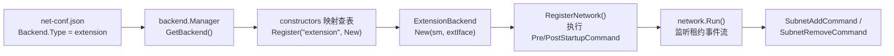
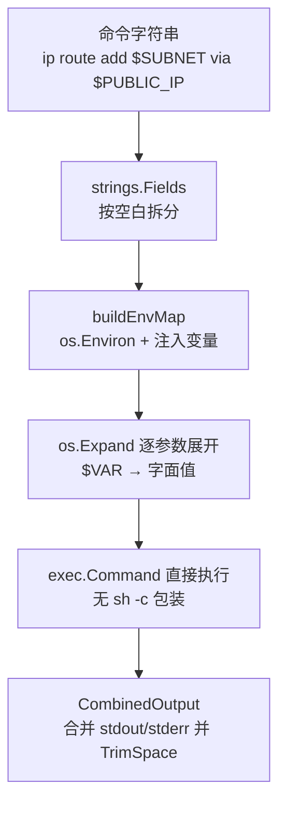
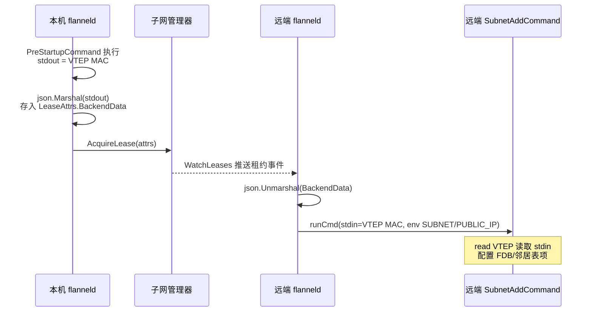

flannel 的 `extension` 后端是一条"逃生舱口"：它允许开发者不写一行 Go 代码，仅通过在 `net-conf.json` 中声明四条命令字符串，就能原型化一种全新的网络后端。本文从源码出发剖析其执行模型、环境变量契约、跨节点数据传播机制，并指出官方文档与现行代码之间的关键漂移——特别是安全修复后从 `sh -c` 到无 shell 直接执行的范式转变。

## 定位与设计动机：为什么需要 extension 后端

flannel 内置的每个后端（VXLAN、host-gw、WireGuard 等）都是编译进二进制的 Go 实现，修改它们需要重新编译、重新发布镜像。`extension` 后端将"数据面逻辑"从编译期推迟到配置期：它本身不实现任何网络功能，只负责在正确的时机、以正确的上下文执行用户提供的命令。其官方定位非常明确——用于原型化新后端，且**不建议生产使用**，因为它没有内置重试机制（对比：其他后端在命令失败时会持续重试）。

从架构视角看，extension 后端是 flannel 插件体系的"元后端"：它复用了与其他后端完全相同的注册协议，但对 `Backend` 接口的实现极度简化——`Run(ctx)` 方法体只有一行 `<-ctx.Done()`，即它自身没有常驻协程，全部动态行为委托给命令与租约监听。

Sources: [Documentation/extension.md](Documentation/extension.md#L1-L5), [pkg/backend/extension/extension.go](pkg/backend/extension/extension.go#L29-L53)

## 注册协议与后端解析：与原生后端共用同一扩展点

extension 后端的接入方式与其他后端完全一致：在包的 `init()` 函数中调用 `backend.Register("extension", New)`，将构造函数塞入 `pkg/backend/manager.go` 的全局 `constructors` 映射。当 flanneld 解析 `net-conf.json` 得到 `Backend.Type == "extension"` 时，`GetBackend` 方法会查表构造 `ExtensionBackend` 实例，并注入两个关键依赖：子网管理器 `subnet.Manager`（负责租约获取与监听）和外部接口信息 `ExternalInterface`（本机对外 IP 与 MTU）。

这意味着第 8 页所述的插件注册模式对所有后端一视同仁——extension 并非特殊通道，而是同一扩展点上最"薄"的一个实现。



Sources: [pkg/backend/extension/extension.go](pkg/backend/extension/extension.go#L29-L53), [pkg/backend/manager.go](pkg/backend/manager.go#L15-L17), [pkg/backend/manager.go](pkg/backend/manager.go#L48-L77), [pkg/backend/common.go](pkg/backend/common.go#L33-L50)

## 配置契约：四个命令字段的职责边界

`RegisterNetwork` 通过 JSON 反序列化从 `config.Backend` 中解析出恰好四个字段，多一个都不认（例如历史示例中的 `ShutdownCommand` 在现行代码中不存在对应解析逻辑，属无效配置）。四个字段构成一条生命周期流水线：

| 字段 | 触发时机 | 注入的环境变量 | stdin 内容 | 失败后果 |
|---|---|---|---|---|
| `PreStartupCommand` | 分配子网**之前** | 无 | 空 | **返回错误，启动中止** |
| `PostStartupCommand` | 获取租约**之后** | `NETWORK`、`SUBNET`、`IPV6SUBNET`、`PUBLIC_IP`、`PUBLIC_IPV6` | 空 | 返回错误，启动中止 |
| `SubnetAddCommand` | 远端子网 EventAdded | `SUBNET`、`PUBLIC_IP` | PreStartupCommand 的 stdout | 仅记日志，继续运行 |
| `SubnetRemoveCommand` | 远端子网 EventRemoved | `SUBNET`、`PUBLIC_IP` | PreStartupCommand 的 stdout | 仅记日志，继续运行 |

注意启动期命令与事件期命令的失败语义差异：前者失败会导致 `RegisterNetwork` 返回错误并终止 flanneld 启动，后者失败仅记录 `failed to run command` 日志——这也解释了为什么说该后端"没有内置重试机制"：事件处理是 fire-and-forget 的。

Sources: [pkg/backend/extension/extension.go](pkg/backend/extension/extension.go#L55-L140), [pkg/backend/extension/extension_network.go](pkg/backend/extension/extension_network.go#L73-L113)

## 执行模型：无 shell 直接执行与 Go 侧变量展开

这是本文最重要的架构事实，也是与官方文档漂移最大的地方。`Documentation/extension.md` 声称 "All commands are run through the `sh` shell"，但现行代码的 `runCmd` 使用 `exec.Command` **直接执行**，没有 `sh -c` 包装。提交 `08bc9a4c`（"Don't use shell invocations in extensions backend"，修复潜在的恶意代码注入）将执行路径从 `exec.Command("sh", "-c", n.preStartupCommand)` 改为 `strings.Fields` 按空白拆分命令串后逐参数传递。

这一转变带来三个直接推论：

1. **shell 语法全部失效**：命令串中的 `&&`、`;`、`|`、`2>/dev/null`、`$(echo ...)` 不再是 shell 指令，而是被当作普通参数字面量传给第一个可执行文件。仓库中的历史示例 `dist/extension-vxlan` 与 `dist/extension-wireguard` 大量使用这些特性，按现行代码执行会行为异常——它们是安全修复之前的产物。
2. **变量由 Go 展开，而非 shell**：`runCmd` 先用 `buildEnvMap` 将 `os.Environ()` 与注入变量合并为查找表，再对每个参数调用 `os.Expand` 展开 `$VAR` / `${VAR}`。展开后的值作为**字面参数**传入，即使变量值中包含 shell 元字符也无法造成注入。
3. **环境变量双通道**：注入变量既通过 `os.Expand` 替换命令串中的引用，也通过 `cmd.Env = append(os.Environ(), env...)` 注入子进程环境——因此引用外部脚本文件的写法仍可通过 `$SUBNET` 读取到值。



一个细微但实用的细节：由于没有 shell，配置中的引号会作为参数字面量的一部分保留（如 `"$SUBNET"` 展开后实参为 `"10.50.5.0/24"`，含引号字符）。`ip` 等工具的多数实现能容忍路径式参数中多余的引号，但这提醒我们：为现行执行模型编写命令时，引号既不必要也不可靠。

Sources: [pkg/backend/extension/extension.go](pkg/backend/extension/extension.go#L142-L201), [pkg/backend/extension/extension.go](pkg/backend/extension/extension.go#L76-L82), Documentation/extension.md#L41

## 跨节点状态传播：BackendData 的回环通道

extension 后端最精巧的设计是 `PreStartupCommand` 的 stdout 如何成为跨节点共享的状态。典型场景是 VXLAN：本机创建 vxlan 设备后需要把它的 MAC 地址（VTEP MAC）告知所有其他节点，否则远端无法构造 FDB 表项。这一传播链路完全复用了 flannel 的租约机制，无需任何额外存储：



实现上，`RegisterNetwork` 将 `PreStartupCommand` 的输出经 `json.Marshal` 封装进 `LeaseAttrs.BackendData`（所以它是 JSON 字符串的二次编码）；事件侧 `handleSubnetEvents` 则做对称的 `json.Unmarshal` 还原为字符串。同时有一个防御性检查：只有 `BackendType == "extension"` 的租约事件会被处理，来自 vxlan 等原生后端的租约会被忽略并警告——这保证了同一集群中混用后端时 extension 命令不会误触。

`network.Run` 的事件循环与其他后端同构：通过 `subnet.WatchLeases` 订阅事件通道，`handleSubnetEvents` 逐条处理批次中的 Added/Removed 事件。另外，`MTU()` 直接返回外部接口的 MTU，`Lease()` 返回本机租约——这两个方法让 extension 网络能无缝接入 flanneld 的上层网络生命周期管理。

Sources: [pkg/backend/extension/extension.go](pkg/backend/extension/extension.go#L84-L100), [pkg/backend/extension/extension_network.go](pkg/backend/extension/extension_network.go#L35-L49), [pkg/backend/extension/extension_network.go](pkg/backend/extension/extension_network.go#L51-L77)

## 实战示例：从 host-gw 复刻到命令改写

仓库在 `dist/` 下提供了三个 JSON 配置示例。其中 `extension-hostgw` 是最小可行样例，它仅用两条命令就复刻了 host-gw 后端的核心（为每个远端子网添加/删除经由远端公网 IP 的路由）：

```json
{
  "Network": "10.50.0.0/16",
  "Backend": {
    "Type": "extension",
    "SubnetAddCommand": "ip route add $SUBNET via $PUBLIC_IP",
    "SubnetRemoveCommand": "ip route del $SUBNET via $PUBLIC_IP"
  }
}
```

注意上面相对原文件做了一处调整：原文件写的是 `"$SUBNET"`，在无 shell 执行模型下引号会进入实参，稳妥写法是直接用 `$SUBNET`（`os.Expand` 会在 Go 侧完成替换）。

而 `dist/extension-vxlan` 与 `dist/extension-wireguard` 两个示例展示了完整的四命令协同（创建设备 → 获取 MAC → 分配地址 → 按事件维护转发表），但它们成文于 `sh -c` 时代，包含 `&&`、`|`、`$( )` 等 shell 特性，在现行模型下需要改写为等价的外部脚本调用。改写思路如下：

| 原始写法（shell 依赖） | 现行模型下的等价写法 | 原因 |
|---|---|---|
| `cmd1 && cmd2 && cmd3` | 写入脚本文件，命令字段填 `myscript.sh` | 无 shell 时 `&&` 是字面参数 |
| `echo "$SUBNET" \| cut -d'/' -f 1` | `$\{SUBNET%%/*}`（若用支持该展开的 shell 包裹脚本）或脚本内处理 | 管道无法使用 |
| `read VTEP` 内联读 stdin | 脚本内 `read VTEP` | stdin 传递机制不变，脚本内读法有效 |

stdin 通道（PreStartup 输出 → SubnetAdd 输入）在安全修复后依然完整保留，`extension-wireguard` 示例中 `read PUBLICKEY` 的模式仍然成立——只要把命令体搬进真正的脚本文件。

Sources: [dist/extension-hostgw](dist/extension-hostgw#L1-L9), [dist/extension-vxlan](dist/extension-vxlan#L1-L11), [dist/extension-wireguard](dist/extension-wireguard#L1-L13), Documentation/extension.md#L17-L38

## 文档漂移清单与生产化建议

综合源码与文档比对，使用 extension 后端前应知悉以下差异与限制：

| `#` | 文档/示例声称 | 现行代码实际 | 影响 |
|---|---|---|---|
| 1 | 命令通过 `sh` shell 执行 | `exec.Command` 直接执行，`strings.Fields` 拆分 | shell 语法失效，见 `08bc9a4c` |
| 2 | SubnetAdd/Remove 命令可获得 `IPV6SUBNET`、`PUBLIC_IPV6` | 事件命令仅注入 `SUBNET`、`PUBLIC_IP`；IPv6 变量只有 `PostStartupCommand` 能拿到 | 双栈场景需在启动命令中缓存 IPv6 信息 |
| 3 | 示例含 `ShutdownCommand` | 代码未解析该字段，纯历史遗留 | 清理退出逻辑需自行实现 |
| 4 | — | 无内置重试；事件命令失败仅记日志 | 生产使用需外层自愈（如 systemd 拉起 + 脚本幂等） |
| 5 | — | 功能测试与 e2e 套件均未覆盖 extension 后端 | 回归风险自担 |

作为原型工具，extension 后端的价值在于以分钟级成本验证一种数据面思路：先通过它确认"事件驱动的路由/FDB/隧道配置"这条路走得通，再将其翻译为原生 Go 后端（参照 `pkg/backend/hostgw` 或 `pkg/backend/vxlan` 的结构）。从 extension 到原生的迁移路径，正是第 8 页所述插件注册模式的又一次应用——实现相同的 `Backend`/`Network` 接口，注册类型名，其余基础设施（租约、监听、MTU、健康检查）全部免费复用。

Sources: [Documentation/extension.md](Documentation/extension.md#L1-L66), [pkg/backend/extension/extension.go](pkg/backend/extension/extension.go#L55-L140), [pkg/backend/extension/extension_network.go](pkg/backend/extension/extension_network.go#L51-L113)

## 延伸阅读

- 理解租约获取与 `BackendData` 在存储层的落点，请阅读 [子网租约机制：从全局大网段到主机子网的分配与续约](7-zi-wang-zu-yue-ji-zhi-cong-quan-ju-da-wang-duan-dao-zhu-ji-zi-wang-de-fen-pei-yu-xu-yue) 与 [kube subnet manager：Node 注解、podCIDR 与 informer 机制](19-kube-subnet-manager-node-zhu-jie-podcidr-yu-informer-ji-zhi)。
- 将原型翻译为原生后端的工程细节，见 [后端插件注册模式：基于 init() 与构造器映射的扩展点设计](8-hou-duan-cha-jian-zhu-ce-mo-shi-ji-yu-init-yu-gou-zao-qi-ying-she-de-kuo-zhan-dian-she-ji)。
- 对比成熟后端如何处理 VXLAN 设备与 FDB 表项，参考 [VXLAN 数据路径演进：从 L2/L3 miss 回调到纯静态表项](9-vxlan-shu-ju-lu-jing-yan-jin-cong-l2-l3-miss-hui-diao-dao-chun-jing-tai-biao-xiang)；原生 WireGuard 实现见 [推荐后端对比：VXLAN、host-gw 与 WireGuard 选型](10-tui-jian-hou-duan-dui-bi-vxlan-host-gw-yu-wireguard-xuan-xing)。