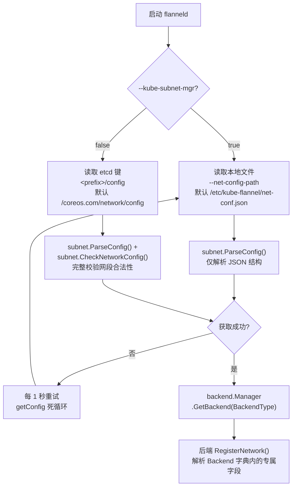

`net-conf.json` 是 flannel 的"网络总体设计图"——它用一份 JSON 声明了整个集群覆盖网络的大网段、每个节点子网的切分规则，以及用哪种后端技术（VXLAN、host-gw、WireGuard 等）把数据包跨主机送达。本文面向初学者，逐项解释每个配置字段的含义、默认值、校验规则与常见错误，并说明这份文件从哪里被加载、由哪段代码解析。命令行参数（如 `--iface`）不属于本文范围，请参阅 [命令行参数与环境变量（FLANNELD_）完整参考](14-ming-ling-xing-can-shu-yu-huan-jing-bian-liang-flanneld_-wan-zheng-can-kao)。

Sources: [configuration.md](Documentation/configuration.md#L10-L45)

## 配置从哪里来：两种加载路径

flannel 根据 `--kube-subnet-mgr` 开关决定从哪里读取配置。开启 Kubernetes 模式时，进程直接读取本地文件（默认路径 `/etc/kube-flannel/net-conf.json`，可用 `--net-config-path` 修改），典型部署中该文件由 ConfigMap `kube-flannel-cfg` 挂载进容器；关闭该开关时，配置则从 etcd 的键 `<--etcd-prefix>/config`（默认 `/coreos.com/network/config`）读取。无论哪种来源，最终都进入同一个解析函数 `subnet.ParseConfig()`。

Sources: [main.go](main.go#L140), [kube.go](pkg/subnet/kube/kube.go#L81-L131), [configuration.md](Documentation/configuration.md#L3-L8)



两条路径有一个关键差异：Kubernetes 模式**只解析不校验**——因为每个节点的子网（podCIDR）由 Kubernetes 自己分配，`Network` 大网段仅用于事后核对 podCIDR 是否落在其中（不一致会直接报错）；而 etcd 模式则要运行完整的 `CheckNetworkConfig()`，对网段做切分、默认值填充与合法性检查。配置获取失败时，`getConfig` 会每秒重试直至成功或进程被取消。

Sources: [kube.go](pkg/subnet/kube/kube.go#L118-L126), [kube.go](pkg/subnet/kube/kube.go#L343-L345), [kube.go](pkg/subnet/kube/kube.go#L499-L507), [local_manager.go](pkg/subnet/etcd/local_manager.go#L90-L105), [registry.go](pkg/subnet/etcd/registry.go#L155-L167), [main.go](main.go#L531-L550)

## 全局字段一览表

下表汇总了 `net-conf.json` 顶层支持的全部字段。注意 JSON 字段名**大小写不敏感**（Go 标准库 `encoding/json` 的默认行为），单元测试中甚至用全小写的 `"network"` 也能通过解析。

Sources: [config.go](pkg/subnet/config.go#L26-L40), [config_test.go](pkg/subnet/config_test.go#L21-L27)

| 字段 | 类型 | 默认值 | 作用 | 强制性 |
|------|------|--------|------|--------|
| `Network` | 字符串（CIDR） | 无 | 整个 flannel 覆盖网络的 IPv4 大网段，如 `10.244.0.0/16` | `EnableIPv4` 为 true 时必填 |
| `IPv6Network` | 字符串（CIDR） | 无 | IPv6 大网段，如 `fc00::/48` | `EnableIPv6` 为 true 时必填 |
| `EnableIPv4` | 布尔 | `true` | 是否启用 IPv4（解析时硬编码默认开启） | 可选 |
| `EnableIPv6` | 布尔 | `false` | 是否启用 IPv6 | 可选 |
| `EnableNFTables` | 布尔 | `false` | 实验性：用 nftables 代替 iptables 做 MASQUERADE | 可选 |
| `SubnetLen` | 整数 | `24` | 每个节点分到的子网前缀长度 | 可选 |
| `SubnetMin` | 字符串 | `Network` 的第二个子网 | 子网分配起始边界 | 可选 |
| `SubnetMax` | 字符串 | `Network` 的最后一个子网 | 子网分配结束边界 | 可选 |
| `IPv6SubnetLen` | 整数 | `64` | IPv6 每节点子网长度 | 可选 |
| `IPv6SubnetMin` / `IPv6SubnetMax` | 字符串 | 同上规则，作用于 IPv6 | IPv6 分配边界 | 可选 |
| `Backend` | 字典 | 缺省时后端类型解析为 `udp`（见下文说明） | 后端类型 `Type` 及其专属参数 | 可选 |

Sources: [configuration.md](Documentation/configuration.md#L12-L45), [config.go](pkg/subnet/config.go#L57-L59)

关于 `Backend` 的默认值有一处值得注意的"文档与代码考古"差异：官方文档写道"默认为 vxlan 后端"，但解析代码 `parseBackendType` 在 `Backend` 字段整体缺失时返回的其实是 `"udp"`。对初学者的实践建议是：**永远显式写出 `"Backend": {"Type": "..."}`**，不依赖任何默认值，即可完全避开这一歧义。

Sources: [config.go](pkg/subnet/config.go#L42-L54), [configuration.md](Documentation/configuration.md#L43-L45)

## `Network` 与子网切分：默认值背后的规则

`Network` 是唯一在 etcd 模式下"必填"的顶层字段——缺失时 `CheckNetworkConfig` 直接报错 `please define a correct Network parameter`。给定大网段后，flannel 把它切成许多等大的小段，每个节点租约（lease）一个小段。切分尺寸由 `SubnetLen` 决定，若不指定，规则是：大网段前缀 ≤ /22 时默认给每个节点 /24；网段更小（/23～/28）则取"网段前缀 +2"作为子网前缀，保证每段至少容纳 4 个地址；网段小于 /28 则直接报错 `network is too small`。

Sources: [config.go](pkg/subnet/config.go#L77-L108)

`SubnetMin`/`SubnetMax` 限定子网租约只在这个区间内分配。两者的默认值很有讲究：默认从**第二个**子网开始（`Network.IP + subnetSize`），因为把第一个子网分给节点会造成接口地址与网络地址本身冲突（例如 `10.100.0.0/16` 网段中，接口若拿到 `10.100.0.0` 会与网络地址撞车）；`SubnetMax` 默认为大网段的最后一个子网。手动指定时，两者都必须落在大网段之内、且对齐到 `SubnetLen` 边界，否则分别报出 `not in the range` 与 `not on a SubnetLen boundary` 错误。`SubnetLen` 本身也有上限 30（`must be less than /31`），且必须比大网段前缀至少小 2 位。

Sources: [config.go](pkg/subnet/config.go#L110-L135), [config.go](pkg/subnet/config.go#L81-L91)

单元测试给出一组可照抄的基准：`{"Network": "10.3.0.0/16"}` 解析校验后得到 `SubnetMin=10.3.1.0`、`SubnetMax=10.3.255.0`、`SubnetLen=24`——即跳过第一个子网、覆盖到最后一个子网。IPv6 侧规则完全对称：`{"EnableIPv6": true, "IPv6Network": "fc00::/48"}` 得到 `IPv6SubnetMin=fc00:0:0:1::`、`IPv6SubnetLen=64`，最小可用网段为 /124，子网长度上限 126。

Sources: [config_test.go](pkg/subnet/config_test.go#L33-L48), [config_test.go](pkg/subnet/config_test.go#L63-L78), [config.go](pkg/subnet/config.go#L137-L167)

## `EnableIPv4` / `EnableIPv6` 与双栈判定

这两个开关决定 flannel 工作在纯 IPv4、纯 IPv6 还是双栈模式。`main` 启动后立即调用 `ipmatch.GetIPFamily` 判定协议栈类型：两者全开会得到双栈，全关则直接报 `none defined stack` 错误退出。双栈模式目前仅 vxlan、wireguard 与 host-gw（Linux）三种后端支持，实战配置可参阅 [双栈与 IPv6-only 集群配置实战](15-shuang-zhan-yu-ipv6-only-ji-qun-pei-zhi-shi-zhan)。

Sources: [main.go](main.go#L282-L286), [match.go](pkg/ipmatch/match.go#L42-L51), [configuration.md](Documentation/configuration.md#L111-L113)

## `EnableNFTables`：流量规则引擎的选择开关

这个布尔值决定 flannel 用哪套防火墙框架来安装 MASQUERADE（源地址伪装）与转发规则。为 `true` 时实例化 `NFTablesManager`，否则用传统的 `IPTablesManager`。配套逻辑有两处：非 nftables 模式下会先检查内核参数文件 `/proc/sys/net/bridge/bridge-nf-call-iptables` 是否存在（缺失则启动失败）；此外启动时会**清理另一种框架的残留规则**，确保 flannel 重启切换选项后状态干净。该字段目前标记为实验性，默认 `false` 即 iptables。

Sources: [main.go](main.go#L288-L301), [main.go](main.go#L390-L409), [main.go](main.go#L679-L685), [configuration.md](Documentation/configuration.md#L22-L23)

## `Backend` 字典：Type 如何路由到后端实现

`Backend` 是一份"嵌套字典"：其中的 `Type` 字符串决定用哪种网络后端，其余键则由**对应后端自己**二次解析。理解这个两段式解析模型对排查配置错误至关重要——顶层解析器只取出 `Type`，把整个 `Backend` 以原始字节（`json.RawMessage`）原样透传，随后各后端用自己的结构体反序列化。这也解释了为什么 vxlan 的 `VNI` 和 wireguard 的 `PSK` 写在同一个字典里却互不干扰。

Sources: [config.go](pkg/subnet/config.go#L38-L39), [vxlan.go](pkg/backend/vxlan/vxlan.go#L122-L128)

```mermaid
flowchart LR
    A["net-conf.json<br/>&quot;Backend&quot;: &#123;&quot;Type&quot;: &quot;vxlan&quot;, ...&#125;"] --> B["ParseConfig:<br/>提取 BackendType,<br/>透传 RawMessage"]
    B --> C["GetBackend:<br/>strings.ToLower 后查表"]
    C --> D{"constructors 映射表<br/>(init() 时注册)"}
    D -->|"vxlan"| E1["vxlan.New"]
    D -->|"host-gw"| E2["hostgw.New"]
    D -->|"wireguard"| E3["wireguard.New"]
    D -->|"udp"| E4["udp.New"]
    D -->|"其余"| E5["ipsec / ipip /<br/>tencent-vpc / alloc /<br/>extension"]
    E1 --> F["RegisterNetwork:<br/>json.Unmarshal 解析<br/>后端专属字段"]
    E2 --> F
    E3 --> F
    E4 --> F
    E5 --> F
```



每个后端在自己的 `init()` 函数中调用 `backend.Register("名字", 构造器)` 把自己登记进全局映射表 `constructors`；`main.go` 通过空白导入强制这些 `init()` 执行。查找时类型名会先转小写，所以 `"Type": "VXLAN"` 也能匹配到 `"vxlan"`，但**未知类型会直接报 `unknown backend type`**。九种后端的注册名分别是 `vxlan`、`host-gw`、`wireguard`、`udp`、`ipsec`、`ipip`、`tencent-vpc`、`alloc`、`extension`。

Sources: [manager.go](pkg/backend/manager.go#L26-L64), [manager.go](pkg/backend/manager.go#L91-L93), [main.go](main.go#L48-L60), [vxlan.go](pkg/backend/vxlan/vxlan.go#L70-L72)

## 各后端专属配置项逐项说明

### vxlan（推荐）

VXLAN 用内核态隧道封装二层数据包，是 flannel 官方推荐的后端。Linux 上的专属字段如下；后端选型的横向对比请参阅 [推荐后端对比：VXLAN、host-gw 与 WireGuard 选型](10-tui-jian-hou-duan-dui-bi-vxlan-host-gw-yu-wireguard-xuan-xing)。

Sources: [backends.md](Documentation/backends.md#L16-L34)

| 字段 | 默认值 | 说明 |
|------|--------|------|
| `VNI` | `1` | VXLAN 网络标识符，同一集群内必须一致 |
| `Port` | 内核默认 `8472` | 封装报文的 UDP 端口；Windows 上**必须**为 `4789` |
| `MTU` | 外部网卡的 MTU | 隧道设备 MTU；留空自动计算，调优见 [性能调优](26-xing-neng-diao-you-mtu-ji-suan-hou-duan-xuan-xing-yu-fang-huo-qiang-duan-kou) |
| `GBP` | `false` | 启用 VXLAN Group Based Policy，Windows 不支持 |
| `Learning` | `false` | 是否让内核做 MAC 自学习，仅 Linux |
| `DirectRouting` | `false` | 同二层子网的主机间直连转发（类似 host-gw），仅跨子网时才走 VXLAN 封装；Windows 不支持 |

Sources: [vxlan.go](pkg/backend/vxlan/vxlan.go#L159-L180), [vxlan.go](pkg/backend/vxlan/vxlan.go#L74-L76), [backends.md](Documentation/backends.md#L22-L29)

Windows 平台额外支持 `MacPrefix`（默认 `0E-2A`，必须形如 `xx-xx` 的 5 字符）与 `Name`（接口名，默认 `flannel.<VNI>`），且校验更严格：`Port` 只能是 `4789`，设置 `DirectRouting` 或 `GBP` 会直接启动失败。数据路径的演进史（静态表项如何取代 L2/L3 miss 回调）见 [VXLAN 数据路径演进](9-vxlan-shu-ju-lu-jing-yan-jin-cong-l2-l3-miss-hui-diao-dao-chun-jing-tai-biao-xiang)。

Sources: [vxlan_windows.go](pkg/backend/vxlan/vxlan_windows.go#L87-L127), [vxlan_windows.go](pkg/backend/vxlan/vxlan_windows.go#L49)

### host-gw（推荐，需二层互通）

host-gw 不建隧道，直接把远端节点子网写成以对方节点 IP 为下一跳的路由，性能最好但要求所有主机在同一二层网络。它**没有任何专属字段**，`Backend` 字典里只需 `"Type": "host-gw"`。另外它有一个启动期硬性检查：`PublicIP` 必须等于所选网卡的真实 IP，检测到 NAT 环境会拒绝启动。

Sources: [hostgw.go](pkg/backend/hostgw/hostgw.go#L32-L34), [hostgw.go](pkg/backend/hostgw/hostgw.go#L42-L44), [hostgw.go](pkg/backend/hostgw/hostgw.go#L53-L77)

### wireguard（推荐，加密）

WireGuard 用内核态加密隧道封装流量。专属字段：`PSK`（预共享密钥，`wg genpsk` 生成）、`ListenPort`（默认 `51820`）、`ListenPortV6`（默认 `51821`）、`MTU`、`PersistentKeepaliveInterval`（秒，默认 0 即关闭）以及 `Mode`。`Mode` 有四种取值：`separate`（默认，IPv4/IPv6 各建一条隧道，接口名分别为 `flannel-wg` 与 `flannel-wg-v6`）、`auto`/`ipv4`/`ipv6`（单一隧道承载双栈，区别仅在对端地址族的自动选择策略）。

Sources: [wireguard.go](pkg/backend/wireguard/wireguard.go#L113-L134), [wireguard.go](pkg/backend/wireguard/wireguard.go#L33-L44), [wireguard.go](pkg/backend/wireguard/wireguard.go#L141-L165)

### udp（仅调试用）

最古老、性能最差的后端，用户态收发包，仅建议在内核连 VXLAN 都不支持时调试使用。唯一字段 `Port`，默认 `8285`。它同时是 `Backend` 字段整体缺失时的隐式兜底类型（见前文考古注记）。

Sources: [udp_amd64.go](pkg/backend/udp/udp_amd64.go#L31-L64), [backends.md](Documentation/backends.md#L70-L76)

### 实验性后端：ipip、ipsec、tencent-vpc、alloc、extension

这五种后端不建议生产使用，字段速查如下；原理详解见 [加密与实验性后端：IPsec、IPIP、UDP 与腾讯云 VPC](11-jia-mi-yu-shi-yan-xing-hou-duan-ipsec-ipip-udp-yu-teng-xun-yun-vpc) 与 [extension 后端](12-extension-hou-duan-yong-shell-ming-ling-yuan-xing-hua-quan-xin-shu-ju-mian)。

Sources: [backends.md](Documentation/backends.md#L78-L80)

| 类型 | 专属字段 | 默认值 / 约束 |
|------|----------|---------------|
| `ipip` | `DirectRouting` | `false`；同子网直连、跨子网走 IPIP 隧道 |
| `ipsec` | `PSK`、`UDPEncap`、`ESPProposal` | PSK **必填**且 ≥ 96 字符（代码常量 `minPasswordLength=96`）；UDPEncap 默认 `false`；ESPProposal 默认 `aes128gcm16-sha256-prfsha256-ecp256` |
| `tencent-vpc` | `AccessKeyID`、`AccessKeySecret` | 必填（也可经环境变量 `ACCESS_KEY_ID`/`ACCESS_KEY_SECRET` 提供） |
| `alloc` | 无 | 只分配子网、不转发数据，用于测试 |
| `extension` | `PreStartupCommand`、`PostStartupCommand`、`SubnetAddCommand`、`SubnetRemoveCommand` | 四条 Shell 命令，用于原型化自定义数据面 |

Sources: [ipip.go](pkg/backend/ipip/ipip.go#L57-L68), [ipsec.go](pkg/backend/ipsec/ipsec.go#L49-L56), [ipsec.go](pkg/backend/ipsec/ipsec.go#L76-L95), [tencentvpc.go](pkg/backend/tencentvpc/tencentvpc.go#L96-L108), [backends.md](Documentation/backends.md#L96-L98), [extension.go](pkg/backend/extension/extension.go#L64-L79)

## JSON 解析语义：初学者容易踩的三个坑

第一，**顶层字段名大小写不敏感**，`"network"` 与 `"Network"` 等价；但 `Backend.Type` 的匹配发生在后端查找阶段，虽然 `GetBackend` 同样做了小写归一化，稳妥起见仍建议全文件统一使用官方文档中的小写驼峰拼写。第二，**未知字段会被静默忽略**——把 vxlan 的 `VNI` 拼错成 `vni_id` 不会报错，后端只会拿到零值，所以配置"看起来生效了但行为不对"时应优先检查拼写。第三，**`Backend.Type` 不是顶层字段**——常见的错误是把 `"Type": "vxlan"` 写在了 JSON 根层级，此时解析出的 `BackendType` 为空，最终落到 `"udp"` 兜底，表现为集群突然使用了完全不同的数据面。

Sources: [config_test.go](pkg/subnet/config_test.go#L22-L27), [config.go](pkg/subnet/config.go#L42-L54), [manager.go](pkg/backend/manager.go#L54)

## 完整配置示例：Kubernetes 与 etcd 两种写法

Kubernetes 模式下，配置以 ConfigMap 形式存在并挂载到 Pod 的 `/etc/kube-flannel/` 目录。官方清单中 `net-conf.json` 的默认内容极简，这正是初学者最佳起点：

```json
{
  "Network": "10.244.0.0/16",
  "EnableNFTables": false,
  "Backend": {
    "Type": "vxlan"
  }
}
```

Sources: [kube-flannel.yml](Documentation/kube-flannel.yml#L61-L98), [kube-flannel.yml](Documentation/kube-flannel.yml#L204-L223)

etcd 模式则把同一份 JSON 写入 etcd 键 `/coreos.com/network/config`（用 `etcdctl put`），并可用上全部子网切分字段。官方文档给出的"全家桶"示例演示了 udp 后端与自定义端口：

```json
{
  "Network": "10.0.0.0/8",
  "SubnetLen": 20,
  "SubnetMin": "10.10.0.0",
  "SubnetMax": "10.99.0.0",
  "Backend": {
    "Type": "udp",
    "Port": 7890
  }
}
```

Sources: [configuration.md](Documentation/configuration.md#L50-L65), [registry.go](pkg/subnet/etcd/registry.go#L155-L167)

## 常见配置错误速查表

下表把源码中的报错字符串与成因一一对应，排障时可直接对照 flannel 日志。

| 日志中的报错 | 根因 | 修复方向 |
|--------------|------|----------|
| `please define a correct Network parameter` | 启用了 IPv4 但缺少 `Network`（仅 etcd 模式校验） | 补上 `Network` 字段 |
| `network is too small. Minimum useful network prefix is /28` | 大网段小于 /28 | 扩大 `Network` |
| `SubnetMin/Max is not in the range of the Network` | 边界地址落在大网段外 | 核对 CIDR 包含关系 |
| `SubnetMin is not on a SubnetLen boundary` | 边界未对齐子网粒度 | 边界取 `SubnetLen` 的整数倍 |
| `network must be able to accommodate at least four subnets` | `SubnetLen` 相对大网段过大 | 减小小网段前缀长度数值 |
| `none defined stack` | `EnableIPv4` 与 `EnableIPv6` 同时为 false | 至少开启一个地址族 |
| `unknown backend type: xxx` | `Backend.Type` 拼写错误 | 对照九种注册名 |
| `password is too short`（ipsec） | PSK 少于 96 字符 | 用 `dd if=/dev/urandom count=48 bs=1 \| xxd -p -c 48` 生成 |
| `your PublicIP differs from interface IP`（host-gw） | 处于 NAT 后 | 换用支持 NAT 的隧道后端 |

Sources: [config.go](pkg/subnet/config.go#L77-L135), [match.go](pkg/ipmatch/match.go#L42-L51), [manager.go](pkg/backend/manager.go#L61-L64), [ipsec.go](pkg/backend/ipsec/ipsec.go#L91-L93), [hostgw.go](pkg/backend/hostgw/hostgw.go#L42-L44), [backends.md](Documentation/backends.md#L129)

## 小结与下一步

net-conf.json 的设计哲学可以概括为"**一份 JSON、两级解析、一个分发点**"：顶层只关心地址族、大网段与切分边界；`Backend` 字典原样透传给类型分发表命中的后端自行消化。掌握这个模型后，无论官方新增多少后端，配置结构都不再陌生。

建议的后续阅读路径：想理解 `Network` 大网段如何变成节点上的 `/run/flannel/subnet.env`，请继续阅读 [子网租约机制：从全局大网段到主机子网的分配与续约](7-zi-wang-zu-yue-ji-zhi-cong-quan-ju-da-wang-duan-dao-zhu-ji-zi-wang-de-fen-pei-yu-xu-yue)；想改用加密隧道，请看 [推荐后端对比：VXLAN、host-gw 与 WireGuard 选型](10-tui-jian-hou-duan-dui-bi-vxlan-host-gw-yu-wireguard-xuan-xing)；需要调整节点上 Flannel 进程的行为（而非集群网络本身），请转向 [命令行参数与环境变量（FLANNELD_）完整参考](14-ming-ling-xing-can-shu-yu-huan-jing-bian-liang-flanneld_-wan-zheng-can-kao)。