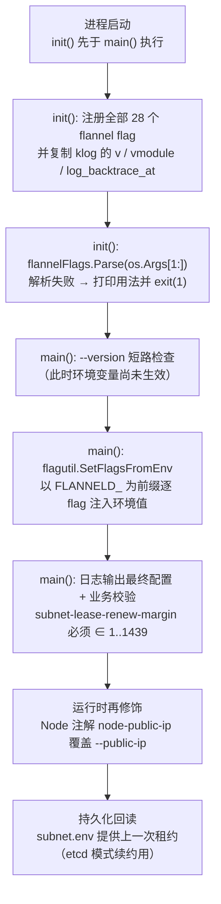

本页是 flanneld 全部命令行参数、`FLANNELD_` 环境变量族以及配套专用环境变量的权威速查手册。flannel 的配置解析采用"命令行优先解析、环境变量随后注入"的两阶段模型，二者最终汇入同一个 `CmdLineOpts` 结构体，再被运行时的 Node 注解与 `subnet.env` 持久化文件进一步修饰。理解这套覆盖链是排查"配置没生效"类问题的第一步。

## 参数解析的两阶段执行模型

flanneld 没有使用全局的 `flag` 包默认 FlagSet，而是在 `main.go` 中创建了独立的 `flannelFlags`（`flag.ExitOnError` 模式），并在 `CmdLineOpts` 结构体中集中声明了全部 28 个参数的绑定字段。其中 `--iface` 与 `--iface-regex` 两个参数比较特殊：它们是可重复指定的多值参数，通过自定义的 `flagSlice` 类型（实现 `flag.Value` 接口，每次 `Set` 调用向切片追加一个元素）来承载。

Go 语言保证 `init()` 总是先于 `main()` 执行，这个顺序决定了两个重要的错误语义差异：命令行解析失败（`flannelFlags.Parse`）会直接打印用法并 `os.Exit(1)`；而环境变量注入失败（`SetFlagsFromEnv` 返回错误）只记录一条 `Failed to set flag FLANNELD from env` 日志，进程继续以该 flag 的既有值启动。换言之，**非法的命令行参数会阻止启动，非法的环境变量值只会被忽略**——这是一个经常让运维人员困惑的不对称行为。

Sources: [main.go](main.go#L104-L111), [main.go](main.go#L143-L182), [main.go](main.go#L169-L177), [main.go](main.go#L217-L235)

`init()` 中还完成了与 klog 的集成：先调用 `log.InitFlags(nil)` 注册 klog 全部日志参数，随后强制设定 `logtostderr=true`、`legacy_stderr_threshold_behavior=false`、`stderrthreshold=INFO`，确保日志流入 journald 而非临时文件；最后只把 `v`、`vmodule`、`log_backtrace_at` 三个"非文件日志"参数复制进 `flannelFlags`（通过 `copyFlag` 复用 klog 的 `flag.Value`），因此 `-v=2` 这类参数可以直接传给 flanneld。

Sources: [main.go](main.go#L143-L167), [main.go](main.go#L180-L188)

## 全部命令行参数速查表

以下按功能域分组列出全部参数，默认值与描述均直接摘自 `init()` 中的注册代码。环境变量列遵循下一节的机械转换规则，可直接对照使用。

**etcd 存储模式（`--kube-subnet-mgr=false` 时生效）**

| 参数 | 等效环境变量 | 类型 / 默认值 | 说明 |
|---|---|---|---|
| `--etcd-endpoints` | `FLANNELD_ETCD_ENDPOINTS` | string / `http://127.0.0.1:4001,http://127.0.0.1:2379` | 逗号分隔的 etcd 端点列表 |
| `--etcd-prefix` | `FLANNELD_ETCD_PREFIX` | string / `/coreos.com/network` | etcd 键前缀 |
| `--etcd-keyfile` | `FLANNELD_ETCD_KEYFILE` | string / 空 | etcd 客户端 TLS 私钥 |
| `--etcd-certfile` | `FLANNELD_ETCD_CERTFILE` | string / 空 | etcd 客户端 TLS 证书 |
| `--etcd-cafile` | `FLANNELD_ETCD_CAFILE` | string / 空 | etcd CA 证书 |
| `--etcd-username` | `FLANNELD_ETCD_USERNAME` | string / 空 | etcd BasicAuth 用户名 |
| `--etcd-password` | `FLANNELD_ETCD_PASSWORD` | string / 空 | etcd BasicAuth 密码 |

**Kubernetes 存储模式（`--kube-subnet-mgr=true` 时生效）**

| 参数 | 等效环境变量 | 类型 / 默认值 | 说明 |
|---|---|---|---|
| `--kube-subnet-mgr` | `FLANNELD_KUBE_SUBNET_MGR` | bool / `false` | 改用 Kubernetes API 分配子网而非 etcd |
| `--kube-api-url` | `FLANNELD_KUBE_API_URL` | string / 空 | API Server 地址，Pod 内运行通常无需指定 |
| `--kubeconfig-file` | `FLANNELD_KUBECONFIG_FILE` | string / 空 | kubeconfig 路径，Pod 内运行通常无需指定 |
| `--kube-annotation-prefix` | `FLANNELD_KUBE_ANNOTATION_PREFIX` | string / `flannel.alpha.coreos.com` | Node 注解前缀，可含一个 `/`，否则追加到末尾 |
| `--set-node-network-unavailable` | `FLANNELD_SET_NODE_NETWORK_UNAVAILABLE` | bool / `true` | 就绪后将 Node 的 NodeNetworkUnavailable 置为 False |

**接口与地址选择**

| 参数 | 等效环境变量 | 类型 / 默认值 | 说明 |
|---|---|---|---|
| `--iface` | `FLANNELD_IFACE` | flagSlice（可重复）/ 空 | 按 IP 或名称指定主机间通信接口，可多次指定按序匹配首个命中 |
| `--iface-regex` | `FLANNELD_IFACE_REGEX` | flagSlice（可重复）/ 空 | 正则匹配接口，在 `--iface` 之后按序检查 |
| `--iface-can-reach` | `FLANNELD_IFACE_CAN_REACH` | string / 空 | 依据 `ip route get <ip>` 选出可达该 IP 的接口 |
| `--public-ip` | `FLANNELD_PUBLIC_IP` | string / 空 | 其他节点访问本机的公网 IP |
| `--public-ipv6` | `FLANNELD_PUBLIC_IPV6` | string / 空 | 其他节点访问本机的公网 IPv6 |

**网络规则与流量管理**

| 参数 | 等效环境变量 | 类型 / 默认值 | 说明 |
|---|---|---|---|
| `--ip-masq` | `FLANNELD_IP_MASQ` | bool / `false` | 为离开织物网络的流量配置 IP 伪装规则 |
| `--ip-masq-fully-random-disable` | `FLANNELD_IP_MASQ_FULLY_RANDOM_DISABLE` | bool / `false` | 禁用 MASQUERADE 的 fully-random 模式 |
| `--iptables-resync` | `FLANNELD_IPTABLES_RESYNC` | int / `5` | iptables 规则重同步周期（秒），锁竞争激烈时可调大 |
| `--iptables-forward-rules` | `FLANNELD_IPTABLES_FORWARD_RULES` | bool / `true` | 向 FORWARD 链添加默认 ACCEPT 规则 |
| `--ip-blackhole-route` | `FLANNELD_IP_BLACKHOLE_ROUTE` | bool / `false` | 为本机 podCIDR 添加黑洞路由（如 Canal 场景 bridge 插件未启用时） |

**文件路径、租约与健康检查**

| 参数 | 等效环境变量 | 类型 / 默认值 | 说明 |
|---|---|---|---|
| `--subnet-file` | `FLANNELD_SUBNET_FILE` | string / `/run/flannel/subnet.env` | 写出 subnet/MTU 等环境变量的文件路径 |
| `--net-config-path` | `FLANNELD_NET_CONFIG_PATH` | string / `/etc/kube-flannel/net-conf.json` | 网络配置文件路径 |
| `--subnet-lease-renew-margin` | `FLANNELD_SUBNET_LEASE_RENEW_MARGIN` | int / `60` | 租约续约提前量（分钟），业务校验范围 1..1439 |
| `--healthz-ip` | `FLANNELD_HEALTHZ_IP` | string / `0.0.0.0` | healthz 服务监听 IP |
| `--healthz-port` | `FLANNELD_HEALTHZ_PORT` | int / `0` | healthz 服务监听端口，0 表示禁用 |
| `--version` | （环境变量无效，见下节） | bool / `false` | 打印版本号后退出 |

**日志（从 klog 复制）**

| 参数 | 等效环境变量 | 说明 |
|---|---|---|
| `-v` | `FLANNELD_V` | V 级日志级别，设为 1 可看到数据路径相关消息 |
| `-vmodule` | `FLANNELD_VMODULE` | 按模块的细粒度 V 日志配置 |
| `--log_backtrace_at` | `FLANNELD_LOG_BACKTRACE_AT` | 触发堆栈回溯的日志位置 |

Sources: [main.go](main.go#L113-L141), [main.go](main.go#L62-L71), [Documentation/configuration.md](Documentation/configuration.md#L67-L90), [main.go](main.go#L143-L167)

## FLANNELD_ 环境变量：转换规则与优先级

官方文档给出了精确的转换规则：**任何命令行选项加上 `FLANNELD_` 前缀、去掉前导短横线、转大写、其余短横线替换为下划线，即成为等效的环境变量**。例如 `--etcd-endpoints=http://10.0.0.2:2379` 等价于环境变量 `FLANNELD_ETCD_ENDPOINTS=http://10.0.0.2:2379`。这条规则由 `main()` 中的 `flagutil.SetFlagsFromEnv(flannelFlags, "FLANNELD")` 统一执行：它遍历 FlagSet 中注册的每个 flag，按上述规则拼出环境变量名，一旦变量存在且非空就调用 `fs.Set` 注入。

Sources: [Documentation/configuration.md](Documentation/configuration.md#L94-L98), [main.go](main.go#L223-L226)

**优先级：环境变量覆盖命令行参数。** 这一点与许多软件相反，但可以从代码执行顺序严格推导：`init()` 中的 `Parse(os.Args[1:])` 先执行，`main()` 中的 `SetFlagsFromEnv` 后执行，因此当同一参数同时通过两种渠道设置时，环境变量的值会最终覆盖命令行的值。生产环境中如果 DaemonSet 的 `args` 与容器 `env` 同时配置了同一参数，以 `env` 为准。另一个由执行顺序决定的细节是：`--version` 的短路检查发生在环境变量注入之前，因此 `FLANNELD_VERSION=true` 不会打印版本——版本查询只能通过命令行参数触发。

Sources: [main.go](main.go#L172-L177), [main.go](main.go#L217-L226)

布尔型环境变量的值必须是 `strconv.ParseBool` 可接受的字面量（`true`/`false`/`1`/`0` 等），因为它本质上仍走 `flag.Value.Set` 的字符串解析路径。注入失败时进程不会退出，只会留下 `Failed to set flag FLANNELD from env` 错误日志并沿用该 flag 的默认值或命令行值——排查环境变量"不生效"时应首先搜索这条日志。

**两个例外要注意**：其一，`--subnet-lease-renew-margin` 的业务校验（必须大于 0 且小于 1440）发生在环境变量注入之后，所以无论通过哪种渠道给出越界值，进程都会以 `Invalid subnet-lease-renew-margin option, out of acceptable range` 退出；其二，`FLANNELD_IFACE` / `FLANNELD_IFACE_REGEX` 这类多值参数经环境变量注入时，`flagSlice.Set` 会把整个字符串作为单一元素追加而不会按逗号拆分，需要多个候选接口时只能通过重复的命令行参数传递。

Sources: [main.go](main.go#L229-L235), [main.go](main.go#L68-L71)

## 非 FLANNELD_ 专用环境变量

除 `FLANNELD_` 族外，flanneld 还读取一组**不参与机械转换**的专用环境变量，它们不是某个命令行参数的别名，而是独立的运行时开关。

| 环境变量 | 消费位置 | 默认行为 | 说明 |
|---|---|---|---|
| `NODE_NAME` | kube subnet manager 初始化 | 未设置 | 优先于 POD 探测：直接指定本 Pod 所在的 Node 名，可免去一次 API 查询 |
| `POD_NAME` + `POD_NAMESPACE` | kube subnet manager 初始化 | 未设置 | 二者必须同时存在（以 Pod 身份运行时由 Downward API 注入），flannel 据此查询 Pod Spec 中的 `nodeName`；两者都缺失则报错退出 |
| `EVENT_QUEUE_DEPTH` | 事件通道容量 | `5000` | Node 事件缓冲队列深度，适配大规模集群节点数；非整数值会导致启动失败，`0` 或负数被忽略并保留默认值 |
| `CONT_WHEN_CACHE_NOT_READY` | SubnetManager 创建失败处理 | 未设置（不继续） | 设为 `"true"` 时，即便节点 informer 缓存同步超时（`context.DeadlineExceeded`）也继续启动而不退出，适用于节点数超过 `EVENT_QUEUE_DEPTH` 的大集群 |

Sources: [pkg/subnet/kube/kube.go](pkg/subnet/kube/kube.go#L97-L116), [pkg/subnet/kube/kube.go](pkg/subnet/kube/kube.go#L184-L195), [main.go](main.go#L246-L249), [Documentation/configuration.md](Documentation/configuration.md#L100-L102)

`POD_NAME`/`POD_NAMESPACE` 的解析顺序体现了明确的回退链：先查 `NODE_NAME`，为空才走 Pod 查询路径——这意味着在大规模集群中直接注入 `NODE_NAME` 可以省去一次 Pod GET 请求。`EVENT_QUEUE_DEPTH` 的错误语义与 `FLANNELD_` 族相反：格式错误是致命的（返回错误导致启动失败），而值本身不合法（≤0）则是宽容的（静默沿用 5000）。

Sources: [pkg/subnet/kube/kube.go](pkg/subnet/kube/kube.go#L97-L116), [pkg/subnet/kube/kube.go](pkg/subnet/kube/kube.go#L184-L195)

## 覆盖链：Node 注解与 subnet.env 对参数的再修饰

参数解析完成后，配置并非一成不变。flannel 在运行时存在两层"再修饰"，理解它们才能解释"我明明设置了参数，为什么行为不一样"。

**第一层：Node 注解覆盖 `--public-ip`。** kube 模式下，`main()` 在选择外部接口之前会调用 `sm.GetStoredPublicIP(ctx)` 读取本节点的 `<annotation-prefix>/node-public-ip` 与 `<annotation-prefix>/node-public-ipv6` 注解，只要注解非空就直接覆盖 `opts.publicIP` / `opts.publicIPv6`。因此实际生效的公网 IP 优先级是：**Node 注解 > `--public-ip` 参数 > 自动探测**。此外，租约注册阶段 `<prefix>/public-ip-overwrite` 注解还会进一步改写后端写回的 PublicIP 注解值，实现"不改配置改注解"的 IP 切换。

Sources: [main.go](main.go#L307-L313), [pkg/subnet/kube/kube.go](pkg/subnet/kube/kube.go#L733-L750), [pkg/subnet/kube/annotations.go](pkg/subnet/kube/annotations.go#L62-L73)

**第二层：subnet.env 的持久化回读。** etcd 模式下构建 LocalManager 时，flannel 会用 `godotenv.Read` 解析 `--subnet-file` 指向的旧文件，取出 `FLANNEL_SUBNET` 与 `FLANNEL_IPV6_SUBNET` 作为续约目标——这样即使某主机因重启错过续约窗口，也能拿回原来的子网而不触发重分配。同样地，`--ip-masq` 启用时，旧文件中的 `FLANNEL_NETWORK`/`FLANNEL_SUBNET` 被用于生成清理旧规则的 iptables 表达式。文件中逗号分隔的多个 CIDR 会被逐一解析，非法条目跳过并记录错误日志。

Sources: [main.go](main.go#L210-L214), [main.go](main.go#L411-L417), [main.go](main.go#L607-L677)

注意区分两个名字相近但方向相反的配置通道：`FLANNELD_IP_MASQ` 是**输入**（环境变量形式设置 `--ip-masq` 参数），而 `FLANNEL_IPMASQ` 是**输出**（flanneld 写入 subnet.env 的结果值，供 Docker/systemd 等下游消费）。`FLANNEL_` 前缀的变量族全部是 flanneld 的产物，不应在启动配置中设置。

## subnet.env：flanneld 的输出契约

`WriteSubnetFile` 按 `--subnet-file` 指定的路径（默认 `/run/flannel/subnet.env`）写出标准 KEY=VALUE 格式，成功写出后 `isReady` 被置位，`/readyz` 端点才返回 200——文件写入是 flannel 就绪判定的一部分。

| 输出键 | 内容 | 生成条件 |
|---|---|---|
| `FLANNEL_NETWORK` | 全局大网段（如 `10.5.0.0/16`） | net-conf 启用 IPv4 |
| `FLANNEL_SUBNET` | 本机子网，IP 已递增为首个可用地址（如 `10.5.72.1/24`） | net-conf 启用 IPv4 |
| `FLANNEL_IPV6_NETWORK` | 全局 IPv6 大网段 | net-conf 启用 IPv6 |
| `FLANNEL_IPV6_SUBNET` | 本机 IPv6 子网，同样递增到首个可用地址 | net-conf 启用 IPv6 |
| `FLANNEL_MTU` | 由后端根据底层接口 MTU 自动计算 | 始终输出 |
| `FLANNEL_IPMASQ` | `--ip-masq` 的最终值，布尔字面量 | 始终输出 |

Sources: [pkg/subnet/subnet.go](pkg/subnet/subnet.go#L70-L92), [main.go](main.go#L477-L485)

这个文件的经典消费方式是 Docker 集成：启动脚本 `source /run/flannel/subnet.env` 后将 `FLANNEL_SUBNET` 与 `FLANNEL_MTU` 分别传给 `docker daemon --bip` 与 `--mtu`；systemd 用户则可通过 `.service` 文件的 `EnvironmentFile` 指令直接引入。另一个进阶用法是多实例共存：flanneld 不支持单进程管理多个网络，但允许同机运行多个守护进程，此时用 `--subnet-file` 与 `--etcd-prefix` 为每个实例划分命名空间，例如 `flanneld -subnet-file /vxlan.env -etcd-prefix=/vxlan/network`。

Sources: [Documentation/running.md](Documentation/running.md#L89-L106), [Documentation/running.md](Documentation/running.md#L13-L20)

## 生产部署中的实际用法

官方静态清单 `Documentation/kube-flannel.yml` 展示了 Kubernetes 模式的典型参数组合：`args` 中传 `--ip-masq`、`--kube-subnet-mgr`、`--healthz-port=8081`，`env` 中通过 Downward API 注入 `POD_NAME`/`POD_NAMESPACE`，并以字面量设置 `EVENT_QUEUE_DEPTH=5000` 与 `CONT_WHEN_CACHE_NOT_READY=false`。Helm Chart 的 DaemonSet 模板采用相同的环境变量集合，但参数改由 `values.yaml` 的 `flannel.args` 数组驱动，便于按环境覆写。

| 渠道 | 清单示例 | 适合承载的内容 |
|---|---|---|
| `args`（命令行参数） | `--ip-masq`、`--kube-subnet-mgr` | 稳定的模式开关，随清单版本管理 |
| `env`（`FLANNELD_` 族） | `FLANNELD_IFACE=eth1` | 需要按节点/环境差异化、或想利用"env 覆盖 args"优先级的参数 |
| `env`（专用变量） | `POD_NAME`、`EVENT_QUEUE_DEPTH` | 只以环境变量形式存在的运行时开关 |

Sources: [Documentation/kube-flannel.yml](Documentation/kube-flannel.yml#L163-L203), [chart/kube-flannel/templates/daemonset.yaml](chart/kube-flannel/templates/daemonset.yaml#L104-L116)

## 实践陷阱速查

- **`FLANNELD_VERSION` 无效**：`--version` 短路在环境变量注入之前执行，版本查询只能用命令行参数。
- **非法 env 值静默降级，非法 CLI 值直接退出**：前者仅记录 `Failed to set flag FLANNELD from env`，后者打印用法并 `exit(1)`；而租约提前量的业务校验对两种渠道都致命（范围 1..1439）。
- **env 优先于 args**：DaemonSet 中 `args` 与 `env` 同时设置同一参数时，环境变量胜出，排查配置漂移时优先检查 env。
- **`--healthz-port=0` 是禁用语义**：默认即禁用，设置非零端口后才会启动 healthz/readyz HTTP 服务并暴露探针端口。
- **多值参数不要走环境变量**：`FLANNELD_IFACE` 不会按逗号拆分，多个候选接口必须重复 `--iface` 参数。
- **存储类型与后端类型不可在线切换**：参数可以在重启时修改，但数据存储与后端类型的变更需全量停机（后端可变的前提是停止全部工作负载并重启所有 flanneld）。

Sources: [main.go](main.go#L217-L226), [main.go](main.go#L229-L235), [main.go](main.go#L270-L272), [Documentation/running.md](Documentation/running.md#L81-L87)

## 下一步阅读

- 深入理解 `--net-config-path` 所指向的 JSON 配置内容，请继续阅读 [net-conf.json 网络配置项逐项详解](13-net-conf-json-wang-luo-pei-zhi-xiang-zhu-xiang-xiang-jie)。
- `--iface` / `--iface-regex` / `--iface-can-reach` 三个参数的完整判定算法与公网 IP 探测细节，见 [节点接口选择逻辑与公网 IP 判定（iface/iface-regex/iface-can-reach）](16-jie-dian-jie-kou-xuan-ze-luo-ji-yu-gong-wang-ip-pan-ding-iface-iface-regex-iface-can-reach)。
- 在 etcd 模式下运行时 `--etcd-*` 参数背后的键设计与租约保留机制，见 [etcd 存储模式：配置键设计与租约保留](20-etcd-cun-chu-mo-shi-pei-zhi-jian-she-ji-yu-zu-yue-bao-liu)。
- 参数设置正确但网络不通时，请按 [常见故障排查：连通性、权限、日志与日志级别](25-chang-jian-gu-zhang-pai-cha-lian-tong-xing-quan-xian-ri-zhi-yu-ri-zhi-ji-bie) 的清单定位问题。