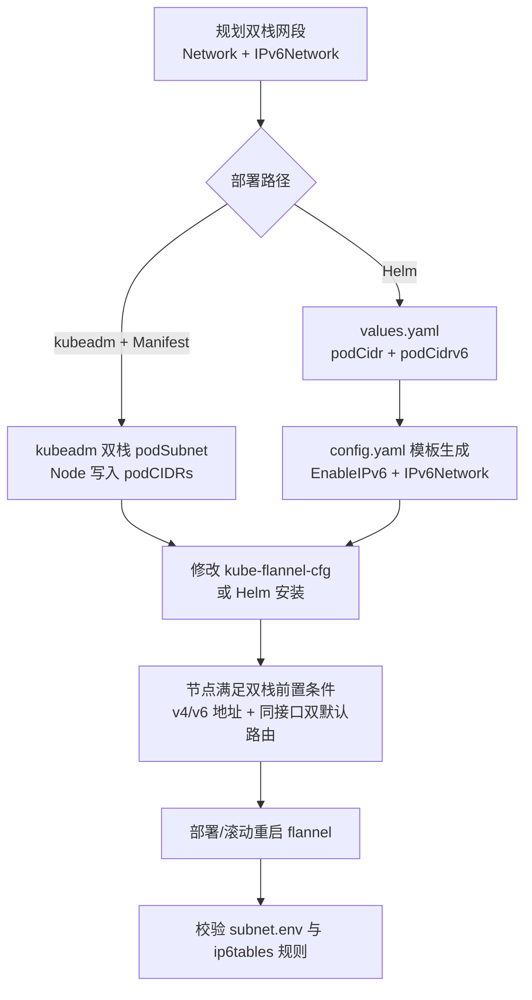
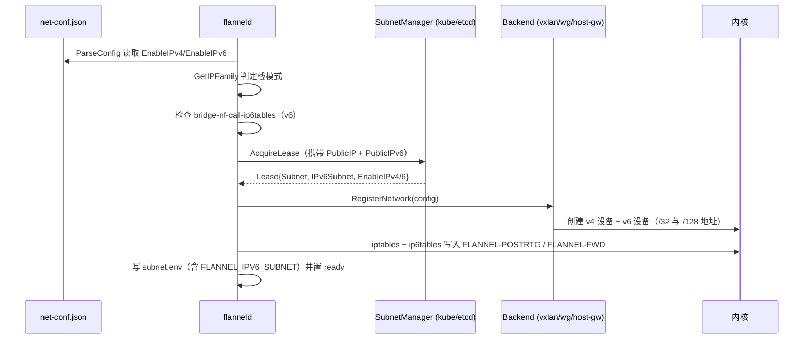

flannel 自 v0.17 起将 IPv4 与 IPv6 视为两条平行的"地址族"，通过 `EnableIPv4`/`EnableIPv6` 两个开关组合出 IPv4 单栈、IPv6 单栈与双栈（dual-stack）三种部署形态。本页是一篇实战导向的 How-to 文档：从网段规划、`net-conf.json` 改写、节点前置条件，到运行时数据面（设备、路由、防火墙规则）的验证，完整走通双栈与 IPv6-only 集群的落地路径。关于单个配置项的语义细节，请配合 [net-conf.json 网络配置项逐项详解](13-net-conf-json-wang-luo-pei-zhi-xiang-zhu-xiang-xiang-jie) 阅读。

Sources: [configuration.md](Documentation/configuration.md#L111-L138)

## 第一步：理解 IP 栈判定与配置开关

flanneld 启动时先从 `net-conf.json` 解析出 `EnableIPv4`、`EnableIPv6` 两个布尔值（`EnableIPv4` 默认为 `true`），再调用 `ipmatch.GetIPFamily` 把它们映射为四种内部栈枚举：`ipv4Stack`、`ipv6Stack`、`dualStack` 与 `noneStack`。当两个开关同时为 `false` 时函数直接返回 "none defined stack" 错误并退出进程——因此任何一种配置组合都必须至少启用一个地址族。这个栈判定结果贯穿后续所有流程：接口选择、后端设备创建、租约获取与防火墙规则下发。

Sources: [match.go](pkg/ipmatch/match.go#L30-L51), [config.go](pkg/subnet/config.go#L56-L63)

| 配置组合 | 内部栈 | 典型场景 |
| --- | --- | --- |
| `EnableIPv4: true` / `EnableIPv6: false`（默认） | `ipv4Stack` | 传统 IPv4 集群 |
| `EnableIPv4: true` / `EnableIPv6: true` | `dualStack` | 双栈迁移期集群 |
| `EnableIPv4: false` / `EnableIPv6: true` | `ipv6Stack` | IPv6-only 集群 |
| `EnableIPv4: false` / `EnableIPv6: false` | `noneStack` | 非法组合，启动即报错退出 |

Sources: [match.go](pkg/ipmatch/match.go#L42-L51)

## 第二步：确认双栈前置条件

官方文档对双栈列出了硬性要求，其中"节点主接口同时具备 IPv4 与 IPv6 地址"和"同时存在 IPv4 与 IPv6 默认路由"这两条会在接口选择阶段被代码强制校验：`dualStack` 模式下 flanneld 会分别取 IPv4 默认网关接口与 IPv6 默认网关接口，若两者名字不一致直接报错 "v6 default route interface must be the same with v4"。此外内核要求（VXLAN IPv6 隧道需要 kernel ≥ 3.12）与 CNI 插件版本（≥ v1.0.1）也需要提前满足。

Sources: [configuration.md](Documentation/configuration.md#L113-L120), [match.go](pkg/ipmatch/match.go#L221-L233)

| 前置条件 | 说明 | 强制程度 |
| --- | --- | --- |
| CNI 插件 ≥ v1.0.1（containernetworking/plugins） | pod 网络配置依赖 | 必需 |
| 节点主接口同时有 IPv4 + IPv6 地址 | `LookupExtIface` 隐式校验 | 必需 |
| 节点同时有 IPv4 + IPv6 默认路由，且位于同一接口 | `dualStack` 分支显式报错 | 必需 |
| VXLAN IPv6 隧道要求 kernel ≥ 3.12 | 仅 vxlan 后端 | 后端相关 |
| 公网 `IPv6Network` 需在集群外部配好路由 | flannel 不宣告集群外 IPv6 路由 | 公网场景必需 |

Sources: [configuration.md](Documentation/configuration.md#L115-L120), [main.go](main.go#L319-L330)

## 第三步：改写 net-conf.json（双栈最小变更）

双栈的最小配置变更只有两处：把 `EnableIPv6` 设为 `true`，并给出全局 IPv6 大网段 `IPv6Network`。`IPv6Network` 是租约分配的"地址池"，每个节点从中切分出 `IPv6SubnetLen`（默认 `/64`）大小的子网。对照官方示例如下：

| 字段 | 单栈（改造前） | 双栈（改造后） |
| --- | --- | --- |
| `Network` | `"10.244.0.0/16"` | `"10.244.0.0/16"`（保留） |
| `IPv6Network` | 无 | `"2001:cafe:42:0::/56"` |
| `EnableIPv6` | `false`（默认） | `true` |
| `Backend.Type` | `"vxlan"` | `"vxlan"`（仅 vxlan/wireguard/host-gw 支持双栈） |

Sources: [configuration.md](Documentation/configuration.md#L111-L134), [kube-flannel.yml](Documentation/kube-flannel.yml#L91-L98)

修改后的完整 ConfigMap 片段（在 Kubernetes 模式下写入 `kube-flannel-cfg`；etcd 模式则用 `etcdctl` 写入 `/coreos.com/network/config`）：

```json
{
  "Network": "10.244.0.0/16",
  "IPv6Network": "2001:cafe:42:0::/56",
  "EnableIPv6": true,
  "Backend": {
    "Type": "vxlan"
  }
}
```

Sources: [configuration.md](Documentation/configuration.md#L3-L8), [configuration.md](Documentation/configuration.md#L122-L123)

IPv6 侧还有三个与 IPv4 完全对称的分配参数，其默认值由 `CheckNetworkConfig` 在 etcd 模式下统一校验（kube 模式依赖 kube-controller-manager 分配 podCIDR，不经过这段逻辑）：

| IPv6 参数 | 默认值 | 约束规则 |
| --- | --- | --- |
| `IPv6SubnetLen` | `/64`（当 `IPv6Network` ≤ `/62` 时） | 必须小于 `/127`；网络至少要容纳 4 个子网 |
| `IPv6SubnetMin` | 第二个子网（跳过第一个） | 必须落在 `IPv6Network` 内且按 `IPv6SubnetLen` 边界对齐 |
| `IPv6SubnetMax` | 倒数第一个子网 | 同上 |

Sources: [configuration.md](Documentation/configuration.md#L34-L41), [config.go](pkg/subnet/config.go#L137-L196)

值得注意的是"跳过第一个子网"的设计：与 IPv4 侧 `fc00::/48` 的第一个子网会与网络地址本身冲突同理，IPv6 子网分配起点默认是 `Network + 子网大小`，而不是网络起点，`IPv6SubnetMin` 默认值通过 `GetIPv6SubnetMin` 计算得出。

Sources: [config.go](pkg/subnet/config.go#L170-L179), [ip6net.go](pkg/ip/ip6net.go#L61-L67)

## 第四步：让 Kubernetes 给节点下发双栈 podCIDR

kube subnet manager 模式下，flannel **不自行分配**子网，而是从 Node 的 `spec.podCIDRs` 中读取。代码按地址族解析每个 CIDR：长度为 `net.IPv4len` 的归入 IPv4 租约，`net.IPv6len` 的归入 IPv6 租约；`podCIDRs` 数量超过 2 个（即不是"单 v4 / 单 v6 / 各一"三种形态）会直接报错 "pod cidrs should be IPv4/IPv6 only or dualstack"。同时它会校验节点 IPv6 PodCIDR 必须落在 flannel 配置的 `IPv6Network` 之内，否则拒绝该租约。

Sources: [kube.go](pkg/subnet/kube/kube.go#L392-L418), [kube.go](pkg/subnet/kube/kube.go#L505-L511)

因此 kubeadm 建集群时要同时给出两个 pod 子网（`kubeadm init --pod-subnet 10.244.0.0/16,2001:cafe:42:0::/56`，即开启 `ipFamily: dual`）。Helm 部署路径则通过 chart 参数完成同一件事：`values.yaml` 中的 `podCidrv6` 一旦非空，模板就会在 ConfigMap 里生成 `"IPv6Network"` 与 `"EnableIPv6": true`；若 `podCidr` 留空则生成 `"EnableIPv4": false`——这正是 Helm 切换双栈/IPv6-only 的唯一入口。



Sources: [config.yaml](chart/kube-flannel/templates/config.yaml#L11-L24), [values.yaml](chart/kube-flannel/values.yaml#L6-L9)

## 第五步：接口选择与公网 IPv6

`--public-ipv6` 命令行参数（对应环境变量 `FLANNELD_PUBLIC_IPV6`）用于显式指定节点间通信的 IPv6 公网地址；它与 `--public-ip` 一样可被 Node 注解覆盖（kube 模式下 `GetStoredPublicIP` 返回一对 v4/v6 注解值）。当两者都未指定时，`LookupExtIface` 会分别把外部 v4/v6 地址回退为所选接口的第一个 IPv4/IPv6 地址。使用 `--iface-regex` 时，双栈要求同一接口的 IPv4 与 IPv6 地址都能匹配正则才算命中，仅按接口名匹配可作为兜底。

Sources: [main.go](main.go#L125-L126), [main.go](main.go#L307-L318), [match.go](pkg/ipmatch/match.go#L150-L184), [match.go](pkg/ipmatch/match.go#L290-L306)

Linux 启动流程中还有一个仅与 IPv6 相关的防御性检查：若启用了 `EnableIPv6`，flanneld 在非 Windows 且非 nftables 模式下会确认 `/proc/sys/net/bridge/bridge-nf-call-ip6tables` 存在，否则直接退出——缺少 `br_netfilter` 模块会导致 IPv6 流量绕过 ip6tables 规则。

Sources: [main.go](main.go#L288-L302)

## 运行时全景：从配置到双栈数据面

配置就绪后，flanneld 的启动序列对两个地址族各执行一遍"租约 → 设备 → 规则"的流水线。理解这条流水线是排障的关键，也解释了为什么双栈要求后端有专门的 v6 支持：



Sources: [main.go](main.go#L274-L302), [vxlan.go](pkg/backend/vxlan/vxlan.go#L122-L157)

租约结构本身是双栈原生的：`Lease` 同时持有 `Subnet`（IPv4）与 `IPv6Subnet`，并用 `EnableIPv4`/`EnableIPv6` 标记实际生效的族；`LeaseAttrs` 中的 `PublicIPv6` 与 `BackendV6Data` 用于向其他节点宣告本机 v6 侧的 VTEP/公钥等后端数据。LeaseWatcher 的去重逻辑 `sameSubnet` 对三种形态（v4-only、v6-only、dual-stack）分别比较对应的子网字段。

Sources: [lease.go](pkg/lease/lease.go#L42-L60), [lease.go](pkg/lease/lease.go#L190-L211)

etcd 模式下 `allocateSubnet` 会同时在两个地址族各挑选 100 个候选子网再随机命中；任何一族耗尽都会以 "out of subnets" 失败。同时它会从 `subnet.env` 读回上次的 `FLANNEL_IPV6_SUBNET`（`previousIPv6Subnet`），保证 flanneld 重启后优先续用原子网——这是"零停机重启"语义在 IPv6 侧的延续。

Sources: [local_manager.go](pkg/subnet/etcd/local_manager.go#L181-L223), [local_manager.go](pkg/subnet/etcd/local_manager.go#L225-L274), [main.go](main.go#L210-L214)

## 后端双栈能力对照

三个支持双栈的后端在实现策略上差异明显，选型时需要结合 [推荐后端对比：VXLAN、host-gw 与 WireGuard 选型](10-tui-jian-hou-duan-dui-bi-vxlan-host-gw-yu-wireguard-xuan-xing) 一起权衡：

| 后端 | v4 侧 | v6 侧 | 关键实现细节 |
| --- | --- | --- | --- |
| **vxlan** | 设备 `flannel.<VNI>`，`/32` 地址 | 独立设备 `flannel-v6.<VNI>`，`/128` 地址 | 两个设备各有 VTEP MAC，分别写入 `BackendData`/`BackendV6Data` 注解 |
| **wireguard** | 隧道 `flannel-wg`，UDP 51820 | 隧道 `flannel-wg-v6`，UDP 51821 | 默认 `Mode: separate`（双隧道），另有 `auto/ipv4/ipv6` 单隧道模式 |
| **host-gw** | `GetRoute`：经对端 `PublicIP` 的路由 | `GetV6Route`：经对端 `PublicIPv6` 的路由 | 路由型后端共用 `RouteNetwork` 的事件循环，按 `EnableIPv4/6` 分别下发 |

Sources: [vxlan.go](pkg/backend/vxlan/vxlan.go#L92-L120), [vxlan.go](pkg/backend/vxlan/vxlan.go#L202-L274), [wireguard.go](pkg/backend/wireguard/wireguard.go#L113-L165), [hostgw.go](pkg/backend/hostgw/hostgw.go#L64-L88), [route_network.go](pkg/backend/route_network.go#L83-L104)

kube subnet manager 中有一段显式的兼容性闸门：除 vxlan、host-gw、wireguard 之外的后端，租约会被强制改写为 `EnableIPv4: true, EnableIPv6: false`——这正是"双栈仅支持这三种后端"的代码级保证，与官方文档的表述一一对应。

Sources: [kube.go](pkg/subnet/kube/kube.go#L512-L517), [configuration.md](Documentation/configuration.md#L113)

WireGuard 的 `Mode` 值得一提：默认 `separate` 会创建两条完全独立的隧道与监听端口（`ListenPort`/`ListenPortV6`）；若环境限制端口数量，可改用 `auto`/`ipv4`/`ipv6` 让单条隧道同时承载两个地址族，此时对端地址族的偏好由模式决定。Helm 侧通过 `backendPortv6` 与 `tunnelMode` 透传这两个参数。

Sources: [backends.md](Documentation/backends.md#L53-L66), [wireguard.go](pkg/backend/wireguard/wireguard.go#L33-L40), [values.yaml](chart/kube-flannel/values.yaml#L53-L61), [config.yaml](chart/kube-flannel/templates/config.yaml#L46-L65)

## 防火墙与 masquerade 规则：按地址族独立成链

`--ip-masq` 开启后，`SetupAndEnsureMasqRules` 会分别在 iptables 与 ip6tables 中创建同名的 `FLANNEL-POSTRTG` NAT 链：IPv4 侧对 `224.0.0.0/4` 组播段做排除，IPv6 侧对应的排除目标是 `ff00::/8`。forward 规则与 nftables 实现同理——`table ip flannel-ipv4` 与 `table inet flannel`（v6 部分）按族分开维护。清理阶段 `CleanUp` 也会把两个族的 `FLANNEL-POSTRTG`/`FLANNEL-FWD` 都删掉，避免后端切换时残留。

Sources: [iptables.go](pkg/trafficmngr/iptables/iptables.go#L92-L133), [iptables.go](pkg/trafficmngr/iptables/iptables.go#L58-L90), [main.go](main.go#L411-L443)

## 验证清单：subnet.env 与逐项检查

一切正常时，flanneld 会写出包含两组键值的 `subnet.env`（子网 IP 已 `IncrementIP` 递增为第一个可用地址），并把就绪探针置为 ready：

```bash
FLANNEL_NETWORK=10.42.0.0/16
FLANNEL_SUBNET=10.42.0.1/24
FLANNEL_IPV6_NETWORK=2001:cafe:42::/56
FLANNEL_IPV6_SUBNET=2001:cafe:42::1/64
FLANNEL_MTU=1450
FLANNEL_IPMASQ=true
```

Sources: [configuration.md](Documentation/configuration.md#L125-L134), [subnet.go](pkg/subnet/subnet.go#L70-L92), [main.go](main.go#L477-L485)

| 检查项 | 命令/位置 | 期望结果 |
| --- | --- | --- |
| 双栈子网下发 | `kubectl get node <name> -o jsonpath='{.spec.podCIDRs}'` | 两个 CIDR（v4+v6） |
| subnet.env | `cat /run/flannel/subnet.env` | 含 `FLANNEL_IPV6_NETWORK/SUBNET` |
| v6 伪装链 | `ip6tables -t nat -S FLANNEL-POSTRTG` | 存在且源为目标 `IPv6Network` |
| VXLAN 设备 | `ip -d link show flannel-v6.1` | 设备存在且带 `/128` 地址 |
| WireGuard 隧道 | `wg show flannel-wg-v6` | 隧道存在，端口 51821 |
| host-gw 路由 | `ip -6 route` | 出现去往远端 `IPv6Subnet` 的路由 |
| flannel 就绪 | `/readyz`（若启用 healthz-port） | HTTP 200（规则与 subnet.env 均就绪后才置位） |

Sources: [rules.go](e2e/rules.go#L139-L146), [main.go](main.go#L477-L485)

常见故障速查：

| 现象 | 根因 | 处理 |
| --- | --- | --- |
| 启动报 "none defined stack" | `EnableIPv4` 与 `EnableIPv6` 同时为 false | 至少启用一族 |
| 报 "v6 default route interface ... must be the same with v4" | v4/v6 默认路由不在同一接口 | 调整节点路由或用 `--iface`/`--public-ipv6` 显式指定 |
| podCIDR 报 "should be IPv4/IPv6 only or dualstack" | Node 的 podCIDRs 多于 2 个 | 检查 kube-controller-manager 双栈配置 |
| 报 "flannel net config doesn't contain ... IPv6 PodCIDR" | 节点 v6 podCIDR 不在 `IPv6Network` 内 | 对齐 kubeadm `--pod-subnet` 与 flannel `IPv6Network` |
| 租约始终没有 IPv6 字段 | 使用了不支持双栈的后端 | 切换到 vxlan/wireguard/host-gw |
| IPv6 转发不通 | 缺少 `br_netfilter`（无 `bridge-nf-call-ip6tables`） | 加载模块后重启 flanneld |

Sources: [match.go](pkg/ipmatch/match.go#L42-L51), [match.go](pkg/ipmatch/match.go#L226-L232), [kube.go](pkg/subnet/kube/kube.go#L416-L417), [kube.go](pkg/subnet/kube/kube.go#L505-L516), [main.go](main.go#L296-L301)

## IPv6-only 集群配置

IPv6-only 是在双栈配置基础上追加一条 `"EnableIPv4": false`：此时 `GetIPFamily` 判定为 `ipv6Stack`，接口选择改走 `GetDefaultV6GatewayInterface`，`subnet.env` 只写 `FLANNEL_IPV6_*` 两组键，租约比较也切换为 IPv6 子网匹配分支。注意启用 IPv6-only 后需要使用支持 IPv6 的镜像源端点（官方文档特别提示对 docker.io 使用其 IPv6-only endpoint），否则镜像拉取会失败。

Sources: [configuration.md](Documentation/configuration.md#L136-L138), [match.go](pkg/ipmatch/match.go#L212-L220), [lease.go](pkg/lease/lease.go#L196-L199), [subnet.go](pkg/subnet/subnet.go#L78-L87)

Helm 路径下等价操作是把 `podCidr` 置空、`podCidrv6` 填入网段，模板会自动产出 `"EnableIPv4": false` + `"IPv6Network": ...` 的组合：

```yaml
podCidr: ""                      # 留空 → "EnableIPv4": false
podCidrv6: "2001:cafe:42:0::/56" # 非空 → "EnableIPv6": true
```

Sources: [config.yaml](chart/kube-flannel/templates/config.yaml#L13-L21), [values.yaml](chart/kube-flannel/values.yaml#L6-L9)

## 用官方 E2E 套件验证双栈

仓库自带的 kind 端到端套件内置了完整的双栈测试矩阵：设置 `IP_FAMILY=dual` 后，kind 集群以 `ipFamily: dual` + 双 pod 子网创建，flannel 清单被自动改写为含 `"IPv6Network"` 的 net-conf.json，随后对 vxlan、vxlan-nftables、wireguard、host-gw 四种后端逐一执行 `pingsV6` 连通性与 `checkRulesV6` 的 ip6tables/nftables 黄金规则断言（默认 IPv6 pod 网段 `fd00:10:244::/56`，可用 `FLANNEL_IPV6_NET` 覆盖）。运行该矩阵要求宿主 Docker 守护进程开启 IPv6（`daemon.json` 中配置 `ipv6`、`fixed-cidr-v6` 与 `ip6tables`），但 flannel 的 IPv6 流量完全封闭在 kind 网络内，宿主机无需可路由的公网 IPv6。测试体系全景见 [测试体系全景：单元测试、功能测试与 kind 端到端套件](22-ce-shi-ti-xi-quan-jing-dan-yuan-ce-shi-gong-neng-ce-shi-yu-kind-duan-dao-duan-tao-jian)。

Sources: [e2e_suite_test.go](e2e/e2e_suite_test.go#L26-L43), [cluster.go](e2e/cluster.go#L54-L79), [flannel.go](e2e/flannel.go#L207-L247), [connectivity_test.go](e2e/connectivity_test.go#L26-L113), [rules.go](e2e/rules.go#L45-L61)

## 深入阅读路径

- 想弄清 `IPv6SubnetLen/Min/Max` 每个字段的语义与合法取值 → [net-conf.json 网络配置项逐项详解](13-net-conf-json-wang-luo-pei-zhi-xiang-zhu-xiang-xiang-jie)
- 想理解双栈租约在 kube/etcd 两种存储下的分配差异 → [子网租约机制：从全局大网段到主机子网的分配与续约](7-zi-wang-zu-yue-ji-zhi-cong-quan-ju-da-wang-duan-dao-zhu-ji-zi-wang-de-fen-pei-yu-xu-yue) 与 [kube subnet manager：Node 注解、podCIDR 与 informer 机制](19-kube-subnet-manager-node-zhu-jie-podcidr-yu-informer-ji-zhi)
- 想深挖 `--public-ipv6`、`--iface-regex` 在双栈下的匹配顺序 → [节点接口选择逻辑与公网 IP 判定（iface/iface-regex/iface-can-reach）](16-jie-dian-jie-kou-xuan-ze-luo-ji-yu-gong-wang-ip-pan-ding-iface-iface-regex-iface-can-reach)
- 双栈环境的连通性/权限排障 → [常见故障排查：连通性、权限、日志与日志级别](25-chang-jian-gu-zhang-pai-cha-lian-tong-xing-quan-xian-ri-zhi-yu-ri-zhi-ji-bie)