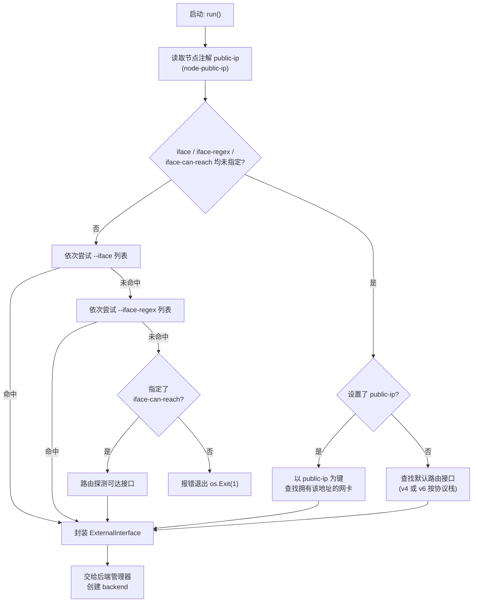
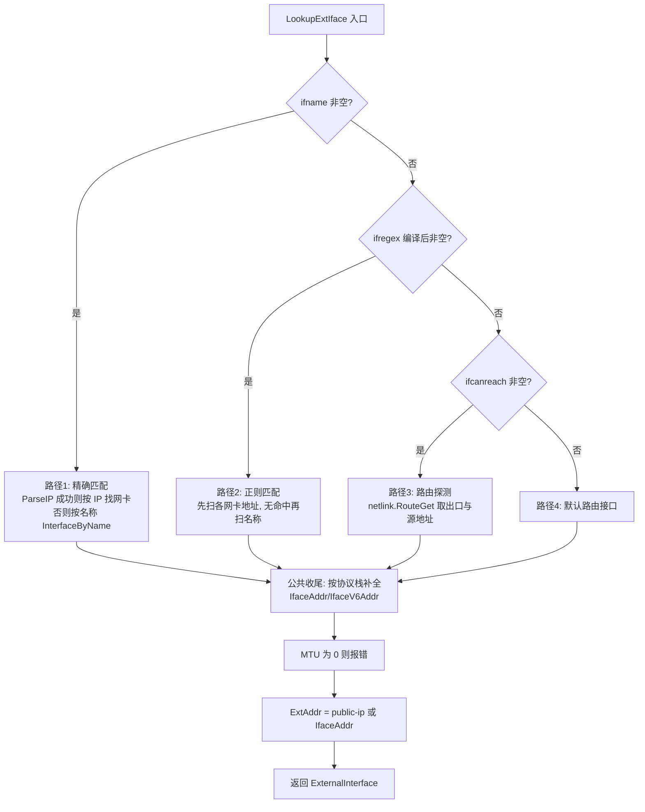

本页剖析 flanneld 在启动阶段如何确定"对外通信网卡"与"公网 IP"：围绕 `--iface`、`--iface-regex`、`--iface-can-reach` 三个接口选择参数，以及 `--public-ip`/`--public-ipv6` 的公网判定语义，逐层拆解 `LookupExtIface` 的四条选择路径、地址过滤排序规则、双栈行为差异与 Windows 平台实现，并给出场景化选型建议。

## 两对必须分清的地址：IfaceAddr 与 ExtAddr

理解接口选择的全部逻辑，起点是一个结构体：`backend.ExternalInterface`。它同时承载两对地址——`IfaceAddr`/`IfaceV6Addr`（选中网卡上**真实配置**的单播地址）与 `ExtAddr`/`ExtV6Addr`（flannel **对外通告**的公网地址）。二者在多数部署中相同，但在 NAT、注解覆盖等场景下会刻意分离，这一分离正是整个机制的精髓所在。

Sources: [common.go](pkg/backend/common.go#L26-L33)

这对地址的消费方式截然不同。各后端将 `ExtAddr` 写入节点租约的 `PublicIP` 字段向集群通告（如 host-gw、udp、ipip、ipsec、腾讯云 VPC 等），VXLAN 后端还会用 `ExtAddr` 构造 VTEP 的 subnet 属性、用 `Iface.Index` 决定 VXLAN 设备挂载在哪块网卡上。也就是说：**IfaceAddr 决定"从哪儿发包"，ExtAddr 决定"别人认为你在哪"**。

Sources: [hostgw.go](pkg/backend/hostgw/hostgw.go#L64-L75)

Sources: [vxlan.go](pkg/backend/vxlan/vxlan.go#L124-L135)

host-gw 后端在构造函数里对这两者做了一次强校验：`ExtAddr` 与 `IfaceAddr` 不相等就直接报错退出，因为 host-gw 不支持 NAT——对端会直接向通告的公网 IP 回程路由，若该地址并非本机网卡真实地址，跨节点路由将无法成立。这是唯一在启动期把"公网 IP 判定结果"反过来约束后端可用性的检查点。

Sources: [hostgw.go](pkg/backend/hostgw/hostgw.go#L41-L44)

## 启动期的接口决策流水线

flanneld 的 `main.go` 在读取网络配置并确定 IP 协议栈（`GetIPFamily` 依据 `EnableIPv4`/`EnableIPv6` 返回 ipv4/ipv6/dual/none 四态）之后，进入接口决策阶段。决策开始前有一个容易被忽略的前置步骤：向 SubnetManager 询问节点注解中是否已存储公网 IP（`GetStoredPublicIP`），若有则**覆盖**命令行的 `--public-ip`/`--public-ipv6` 值。

Sources: [main.go](main.go#L281-L318)

Sources: [kube.go](pkg/subnet/kube/kube.go#L733-L750)

随后的分支逻辑体现了明确的优先级：若 `--iface`、`--iface-regex`、`--iface-can-reach` **三者皆未指定**，则只在"默认接口"上做文章——此时若设置了 `public-ip`，flannel 会把它当作**接口查找键**（寻找拥有该地址的网卡）；否则按协议栈查找 IPv6 或 IPv4 的默认路由接口。若任一接口参数被指定，则按 `--iface` → `--iface-regex` → `--iface-can-reach` 的顺序依次尝试，全部落空则打印错误并以非零码退出。

Sources: [main.go](main.go#L319-L370)

三个参数的定义与官方帮助文本如下表所示，它们均可用 `FLANNELD_` 前缀的环境变量等价设置（`FLANNELD_IFACE`、`FLANNELD_IFACE_REGEX`、`FLANNELD_IFACE_CAN_REACH`、`FLANNELD_PUBLIC_IP`）：

| 参数 | 类型 | 语义 | 多值支持 |
| :--- | :--- | :--- | :--- |
| `--iface` | 列表 | 按名称或 IP 精确匹配网卡，返回第一个命中项 | 是，按声明顺序逐个尝试 |
| `--iface-regex` | 列表 | 正则表达式匹配（先匹配地址，后匹配名称），正则在 `--iface` 之后检查 | 是，按声明顺序逐个尝试 |
| `--iface-can-reach` | 单值 | 以"到达指定 IP 所用的路由出口"反向确定网卡，等价于 `ip route get <ip>` | 否 |
| `--public-ip` / `--public-ipv6` | 单值 | 对外通告的地址；未指定时默认取选中网卡的地址 | 否 |

Sources: [main.go](main.go#L121-L126)

Sources: [configuration.md](Documentation/configuration.md#L77-L79)

Sources: [main.go](main.go#L223-L226)

## LookupExtIface 的四条选择路径

`ipmatch.LookupExtIface(ifname, ifregexS, ifcanreach, ipStack, opts)` 是所有路径的汇聚点，其内部按"参数非空即启用"的次序分发。以下流程图概括了四条路径与后续的公共收尾阶段（地址补全 → MTU 校验 → ExtAddr 判定）：

Sources: [match.go](pkg/ipmatch/match.go#L53-L70)

### 路径一：--iface 的双重身份（IP 或名称）

`--iface` 的值先经 `net.ParseIP` 解析：解析成功说明传入的是 IP，按协议栈走 `GetInterfaceByIP`（遍历所有网卡逐一比对地址）或 `GetInterfaceByIP6`；解析失败则按网卡名称调用 `net.InterfaceByName`。这意味着同一个参数天然支持两种写法，且 IP 形式在双栈下要求 IPv4 与 IPv6 地址必须落在**同一块网卡**上，否则直接报错 `v6 interface must be the same with v4 interface`。

Sources: [match.go](pkg/ipmatch/match.go#L72-L116)

Sources: [iface.go](pkg/ip/iface.go#L182-L212)

### 路径二：--iface-regex 的两级扫描

正则路径对 `net.Interfaces()` 返回的网卡列表做两级扫描：**第一级匹配地址**——对每块网卡枚举其 IPv4（或 IPv6/双栈两族）地址，逐个用 `matchIP` 做正则匹配，命中即选定；**第二级兜底匹配名称**——仅当所有网卡地址都未命中时，才对网卡名做 `MatchString`。双栈模式要求同一块网卡上同时存在命中正则的 v4 与 v6 地址。两级扫描全部落空时，错误信息会列出所有候选网卡及其地址，这一日志在排障时极具价值。

Sources: [match.go](pkg/ipmatch/match.go#L117-L201)

Sources: [match.go](pkg/ipmatch/match.go#L318-L325)

两个实现细节值得注意：其一，正则由调用方传入字符串在运行时编译，非法正则会在启动期立即报错而非静默失败；其二，地址匹配的是 `IP.String()` 规范化后的文本，因此测试用例中写作 `192\.168\.200\.\d+` 这类对点号转义的精确模式。

Sources: [match.go](pkg/ipmatch/match.go#L60-L65)

Sources: [match_test.go](pkg/ipmatch/match_test.go#L49-L62)

### 路径三：--iface-can-reach 的路由反查

该路径调用 `ip.GetInterfaceBySpecificIPRouting`，底层是 `netlink.RouteGet(targetIP)`——内核据此返回真实路由决策，与手工执行 `ip route get <ip-address>` 观察到的出口完全一致。其独特价值在于返回值中的 `route.Src`（内核为该目标选择的源地址）被直接用作 `IfaceAddr`：即使网卡上有多个地址，选中的也是"路由视角"下最优的那个，而非枚举序第一的地址。测试用例展示了这一语义：`dummy0` 上虽有 5 个 IPv4 地址，但到达 `172.16.32.254` 的路由经网关 `172.16.32.100`，最终 `IfaceAddr` 即为该源地址。

Sources: [iface.go](pkg/ip/iface.go#L214-L230)

Sources: [match.go](pkg/ipmatch/match.go#L202-L209)

Sources: [match_test.go](pkg/ipmatch/match_test.go#L150-L165)

唯一的使用限制：Windows 平台显式不支持，直接返回 `ifcanreach is not supported on windows` 错误。

Sources: [match.go](pkg/ipmatch/match.go#L203-L205)

### 路径四：默认路由接口兜底

三条路径均未启用时，flannel 依据协议栈调用 `GetDefaultGatewayInterface`（IPv4）或 `GetDefaultV6GatewayInterface`（IPv6），实现是遍历 netlink 路由表寻找 `0.0.0.0/0`（或 `::/0`）路由并取其出口网卡。双栈下有一个一致性约束：v4 与 v6 默认路由的出口必须是同一块网卡，否则报错退出——这与官方文档"Nodes must have an ipv4 and ipv6 address default route"的双栈要求呼应。

Sources: [iface.go](pkg/ip/iface.go#L146-L180)

Sources: [match.go](pkg/ipmatch/match.go#L210-L234)

Sources: [configuration.md](Documentation/configuration.md#L113-L119)

## 候选地址的过滤与排序规则

选定网卡后，需要一个地址作为 `IfaceAddr`。Linux 实现通过 netlink 枚举地址并施加三重过滤：必须是 IPv4（v6 路径对应 `To16()`）、必须为全局单播或链路本地单播、且未携带 `IFA_F_DEPRECATED` 标记（已废弃地址被排除）。全部通过后取**排序后的第一个**地址。

Sources: [iface.go](pkg/ip/iface.go#L52-L106)

排序由 `compareAddrs` 定义了三级偏好，这是多地址网卡（如同时配置了临时地址、私有地址、链路本地地址的场景）下确定 `IfaceAddr` 的关键规则：

| 优先级 | 偏好规则 | 依据 |
| :--- | :--- | :--- |
| 1 | 全局单播 > 链路本地单播 | 全局地址可达性更好 |
| 2 | 手工配置（`IFA_F_PERMANENT`）> 自动生成 | 静态配置更稳定 |
| 3 | 非临时（`IFA_F_TEMPORARY`=0）> 临时地址 | 避免 IPv6 隐私扩展地址抖动 |

Sources: [iface.go](pkg/ip/iface.go#L333-L359)

补全逻辑按协议栈分别处理：ipv4-only 且 `ifaceAddr` 为空时取 v4 首地址；ipv6-only 对应 v6；双栈则两边各自补全。若补全后仍无地址，报 `failed to find IPv4/IPv6 address for interface` 并终止。随后还有一道 MTU 防线：选中网卡的 MTU 为 0 视为致命错误，因为该值是后端计算隧道 MTU（VXLAN 以 `extIface.Iface.MTU` 为默认值）并写入 `subnet.env` 的输入。

Sources: [match.go](pkg/ipmatch/match.go#L236-L277)

Sources: [vxlan.go](pkg/backend/vxlan/vxlan.go#L124-L171)

## 公网 IP 的判定与 NAT 语义

`ExtAddr` 的判定规则简明：`--public-ip`（或注解）非空则解析为 `ExtAddr`，解析失败报错；否则回退为 `IfaceAddr`（v6 侧对称，但仅在对应协议栈启用时才回退）。`PublicIPOpts` 结构将两个标志值透传给 `LookupExtIface`，完成"接口选择"与"公网通告"的最后一步解耦。

Sources: [match.go](pkg/ipmatch/match.go#L37-L40)

Sources: [match.go](pkg/ipmatch/match.go#L279-L315)

这里存在一个**极易踩坑的双重身份**：`public-ip` 在不同分支下语义不同。当未指定任何接口参数时，`public-ip` 被作为 `LookupExtIface` 的 `ifname` 参数——即必须能在本机找到拥有该地址的网卡，否则报 `no interface with given IP found` 退出；而当显式指定了 `--iface` 等参数时，`public-ip` 仅用于覆盖 `ExtAddr`（对外通告值），不再参与接口查找。因此 **NAT 后的节点必须同时提供接口参数与 `--public-ip`**：前者选出真实发包网卡，后者通告外部可见地址。

Sources: [main.go](main.go#L319-L330)

Sources: [match.go](pkg/ipmatch/match.go#L282-L293)

公网 IP 与租约强绑定。官方排障文档明确：所选接口与公网 IP 在启动时确定，因为租约以公网地址为键，地址变更后必须重启 flannel 才能重新注册。kube subnet manager 模式下，这一地址还可通过节点注解 `flannel.alpha.coreos.com/node-public-ip`（IPv6 为 `node-public-ipv6`，前缀可用 `--kube-annotation-prefix` 定制）预先声明，启动时读取并覆盖命令行值。

Sources: [troubleshooting.md](Documentation/troubleshooting.md#L27-L35)

Sources: [annotations.go](pkg/subnet/kube/annotations.go#L62-L73)

Sources: [kube.go](pkg/subnet/kube/kube.go#L742-L747)

一个展示 `IfaceAddr` 与 `ExtAddr` 分离的测试场景：网卡地址匹配正则 `172\.16\.30\.\d+` 选中 `172.16.30.18` 作为 `IfaceAddr`，同时传入 `PublicIP: 172.16.31.200`，最终断言 `ExtAddr` 为后者——精确复现了"绑定地址与通告地址分离"的 NAT 部署形态。

Sources: [match_test.go](pkg/ipmatch/match_test.go#L127-L148)

## IPv6 与双栈语境下的行为差异

协议栈由 `GetIPFamily` 从 `EnableIPv4`/`EnableIPv6` 配置推导，两者皆关闭时返回 `noneStack` 并在 `LookupExtIface` 入口即拒绝。所有选择路径内部均以 `switch ipStack` 分族处理，三族（v4/v6/双栈）的扫描地址族、补全规则、ExtAddr 回退条件各不相同，总结如下表：

| 行为点 | ipv4Stack | ipv6Stack | dualStack |
| :--- | :--- | :--- | :--- |
| 精确 IP 查找 | `GetInterfaceByIP` | `GetInterfaceByIP6`，且 `IfaceV6Addr` 直接取该 IP | 按 IP 版本分别查找，v6 侧还可用 `--public-ipv6` 指定，两族须同网卡 |
| 正则扫描对象 | 仅 v4 地址 | 仅 v6 地址 | 同一网卡须同时命中 v4 与 v6 地址 |
| 默认路由 | v4 默认路由 | v6 默认路由 | 两者出口必须同名 |
| ExtAddr 回退 | `IfaceAddr` | 保持 nil | `IfaceAddr` + `IfaceV6Addr` 各自回退 |

Sources: [match.go](pkg/ipmatch/match.go#L42-L51)

Sources: [match.go](pkg/ipmatch/match.go#L87-L109)

Sources: [match.go](pkg/ipmatch/match.go#L290-L306)

## Windows 平台的实现差异

Windows 侧通过构建标签隔离在 `iface_windows.go`，与 Linux 有四点实质差异。其一，地址枚举走标准库 `iface.Addrs()`，仅按 `To4()` 过滤，**没有**全局单播/废弃地址过滤与三级排序，"第一个地址"完全依赖系统枚举顺序。其二，默认网关发现不使用 netlink，而是借助 PowerShell 执行 `Get-NetRoute` 查询 `0.0.0.0/0` 的 `ifIndex`。其三，`--iface-can-reach` 被显式禁用。其四，IPv6 相关的接口查找函数（`GetInterfaceByIP6`、`GetInterfaceIP6Addrs`、`GetDefaultV6GatewayInterface` 等）均为返回 nil 的桩实现。

Sources: [iface_windows.go](pkg/ip/iface_windows.go#L29-L56)

Sources: [iface_windows.go](pkg/ip/iface_windows.go#L58-L114)

Sources: [iface_windows.go](pkg/ip/iface_windows.go#L155-L160)

## 场景化选型参考与验证方法

结合源码行为与官方文档，典型场景的参数选择可归纳如下：

| 场景 | 推荐参数 | 行为依据 |
| :--- | :--- | :--- |
| Vagrant 双网卡（第一块 NAT 为 `10.0.2.15`） | `--iface=eth1` | 默认选择会命中第一块网卡，导致所有节点"公网 IP"相同而互相冲突 |
| 多网卡、网卡名不可预测（如 `ens192`/`bond0`） | `--iface-can-reach=<对端节点 IP>` | 由内核路由决策反查出口，与 `ip route get` 结果严格一致 |
| 网卡命名有规律（云厂商 `ens*`、CNI 前置环境） | `--iface-regex=^ens\d+` | 地址优先、名称兜底的两级扫描 |
| 节点在 NAT 后（公网 IP 非本机地址） | `--iface=<内网网卡>` + `--public-ip=<公网 IP>` | 两者缺一不可：接口参数使 public-ip 退出"查找键"角色；host-gw 会拒绝 NAT，应改用 VXLAN/WireGuard |
| 公网 IP 由外部系统注入（GitOps） | 节点注解 `node-public-ip` | 启动时读取并覆盖命令行值 |

Sources: [troubleshooting.md](Documentation/troubleshooting.md#L37-L40)

Sources: [main.go](main.go#L307-L313)

验证手段分两层。运行期看启动日志：`Determining IP address of default interface`（进入兜底路径）、`Using interface with name X and address Y`（最终选择）、`Using Z as external address`（公网判定结果）三行日志完整呈现决策链；正则路径失败时的错误信息会列出全部候选网卡及地址，可直接对照修正模式。

Sources: [match.go](pkg/ipmatch/match.go#L268-L273)

Sources: [match.go](pkg/ipmatch/match.go#L186-L201)

Sources: [troubleshooting.md](Documentation/troubleshooting.md#L30-L35)

开发期可直接阅读 `pkg/ipmatch/match_test.go`——它以 dummy 网卡搭建了含多地址、双栈、策略路由的完整环境，七个子测试（按正则匹配地址/名称、按名称、按 IPv4、双栈、正则匹配 + PublicIP、can-reach）构成了一份**可执行的行为规范**，新增特性前先对照该文件确认现有语义是最稳妥的路径。

Sources: [match_test.go](pkg/ipmatch/match_test.go#L25-L47)

## 小结与延伸阅读

接口选择的本质是一个五级瀑布：注解/`--public-ip` 提供公网值 → `--iface` 精确匹配 → `--iface-regex` 模式匹配 → `--iface-can-reach` 路由反查 → 默认路由兜底，任何一级命中后即进入"地址补全 → MTU 校验 → ExtAddr 判定"的公共收尾，产出 `ExternalInterface` 供后端消费。掌握 `IfaceAddr`（绑定面）与 `ExtAddr`（通告面）的分离语义，是理解 NAT 部署、host-gw 拒载、租约与公网 IP 绑定等现象的钥匙。

若需继续深入，建议按以下路径延伸：

- 参数全集与环境变量映射规则见 [命令行参数与环境变量（FLANNELD_）完整参考](14-ming-ling-xing-can-shu-yu-huan-jing-bian-liang-flanneld_-wan-zheng-can-kao)
- 双栈/IPv6-only 的 `net-conf.json` 配置细节见 [双栈与 IPv6-only 集群配置实战](15-shuang-zhan-yu-ipv6-only-ji-qun-pei-zhi-shi-zhan)
- 公网 IP 写入租约及续约机制见 [子网租约机制：从全局大网段到主机子网的分配与续约](7-zi-wang-zu-yue-ji-zhi-cong-quan-ju-da-wang-duan-dao-zhu-ji-zi-wang-de-fen-pei-yu-xu-yue)
- MTU 派生与后端选型的性能权衡见 [性能调优：MTU 计算、后端选型与防火墙端口](26-xing-neng-diao-you-mtu-ji-suan-hou-duan-xuan-xing-yu-fang-huo-qiang-duan-kou)
- 接口选错的现场排障见 [常见故障排查：连通性、权限、日志与日志级别](25-chang-jian-gu-zhang-pai-cha-lian-tong-xing-quan-xian-ri-zhi-yu-ri-zhi-ji-bie)