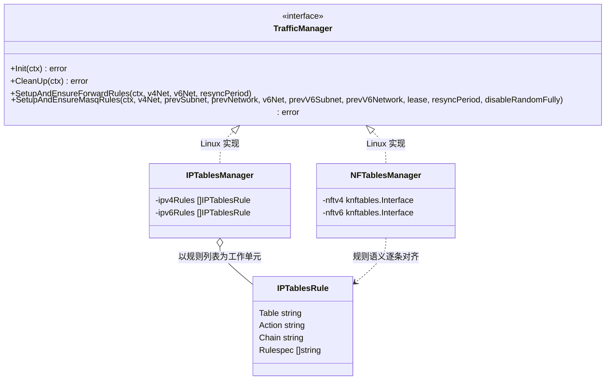
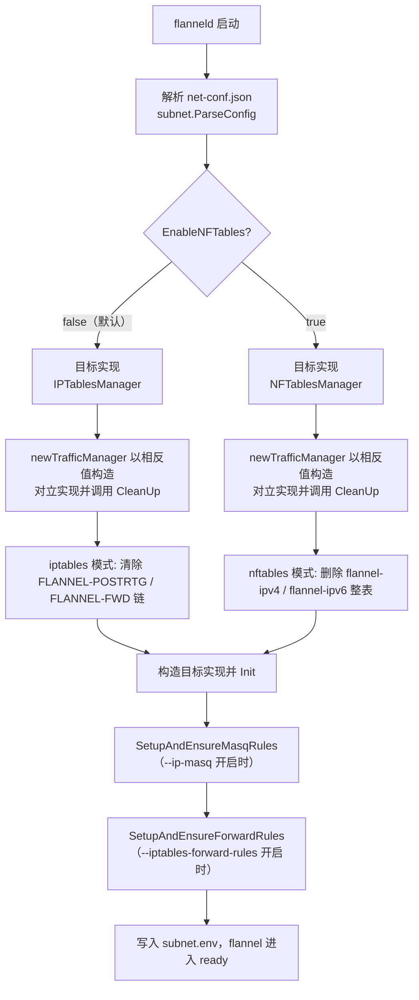

flannel 在每个节点上通过内核防火墙规则完成两件事：放行进出 flannel 网络的转发流量，以及对离开 overlay 网络的流量做 IP 伪装（MASQUERADE）。随着内核社区推动 nftables 取代 iptables，flannel 将这些能力收敛为一个 `TrafficManager` 接口，并在同一代码库中提供 iptables 与 nftables 两套互斥实现。本文剖析这一抽象的动机、契约、两个实现的结构性差异，以及运行时的选择与切换机制。

## 设计动机：从单实现走向双实现

官方 ADR（2024-02-01）记录了引入 nftables 实现的三个动因：其一是 iptables 规则按线性列表匹配导致 O(n) 性能（尽管 flannel 规则数量少，影响有限）；其二是稳定性问题——flannel 每次变更规则都必须"先清除再重建"以维持规则顺序，且会与 kube-proxy、kube-router 等同样操作 iptables 的组件相互干扰；其三是 nftables 已被内核及未来的 RHEL 等发行版确立为 iptables 的替代方向。

Sources: [add-nftables-implementation.md](Documentation/adrs/add-nftables-implementation.md#L9-L21)

ADR 同时明确了迁移的边界条件：两套实现需在代码中共存、在运行时互斥；iptables 在过渡期内保持默认；以一种模式启动时应尽可能重置另一种模式的残留规则，避免用户切换模式时必须重启节点。

Sources: [add-nftables-implementation.md](Documentation/adrs/add-nftables-implementation.md#L32-L41)

## TrafficManager 接口：抽象的核心契约

抽象的落点是 `pkg/trafficmngr` 包中的 `TrafficManager` 接口，它只暴露四个方法：`Init`（初始化）、`CleanUp`（清理已有表和规则）、`SetupAndEnsureForwardRules`（安装转发放行规则）与 `SetupAndEnsureMasqRules`（安装 NAT 伪装规则）。接口注释特意说明 `resyncPeriod` 的周期性重同步是"按后端需要"安排的——这一措辞为 nftables 实现省略重同步循环预留了空间，下文会看到两个实现在这一点上的分野。

Sources: [trafficmngr.go](pkg/trafficmngr/trafficmngr.go#L38-L60)

接口文件还承载了两个实现共享的类型与常量：`IPTablesRule` 结构体（Table/Action/Chain/Rulespec）是规则的中立表示，iptables 实现直接以它为工作单元；`KubeProxyMark` 常量（`0x4000/0x4000`）编码了 kube-proxy 打标流量的识别条件；`ErrUnimplemented` 哨兵错误则被 Windows 平台的桩实现引用。

Sources: [trafficmngr.go](pkg/trafficmngr/trafficmngr.go#L25-L36)

## 运行时选择：配置驱动与互斥清理

模式选择并非像 ADR 最初设想的那样经由命令行开关，而是落在 net-conf.json 的 `EnableNFTables` 字段上。`subnet.Config` 结构体中该字段经标准 `json.Unmarshal` 解析，Go 零值语义决定了未配置时默认为 `false`，即 iptables 模式——与 ADR"iptables 暂为默认"的要求一致。

Sources: [config.go](pkg/subnet/config.go#L26-L72), [configuration.md](Documentation/configuration.md#L140-L141)

`main.go` 底部的工厂函数 `newTrafficManager(useNftables bool)` 完成具体类型的构造，返回值统一为接口类型。整个选择与启动流程遵循一个刻意设计的顺序：**先清理对立模式，再初始化目标模式**。

启动代码先用 `newTrafficManager(!config.EnableNFTables)` 构造**未被选用**的实现并立即执行 `CleanUp`，日志明确说明其意图是"确保以不同选择重启 flannel 时状态干净"；随后才用 `newTrafficManager(config.EnableNFTables)` 构造真正生效的管理器并调用 `Init`。这正是 ADR 中"任一模式启动时都应尽量重置另一模式"要求的落地。

Sources: [main.go](main.go#L390-L409), [main.go](main.go#L679-L685)

两条 Setup 方法的入参也值得注意：`SetupAndEnsureMasqRules` 同时接收当前网络/子网与从 subnet.env 读出的**前次**网络/子网，供 iptables 实现判断是否需要回收旧规则；重同步周期来自 `--iptables-resync`（默认 5 秒），`--ip-masq-fully-random-disable` 则控制 MASQUERADE 的 fully-random 行为。

Sources: [main.go](main.go#L411-L443), [main.go](main.go#L128-L141)

另有一个模式相关的启动检查：在 Linux 且未启用 nftables 时，flannel 会探测 `/proc/sys/net/bridge/bridge-nf-call-iptables`（IPv6 对应 `...-ip6tables`）以确认 br_netfilter 模块已加载；nftables 模式跳过该检查。

Sources: [main.go](main.go#L288-L302)

## iptables 实现：专属链 + iptables-restore 事务重建

iptables 实现采用"专属链 + 跳板"的经典隔离结构：在 nat 表创建 `FLANNEL-POSTRTG` 链管理伪装、在 filter 表创建 `FLANNEL-FWD` 链管理转发，并向内置的 `POSTROUTING`/`FORWARD` 链追加一条带注释的 jump 规则把流量导入专属链。`CleanUp` 则逐协议族（iptables/ip6tables）对这两条链执行 `ClearAndDeleteChain`。

Sources: [iptables.go](pkg/trafficmngr/iptables/iptables.go#L58-L90), [iptables.go](pkg/trafficmngr/iptables/iptables.go#L135-L169), [iptables.go](pkg/trafficmngr/iptables/iptables.go#L223-L231)

其工程核心是**顺序保证**问题。iptables 规则按追加顺序匹配，若第三方在 flannel 规则之间插入了规则，或部分规则被外部删除，简单追加无法修复。为此实现引入了 `iptables-restore` 事务：`ipTablesCleanAndBuild` 逐条检查规则是否存在，将已存在的规则生成 `-D` 删除指令、再生成追加指令，组装成按表分组的 restore 载荷，最后以 `ApplyWithoutFlush`（`--noflush` 模式）原子提交——已存在的规则被先删后建，从而保证 flannel 规则连续且顺序正确，且不冲刷链上其他组件的规则。

Sources: [iptables.go](pkg/trafficmngr/iptables/iptables.go#L296-L361), [iptables_restore.go](pkg/trafficmngr/iptables/iptables_restore.go#L89-L100)

`setupAndEnsureIP4Tables`/`setupAndEnsureIP6Tables` 在首次 bootstrap 后把规则累积到管理器状态中，并启动一个 goroutine 周期性执行 `ensureIPTables`：先用 `ipTablesRulesExist` 全量核对规则（含专属链存在性检查），只要有一条缺失就整体 teardown 后重建；goroutine 监听 `ctx.Done()` 在进程退出时结束。restore 封装内部还处理了两个细节：互斥锁防止并发 goroutine 交叠调用 restore 导致"误恢复已删规则"；以及通过解析版本号判断 iptables-restore ≥ 1.6.2 才追加 `--wait` 参数。

Sources: [iptables.go](pkg/trafficmngr/iptables/iptables.go#L363-L398), [iptables.go](pkg/trafficmngr/iptables/iptables.go#L482-L500), [iptables_restore.go](pkg/trafficmngr/iptables/iptables_restore.go#L46-L54), [iptables_restore.go](pkg/trafficmngr/iptables/iptables_restore.go#L166-L177)

伪装规则的生成还带一层运行时能力探测：通过 go-iptables 的 `HasRandomFully()` 判断内核是否支持 `--random-fully`，结合 `--ip-masq-fully-random-disable` 开关决定 MASQUERADE 规则是否携带随机端口分配参数，以规避特定内核上的源端口冲突问题。

Sources: [iptables.go](pkg/trafficmngr/iptables/iptables.go#L135-L169)

## nftables 实现：专属表 + 原子事务

nftables 实现基于 `sigs.k8s.io/knftables` 库——这正是 ADR 中提到的、为 kube-proxy nftables 代理模式开发的库。隔离单元从"内置表中的专属链"升级为**完全独立的表**：IPv4 与 IPv6 各一张（`flannel-ipv4`/`flannel-ipv6`），`Init` 阶段即以事务方式创建两张表。

Sources: [nftables.go](pkg/trafficmngr/nftables/nftables.go#L30-L73), [add-nftables-implementation.md](Documentation/adrs/add-nftables-implementation.md#L78-L88)

规则安装因此获得了结构性简化。`SetupAndEnsureForwardRules` 在表内创建挂接于 forward hook 的原生 base chain（filter 类型），`SetupAndEnsureMasqRules` 创建挂接于 postrouting hook 的 NAT base chain（SNAT 优先级）。两者的关键动作都是 `tx.Flush(&knftables.Chain{...})`——先清空链再追加规则，整个操作在单次 `nft.Run(ctx, tx)` 事务中原子生效。代码注释直言：正因 Flush 保证了链的确定性状态，iptables 版本里那套"检查并回收旧规则"的逻辑不再需要；同样地，**无需周期性 resync goroutine**，接口注释中"按后端需要"的伏笔在此兑现。

Sources: [nftables.go](pkg/trafficmngr/nftables/nftables.go#L149-L205), [nftables.go](pkg/trafficmngr/nftables/nftables.go#L77-L147)

`random-fully` 的能力探测同样存在，但机制不同：`checkRandomfully` 在 `masqueradeTestTable` 测试链中尝试添加一条 `masquerade fully-random` 规则，用 knftables 的 `Check`（干跑校验）探测内核支持性，失败则回退为普通 `masquerade`。

Sources: [utils.go](pkg/trafficmngr/nftables/utils.go#L31-L58)

清理也因表级隔离而更彻底：`CleanUp` 直接删除 `flannel-ipv4`/`flannel-ipv6` 整表，不留任何链级残留。需要注意 forward 链上有一条显式的工程警示——绝不能在 flannel 的 forward 链上设置默认 drop 策略，否则会切断节点自身连通性。

Sources: [nftables.go](pkg/trafficmngr/nftables/nftables.go#L279-L302), [nftables.go](pkg/trafficmngr/nftables/nftables.go#L75-L76)

## 规则语义的对齐与细微差异

两个实现在 `FLANNEL-POSTRTG`/`postrtg` 链中维护语义等价的规则序列，这是"nftables 模式是当前 iptables 代码的精确等价物"这一 ADR 实施目标的体现。逐条对比如下：

| 顺序 | 语义意图 | iptables 规则（FLANNEL-POSTRTG 链内） | nftables 规则（postrtg 链内） |
|---|---|---|---|
| 1 | kube-proxy 打标流量直接返回，规避双 NAT | `-m mark --mark 0x4000/0x4000 -j RETURN` | `meta mark 0x4000 return` |
| 2 | Pod→集群网段流量不做 NAT | `-s pod_cidr -d cluster_cidr -j RETURN` | `ip saddr pod daddr cluster return` |
| 3 | 集群→Pod 流量不做 NAT | `-s cluster_cidr -d pod_cidr -j RETURN` | `ip saddr cluster daddr pod return` |
| 4 | 外部到达本节点所拥有 Pod IP 的流量不做 NAT | `! -s cluster_cidr -d pod_cidr -j RETURN` | `ip saddr != pod daddr cluster return` |
| 5 | 集群发出、非组播流量 MASQUERADE | `-s cluster_cidr ! -d 224.0.0.0/4 -j MASQUERADE [--random-fully]` | `saddr cluster daddr != 组播段 masquerade [fully-random]` |
| 6 | 主机发往集群网段的流量 MASQUERADE | `! -s cluster_cidr -d cluster_cidr -j MASQUERADE [--random-fully]` | `saddr != cluster daddr cluster masquerade [fully-random]` |

Sources: [iptables.go](pkg/trafficmngr/iptables/iptables.go#L135-L208), [nftables.go](pkg/trafficmngr/nftables/nftables.go#L208-L276)

细看第 1、4 行可以发现两处已可验证的细微差异：kube-proxy 打标匹配上，iptables 使用共享常量 `KubeProxyMark`（带掩码 `0x4000/0x4000`），nftables 则内联写死 `meta mark 0x4000` 且留有 TODO 注释提醒部署 kube-proxy 时核对取值；第 4 条规则上，nftables 版本按 ADR 示例写作"saddr 非 Pod、daddr 为集群"，而 iptables 版本为"saddr 非集群、daddr 为 Pod"，两者注释意图相同但匹配条件不同。

Sources: [trafficmngr.go](pkg/trafficmngr/trafficmngr.go#L36), [nftables.go](pkg/trafficmngr/nftables/nftables.go#L222-L230), [add-nftables-implementation.md](Documentation/adrs/add-nftables-implementation.md#L51-L76)

## 双实现结构对比

将两个实现并置，可以清晰看到 nftables 的表级隔离与事务模型如何系统性消解 iptables 版本中的工程复杂度：

| 维度 | iptables 实现 | nftables 实现 |
|---|---|---|
| 内核交互方式 | go-iptables 库调用 iptables/ip6tables/iptables-restore 可执行文件 | knftables 库事务 API |
| 隔离单元 | nat/filter 内置表中的专属链 FLANNEL-POSTRTG / FLANNEL-FWD | 独立表 flannel-ipv4 / flannel-ipv6 |
| 规则挂载方式 | 向 POSTROUTING/FORWARD 追加 jump 规则引流 | 创建原生 base chain（postrouting/forward hook） |
| 幂等与顺序保证 | Exists 全量核对 + 先删后建的 restore 事务 | 每次 setup 前 Flush 链，事务原子生效 |
| 周期性 resync | goroutine 每 resyncPeriod 秒执行 ensure | 不需要（Flush 即收敛） |
| random-fully 探测 | go-iptables `HasRandomFully()` | knftables `Check()` 干跑校验 |
| 模式清理 | 逐协议族逐链 ClearAndDeleteChain | 整表删除 |
| 互操作风险 | 与 kube-proxy 等共享链空间，需保序 | 独立表，互不干扰 |

Sources: [iptables.go](pkg/trafficmngr/iptables/iptables.go#L263-L361), [nftables.go](pkg/trafficmngr/nftables/nftables.go#L149-L205)

## 可测试性与跨平台

iptables 实现定义了 `IPTables` 与 `IPTablesError` 两个内部接口，将 go-iptables 的能力面收窄为五个方法。单元测试据此构建 `MockIPTables`（内存中维护规则列表，实现 Exists/Delete/AppendUnique 等）与 `MockIPTablesError`，使"规则缺失时触发整体重建"这类核心逻辑无需真实 iptables 二进制即可验证——这正是 ADR 所说的"该类型几乎完全内聚于包内，便于重构隐藏"的红利。

Sources: [iptables.go](pkg/trafficmngr/iptables/iptables.go#L31-L42), [iptables_test.go](pkg/trafficmngr/iptables/iptables_test.go#L40-L118)

跨平台方面，两个实现各有一个 Windows 构建桩（`iptables_windows.go`、`nftables_windows.go`），以空操作实现接口：`Init`/`CleanUp` 直接返回，`SetupAndEnsureForwardRules` 为空方法，`SetupAndEnsureMasqRules` 记录 `trafficmngr.ErrUnimplemented` 警告——Windows 后端的流量规则由独立机制处理，流量管理器在非 Linux 平台退化为无害占位。

Sources: [iptables_windows.go](pkg/trafficmngr/iptables/iptables_windows.go#L37-L56), [nftables_windows.go](pkg/trafficmngr/nftables/nftables_windows.go#L30-L50)

## 总结与延伸阅读

flannel 的流量管理器抽象展示了一次教科书式的渐进式替换：以最小接口（四个方法 + 一个规则类型）收敛两种防火墙技术，用"启动时互斥清理"化解模式切换的状态残留，用共享常量与逐条对齐的规则语义保证行为等价，同时诚实保留了 nftables 事务模型消解掉的复杂度差异（无 resync、无先删后建）。对于希望理解"如何在保留旧行为的前提下为系统引入第二实现"的读者，`pkg/trafficmngr` 与配套 ADR 是一份值得精读的样本。

若要继续深入，建议按以下路径阅读：

- 了解 `TrafficManager` 在 flanneld 启动序列中的位置，参见 [flanneld 架构总览：启动流程与组件协作全解](6-flanneld-jia-gou-zong-lan-qi-dong-liu-cheng-yu-zu-jian-xie-zuo-quan-jie)
- 查看 `EnableNFTables` 等全部网络配置项的完整说明，参见 [net-conf.json 网络配置项逐项详解](13-net-conf-json-wang-luo-pei-zhi-xiang-zhu-xiang-xiang-jie)
- 了解 `--iptables-resync`、`--ip-masq` 等相关命令行参数，参见 [命令行参数与环境变量（FLANNELD_）完整参考](14-ming-ling-xing-can-shu-yu-huan-jing-bian-liang-flanneld_-wan-zheng-can-kao)
- 排查防火墙规则导致的连通性问题，参见 [常见故障排查：连通性、权限、日志与日志级别](25-chang-jian-gu-zhang-pai-cha-lian-tong-xing-quan-xian-ri-zhi-yu-ri-zhi-ji-bie)