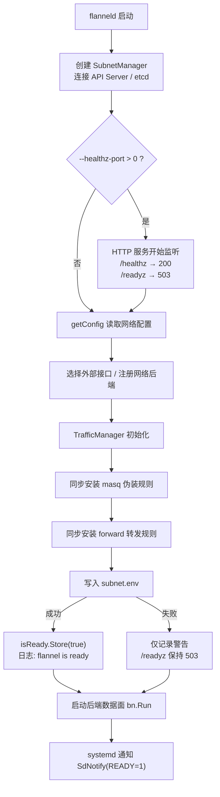

flanneld 内置了一个轻量级 HTTP 健康检查服务器，对外提供两个语义完全不同的端点：`/healthz` 回答"进程还活着吗"，`/readyz` 回答"节点网络已经配置好了吗"。本文将带你从命令行参数出发，逐层剖析这两个端点的实现代码、就绪状态的翻转时机，以及它们如何接入 Kubernetes 的 liveness/readiness 探针体系。掌握这套机制后，你就能准确回答一个运维中极常见的问题：**flannel Pod 显示 Running，但节点网络到底通没通？**

## 两个探针，两种职责

在 Kubernetes 中，liveness（存活）与 readiness（就绪）是两类独立的探针：liveness 失败会让 kubelet **重启容器**，而 readiness 失败只会把 Pod 标记为 NotReady，使其退出服务端点列表。flannel 官方文档明确将这两个端点与这两类探针一一对应，两者都挂在同一个 `--healthz-port` 端口上，且该端口默认关闭（值为 0），必须显式设置为非零值才会启用。

`/healthz` 只要 flanneld 进程还在运行就返回 200；`/readyz` 则严格得多——只有当 iptables 或 nftables 流量规则（伪装/转发）安装完成、**并且**子网环境文件 `subnet.env` 写入成功之后才返回 200，在此之前一律返回 503。

| 端点 | 对应探针类型 | 回答的问题 | 失败后果 |
|------|------------|-----------|---------|
| `/healthz` | liveness（存活探针） | 进程还活着吗？ | kubelet 重启容器 |
| `/readyz` | readiness（就绪探针） | 网络配置完成了吗？ | Pod 被标记为 NotReady |

Sources: [configuration.md](Documentation/configuration.md#L104-L109)

## 开启探针：--healthz-port 与 --healthz-ip

健康检查服务由两个命令行参数控制，均定义在 main.go 中。`--healthz-port` 默认为 `0`，即**完全禁用**；只有传入非零端口号（如 `8081`）才会启动 HTTP 服务器。`--healthz-ip` 控制监听地址，默认 `0.0.0.0` 监听所有网卡。与其他所有 flannel 参数一样，它们也可以通过环境变量 `FLANNELD_HEALTHZ_PORT`、`FLANNELD_HEALTHZ_IP` 传入——规则是把前导横线去掉、转大写、其余横线换下划线并加 `FLANNELD_` 前缀。

| 参数 | 默认值 | 作用 |
|------|--------|------|
| `--healthz-port` | `0`（禁用） | 健康检查服务器监听端口，0 表示关闭 |
| `--healthz-ip` | `0.0.0.0` | 健康检查服务器监听的 IP 地址 |

Sources: [main.go](main.go#L135-L136), [main.go](main.go#L95-L96), [configuration.md](Documentation/configuration.md#L87-L98)

## HTTP 服务的实现剖析：mustRunHealthz

整个健康检查服务器由 `mustRunHealthz` 函数实现。它在主启动流程中很靠前的位置被调用——条件仅仅是 `opts.healthzPort > 0`。这个"早启动"的设计非常关键：HTTP 服务器在 flannel 还没读取网络配置、没连接后端之前就已经在监听了，所以 kubelet 从启动的第一秒起就能探到 `/healthz` 返回 200，而此时 `/readyz` 还在返回 503。

两个 handler 的行为差异体现了"存活"与"就绪"的语义分野：

| Handler | 就绪前 | 就绪后 | 响应体 |
|---------|--------|--------|--------|
| `/healthz` | 200 | 200 | `flanneld is running` |
| `/readyz` | **503** | 200 | `flanneld is ready` / `flanneld is not ready yet` |

Sources: [main.go](main.go#L270-L272), [main.go](main.go#L552-L579)

服务器的生命周期管理也值得注意。`ListenAndServe` 跑在一个独立 goroutine 中，同时函数向主 WaitGroup 注册了两个协程计数：一个服务 HTTP 请求，另一个阻塞在 `stopChan`（即主 context 的 Done 通道）上等待关闭信号。收到信号后会以 **3 秒超时**调用 `server.Shutdown` 优雅排空在途请求，避免重启时探针拿到连接拒绝的误报。一个边缘细节：`/healthz` 写响应体失败时会直接 panic（触发容器重启），而 `/readyz` 只记录错误日志。

Sources: [main.go](main.go#L581-L605), [main.go](main.go#L556-L563)

## 就绪判定：isReady 状态何时翻转

`/readyz` 背后的判断依据是一个**包级原子布尔变量** `isReady`（`atomic.Bool` 类型），其零值为 `false`——这保证了进程刚启动时 `/readyz` 必然返回 503。整个代码库中它只有一处写入点：主启动流程在成功调用 `sm.HandleSubnetFile` 写出 `subnet.env` 之后执行 `isReady.Store(true)`，并打印日志 `flannel is ready`。源码注释一语道破了翻转的先决条件："subnet.env 已写入且流量规则已就位"。

要理解为什么这一行代码就能代表"全部就绪"，需要看完整的启动时序。在 `isReady.Store(true)` 之前，主流程已经**同步**完成了流量规则安装（masq 规则与 forward 规则）；在它之后才启动后端数据面并通知 systemd。因此 `subnet.env` 写入成功这一时刻，恰好是所有前置条件都满足的汇聚点：

Sources: [main.go](main.go#L109-L110), [main.go](main.go#L477-L493)

一个值得留意的对照：翻转到就绪之后，主流程还会调用 `daemon.SdNotify(false, "READY=1")` 向 systemd 发送同类语义的就绪通知——这是健康检查 HTTP 端点之外，flannel 面向 systemd 世界的"平行"就绪机制，两者依赖的是同一套启动前置条件。

Sources: [main.go](main.go#L495-L498)

## 前置条件改造：让"就绪"名副其实的同步化变更

`isReady` 的可靠性依赖一个隐含前提：调用 `Store(true)` 时流量规则必须真的已经装好。这并非理所当然——在引入探针的 PR [#2523](https://github.com/flannel-io/flannel/pull/2523)（commit `07c20946`）之前，iptables 版本的 `SetupAndEnsureMasqRules` 与 `SetupAndEnsureForwardRules` 都是用 `go iptm.setupAndEnsureIP4Tables(...)` 把规则安装**丢进后台 goroutine** 就立即返回的，主流程根本无法得知规则何时生效。如果在这种异步语义下翻转 `isReady`，就可能出现"探针报就绪，但转发规则还没落地"的假阳性。

改造的思路是拆分"首次安装"与"周期校验"两个阶段：`setupAndEnsureIP4Tables` 先在调用线程上**同步执行** `ipTablesBootstrap`（阻塞直到规则写入内核），随后才把周期性 resync 循环（默认每 5 秒检查规则是否存在并修复）放入 goroutine。接口 `TrafficManager` 的文档注释也相应从"启动一个 goroutine 重写规则"更新为"安装初始规则并安排后端特定的周期性 resync"。

| 对比项 | 改造前 | 改造后 |
|--------|--------|--------|
| 规则首次安装 | `go setupAndEnsureIP4Tables(...)` 异步 | 同步调用，阻塞至完成 |
| resync 循环 | 在原函数的 `for` 循环中（调用即阻塞） | 包进 `go func(){...}()` 后台执行 |
| 主流程感知 | 无法得知规则何时生效 | 函数返回即规则就位 |

Sources: [iptables.go](pkg/trafficmngr/iptables/iptables.go#L210-L221), [iptables.go](pkg/trafficmngr/iptables/iptables.go#L363-L397), [iptables.go](pkg/trafficmngr/iptables/iptables.go#L111-L130)

相比之下，nftables 实现从诞生起就是同步的：无论是伪装规则还是转发规则，都在一个事务中通过 `nftm.nftv4.Run(ctx, tx)` 阻塞式提交给内核，事务返回即生效。因此 nftables 路径无需改造就天然满足探针的先决条件。

Sources: [nftables.go](pkg/trafficmngr/nftables/nftables.go#L77-L112), [nftables.go](pkg/trafficmngr/nftables/nftables.go#L149-L200)

## 在 Kubernetes 中接入探针：静态清单与 Helm Chart

官方静态部署清单 `kube-flannel.yml` 已经预置了完整配置：`--healthz-port=8081` 参数、名为 `healthz` 的容器端口声明，以及两组探针。探针节奏经过区分——liveness 首次延迟 10 秒、每 30 秒探测一次；readiness 首次延迟 5 秒、每 10 秒探测一次，让就绪状态能被更快感知。

| 探针 | 路径 | initialDelaySeconds | periodSeconds |
|------|------|--------------------:|--------------:|
| livenessProbe | `/healthz` | 10 | 30 |
| readinessProbe | `/readyz` | 5 | 10 |

Sources: [kube-flannel.yml](Documentation/kube-flannel.yml#L159-L182)

由于 flannel Pod 以 `hostNetwork: true` 运行，HTTP 服务器实际监听在**节点网络命名空间**中——kubelet 通过 `localhost:8081` 探测，但默认的 `0.0.0.0` 绑定也意味着该端口会暴露在节点所有网卡的 IP 上。如有安全顾虑，可将 `--healthz-ip` 收紧为 `127.0.0.1`。

Sources: [kube-flannel.yml](Documentation/kube-flannel.yml#L128), [main.go](main.go#L135)

Helm Chart 提供了同套能力的模板化版本，配置锚点是 `flannel.healthz` 值组。模板采用**条件渲染**：只有 `flannel.healthz.port` 非零时，才会追加 `--healthz-port` 参数并渲染 `ports`/探针块；把端口设为 `0` 即整体禁用。Chart 的 helm-unittest 测试明确覆盖了这两个分支——断言默认值渲染出 `containerPort: 8081` 与两个探针路径，以及 `port: 0` 时完全不出现在渲染结果中。

Sources: [values.yaml](chart/kube-flannel/values.yaml#L90-L99), [daemonset.yaml](chart/kube-flannel/templates/daemonset.yaml#L73-L99), [daemonset_test.yaml](chart/kube-flannel/tests/daemonset_test.yaml#L50-L75)

## 观察与排障：两种状态分别意味着什么

将这套机制用于日常排障时，最直接的手段就是在**节点上**请求这两个端点（`curl http://localhost:8081/healthz` 与 `curl -i http://localhost:8081/readyz`），并把结果对照下表解读。`/readyz` 长时间 503 通常意味着启动流程卡在了 `subnet.env` 写入之前的某一步；而日志中的 `flannel is ready` 一行，正是 `isReady` 翻转的权威证据。

| 观察到的现象 | 含义 | 建议排查方向 |
|--------------|------|--------------|
| `/healthz` 返回 200，`/readyz` 返回 503 | 进程活着，但启动未完成（规则未装好或 subnet.env 未写出） | 检查启动日志中卡住的步骤：SubnetManager 连接、接口选择、规则安装 |
| 两者都返回 200 | 启动完成，`isReady` 已翻转 | 网络配置阶段已通过，问题若仍在应转向数据面排障 |
| `/healthz` 连接被拒绝 | 端口未启用（默认 0）或进程已退出 | 确认 `--healthz-port` 已设置；查看容器是否崩溃重启 |
| 日志出现 `Failed to write subnet file` 警告 | subnet.env 写入失败，`isReady` 不会翻转 | `/readyz` 将持续 503，检查宿主机 `/run/flannel/` 目录权限 |

Sources: [main.go](main.go#L477-L485), [configuration.md](Documentation/configuration.md#L106-L109)

## 下一步阅读

- 理解 `subnet.env` 的写入逻辑与 `/run/flannel` 持久化语义，请继续阅读 [运行时限制、零停机重启与 subnet.env 持久化语义](27-yun-xing-shi-xian-zhi-ling-ting-ji-zhong-qi-yu-subnet-env-chi-jiu-hua-yu-yi)
- 想深入本文提到的 masq/forward 规则与 TrafficManager 抽象本身，请阅读 [iptables 与 nftables 双实现的流量管理器抽象](17-iptables-yu-nftables-shuang-shi-xian-de-liu-liang-guan-li-qi-chou-xiang)
- 想了解 `--healthz-port` 等所有命令行参数与环境变量的完整清单，请查阅 [命令行参数与环境变量（FLANNELD_）完整参考](14-ming-ling-xing-can-shu-yu-huan-jing-bian-liang-flanneld_-wan-zheng-can-kao)
- 启动流程的全貌（本文 Mermaid 时序图的上游）在 [flanneld 架构总览：启动流程与组件协作全解](6-flanneld-jia-gou-zong-lan-qi-dong-liu-cheng-yu-zu-jian-xie-zuo-quan-jie) 中有系统性展开