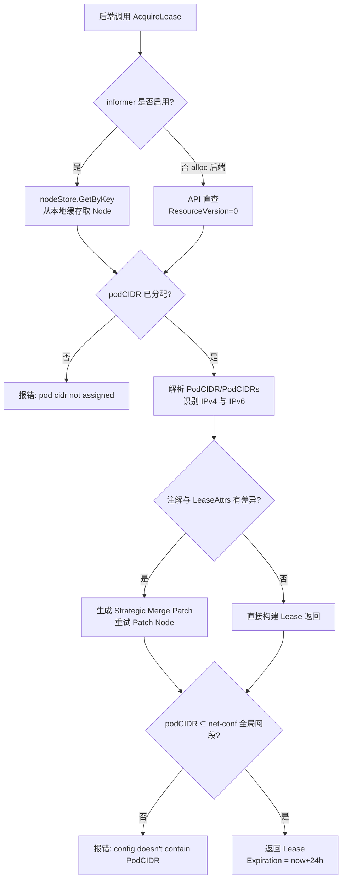
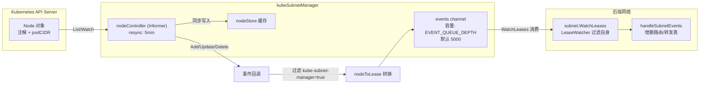

当 flannel 以 Kubernetes 模式运行时，它不再依赖 etcd 存储网络配置与子网租约，而是将一切状态"寄生"在 Kubernetes 原生资源之上：网络全局配置来自本地 `net-conf.json`，而每个节点的子网租约则完整编码为 **Node 对象的注解（annotations）与 `spec.podCIDR` 字段**。实现这一模式的核心组件是 `kubeSubnetManager`——`subnet.Manager` 接口的 Kubernetes 实现。本文解析它的初始化流程、注解命名体系、podCIDR 的获取与校验逻辑，以及基于 informer 的租约事件分发机制。

Sources: [subnet.go](pkg/subnet/subnet.go#L94-L106), [kube.go](pkg/subnet/kube/kube.go#L63-L79)

## 定位：subnet.Manager 的"Kubernetes 方言"

flannel 通过 `--kube-subnet-mgr` 命令行开关（可用环境变量 `FLANNELD_KUBE_SUBNET_MGR` 覆盖）选择存储后端。`main.go` 中的工厂函数 `newSubnetManager` 在该开关打开时调用 `kube.NewSubnetManager`，否则回退到 etcd 本地管理器。这一选择决定了后续所有租约操作的语义。

两个管理器实现同一个 `Manager` 接口（`AcquireLease`、`WatchLeases`、`CompleteLease` 等十个方法），但语义差异显著。最典型的例子是 `RenewLease`：etcd 模式下租约需要周期性续约，而 kube 模式直接返回 `ErrUnimplemented`——因为 Node 对象的生命周期由 Kubernetes API 管理，flannel 无需自行维护租约 TTL。

| 维度 | kube subnet manager | etcd subnet manager |
|------|--------------------|--------------------|
| 子网来源 | `Node.spec.podCIDR`（由 kube-controller-manager 分配） | 从全局大网段中自行分配租约键 |
| 状态存储 | Node 注解 | etcd 键值（`/coreos.com/network/...`） |
| 续约 | 不支持（`ErrUnimplemented`） | 周期性续约（`subnet-lease-renew-margin`） |
| 变更通知 | informer watch Node 对象 | etcd watch 机制 |
| 过期时间 | 固定 24 小时（仅形式语义） | 真实 TTL 驱动 |

Sources: [main.go](main.go#L130), [main.go](main.go#L190-L198), [kube.go](pkg/subnet/kube/kube.go#L624-L631), [lease.go](pkg/lease/lease.go#L51-L60)

更深层的架构意义在于：kube 模式下 flannel 放弃了子网分配的主导权。PodCIDR 由 kube-controller-manager 根据 `--cluster-cidr` 参数统一分配，flannel 只是这一分配结果的**消费者与转译器**——把 Kubernetes 的网络意图转译为各后端可执行的路由/隧道配置。租约分配的完整原语对比可参考 [子网租约机制：从全局大网段到主机子网的分配与续约](7-zi-wang-zu-yue-ji-zhi-cong-quan-ju-da-wang-duan-dao-zhu-ji-zi-wang-de-fen-pei-yu-xu-yue)。

Sources: [kube.go](pkg/subnet/kube/kube.go#L347-L350)

## 初始化：节点发现与控制器同步

`NewSubnetManager` 的第一项工作是定位"我是谁"。它通过 `clientcmd.BuildConfigFromFlags` 构建 API 客户端——当 `kube-api-url` 与 `kubeconfig-file` 均未指定时自动回落到 in-cluster 配置（依赖 ServiceAccount）。随后需要确定本节点的名称，逻辑分两条路径：

1. **直连模式**：读取 `NODE_NAME` 环境变量（Downward API 或 systemd 部署时注入）；
2. **Pod 模式**：读取 `POD_NAME` + `POD_NAMESPACE`，反查 Pod 对象的 `spec.nodeName` 字段。

两条路径都失败则启动中止。官方 Helm Chart 的 DaemonSet 通过 Downward API 注入 `POD_NAME` 与 `POD_NAMESPACE`，因此即使不设置 `NODE_NAME` 也能工作。

Sources: [kube.go](pkg/subnet/kube/kube.go#L81-L126), [daemonset.yaml](chart/kube-flannel/templates/daemonset.yaml#L104-L116)

节点名称确定后，构造函数创建 informer 并启动 `Run`，随后进入一个特殊的同步等待循环：以 1 秒为节拍轮询 `nodeController.HasSynced()`，总超时 10 分钟（`nodeControllerSyncTimeout`）。这里有一个耐人寻味的并发细节——`HasSynced()` 会阻塞在 DeltaFIFO 的互斥锁上，而该锁同时被其他缓存回调持有，因此代码用独立的 goroutine + channel + select 包裹调用，避免主线程被永久卡死。

Sources: [kube.go](pkg/subnet/kube/kube.go#L50-L53), [kube.go](pkg/subnet/kube/kube.go#L134-L164)

如果同步超时，默认行为是启动失败。但部署侧可以通过 `CONT_WHEN_CACHE_NOT_READY=true` 环境变量放宽：`main.go` 检测到错误为 `context.DeadlineExceeded` 时仅记录日志并继续启动。这在 API Server 短暂不可用的场景下提供了容错弹性。

Sources: [main.go](main.go#L244-L254), [daemonset.yaml](chart/kube-flannel/templates/daemonset.yaml#L115-L116)

## 注解体系：十个键构成的状态编解码器

`annotations.go` 是 kube 模式的"数据契约"。`newAnnotations(prefix)` 函数接收注解前缀（默认 `flannel.alpha.coreos.com`，可通过 `--kube-annotation-prefix` 修改），并生成十个完整注解键名：

| 注解键（prefix 为默认值时） | 用途 |
|---------------------------|------|
| `flannel.alpha.coreos.com/kube-subnet-manager` | 托管标记，值为 `"true"` 表示该 Node 的网络由 flannel 管理 |
| `.../backend-type` | 该节点使用的后端类型（vxlan、host-gw 等） |
| `.../backend-data` | 后端私有数据的 JSON（如 VXLAN 的 VNI 与 VtepMAC） |
| `.../backend-v6-data` | IPv6 侧的后端私有数据 |
| `.../public-ip` | 节点对外通信的 IPv4 |
| `.../public-ipv6` | 节点对外通信的 IPv6 |
| `.../public-ip-overwrite` | 强制覆盖 public-ip（NAT 场景） |
| `.../public-ipv6-overwrite` | 强制覆盖 public-ipv6 |
| `.../node-public-ip` | 启动时声明的节点 IP，优先级高于接口探测 |
| `.../node-public-ipv6` | 同上的 IPv6 版本 |

Sources: [annotations.go](pkg/subnet/kube/annotations.go#L23-L34), [annotations.go](pkg/subnet/kube/annotations.go#L62-L73), [kubernetes.md](Documentation/kubernetes.md#L32-L37)

前缀本身经过严格校验：至多包含一个 `/`，且必须匹配正则 `(?:[a-z0-9_-]+\.)+[a-z0-9_-]+/(?:[a-z0-9_-]+-)?$`——即 Kubernetes 注解键的 FQDN 规范（小写字母、数字、下划线、连字符、点）。`annotations_test.go` 用 12 个用例覆盖了各类非法输入（无 FQDN、大写字母等）。这一校验在构造期完成，保证任何注入到 Node 注解的键名都不会被 API Server 拒绝。

Sources: [annotations.go](pkg/subnet/kube/annotations.go#L36-L60), [annotations_test.go](pkg/subnet/kube/annotations_test.go#L19-L96)

`kube-subnet-manager` 注解扮演着**所有权令牌**的角色：事件回调（`handleAddLeaseEvent`/`handleUpdateLeaseEvent`）只处理该注解值为 `"true"` 的节点。这意味着集群中可以存在未被 flannel 管理的节点（例如运行其他 CNI 的节点），它们的任何变化都不会触发 flannel 的租约事件。

Sources: [kube.go](pkg/subnet/kube/kube.go#L296-L308)

## AcquireLease：从 podCIDR 到租约的完整转译

`AcquireLease` 是后端注册网络时的入口调用，其内部流程是 kube 模式的核心转译逻辑，可分为五个阶段：

Sources: [kube.go](pkg/subnet/kube/kube.go#L347-L379)

**阶段一：获取节点**。informer 启用时从本地缓存 `nodeStore.GetByKey` 读取（零 API 开销）；`alloc` 后端场景下 informer 被禁用，改为带 `ResourceVersion: "0"` 的直接 API 查询（允许读任意缓存版本）。两种路径均以 3 秒间隔、30 秒总超时轮询，容忍 API Server 抖动。

Sources: [kube.go](pkg/subnet/kube/kube.go#L351-L374), [kube.go](pkg/subnet/kube/kube.go#L197-L201)

**阶段二：podCIDR 校验**。如果 `n.Spec.PodCIDR` 为空直接报错——这正是 `kubeadm init` 必须携带 `--pod-network-cidr` 参数的原因：没有它，kube-controller-manager 不会为节点分配 PodCIDR，flannel 无从构建租约。随后的解析兼容两种形态：单栈的 `PodCIDR` 字符串，以及双栈的 `PodCIDRs` 列表（最多一 IPv4 + 一 IPv6，超过两个则拒绝）。

Sources: [kube.go](pkg/subnet/kube/kube.go#L376-L418), [kubernetes.md](Documentation/kubernetes.md#L5)

**阶段三：注解写入**。代码将 Node 现有注解与后端提交的 `LeaseAttrs`（`PublicIP`、`BackendType`、`BackendData` 等 JSON）逐一比对，仅在存在差异时才通过 `strategicpatch.CreateTwoWayMergePatch` 生成最小差异补丁，并以 3 秒间隔重试 PATCH 请求。这避免了每次启动都产生无意义的 API 写入。值得注意的是 `public-ip-overwrite` 的优先级逻辑：若该注解非空且与探测到的 public-ip 不一致，则注解值胜出——这是 NAT 环境下强制对外声明 IP 的机制。

Sources: [kube.go](pkg/subnet/kube/kube.go#L420-L492), [kube.go](pkg/subnet/kube/kube.go#L436-L446)

**阶段四：网段包含校验**。得到的 podCIDR 必须被 `net-conf.json` 中的 `Network`（IPv4）或 `IPv6Network` 包含，`containsCIDR` 通过"前缀长度不大于 + IP 包含"双重判定实现。这一步把本地配置与集群实际分配绑定为一致性约束，防止 flannel 在错误的网段上构建路由。

Sources: [kube.go](pkg/subnet/kube/kube.go#L494-L511), [kube.go](pkg/subnet/kube/kube.go#L677-L681)

**阶段五：双栈裁剪**。即使集群分配了双栈 PodCIDR，非 `vxlan`/`host-gw`/`wireguard` 后端也会被强制降级为 IPv4-only——这是代码中明确标注 TODO 的已知限制。双栈细节可参考 [双栈与 IPv6-only 集群配置实战](15-shuang-zhan-yu-ipv6-only-ji-qun-pei-zhi-shi-zhan)。

Sources: [kube.go](pkg/subnet/kube/kube.go#L512-L517)

## Informer 机制：Node 变化如何变成路由指令

kube 模式的"活"特性来自 informer。`newKubeSubnetManager` 通过 `cache.NewListWatchFromClient` 对 `nodes` 资源建立 List-Watch，注册三类事件回调，形成从 Kubernetes API 到后端路由表的一条完整数据通路：

Sources: [kube.go](pkg/subnet/kube/kube.go#L202-L245), [kube.go](pkg/subnet/kube/kube.go#L521-L534)

**事件回调的差异检测**是性能与正确性的平衡点。`handleUpdateLeaseEvent` 不会对每次 Node 更新（心跳、标签变化等都会触发）都发出租约事件，而是逐项比对与租约相关的注解——IPv4 侧比对 `backend-data`/`backend-type`/`public-ip`，IPv6 侧比对 `backend-v6-data`/`backend-type`/`public-ipv6`，任一变化才生成事件。这在节点心跳频繁的大型集群中显著降低了下游路由重算的噪声。

Sources: [kube.go](pkg/subnet/kube/kube.go#L310-L341)

**Delete 回调**有一段防御性代码值得注意：informer 在无法确认删除事件的对象类型时，会传入 `cache.DeletedFinalStateUnknown` 包装对象（例如 API Server 长时间失联后的本地推断删除）。代码对此显式解包并校验内部对象确实是 `*v1.Node`，随后以 `EventRemoved` 类型走与新增相同的处理路径。

Sources: [kube.go](pkg/subnet/kube/kube.go#L216-L233)

**背压设计**体现在 `enqueueLeaseEvent`：优先尝试非阻塞写入 events channel；若缓冲已满，则先获取一个权重为 100 的信号量额度，再派生 goroutine 以指数退避（100ms 起、5s 封顶）持续重试入队。这保证了极端情况下（如后端消费缓慢）事件不丢失、informer 回调不被卡死，同时用信号量限制了异步重试 goroutine 的并发上界。缓冲容量默认 5000，可通过 `EVENT_QUEUE_DEPTH` 环境变量调整——官方 Chart 明确将其设为 5000。

Sources: [kube.go](pkg/subnet/kube/kube.go#L184-L196), [kube.go](pkg/subnet/kube/kube.go#L250-L294), [daemonset.yaml](chart/kube-flannel/templates/daemonset.yaml#L113-L114)

**alloc 后端的特殊性**：由于该后端的路由由云控制器管理器负责，informer 完全禁用（对应 issue #1617），`NewSubnetManager` 会打印 "Node controller skips sync" 并跳过同步等待。

Sources: [kube.go](pkg/subnet/kube/kube.go#L197-L201), [kube.go](pkg/subnet/kube/kube.go#L134-L136)

最终，事件经由通用的 `subnet.WatchLeases` 辅助函数进入 `LeaseWatcher`：后者维护一份"其他节点租约"列表，将 Added/Removed 事件去重、过滤自身后批量推送给后端。以 host-gw/vxlan 为代表的 `RouteNetwork.Run` 就是该通道的标准消费者，收到事件后直接增删系统路由。

Sources: [subnet.go](pkg/subnet/subnet.go#L112-L147), [route_network.go](pkg/backend/route_network.go#L53-L81)

## 生命周期后段：CompleteLease 与重启恢复

租约"获取"完成并不意味着节点就绪。`CompleteLease` 承担两项收尾工作：其一，若存在 `clusterCIDRController`（预留的扩展点）则在此时启动并等待同步；其二，当 `--set-node-network-unavailable` 开启（默认开启）时，通过 PatchStatus 将节点的 `NodeNetworkUnavailable` 条件置为 `False`，Reason 为 `FlannelIsUp`。这让 kubelet 的节点状态反映真实网络可用性，避免 Pod 在网络未就绪时被调度。

Sources: [kube.go](pkg/subnet/kube/kube.go#L637-L675), [main.go](main.go#L500-L507)

重启场景下的状态恢复依赖两个查询方法。`GetStoredMacAddresses` 从 `backend-data` 注解中解析 VXLAN 的 VtepMAC——注解格式形如 `{"VNI":1,"VtepMAC":"12:c6:65:89:b4:e3"}`，代码用字符串切割提取 MAC 部分，使 flannel 重启后能复用原 MAC 而不触发全网 FDB 表刷新。`GetStoredPublicIP` 则读取 `node-public-ip`/`node-public-ipv6` 注解，其结果会覆盖命令行的 `--public-ip` 参数，作为接口探测的起点。

Sources: [kube.go](pkg/subnet/kube/kube.go#L697-L731), [kube.go](pkg/subnet/kube/kube.go#L733-L750), [main.go](main.go#L307-L313)

最后一个容易被忽略的成员是 `HandleSubnetFile`：它写入 CNI 插件消费的 `subnet.env` 文件，同时把路径、子网、MTU 等不可变数据缓存到 `snFileInfo` 结构中。这一缓存为将来 clusterCIDR 资源驱动的文件动态更新预留了状态基础。

Sources: [kube.go](pkg/subnet/kube/kube.go#L683-L695), [subnet.go](pkg/subnet/subnet.go#L70-L92)

## 小结

kube subnet manager 的设计哲学可以概括为"**借势而非造物**"：它不发明存储模型，而是将 flannel 的租约语义完整映射到 Kubernetes 已有的原语上——podCIDR 承担子网分配，注解承担后端状态，informer 承担变更通知，Node Condition 承担就绪信号。理解这套映射后，排查 kube 模式问题的思路也随之清晰：节点缺 PodCIDR 查 kube-controller-manager 参数，租约不更新查 `kube-subnet-manager` 注解与 API Server 连通性，事件堆积查 `EVENT_QUEUE_DEPTH`。更多排障手段可参考 [常见故障排查：连通性、权限、日志与日志级别](25-chang-jian-gu-zhang-pai-cha-lian-tong-xing-quan-xian-ri-zhi-yu-ri-zhi-ji-bie)。

如果希望对比另一条存储路径的设计取舍，请继续阅读 [etcd 存储模式：配置键设计与租约保留](20-etcd-cun-chu-mo-shi-pei-zhi-jian-she-ji-yu-zu-yue-bao-liu)；若想回顾 manager 在整体启动流程中的位置，可回到 [flanneld 架构总览：启动流程与组件协作全解](6-flanneld-jia-gou-zong-lan-qi-dong-liu-cheng-yu-zu-jian-xie-zuo-quan-jie)。