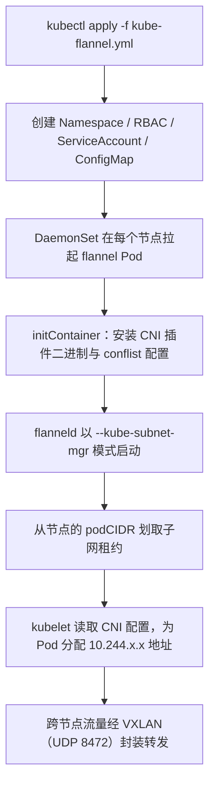
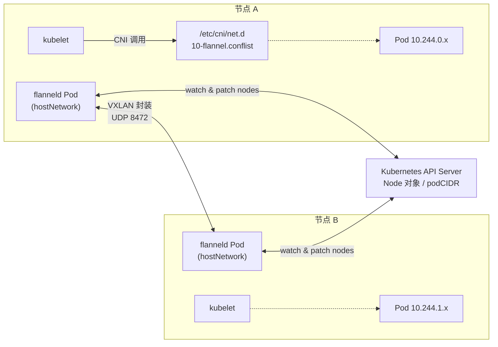

flannel 是一个为 Kubernetes 设计的简易三层网络织物，而 `kube-flannel.yml` 是官方提供的一体化部署清单：只需一条 `kubectl apply` 命令，它就能在集群的每个节点上拉起 flannel 网络代理，让所有 Pod 获得可互通的 IP 地址。本页面向初学者，完整走通"环境准备 → 一键部署 → 理解清单内容 → 验证连通性 → 常见问题排查"这条最短路径。阅读本页前建议先浏览[项目概览：为 Kubernetes 打造的简易三层网络织物](1-xiang-mu-gai-lan-wei-kubernetes-da-zao-de-jian-yi-san-ceng-wang-luo-zhi-wu)了解 flannel 的基本工作模型。

Sources: [README.md](README.md#L8-L14)

## 为什么一条命令就能完成部署

Kubernetes 自身不实现 Pod 之间的网络，它把这项工作交给 CNI（Container Network Interface）插件。flannel 的官方清单把部署所需的全部 Kubernetes 资源——命名空间、权限、配置、守护进程——打包进单个 YAML 文件，因此 `kubectl apply` 一条命令即可完成安装。值得一提的是，这份清单并非"示例玩具"：flannel 项目自己的端到端测试套件（基于 kind 集群）就是直接加载 `../Documentation/kube-flannel.yml` 来安装 flannel 的，官方用它验证 vxlan、host-gw、wireguard 等后端的 Pod 跨节点连通性。换句话说，你在生产中执行的部署路径，与项目自动化测试验证的路径完全一致。

Sources: [e2e/flannel.go](e2e/flannel.go#L43-L64), [e2e/connectivity_test.go](e2e/connectivity_test.go#L65-L78)

整个部署过程可以概括为下面的流程：清单被应用后，DaemonSet 会在每个节点上创建 flannel Pod；Pod 内的初始化容器先把 CNI 插件与配置文件安装到宿主机；随后 flanneld 主进程以 kube subnet manager 模式启动，向 Kubernetes API 声明本节点的子网租约；此后 kubelet 创建的每个 Pod 都会从该子网中获得 IP。



Sources: [kube-flannel.yml](Documentation/kube-flannel.yml#L100-L157), [main.go](main.go#L130)

## 部署前的四件准备工作

flannel 最简单的部署时机是集群刚建立、还没有任何使用 Pod 网络的 Pod 运行之时，且官方明确支持 Kubernetes v1.17 及以上版本。在执行部署命令之前，请逐项确认下表中的前置条件，它们分别对应"地址规划、插件就位、内核开关、网络放行"四个维度。

| `#` | 前置条件 | 操作方法 | 作用 |
|---|---------|---------|------|
| 1 | 节点已分配 podCIDR | `kubeadm init` 时传入 `--pod-network-cidr=10.244.0.0/16` | flannel 的 kube subnet manager 依赖每个节点已有 podCIDR 才能分配子网 |
| 2 | CNI 插件二进制就位 | 下载 containernetworking/plugins 并解压到 `/opt/cni/bin` | flannel 的 initContainer 只安装 flannel 自身插件，portmap 等通用插件需预先存在 |
| 3 | 加载 `br_netfilter` 内核模块 | `modprobe br_netfilter`（kubeadm 1.30+ 不再自动检查） | 模块缺失时 flannel 无法正常启动 |
| 4 | 防火墙放行封装端口 | VXLAN 放行 UDP 8472（UDP 后端则为 8285） | 保证跨节点的封装流量可以通过 |

Sources: [README.md](README.md#L42-L52), [README.md](README.md#L69-L83), [troubleshooting.md](Documentation/troubleshooting.md#L83-L101)

其中第 1 项最容易被初学者忽略。flannel 在 Kubernetes 模式下不做地址规划，而是直接使用每个 Node 对象上已记录的 `podCIDR` 字段；若 `kubeadm init` 时漏传 `--pod-network-cidr`，节点就没有 podCIDR，flannel 启动后会一直报 `node <NODE_NAME> pod cidr not assigned`。可以通过 `kubectl get nodes -o jsonpath='{.items[*].spec.podCIDR}'` 提前检查所有节点是否已有网段。

Sources: [kubernetes.md](Documentation/kubernetes.md#L5), [troubleshooting.md](Documentation/troubleshooting.md#L93-L101)

## 一键部署：kubectl apply

确认前置条件后，执行官方清单即可完成部署：

```bash
kubectl apply -f https://github.com/flannel-io/flannel/releases/latest/download/kube-flannel.yml
```

如果你的集群使用了自定义 podCIDR（不是默认的 `10.244.0.0/16`），需要先下载清单、修改其中的 `Network` 字段使其与集群网段一致后再应用，具体做法见下文"自定义网络"一节。命令执行后，大约几十秒内每个节点都会出现一个 `kube-flannel-ds-xxxxx` Pod。

Sources: [README.md](README.md#L46-L52)

## 读懂 kube-flannel.yml：五个资源对象

对初学者而言，"一键部署"的价值不仅在于省事，更在于清单本身就是一份可读的部署说明书。官方文档将清单归纳为五个部分：带特权 Pod 安全级别的 `kube-flannel` 命名空间、RBAC 权限、ServiceAccount、双配置的 ConfigMap，以及按架构在每个节点部署 flannel 的 DaemonSet。对照下表可以快速建立全局认知：

| `#` | 资源对象 | 名称 | 作用 |
|---|---------|------|------|
| 1 | Namespace | `kube-flannel` | 隔离 flannel 资源，并强制 `privileged` Pod 安全级别 |
| 2 | ClusterRole + ClusterRoleBinding | `flannel` | 授予读取 pods/nodes、更新 nodes/status 的最小权限 |
| 3 | ServiceAccount | `flannel` | flannel Pod 访问 API 的身份载体 |
| 4 | ConfigMap | `kube-flannel-cfg` | 同时承载 CNI 配置（cni-conf.json）与 flannel 网络配置（net-conf.json） |
| 5 | DaemonSet | `kube-flannel-ds` | 确保每个节点运行一个 flannel Pod（含两个 initContainer） |

Sources: [kubernetes.md](Documentation/kubernetes.md#L9-L14), [kube-flannel.yml](Documentation/kube-flannel.yml#L1-L59)

### ConfigMap：两份 JSON 决定网络行为

ConfigMap 中包含两份相互独立又配合工作的配置。`cni-conf.json` 是写给 kubelet 看的 CNI 配置链：它声明了一个名为 `cbr0` 的网络，先由 `flannel` 插件把 Pod 接入网络，再由 `portmap` 插件支持 Service 的端口映射能力。`net-conf.json` 则是写给 flanneld 看的网络规划：`"Network": "10.244.0.0/16"` 是整个集群的 Pod 大网段，`"Backend": {"Type": "vxlan"}` 指定默认后端为 VXLAN 隧道。两份配置都通过卷挂载进入 Pod，这正是"一键部署"背后的配置注入机制。

Sources: [kube-flannel.yml](Documentation/kube-flannel.yml#L61-L98)

### DaemonSet：flannel Pod 如何在节点上运行

DaemonSet 部分体现了 flannel 作为"节点级网络代理"的所有运行特征，初学者需要重点关注四处设计：其一是 `hostNetwork: true` 与 `tolerations: operator: Exists`——flannel 必须使用宿主机网络栈，且容忍所有污点以便在控制平面节点上也能运行；其二是两个 initContainer——`install-cni-plugin` 把 flannel CNI 插件二进制复制到 `/opt/cni/bin`，`install-cni` 则调用 `install-conf` 工具把 CNI 配置**原子地**写入 kubelet 读取的 `/etc/cni/net.d/10-flannel.conflist`；其三是主容器的启动参数 `--ip-masq`（为发往覆盖网络之外的流量设置 IP 伪装）、`--kube-subnet-mgr`（使用 Kubernetes API 而非 etcd 获取子网分配）与 `--healthz-port=8081`（开启健康检查端口）；其四是安全上下文仅需 `NET_ADMIN` 与 `NET_RAW` 两个 Linux capabilities，而非完全特权模式。

Sources: [kube-flannel.yml](Documentation/kube-flannel.yml#L100-L227), [main.go](main.go#L128-L136), [cmd/install_conf/main.go](cmd/install_conf/main.go#L26-L41)

下面的架构图展示了各组件之间的关系：flannel Pod 通过 watch Node 对象感知集群拓扑并回写节点注解，kubelet 通过宿主机上的 CNI 配置调用插件为 Pod 联网，节点之间则由内核 VXLAN 隧道承载封装流量。



Sources: [kube-flannel.yml](Documentation/kube-flannel.yml#L158-L227), [troubleshooting.md](Documentation/troubleshooting.md#L93-L101)

## 验证部署是否成功

部署完成后按"Pod 状态 → 日志 → 子网分配 → 跨节点连通"四步递进验证。首先确认 flannel Pod 全部处于 `Running` 状态，并可通过日志观察其选定的网络接口与公网 IP；然后确认每个节点都已拿到子网；最后部署两个分别固定在不同节点上的测试 Pod 并互相 ping——这正是官方 e2e 套件验证每个后端的核心场景（在两个节点上各创建一个 multitool Pod 然后互 ping）。健康检查方面，清单已配置 `/healthz` 存活探针与 `/readyz` 就绪探针指向 8081 端口，`kubectl get pod` 中 Pod 未就绪时可直接观察探针事件。

```bash
# 1. 查看 flannel Pod 状态（每个节点应有一个 Running 的 Pod）
kubectl get pod --namespace kube-flannel -l app=flannel

# 2. 查看某个 flannel Pod 的日志
kubectl logs --namespace kube-flannel <POD_ID> -c kube-flannel

# 3. 确认所有节点均已分配 podCIDR
kubectl get nodes -o jsonpath='{.items[*].spec.podCIDR}'
```

Sources: [troubleshooting.md](Documentation/troubleshooting.md#L25-L26), [troubleshooting.md](Documentation/troubleshooting.md#L93-L97), [kube-flannel.yml](Documentation/kube-flannel.yml#L167-L182), [e2e/kube.go](e2e/kube.go#L37-L48)

跨节点连通性测试可以手动模拟 e2e 套件的做法：在两个不同节点上各启动一个 Pod，获取它们的 IP（应形如 `10.244.x.x`），然后从其中一个 Pod ping 另一个。只要能互通，说明子网分配、路由/隧道与防火墙放行都工作正常。需要注意，清单中 Pod 被分配的地址来自 net-conf.json 的 `Network` 大网段与各节点 podCIDR 的交集，官方文档明确承诺：无论 Pod 被调度到哪个节点，它们都可以相互通信。

Sources: [e2e/connectivity_test.go](e2e/connectivity_test.go#L36-L78), [kubernetes.md](Documentation/kubernetes.md#L16)

## 自定义网络：修改 podCIDR 与后端

默认清单面向"标准 kubeadm 集群"，当你的集群使用非默认网段或希望更换后端时，需要先下载清单再编辑。核心修改点集中在 ConfigMap 的 `net-conf.json` 中，下表列出常见定制项及其在清单中的位置：

| 定制需求 | 修改位置 | 修改内容 |
|---------|---------|---------|
| 使用自定义 podCIDR | `net-conf.json` 的 `Network` 字段 | 改为与 `kubeadm init --pod-network-cidr` 一致的网段 |
| 更换网络后端 | `net-conf.json` 的 `Backend.Type` | 如改为 `host-gw`（需后端与防火墙条件匹配） |
| 启用 nftables 流量管理 | `net-conf.json` 的 `EnableNFTables` | 由 `false` 改为 `true` |
| 固定镜像版本（GitOps） | kustomization.yaml 的 `images.newTag` | 用 kustomize 覆盖镜像 tag（当前为 `v0.28.9`） |

Sources: [README.md](README.md#L52), [kube-flannel.yml](Documentation/kube-flannel.yml#L91-L98), [kustomization.yaml](Documentation/kustomization/kube-flannel/kustomization.yaml#L1-L9)

对于想在本机做实验的读者，还有两个轻量路径：其一，flannel 仓库提供了面向 kind 的 e2e 环境，其 kind 配置显式设置 `disableDefaultCNI: true` 与 `podSubnet`，是复现"干净集群 + flannel"的标准做法；其二，`Documentation/minikube.yml` 是开发专用的精简清单（无命名空间、host-gw 后端、本地镜像），但它仅用于开发调试，不建议在生产或正式学习中使用。若你希望用 Helm 管理部署或启用网络策略，请直接阅读[Helm Chart 部署与网络策略（netpol）集成](3-helm-chart-bu-shu-yu-wang-luo-ce-lue-netpol-ji-cheng)。

Sources: [e2e/kind-config.yaml](e2e/kind-config.yaml#L7-L9), [minikube.yml](Documentation/minikube.yml#L1-L5)

## 常见问题速查表

初次部署时，绝大多数问题可归结为下表中的几类。排查的第一入口永远是 flannel Pod 自身的日志（`kubectl logs --namespace kube-flannel <POD_ID> -c kube-flannel`），下表已把官方文档中记录的典型报错与对策汇总：

| 现象 / 报错 | 根因 | 解决方法 |
|------------|------|---------|
| `node <NODE> pod cidr not assigned` | 节点没有 podCIDR | `kubeadm init` 补 `--pod-network-cidr`，或 `kubectl patch node <NODE> -p '{"spec":{"podCIDR":"<SUBNET>"}}'` |
| `failed to read net conf` | flannel 读不到 net-conf.json | 检查 `kube-flannel-cfg` ConfigMap 是否存在并正确挂载 |
| `error parsing subnet config` | net-conf.json 格式错误 | 修正 JSON 语法后重新应用清单 |
| `Failed to create SubnetManager: ... does not allow access` | RBAC 权限未生效 | 完整应用清单的 ClusterRole/Binding 部分 |
| `Error creating: non-default capabilities (... NET_ADMIN ...)`, `hostNetwork=true` | Pod 安全准入未放行 | 清单已为 `kube-flannel` 命名空间强制 `privileged` 级别，勿删除该标签；共享命名空间部署需自行配置准入策略 |
| Pod 一直 `ContainerCreating`、CNI 报错 | `/opt/cni/bin` 缺少插件二进制 | 预先安装 containernetworking/plugins 到 `/opt/cni/bin` |
| 跨节点 Pod 互 ping 不通 | 防火墙拦截封装流量 | 放行 VXLAN 的 UDP 8472（UDP 后端为 8285） |
| flannel 起不来（kubeadm 1.30+） | 缺少 `br_netfilter` 模块 | `modprobe br_netfilter` 后重启 flannel Pod |

Sources: [troubleshooting.md](Documentation/troubleshooting.md#L83-L111), [kubernetes.md](Documentation/kubernetes.md#L21-L27), [README.md](README.md#L69-L83)

## 下一步

完成一键部署后，建议按照下列顺序深入：想理解 flanneld 内部如何完成这些动作（启动流程、组件协作），阅读[flanneld 架构总览：启动流程与组件协作全解](6-flanneld-jia-gou-zong-lan-qi-dong-liu-cheng-yu-zu-jian-xie-zuo-quan-jie)；想逐项吃透 `net-conf.json` 与命令行参数，分别参见[net-conf.json 网络配置项逐项详解](13-net-conf-json-wang-luo-pei-zhi-xiang-zhu-xiang-xiang-jie)与[命令行参数与环境变量（FLANNELD_）完整参考](14-ming-ling-xing-can-shu-yu-huan-jing-bian-liang-flanneld_-wan-zheng-can-kao)；想在 VXLAN、host-gw 与 WireGuard 之间做后端选型，参见[推荐后端对比：VXLAN、host-gw 与 WireGuard 选型](10-tui-jian-hou-duan-dui-bi-vxlan-host-gw-yu-wireguard-xuan-xing)；后续运维场景则可查阅[版本升级：kubectl、Helm 与原地替换三种路径](5-ban-ben-sheng-ji-kubectl-helm-yu-yuan-di-ti-huan-san-chong-lu-jing)、[常见故障排查：连通性、权限、日志与日志级别](25-chang-jian-gu-zhang-pai-cha-lian-tong-xing-quan-xian-ri-zhi-yu-ri-zhi-ji-bie)与[性能调优：MTU 计算、后端选型与防火墙端口](26-xing-neng-diao-you-mtu-ji-suan-hou-duan-xuan-xing-yu-fang-huo-qiang-duan-kou)。