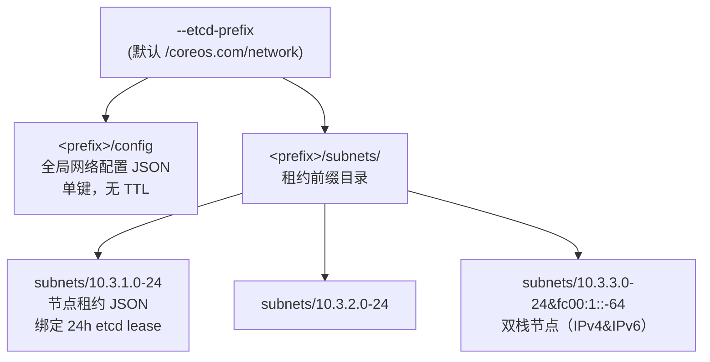
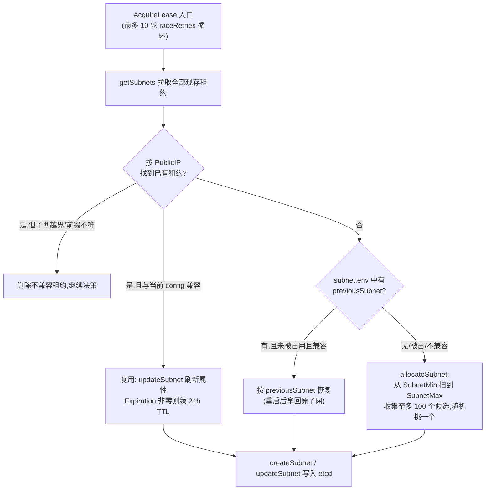
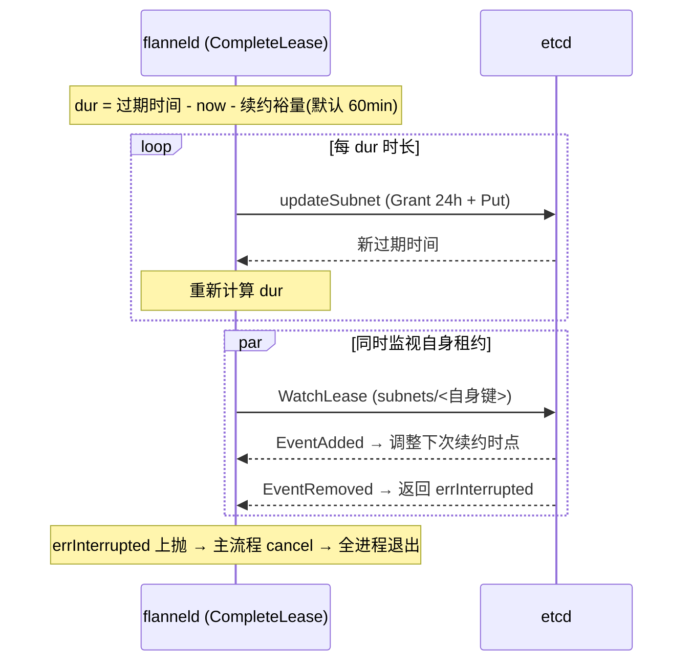

当 flannel 运行在 Kubernetes 之外（或显式不启用 `--kube-subnet-mgr`）时，全局网络配置与每个节点的子网租约都存放在 etcd 中。本页聚焦 etcd 存储模式的两个核心命题：**配置键空间如何设计**（`config` 键与 `subnets/` 键前缀的布局、命名编码、值的结构），以及**租约如何保留**（获取时的三段式候选决策、基于 etcd TTL 的续约节奏、以及租约被吊销时的自毁路径）。全文所有结论均来自对当前仓库代码的逐行核验。

## 模式分岔点：etcd 何时成为存储后端

flannel 的存储后端选择发生在 `main()` 之前的 `newSubnetManager` 中：若命令行传入 `--kube-subnet-mgr`，则交给 kube subnet manager（Kubernetes API 协调）；否则组装 `etcd.EtcdConfig` 并构造 `NewLocalManager`，进入 etcd 模式。etcd 模式构造器还会顺手做一件重要的事——从本地 `subnet.env`（默认 `/run/flannel/subnet.env`）读出上一次使用的子网，作为 `previousSubnet` 传入管理器，这是后续"租约恢复"语义的起点。

Sources: [main.go](main.go#L190-L215)

etcd 连接参数全部由命令行旗标定义，并可通过 `FLANNELD_` 前缀的环境变量覆盖（`flagutil.SetFlagsFromEnv`）。这些参数对应 `EtcdConfig` 结构体的七个字段：端点列表、键前缀、TLS 三件套（证书、私钥、CA）以及 BasicAuth 用户名密码。

| 旗标 | 默认值 | 作用 |
|---|---|---|
| `--etcd-endpoints` | `http://127.0.0.1:4001,http://127.0.0.1:2379` | 逗号分隔的 etcd 端点列表 |
| `--etcd-prefix` | `/coreos.com/network` | flannel 键空间前缀 |
| `--etcd-certfile` / `--etcd-keyfile` | 空 | 客户端证书/私钥，两者都提供才启用 TLS |
| `--etcd-cafile` | 空 | 校验 etcd 服务端的 CA |
| `--etcd-username` / `--etcd-password` | 空 | BasicAuth 凭据 |

Sources: [main.go](main.go#L114-L120), [main.go](main.go#L223-L226), [registry.go](pkg/subnet/etcd/registry.go#L58-L66)

`LocalManager` 本身是一个薄协调层，持有 `Registry` 接口（隔离全部 etcd 读写细节）、`previousSubnet`/`previousIPv6Subnet`（重启恢复）与 `subnetLeaseRenewMargin`（续约裕量）。这个接口切分使得同一套管理器逻辑可以运行在真实 etcd 之上，也可以运行在单元测试用的 `MockSubnetRegistry` 之上。

Sources: [local_manager.go](pkg/subnet/etcd/local_manager.go#L43-L48), [registry.go](pkg/subnet/etcd/registry.go#L46-L56)

## 配置键空间：两棵固定布局的键

etcd 模式的键空间设计极为克制——只有两类键，全部位于 `--etcd-prefix` 之下：

`config` 是一个单键，`getNetworkConfig` 以 `path.Join(prefix, "config")` 精确读取；若键不存在，返回的错误文案直接给出了排障线索——"Did you create your config using etcdv3 API?"，暗示 flannel 只支持 etcd v3 API 写入的键。

Sources: [registry.go](pkg/subnet/etcd/registry.go#L155-L167), [registry.go](pkg/subnet/etcd/registry.go#L38-L44)

`subnets/` 则是一个前缀目录，每个已分配子网占一个键。`getSubnets` 以 `WithPrefix()` 一次拉取全部租约，并对每个键额外调用 `TimeToLive` 把 etcd lease 的剩余 TTL 换算成绝对过期时间；某键的 TTL 读取失败只记录警告并跳过，不影响其余租约的收集。

Sources: [registry.go](pkg/subnet/etcd/registry.go#L169-L200)

单元测试与功能测试从两个层面印证了这套键布局：`initTestRegistry` 直接向 etcd 写入 `/coreos.com/network/config` 并预置 `10.3.1.0-24` 等租约键；功能测试在每轮结束后用 `etcdctl del /coreos.com/network/config` 清理状态、用 `etcdctl get --prefix /coreos.com/network/subnets` 转储调试信息。

Sources: [subnet_test.go](pkg/subnet/etcd/subnet_test.go#L33-L64), [etcd_test.go](functional/etcd_test.go#L84-L103)

## 子网键编码：IPv4 与双栈两种格式

租约键的名字就是子网本身，由 `MakeSubnetKey` 生成：IPv4 部分以点分隔、斜杠换成连字符（如 `10.3.1.0-24`）；若启用双栈，则追加 `&` 与 IPv6 部分（冒号换成连字符，如 `fc00:1::-64`）。反向解析由 `ParseSubnetKey` 用一条正则完成，两组捕获分别对应 IPv4 与可选的 IPv6。

| 集群形态 | 键名示例 |
|---|---|
| 仅 IPv4 | `10.3.1.0-24` |
| 双栈（IPv4 + IPv6） | `10.3.1.0-24&fc00:10:1::-64` |

Sources: [subnet.go](pkg/subnet/subnet.go#L33-L68)

这个编码设计的实际收益体现在 watch 事件处理上：etcd 推来的事件只有字节形式的键，`parseSubnetWatchResponse` 与 `kvToIPLease` 靠同一个解析函数从键名无损还原出子网结构；解析失败的畸形键（如 `not-a-subnet`）会被跳过并告警，不会中断整批事件的处理——单测 `TestWatchResultsSkipsMalformedEvents` 专门验证了这一容错行为。

Sources: [registry.go](pkg/subnet/etcd/registry.go#L464-L543), [registry_test.go](pkg/subnet/etcd/registry_test.go#L51-L80)

## config 键的值：JSON 字段与默认值推导

`config` 键的值是一段 JSON，即 net-conf.json 的内容（字段详解见 [net-conf.json 网络配置项逐项详解](13-net-conf-json-wang-luo-pei-zhi-xiang-zhu-xiang-xiang-jie)）。`ParseConfig` 反序列化出 `Config` 结构后，`CheckNetworkConfig` 会补全并校验派生字段——**这一步只在 etcd 模式执行**（代码注释明确写着 kubernetes 模式不走此函数），因为 etcd 模式的 config 键是运维手写的，必须由 flannel 自己兜底。

Sources: [config.go](pkg/subnet/config.go#L56-L76)

默认值推导规则是理解子网分配行为的前提：

| 字段 | 未显式配置时的推导规则 |
|---|---|
| `SubnetLen` | Network 前缀 ≤ /22 时取 /24；否则取 Network 前缀 +2（保证每子网至少 4 个地址）；上限 /30 |
| `SubnetMin` | Network 的**第二个**子网（刻意跳过第一个子网，避免网络地址与接口地址冲突） |
| `SubnetMax` | Network 的最后一个子网的前一个 |
| `IPv6SubnetLen` | 同构规则：前缀 ≤ /62 时取 /64，上限 /126 |
| 校验约束 | SubnetMin/SubnetMax 必须落在 Network 内且对齐 SubnetLen 边界 |

Sources: [config.go](pkg/subnet/config.go#L92-L135), [config.go](pkg/subnet/config.go#L137-L196)

`config` 键允许在 flannel 启动之后才写入：`getConfig` 以 1 秒为周期轮询 `GetNetworkConfig`，直到解析校验成功才继续启动流程，这让"先起 flanneld、后灌配置"的编排顺序成为可能。

Sources: [main.go](main.go#L531-L550), [local_manager.go](pkg/subnet/etcd/local_manager.go#L90-L105)

另外，前缀本身就是**多网络隔离**的手段：功能测试演示了在同一 etcd 上用 `--etcd-prefix=/vxlan/network` 与 `--etcd-prefix=/hostgw/network` 同时跑两个 flanneld 实例，各自维护独立的 `config` 与 `subnets/` 键树，互不感知。

Sources: [etcd_test.go](functional/etcd_test.go#L209-L212), [etcd_test.go](functional/etcd_test.go#L226-L231)

## 租约值：LeaseAttrs JSON

`subnets/` 键的值是 `LeaseAttrs` 的 JSON 序列化，包含节点对外 IP（`PublicIP`/`PublicIPv6`）与后端插件自描述信息（`BackendType`、`BackendData`、`BackendV6Data`）。其他节点正是通过 watch 这些值来构建远端主机路由或隧道对端的——例如 VXLAN 后端把 VTEP MAC 放在 `BackendData` 中。

Sources: [lease.go](pkg/lease/lease.go#L42-L48)

读取侧的 `kvToIPLease` 展示了租约对象的完整拼装：键名解析出子网、值反序列化出属性、`TimeToLive` 换算出过期时间，外加 `ModRevision` 存入 `Asof` 字段（注释明确标注"Only used in etcd"）——这个修订号就是后续增量 watch 的游标起点。

Sources: [registry.go](pkg/subnet/etcd/registry.go#L514-L543)

## AcquireLease：三段式候选决策

每个节点的子网获取遵循一个固定优先级的三段式决策，完整决策链如下：

Sources: [local_manager.go](pkg/subnet/etcd/local_manager.go#L107-L126), [local_manager.go](pkg/subnet/etcd/local_manager.go#L148-L223)

**第一优先级是按 PublicIP 复用**：只要本机对外 IP 没变，就重新认领同一个子网，这保证了节点重启后的网络身份稳定。复用前有双向兼容检查 `isSubnetConfigCompat`/`isIPv6SubnetConfigCompat`——子网必须仍落在 `SubnetMin`–`SubnetMax` 区间内且前缀长度与 `SubnetLen` 一致，不兼容的旧租约会被直接删除后走新分配。这里还有一个历史痕迹值得注意：若现存租约的 `Expiration` 为零值（旧版"预留"语义），续约时传入 ttl=0，代码注释标注 "Not a reservation" 即只有非预留租约才刷新 24 小时 TTL。

Sources: [local_manager.go](pkg/subnet/etcd/local_manager.go#L154-L179), [local_manager.go](pkg/subnet/etcd/local_manager.go#L409-L426)

**第二优先级是 previousSubnet 恢复**：`subnet.env` 是每次分配成功后写回本地磁盘的（后文详述），重启时从中读出上次的子网，若该键在 etcd 中已无人持有（比如 TTL 过期被回收）且兼容当前配置，就直接按原子网重新创建租约。单测分别验证了"有 previousSubnet 则复用"与"previousSubnet 不匹配配置则弃用"两个分支。

Sources: [main.go](main.go#L607-L618), [local_manager.go](pkg/subnet/etcd/local_manager.go#L181-L196), [subnet_test.go](pkg/subnet/etcd/subnet_test.go#L88-L139)

**第三优先级才是全新分配**：`allocateSubnet` 从 `SubnetMin` 线性扫描到 `SubnetMax`，跳过所有 `Overlaps` 的已租子网，凑满 **100 个候选**后停止扫描，再用时间戳种子的伪随机数（`rand.go`）从中挑一个——随机化是为了让多个并发启动的节点倾向于挑选不同的子网，降低碰撞概率。候选池为空则返回 "out of subnets"。

Sources: [local_manager.go](pkg/subnet/etcd/local_manager.go#L225-L274), [rand.go](pkg/subnet/etcd/rand.go#L24-L31)

## CAS 写入：createSubnet 的事务语义

随机挑选只降低概率，真正排除并发冲突的是 etcd 事务。`createSubnet` 分三步走：先 `Grant` 一个绑定 TTL 的 etcd lease，再以条件事务 `If(Version(key) == 0).Then(Put)` 执行 **compare-and-swap** 语义的创建——仅当目标键尚不存在时才写入；若事务失败（键已被并发抢占）或 Put 出错，立即 `Revoke` 释放刚 Grant 的 lease，避免留下悬挂的 TTL 对象。CAS 失败返回 `errSubnetAlreadyexists`。

Sources: [registry.go](pkg/subnet/etcd/registry.go#L221-L254)

外层 `AcquireLease` 为冲突场景预留了 `raceRetries = 10` 的防御性循环：仅当内部返回 `errTryAgain`（由 `isErrEtcdNodeExist` 判定）时重试，其余错误直接上抛，耗尽轮次则报 "max retries reached trying to acquire a subnet"。与之对照，`updateSubnet`（续约/复用路径）无需 CAS——它对已属于本节点的键执行 `Grant` 新 lease + `Put` 重新绑定，天然覆盖写。

Sources: [local_manager.go](pkg/subnet/etcd/local_manager.go#L32-L41), [local_manager.go](pkg/subnet/etcd/local_manager.go#L107-L126), [registry.go](pkg/subnet/etcd/registry.go#L256-L280)

## 租约保留：TTL、续约节奏与自毁路径

etcd 模式的"租约"是双层结构：flannel 层的 `Lease` 对象（子网 + 属性 + 过期时间）与 etcd 层的 lease 对象（真正的 TTL 计时器）。`subnetTTL` 恒为 **24 小时**，创建与每次续约都通过 `Grant(86400)` 重建这个计时器，过期时间是 `Grant` 响应中的 TTL 换算的本地绝对时间。

Sources: [local_manager.go](pkg/subnet/etcd/local_manager.go#L32-L35)

持有租约之后的存活逻辑收敛在 `CompleteLease` 中，其运行时序如下：

Sources: [local_manager.go](pkg/subnet/etcd/local_manager.go#L362-L407)

三个细节值得展开。其一，**续约裕量**（`--subnet-lease-renew-margin`，默认 60 分钟）意味着 flannel 在租约到期前一小时就开始续约，且该值被约束在 1–1439 分钟之间（必须小于 24 小时 TTL），否则启动即失败。其二，续约失败不会立即崩溃，而是记录错误并在 **1 分钟后重试**，给了 etcd 短暂故障足够的容忍窗口。其三，若租约在两次续约之间被外部删除（如运维误删键、etcd 数据回滚），watch 通道收到 `EventRemoved`，`CompleteLease` 返回 `errInterrupted`，`main()` 据此 cancel 根 context 让整个守护进程有序退出——**宁可退出也不带病运行**，因为一个子网已被回收却仍在转发流量的节点会撕裂整个网络。

Sources: [main.go](main.go#L127-L128), [main.go](main.go#L232-L235), [local_manager.go](pkg/subnet/etcd/local_manager.go#L374-L406), [main.go](main.go#L500-L507)

租约保留策略的最后一环是写回本地：`HandleSubnetFile`（etcd 模式下"文件从不变化，启动时只写一次"）把 `FLANNEL_NETWORK`、`FLANNEL_SUBNET`、`FLANNEL_IPV6_SUBNET`、`FLANNEL_MTU`、`FLANNEL_IPMASQ` 等写入 `subnet.env`，与开头的 previousSubnet 读取形成闭环。subnet.env 的持久化语义在 [运行时限制、零停机重启与 subnet.env 持久化语义](27-yun-xing-shi-xian-zhi-ling-ting-ji-zhong-qi-yu-subnet-env-chi-jiu-hua-yu-yi) 有专门展开。

Sources: [local_manager.go](pkg/subnet/etcd/local_manager.go#L436-L439), [subnet.go](pkg/subnet/subnet.go#L70-L92)

## 租约监视：revision 游标与 compaction 自愈

后端插件要感知全网拓扑变化（例如 host-gw 要维护到每个远端子网的路由），依赖 `WatchLeases` 的增量推送。etcd 实现采用"复位 + 增量"两段式：先 `leasesWatchReset` 拉一次全量快照发给消费方，同时记录快照时的 MVCC **revision 作为游标**，再从 `revision + 1` 起对 `subnets/` 前缀建立 watch；单个租约的监视（`CompleteLease` 自身存活检测所用）则是同一机制收敛到单键粒度。

Sources: [local_manager.go](pkg/subnet/etcd/local_manager.go#L286-L314), [local_manager.go](pkg/subnet/etcd/local_manager.go#L339-L360), [registry.go](pkg/subnet/etcd/registry.go#L614-L626)

`runWatch` 是这条链路的可靠性核心，它把连接管理收敛在一个循环里：

- **指数退避重连**：初始 100ms、每次翻倍、上限 5s，任何一次成功收到事件后重置回初始值；
- **游标推进纪律**：只有当前批次的所有事件都成功投递后才把游标推进到 `Header.Revision + 1`，注释强调"TTL 解析途中的 RPC 失败必须从同一 revision 重试"；
- **compaction 自愈**：若 watch 起点已被 etcd 压缩（`mvcc: required revision has been compacted`），在同一 revision 上重连将永远失败，此时 `isCompacted` 识别该情况并触发 `resync`——重新拉全量快照、发出复位结果、从新 revision 恢复增量，而不是无限热循环；
- **leader 要求**：watch 请求携带 `WithRequireLeader`，避免连到无 leader 的分区时静默挂起。

Sources: [registry.go](pkg/subnet/etcd/registry.go#L298-L408), [registry.go](pkg/subnet/etcd/registry.go#L545-L564)

压缩恢复在单键 watch 上还有一个特殊分支：`resyncWatchSubnet` 重读键时若发现租约已不存在，会**合成一条 `EventRemoved`** 发出（因为压缩掉的删除事件无法从 watch 流恢复），把吊销处理权交还给上层的 `CompleteLease` 自毁逻辑——这保证了"租约被删"这一关键信号在任何故障窗口下都不会丢失。

Sources: [registry.go](pkg/subnet/etcd/registry.go#L572-L612)

## 运维速查：键操作命令与故障对照

运维侧与这套键空间交互的最小命令集如下（TLS 参数按需追加）：

| 操作 | 命令 | 说明 |
|---|---|---|
| 写入网络配置 | `etcdctl put /coreos.com/network/config '{"Network":"10.10.0.0/16","Backend":{"Type":"vxlan"}}'` | 必须用 etcd v3 API |
| 查看当前租约 | `etcdctl get --prefix /coreos.com/network/subnets` | 功能测试的调试转储同款命令 |
| 删除某节点租约 | `etcdctl del /coreos.com/network/subnets/10.3.1.0-24` | 该节点将收到 EventRemoved 并自毁 |
| 多网络隔离 | flanneld 增加 `--etcd-prefix=/vxlan/network` | config 与 subnets 键树整体换根 |

Sources: [etcd_test.go](functional/etcd_test.go#L89-L102), [etcd_test.go](functional/etcd_test.go#L209-L231)

| 现象 | 根因定位 | 代码锚点 |
|---|---|---|
| 启动报 "flannel config not found in etcd store. Did you create your config using etcdv3 API?" | config 键不存在，或用 etcd v2 API 写入 | [registry.go](pkg/subnet/etcd/registry.go#L155-L167) |
| 日志反复出现 "etcd watch ... fell behind compaction horizon" 后恢复 | watch 消费过慢导致起点被压缩，属自愈行为 | [registry.go](pkg/subnet/etcd/registry.go#L342-L373) |
| "Lease has been revoked. Shutting down daemon." | 自身租约键被删除或过期后未续上，进程主动退出 | [local_manager.go](pkg/subnet/etcd/local_manager.go#L401-L404) |
| "out of subnets" | SubnetMin–SubnetMax 区间内候选耗尽 | [local_manager.go](pkg/subnet/etcd/local_manager.go#L262-L263) |
| 节点重启后换了子网 | subnet.env 丢失或 previousSubnet 与新 config 不兼容 | [local_manager.go](pkg/subnet/etcd/local_manager.go#L181-L196) |

## 延伸阅读

理解了 etcd 模式的键设计与租约保留之后，建议按以下路径继续：租约分配与续约的算法侧通用原理（两种存储模式共享）见 [子网租约机制：从全局大网段到主机子网的分配与续约](7-zi-wang-zu-yue-ji-zhi-cong-quan-ju-da-wang-duan-dao-zhu-ji-zi-wang-de-fen-pei-yu-xu-yue)；对照阅读 Kubernetes 模式如何用 Node 注解替代这套键空间，见 [kube subnet manager：Node 注解、podCIDR 与 informer 机制](19-kube-subnet-manager-node-zhu-jie-podcidr-yu-informer-ji-zhi)；config 键 JSON 字段的逐项含义见 [net-conf.json 网络配置项逐项详解](13-net-conf-json-wang-luo-pei-zhi-xiang-zhu-xiang-xiang-jie)；动手在 Docker + etcd 环境跑通本页所述流程，见 [脱离 Kubernetes：在 Docker 与 etcd 环境中手动运行](4-tuo-chi-kubernetes-zai-docker-yu-etcd-huan-jing-zhong-shou-dong-yun-xing)。