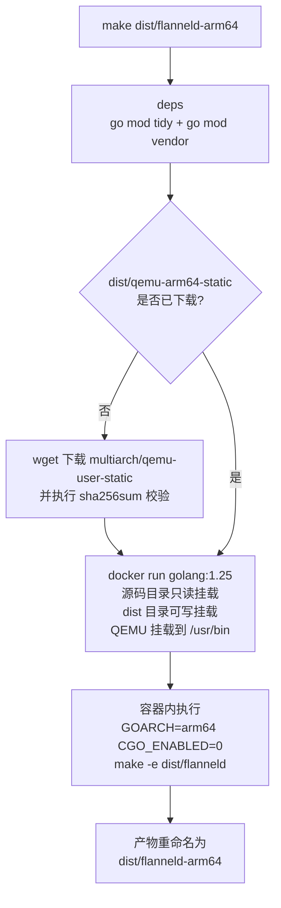
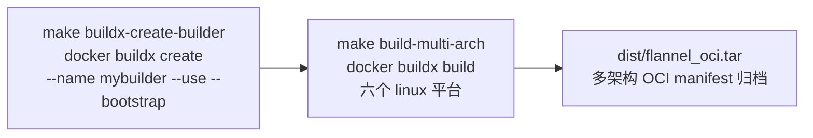
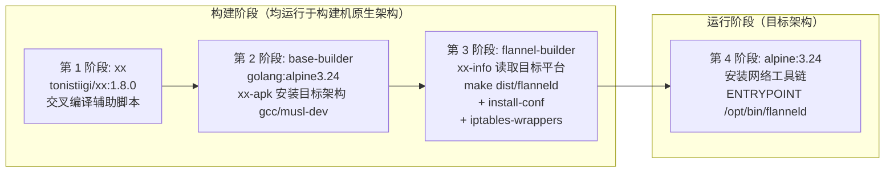

本页面向初次接触 flannel 的开发者，讲解如何从源码产出 flanneld 二进制与多架构容器镜像。flannel 官方支持 six 种 Linux CPU 架构（amd64、arm、arm64、ppc64le、s390x、riscv64）以及 Windows，因此"跨架构构建"是本仓库构建体系的核心命题。我们将以 `Makefile` 为主线，配合 `images/Dockerfile` 与 CI 工作流，逐步拆解 Docker 容器化编译与 QEMU 用户态模拟两条技术路径。

## 构建体系全景：两条并行的多架构路径

flannel 仓库中存在两套互相配合的构建机制。第一套以 `Makefile` 为入口：在开发者本机的 Docker 中启动 `golang` 官方镜像完成编译，跨架构时借助从 `multiarch/qemu-user-static` 项目下载并校验的 QEMU 静态二进制；第二套以 `images/Dockerfile` 为核心：使用 Docker buildx 配合 `tonistiigi/xx` 交叉编译工具链脚本，一次性产出多架构镜像（CI 的 PR 校验与正式发布都走这条路）。理解"哪条路径解决什么问题"是上手的第一步。

```mermaid
flowchart TB
    subgraph Makefile路径["路径一：Makefile + 宿主机 Docker"]
        BIN["make dist/flanneld-&#40;ARCH&#41;<br/>容器内编译单架构二进制"]
        QEMU["dist/qemu-*-static<br/>下载 + SHA256 校验"]
        IMG["make image<br/>单架构镜像 .docker 归档"]
        REL["make release / tar.gz<br/>全架构二进制与压缩包"]
    end
    subgraph Dockerfile路径["路径二：images/Dockerfile + buildx"]
        MMA["make build-multi-arch<br/>六架构 OCI 归档"]
        DF["xx 交叉编译四阶段构建"]
    end
    BIN --> QEMU
    REL --> BIN
    IMG --> DF
    MMA --> DF
```

| 维度 | Makefile 路径 | Dockerfile + buildx 路径 |
|---|---|---|
| 入口命令 | `make dist/flanneld-amd64`、`make image`、`make release` | `make build-multi-arch` |
| 交叉编译方式 | golang 容器内设置 `GOARCH` + QEMU 挂载 | `tonistiigi/xx` 脚本原生交叉编译 |
| QEMU 依赖 | 需手动下载或 `apt-get install qemu-user-static` | 由 buildx/QEMU 在模拟层运行目标架构阶段 |
| 典型产物 | `dist/flanneld-arm64`、`dist/*.docker`、`dist/*.tar.gz` | `dist/flannel_oci.tar`（多架构 manifest） |
| 主要使用场景 | 本地开发调试、发布二进制压缩包 | PR 验证与正式发布多架构镜像 |

Sources: [Makefile](Makefile#L55-L93)、[images/Dockerfile](images/Dockerfile#L1-L57)、[Documentation/building.md](Documentation/building.md#L1-L35)

## 核心变量与产物命名约定

`Makefile` 开头定义了一组可被环境变量覆盖的构建参数，它们决定了产物名称、目标架构与链接方式。初学者最容易混淆的是 `TAG` 与 `ARCH`：前者是版本标签，默认由 `git describe --tags --always` 生成（有 tag 用 tag，没有 tag 回退到 commit 短哈希）；后者是目标 CPU 架构，默认 `amd64`，合法取值在代码注释中明确列出为 `[amd64 arm arm64 ppc64le s390x riscv64]`。

| 变量 | 默认值 | 作用 |
|---|---|---|
| `TAG` | `git describe --tags --always` | 版本号，注入二进制并通过 `-$(TAG)` 后缀命名镜像 |
| `ARCH` | `amd64` | 目标架构，决定 `GOARCH`、QEMU 资产与镜像平台 |
| `CGO_ENABLED` | amd64 为 `1`，其余架构为 `0` | 仅 amd64 启用 CGO（代码注释指出这与 UDP 后端相关） |
| `GO_VERSION` | `1.25` | 容器内编译所用 golang 镜像标签 |
| `GOARM` | `7` | arm 架构的 Go ARM 版本 |
| `REGISTRY` | `quay.io/coreos/flannel` | 镜像仓库地址，可覆盖为私有仓库 |
| `QEMU_VERSION` | `v7.2.0-1` | multiarch/qemu-user-static 的发布版本 |

版本号最终如何进入二进制？答案在链接期参数：`dist/flanneld` 目标使用 `-ldflags '-X github.com/flannel-io/flannel/pkg/version.Version=$(TAG)'` 把 `TAG` 写入包变量，而该变量在源码中默认值仅为 `"dev"`，因此不传 `TAG` 构建出的二进制会自报为开发版本。

Sources: [Makefile](Makefile#L31-L53)、[Makefile](Makefile#L63-L65)、[pkg/version/version.go](pkg/version/version.go#L15-L18)

## 第一步：容器内编译单架构二进制

官方文档明确指出"构建 flannel 最可靠的方式是使用 Docker"，对应命令是 `make dist/flanneld-amd64`，成功后 `dist/` 目录下会出现 `flanneld-amd64`。这个目标背后是一条精心设计的容器化流水线：先执行 `deps`（`go mod tidy` + `go mod vendor`）整理依赖，再确保对应架构的 QEMU 静态二进制就位，然后启动 golang 容器完成编译。

这条命令有几个值得初学者注意的细节。其一，`-u $(shell id -u):$(shell id -g)` 让容器以当前用户身份运行，避免产出 root 属主的文件；其二，源码以 `:ro`（只读）方式挂载进容器，仅 `dist/` 目录可写，保证构建不污染源码树；其三，`make -e` 强制环境变量覆盖 Makefile 内部赋值，使容器外的 `CGO_ENABLED` 与 `GOARCH` 真正生效；其四，链接参数 `-s -w` 去除符号表减小体积，`-extldflags "-static"` 产出静态链接二进制，便于在任意 Linux 环境直接运行。

Sources: [Documentation/building.md](Documentation/building.md#L1-L8)、[Makefile](Makefile#L63-L82)、[Makefile](Makefile#L238-L240)

## QEMU 静态二进制：跨架构执行的基石

在 x86 笔记本上产出 arm64 二进制时，Go 语言本身就是优秀的交叉编译器，但构建过程中若需要*执行*目标架构的程序（例如运行交叉编译产出的测试、或在镜像构建中运行目标架构的安装脚本），就必须依赖 **QEMU 用户态模拟**——它能把另一种 CPU 指令集的 Linux 可执行文件"翻译"给宿主机内核执行。flannel 将这一机制做成了可复现的 Makefile 目标 `dist/qemu-%-static`。

该目标的工作方式非常严谨：从 `multiarch/qemu-user-static` 项目的 GitHub Release 下载 `v7.2.0-1` 版本对应架构的静态二进制（如 `qemu-aarch64-static`），随后用 Makefile 中预置的 SHA256 值做 `sha256sum --check` 校验，任何下载损坏或被篡改都会导致构建立即失败。这是典型的供应链安全实践——**先固定哈希，再允许下载**。如果不想手动下载，`Documentation/building.md` 提供了 Ubuntu 下的等价捷径：`sudo apt-get install qemu-user-static` 即可把所需二进制安装到 `/usr/bin`。执行 `make clean` 时，`dist/qemu-*` 也会一并清理。

| 目标架构 | QEMU 资产文件名 | SHA256 校验值 |
|---|---|---|
| amd64 | `qemu-x86_64-static` | `7132ffd39aef71c26d3344cc0c7dffc530e10e3e720c58c8279a97ef6fdd7784` |
| arm | `qemu-arm-static` | `9f07762a3cd0f8a199cb5471a92402a4765f8e2fcb7fe91a87ee75da9616a806` |
| arm64 | `qemu-aarch64-static` | `dce64b2dc6b005485c7aa735a7ea39cb0006bf7e5badc28b324b2cd0c73d883f` |
| ppc64le | `qemu-ppc64le-static` | `a8855b9a9cdefbe2163d9f7851fb71c77207d816451237caed616eb9b03229ac` |
| s390x | `qemu-s390x-static` | `a438ab2f7c2e0f0ffe63992bccedaf60d789cfb1849e035c0764bda7d9e73a9a` |
| riscv64 | `qemu-riscv64-static` | `3d25c6ec0523cf36e51ccd32ecefebed1752958ef384d10ba84c059ac26a4b3c` |

Sources: [Makefile](Makefile#L7-L29)、[Makefile](Makefile#L197-L207)、[Makefile](Makefile#L56-L61)、[Documentation/building.md](Documentation/building.md#L16-L20)

## 构建单架构容器镜像：make image

拿到二进制后，`make image`（或完整写作 `ARCH=arm make image`）会调用 `docker buildx build --platform=$(ARCH)` 基于同一份源码构建出该架构的容器镜像，再通过 `docker save` 把镜像导出为 `dist/flanneld-$(TAG)-$(ARCH).docker` 离线归档。这里有一个初学者容易忽略的特例：**amd64 架构会额外构建一个不带架构后缀的镜像标签**（如 `quay.io/coreos/flannel:$(TAG)`），因为 amd64 是事实上的默认架构，无后缀标签更方便日常拉取。

对于"Makefile 目标到底帮我做了什么"，下表给出目标与等价原始命令的对照，帮助你建立从 Makefile 到 Docker CLI 的映射直觉：

| Makefile 入口 | 等价的原始操作 | 产物 |
|---|---|---|
| `make dist/flanneld-amd64` | 启动 `golang:1.25` 容器 → 容器内 `make -e dist/flanneld` → 重命名产物 | `dist/flanneld-amd64` |
| `make image` | `docker buildx build -f images/Dockerfile --platform=$(ARCH) --build-arg TAG=… -t …:$(TAG)-$(ARCH) --load .` + `docker save` | `dist/flanneld-$(TAG)-$(ARCH).docker`（amd64 额外有无后缀标签） |
| `make build-multi-arch` | `docker buildx build --platform=linux/amd64,linux/arm64,linux/arm,linux/s390x,linux/ppc64le,linux/riscv64 … -o type=oci,dest=dist/flannel_oci.tar` | `dist/flannel_oci.tar` |
| `make clean` | 删除 `dist/flanneld*`、`*.aci`、`*.docker`、`*.tar.gz`、`qemu-*` | 清空的 dist 产物 |

Sources: [Makefile](Makefile#L84-L93)、[Makefile](Makefile#L242-L246)、[Makefile](Makefile#L56-L61)

## 一次构建六架构：buildx 多架构镜像

如果你想本地复现官方发布级别的多架构镜像，需要先安装 [Docker buildx](https://github.com/docker/buildx)。流程分两步：首次使用先执行 `make buildx-create-builder` 创建名为 `mybuilder` 的支持多平台的构建器（`docker buildx create --name mybuilder --use --bootstrap`），然后执行 `make build-multi-arch`。后者一次性为 `linux/amd64、linux/arm64、linux/arm、linux/s390x、linux/ppc64le、linux/riscv64` 六个平台构建，并将结果以 OCI 归档格式输出到 `dist/flannel_oci.tar`——这个 tar 文件内含一个多架构 manifest list，推送到镜像仓库后，不同架构的节点拉取同一标签即可各自获得匹配的镜像层。

Sources: [Documentation/building.md](Documentation/building.md#L22-L35)、[Makefile](Makefile#L242-L246)

## images/Dockerfile 解剖：xx 交叉编译与四阶段流水线

`images/Dockerfile` 是理解现代 Go 项目多架构构建的绝佳教材。它没有采用"在 QEMU 中完整模拟目标架构跑编译"的笨重方案，而是使用 `tonistiigi/xx` 工具集实现**原生平台交叉编译**：所有构建阶段都固定在 `--platform=$BUILDPLATFORM`（即构建机自身架构）上运行，由 xx 脚本负责查询目标平台信息并安装对应架构的 C 工具链。只有最终的运行时镜像才是目标架构，从而把 QEMU 模拟的开销压缩到最小。

这条流水线有三个鲜明的工程特征。**供应链锁定**：三个基础镜像（`tonistiigi/xx:1.8.0`、`golang:alpine3.24`、`alpine:3.24`）全部通过 `@sha256:` 摘要精确固定，杜绝上游镜像变动引入不可复现性。**一次构建多个组件**：除主程序 flanneld 外，还在同一环境交叉编译了 `cmd/install_conf` 辅助工具，并克隆 `kubernetes-sigs/iptables-wrappers` 仓库、检出固定 commit `bfef9e5087a198b50a4124bb9ce9d2c7c99025dd` 后构建 iptables 包装器，一并打入镜像。**运行时自包含**：基于 `alpine:3.24` 的最终镜像预装 `iproute2`、`ca-certificates`、`nftables`、`iptables`、`strongswan`，并从 Alpine edge 社区仓库补充 `wireguard-tools`，随后显式校验 `iptables-legacy` 与 `iptables-nft` 同时存在（注释说明这是因为多架构构建下 wrapper 安装脚本的健全性检查不生效），最后执行 `iptables-wrapper install` 完成初始化。

| 运行时镜像组件 | 来源 | 用途 |
|---|---|---|
| `/opt/bin/flanneld` | flannel-builder 阶段 | 主守护进程，ENTRYPOINT |
| `/opt/bin/install-conf` | `cmd/install_conf` 交叉编译产物 | 配置安装辅助工具 |
| `/opt/bin/mk-docker-opts.sh` | 仓库 `dist/` 目录 | 生成 Docker 网络参数脚本 |
| `/usr/sbin/iptables-wrapper` | iptables-wrappers 固定 commit 构建 | iptables/nftables 后端切换 |
| alpine 软件包 | `apk add` | iproute2、nftables、iptables、strongswan、wireguard-tools 等 |

Sources: [images/Dockerfile](images/Dockerfile#L1-L39)、[images/Dockerfile](images/Dockerfile#L41-L57)

## Windows 交叉编译：flanneld.exe

flannel 同样支持 Windows 节点，对应的二进制由 `dist/flanneld.exe` 目标产出。它的特别之处在于**真正的 C 交叉编译**：通过 `CXX=x86_64-w64-mingw32-g++ CC=x86_64-w64-mingw32-gcc` 指定 MinGW-w64 交叉工具链，配合 `CGO_ENABLED=1 GOOS=windows` 一次性产出静态链接的 Windows 可执行文件。官方文档要求 Ubuntu 用户先安装 `sudo apt-get install mingw-w64` 才能执行此目标。构建产物同样注入版本号，最终被打包进 `flannel-$(TAG)-windows-amd64.tar.gz` 发布压缩包，其中还包含 `mk-docker-opts.sh` 与 README。

Sources: [Makefile](Makefile#L67-L69)、[Makefile](Makefile#L214-L216)、[Documentation/building.md](Documentation/building.md#L43-L49)

## 不用 Docker 的手动构建

如果环境不允许使用 Docker，`Documentation/building.md` 给出了纯手动路径，共三步：第一步安装依赖，Ubuntu 为 `sudo apt-get install linux-libc-dev golang gcc`（Fedora/RedHat 为 `kernel-headers golang gcc glibc-static`），并确认 Go 版本不低于 1.7；第二步把仓库克隆到 GOPATH 下的 `github.com/flannel-io/flannel` 路径（这是旧式 GOPATH 布局的硬性要求）；第三步确保 `CGO_ENABLED=1` 后执行 `make dist/flanneld`（Linux）或 `make dist/flanneld.exe`（Windows）。需要注意，手动路径要求本机架构与目标架构一致，跨架构请回到前文的 QEMU 路径。

Sources: [Documentation/building.md](Documentation/building.md#L40-L51)

## 发布流水线：release 目标与 CI 工作流

本地一键复现官方发布产物的方式是 `make release`：它先构建 `tar.gz` 压缩包，再下载 s390x、ppc64le、arm64、arm、riscv64 五种架构的 QEMU 静态二进制，随后循环以六个 `ARCH` 取值分别产出 `dist/flanneld-$(TAG)-<架构>.docker` 镜像归档。`tar.gz` 目标则逐架构编译并打包，每个压缩包统一含 `flanneld`（重命名去架构后缀）、`mk-docker-opts.sh` 与 `README.md` 三个文件。

CI 层面由两个工作流接管。**PR 校验**（`.github/workflows/build.yaml`）在每次 pull request 时运行 Helm chart 测试、用 buildx 以 `push: false` 方式验证六个平台镜像可构建，并额外执行 `make dist/flanneld.exe` 验证 Windows 交叉编译。**正式发布**（`.github/workflows/release.yml`）在 release 发布时触发，包含四个作业：推送多架构镜像到 Docker Hub（显式安装 `docker/setup-qemu-action`）、推送同一镜像到 ghcr.io 并生成构建来源证明、执行 `make release` 并将 `dist/flannel*` 上传到 GitHub Release 页面，以及打包 Helm chart 与 kube-flannel.yml 清单并发布到 GitHub Pages。

| 工作流 / 作业 | 触发条件 | 核心动作 | 关键产物 |
|---|---|---|---|
| build.yaml: chart-tests | pull request | `make chart-test` | — |
| build.yaml: build-images | pull request | buildx 构建六平台镜像（不推送）+ `make dist/flanneld.exe` | 验证通过的构建 |
| release.yml: build-and-push-images | release 发布 | setup-qemu + buildx 构建并推送 | Docker Hub 多架构镜像 |
| release.yml: build-and-push-images-github-registry | release 发布 | 推送 ghcr.io + 生成 artifact attestation | ghcr.io 多架构镜像 |
| release.yml: build-and-push-artifacts | release 发布 | `make release` + `gh release upload dist/flannel*` | GitHub Release 二进制与压缩包 |
| release.yml: publish-chart | release 发布 | `make release-manifest release-helm` | flannel.tgz、kube-flannel.yml、chart 仓库索引 |

Sources: [Makefile](Makefile#L172-L183)、[Makefile](Makefile#L209-L231)、[.github/workflows/build.yaml](.github/workflows/build.yaml#L59-L70)、[.github/workflows/release.yml](.github/workflows/release.yml#L39-L70)、[.github/workflows/release.yml](.github/workflows/release.yml#L133-L199)

## 测试辅助镜像：images/iperf3

构建体系还包含一个常被忽视的小角色：`images/iperf3` 目录下的性能测试镜像。它的 Makefile 按 `ARCH` 变量选择架构专属且摘要固定的 Alpine 基础镜像（amd64、arm64、ppc64le 三种），Dockerfile 仅安装 `iperf3` 并以服务端模式监听 5201 端口。该镜像不会被 `make image` 触发，而是在 `make e2e-test` 与 `make kind-e2e-test` 中按当前 `ARCH` 按需构建，供功能与端到端测试测量网络吞吐。想深入了解这些测试的组织方式，请继续阅读 [测试体系全景：单元测试、功能测试与 kind 端到端套件](22-ce-shi-ti-xi-quan-jing-dan-yuan-ce-shi-gong-neng-ce-shi-yu-kind-duan-dao-duan-tao-jian)。

Sources: [images/iperf3/Makefile](images/iperf3/Makefile#L1-L23)、[images/iperf3/Dockerfile](images/iperf3/Dockerfile#L1-L14)、[Makefile](Makefile#L115-L135)

## 常见问题排查

初学者在本地构建时最常卡在环境准备环节。下表汇总了从源码中可验证的失败模式与对策：

| 症状 | 根因 | 对策 |
|---|---|---|
| `Unsupported qemu target: …` | 传入了 Makefile 未登记的 `ARCH` 值 | 仅使用 `[amd64 arm arm64 ppc64le s390x riscv64]` 中的取值 |
| `Missing SHA256 for …` | QEMU 资产缺少对应校验值 | 使用 Makefile 预置的六种架构，或补充 `QEMU_SHA256_*` 变量 |
| 交叉编译时无法执行目标架构程序 | 宿主机 `/usr/bin` 缺少 qemu-static | `sudo apt-get install qemu-user-static`，或先跑一次触发自动下载 |
| `build-multi-arch` 报无可用 builder | 尚未创建支持多平台的 buildx 构建器 | 先执行 `make buildx-create-builder` |
| 二进制版本号显示 `dev` | 构建时未传入 `TAG` | 设置 `TAG` 后重新构建，版本经 ldflags 注入 |
| Windows 构建报编译器缺失 | 未安装 MinGW-w64 | Ubuntu 执行 `sudo apt-get install mingw-w64` |
| 容器内编译产出 root 属主文件 | 未按 Makefile 方式传入用户 UID | 使用官方目标（已内置 `-u $(id -u):$(id -g)`） |

Sources: [Makefile](Makefile#L197-L207)、[Makefile](Makefile#L73-L82)、[Documentation/building.md](Documentation/building.md#L12-L20)、[pkg/version/version.go](pkg/version/version.go#L15-L18)

## 下一步阅读

掌握构建体系后，建议按以下顺序继续深入：想理解刚构建出的二进制如何启动并协调各组件，请阅读 [flanneld 架构总览：启动流程与组件协作全解](6-flanneld-jia-gou-zong-lan-qi-dong-liu-cheng-yu-zu-jian-xie-zuo-quan-jie)；构建出的镜像最终跑在哪种测试环境中，请阅读 [测试体系全景：单元测试、功能测试与 kind 端到端套件](22-ce-shi-ti-xi-quan-jing-dan-yuan-ce-shi-gong-neng-ce-shi-yu-kind-duan-dao-duan-tao-jian)；对 `flanneld.exe` 背后的 Windows 支持感兴趣，请阅读 [Windows 跨平台支持：设备、路由与 PowerShell 集成](24-windows-kua-ping-tai-zhi-chi-she-bei-lu-you-yu-powershell-ji-cheng)；若想在容器里调整 flanneld 的启动行为，则可参考 [命令行参数与环境变量（FLANNELD_）完整参考](14-ming-ling-xing-can-shu-yu-huan-jing-bian-liang-flanneld_-wan-zheng-can-kao)。