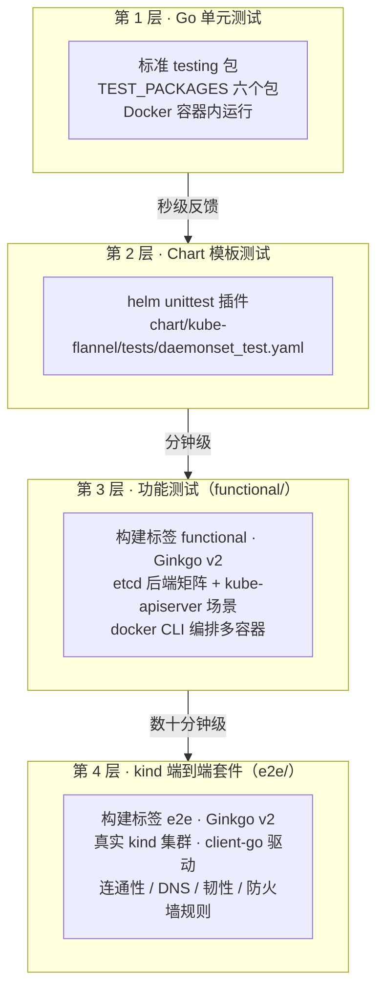
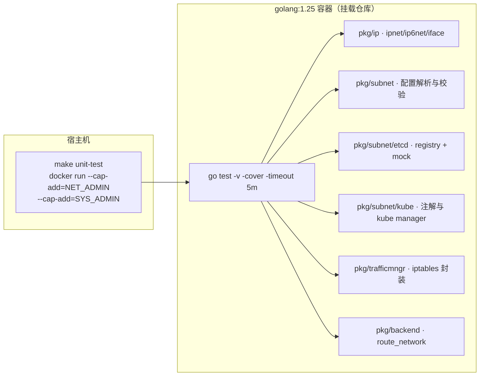
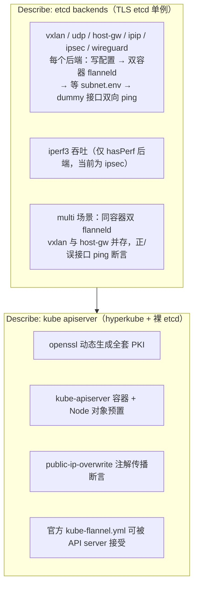
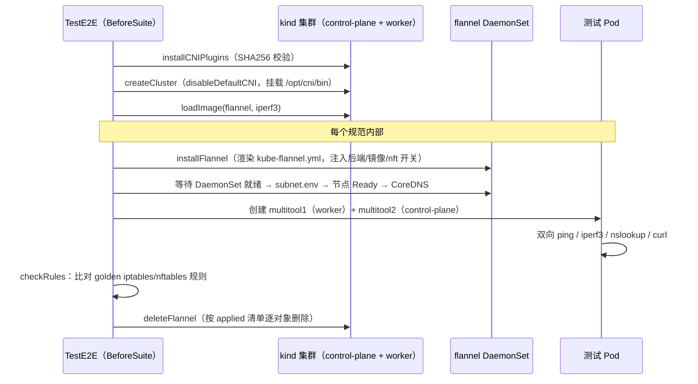

flannel 的测试体系是一个自底向上的四层验证结构：纯 Go 单元测试负责函数级正确性，helm unittest 守护 Chart 模板渲染，Docker 功能测试在容器编排中验证各后端的真实数据路径，kind 端到端套件则在真实 Kubernetes 集群中完成连通性、DNS、韧性与防火墙规则的最终裁决。全部测试通过 `Makefile` 的少数几个目标编排，并在每次 pull request 时由 GitHub Actions 自动触发。本文逐层拆解这套体系的架构、运行方式与设计取舍，帮助你在提交代码前后快速选择正确的验证手段。

Sources: [Makefile](Makefile#L95-L141)

## 测试金字塔：四层验证体系总览

flannel 的测试栈遵循经典的"金字塔"形态——越往下运行越快、越贴近代码；越往上环境越真实、成本越高。两层"集成以上"的套件（functional 与 e2e）都基于 **Ginkgo v2 + Gomega** 框架，并通过 Go 构建标签（`//go:build functional`、`//go:build e2e`）与常规构建隔离，使得 `go build ./...` 与 `go test ./pkg/...` 完全不受重型依赖影响。值得注意的历史演进：两套 Ginkgo 套件的文档注释明确说明，它们分别取代了此前的 bash_unit 脚本套件（`dist/functional-test.sh` 与 `run-e2e-tests.sh`），将测试基础设施统一收敛到了 Go 生态内。

| 维度 | 单元测试 | Chart 测试 | 功能测试 | kind 端到端 |
|---|---|---|---|---|
| 位置 | `pkg/**/*_test.go` | `chart/kube-flannel/tests/` | `functional/` | `e2e/` |
| 构建标签 | 无 | 无（YAML） | `functional` | `e2e` |
| 框架 | Go `testing` | helm-unittest | Ginkgo v2 + Gomega | Ginkgo v2 + Gomega |
| Make 目标 | `make unit-test` | `make chart-test` | `make e2e-test` | `make kind-e2e-test` |
| CI 工作流 | e2eTests.yaml | build.yaml | e2eTests.yaml | kind-e2eTests.yml |
| 超时上限 | 5 分钟 | — | 60 分钟 | 60 分钟（CI 作业 90 分钟） |
| 环境依赖 | golang 容器 + Linux capabilities | helm CLI | Docker + flannel/etcd/iperf3 镜像 | Docker + kind + CNI 插件 |

Sources: [Makefile](Makefile#L95-L141), [functional/functional_suite_test.go](functional/functional_suite_test.go#L17-L37), [e2e/e2e_suite_test.go](e2e/e2e_suite_test.go#L16-L43)

## `make test` 总入口：测试之前的质量门禁

`make test` 是 CI 中执行的全链路入口，它并非直接跑测试，而是先串联四道门禁：`license-check`（运行 `dist/license-check.sh` 校验许可证头）、`gofmt`（格式必须为零差异）、`deps` 与 `verify-modules`（在 golang 容器内验证 `go mod tidy` 与 `go vet` 不产生任何输出差异）。门禁通过后才依次执行 `make unit-test`、`go test ./dist/` 与 `make e2e-test`。这一设计将"代码风格与模块卫生"提升为与测试同级别的硬性前置条件，保证进入重型功能测试的代码已经过基础卫生检查。

Sources: [Makefile](Makefile#L96-L144), [Makefile](Makefile#L146-L167)

## 单元测试层：容器内运行的纯 Go 验证

单元测试是整个体系中唯一不依赖集群或容器的层级，但 flannel 的特殊性在于其大量代码直接操作网络接口、路由表和网络命名空间，因此 `make unit-test` 将测试放入 golang 容器，并额外授予 `NET_ADMIN`（网络操作）与 `SYS_ADMIN`（创建网络命名空间）两个 capabilities——这是 Makefile 注释中明确说明的原因。默认被测包集合由 `TEST_PACKAGES` 变量声明，覆盖六个包：`pkg/ip`、`pkg/subnet`、`pkg/subnet/etcd`、`pkg/subnet/kube`、`pkg/trafficmngr`、`pkg/backend`，可通过环境变量覆盖扩展。一个值得注意的精确事实：仓库根目录的 `main_test.go` 与 `pkg/ipmatch`、`pkg/mac` 下也存在测试文件，但它们不在默认的 `TEST_PACKAGES` 集合中，需通过 `go test ./...` 或覆盖变量才能运行。

测试风格上，flannel 坚持标准库 `testing` 包的表格驱动与最小依赖原则。例如 `pkg/subnet/config_test.go` 直接对 `ParseConfig` + `CheckNetworkConfig` 做默认值断言，验证只给出 `"network": "10.3.0.0/16"` 时 `SubnetMin` 推导为 `10.3.1.0`、子网长度默认 24；根目录的 `main_test.go` 则围绕 `subnet.env` 文件解析的健壮性设计用例，验证非法 CIDR 混入时函数跳过而非 panic。需要外部依赖的包通过本地 mock 解耦：`pkg/subnet/etcd` 目录中维护 `mock_registry.go` 与 `mock_subnet.go`，使租约管理逻辑无需真实 etcd 即可测试。

此外还有两类特殊单元测试值得一提。其一是**脚本测试**：`dist/mk_docker_opts_test.go` 以 `//go:build linux` 标签将 `mk-docker-opts.sh` 的行为封装为表格驱动的 Go 测试，用例中直接比对脚本输出与期望的 `DOCKER_OPT_*` 变量文本，取代了旧的 bash_unit 脚本测试。其二是**平台专属测试**：Windows 路径的 `pkg/routing/router_windows_test.go`、`pkg/ip/iface_windows_test.go` 等文件只在对应平台构建时参与编译，相关跨平台细节见 [Windows 跨平台支持：设备、路由与 PowerShell 集成](24-windows-kua-ping-tai-zhi-chi-she-bei-lu-you-yu-powershell-ji-cheng)。若需要单包覆盖率分析，`cover` 目标支持 `PACKAGES=pkg/ip make cover` 并生成 HTML 报告。

Sources: [Makefile](Makefile#L49-L53), [Makefile](Makefile#L105-L118), [Makefile](Makefile#L137-L140), [pkg/subnet/config_test.go](pkg/subnet/config_test.go#L21-L49), [main_test.go](main_test.go#L26-L74), [dist/mk_docker_opts_test.go](dist/mk_docker_opts_test.go#L17-L19), [pkg/subnet/etcd](pkg/subnet/etcd)

顺带一提，`pkg/ip`、`pkg/subnet`、`pkg/subnet/etcd`、`pkg/subnet/kube`、`pkg/backend/vxlan` 中还分布着若干 `fuzz_test.go` 文件，它们与 `.clusterfuzzlite/` 的持续模糊测试基建属于独立的安全防护专题，本文不展开，详见 [持续模糊测试：ClusterFuzzLite 与输入解析安全防护](23-chi-xu-mo-hu-ce-shi-clusterfuzzlite-yu-shu-ru-jie-xi-an-quan-fang-hu)。

Sources: [pkg/subnet/kube](pkg/subnet/kube), [pkg/backend/vxlan](pkg/backend/vxlan)

## Chart 模板测试：helm unittest 的声明式断言

Helm Chart 的正确性由 `make chart-test` 守护：目标先检测并安装 `helm-unittest` 插件（默认版本 `v1.1.1`，通过 `HELM_UNITTEST_VERSION` 可覆盖），随后对 `chart/kube-flannel` 执行 `helm unittest`。断言本身是纯声明式 YAML——`tests/daemonset_test.yaml` 渲染 `daemonset.yaml` 模板后，逐项校验 API 版本、镜像仓库与标签覆盖（`set` 注入 values 后断言渲染结果）、`flannel.args` 透传，以及 healthz 端口与探针的默认值。CI 侧它作为独立作业 `chart-tests` 在每次 PR 上运行，与镜像构建作业并行，二者互不阻塞。

Sources: [Makefile](Makefile#L120-L128), [chart/kube-flannel/tests/daemonset_test.yaml](chart/kube-flannel/tests/daemonset_test.yaml#L1-L60), [.github/workflows/build.yaml](.github/workflows/build.yaml#L14-L27)

## 功能测试层：Docker 编排下的后端矩阵

functional 套件回答的问题是："每种网络后端在两个真实 flanneld 容器之间能否打通数据路径？"它使用 `//go:build functional` 标签与 Ginkgo v2 编写，运行命令为 `go test -tags functional -timeout 60m -v ./functional/...`，由 `make e2e-test` 包装——该目标会先构建指定架构的 flannel 镜像与 `images/iperf3` 辅助镜像，再通过 `FLANNEL_DOCKER_IMAGE` 环境变量把镜像引用传给测试。套件配置全部来自环境变量（`ARCH`、`TAG`、`FLANNEL_NET` 默认 `10.10.0.0/16`、`K8S_VERSION` 默认 `1.32.6` 等），并在 `BeforeSuite` 中解析为套件级变量。基础工具函数集中在 `docker_test.go`：`docker0IP` 探测宿主网桥地址、`etcdctl*` 系列封装带 TLS 证书的 etcd 读写、`createPingDest` 在容器内创建 dummy 接口并绑定子网地址、`pings` 执行双向 ping。

**etcd 场景**以 `BeforeAll` 启动一个挂载 `dist/test` 证书的 TLS etcd 容器，随后对六个后端逐一验证：向 `/coreos.com/network/config` 写入后端类型，启动两个特权 flanneld 容器，等待双方 `/run/flannel/subnet.env` 出现后在各自子网内创建 dummy 接口并执行双向 ping。`udp` 后端通过 `amd64Only` 标志在非 amd64 架构上自动 `Skip`；`ipsec` 后端额外附带 iperf3 吞吐用例（服务端容器通过 `--net=container` 共享 flannel 容器网络）。**multi 场景**进一步验证双网络并存：在两个宿主容器内分别以不同 `-etcd-prefix` 启动 vxlan 与 host-gw 两个 flanneld 实例，断言流量走正确后端接口可达、走错误接口必须失败——这是少数"负向断言"用例。

**kube-apiserver 场景**则完全不同：它用 openssl 动态生成 CA、apiserver 证书（含 SAN）、service-account 密钥对和管理员证书，启动 hyperkube 镜像的 apiserver 容器加裸 etcd，预置 `flannel1`/`flannel2` 两个 Node 对象（podCIDR 分别为 `10.10.1.0/24` 与 `10.10.2.0/24`），再以 `--kube-subnet-mgr` 模式运行 flannel。这里验证的是 Kubernetes 集成路径而非后端数据面：`public-ip-overwrite` 注解能否正确覆盖租约中的 public-ip（通过 `Eventually` 轮询 Node 注解除断），以及仓库自带的 `Documentation/kube-flannel.yml` 能否被 API server 完整接受。每个用例的 `AfterEach` 都会转储 etcd 子网状态与两个 flannel 容器日志再清理容器，为失败排查保留现场。

Sources: [functional/functional_suite_test.go](functional/functional_suite_test.go#L62-L104), [functional/docker_test.go](functional/docker_test.go#L44-L63), [functional/docker_test.go](functional/docker_test.go#L208-L234), [functional/etcd_test.go](functional/etcd_test.go#L44-L103), [functional/etcd_test.go](functional/etcd_test.go#L129-L196), [functional/etcd_test.go](functional/etcd_test.go#L200-L278), [functional/k8s_test.go](functional/k8s_test.go#L89-L154), [functional/k8s_test.go](functional/k8s_test.go#L218-L267), [functional/k8s_test.go](functional/k8s_test.go#L302-L393)

## kind 端到端套件：一次 PR 触发两套 IP 家族矩阵

e2e 套件是验证链的终点，它在 **kind 库直接创建的真实双节点 Kubernetes 集群**（control-plane + worker，禁用默认 CNI）中运行，通过 client-go 的 typed 与 dynamic 客户端驱动一切操作，不再依赖 docker CLI。`BeforeSuite` 中完成三件事：按架构下载 CNI 插件 v1.9.1 并做 SHA256 校验后解压到 `/opt/cni/bin`（kind 配置将该目录绑定挂载进每个节点）、用 `kindConfigYAML` 生成集群配置（`disableDefaultCNI: true`，podSubnet 取自 `FLANNEL_NET`，双栈时追加 IPv6 网段）、创建集群并将 flannel 与 iperf3 镜像 `load` 进去。kind 节点镜像被 digest 钉死（`kindest/node:v1.36.1@sha256:3489...`），从根源上消除上游镜像漂移导致的假失败。整个套件共享同一个集群实例，`AfterSuite` 中统一销毁。

后端矩阵在 `connectivity_test.go` 中以数据结构 `backendSpecs` 声明：`vxlan`、`vxlan-nftables`（同一 vxlan 后端但切换 nftables 流量管理器）、`wireguard`、`host-gw`、`ipip`、`udp`（amd64-only）。矩阵与 IP 家族**互斥双轨**：`IP_FAMILY=dual` 时 IPv4 矩阵整体 Skip（其断言由双栈矩阵覆盖），默认 ipv4 时双栈矩阵整体 Skip——CI 用一个 `strategy.matrix: [ipv4, dual]` 同时跑两条轨道。双栈轨道要求 Docker daemon 开启 IPv6，kind-e2eTests.yml 在 dual 分支中改写 `daemon.json` 并重启 Docker，注释明确说明所有 IPv6 流量都留在 kind 网络内、runner 无需可路由的公网 IPv6。

| 规范文件 | 覆盖后端 | 核心断言 |
|---|---|---|
| connectivity_test.go | 全部六种 + 双栈子集 | 双节点 multitool Pod 双向 ping；iperf3 吞吐；iptables/nftables 规则与 golden 完全一致 |
| dns_test.go | 仅 vxlan（低成本） | CoreDNS 解析 `kubernetes.default`；Service FQDN 解析到 ClusterIP；按 DNS 名与裸 ClusterIP 均可 curl 到 200 |
| resilience_test.go | 仅 vxlan（低成本） | Pod 删除重建后连通性恢复；DaemonSet 滚动重启后各节点 `FLANNEL_SUBNET` 租约不变且连通性保持 |

规则断言是 e2e 套件中最具 flannel 特色的部分：`rules.go` 内嵌了 **golden 规则文本**——iptables 侧精确到 `FLANNEL-POSTRTG` 链的每一条 RETURN/MASQUERADE 规则（含 `--random-fully`）与 `FLANNEL-FWD` 转发链，nftables 侧对应 `flannel-ipv4` 表的 `postrtg`/`forward` 链全文。测试在两个节点上分别执行 `iptables -S`/`nft list` 并与 golden 做整串相等比较，任何规则顺序或参数偏差都会失败。这种"全量快照"式断言比"包含关键行"严格得多，能捕获 masquerade 语义的隐性回归。

所有规范共享统一的就绪编排 `prepareTest`：清理旧 Pod → 按后端安装 flannel（`installFlannel` 用 Go template 渲染 `Documentation/kube-flannel.yml`，改写镜像与 net-conf.json，nftables 场景还需 patch ConfigMap）→ 依次等待 DaemonSet 滚动完成（5 分钟）、所有节点出现 subnet.env（2 分钟）、节点 Ready（5 分钟）、CoreDNS 就绪（5 分钟）。任何规范失败时 `AfterEach` 钩子自动调用 `dumpDebugInfo` 收集集群现场，韧性套件的注释还解释了一个务实取舍：刻意避免 kind 节点整机重启（太慢且 flaky），改用 Pod 重建与 DaemonSet 滚动重启覆盖 flanneld 的两条真实恢复路径——Pod/veth 重新接线与子网租约持久化。

Sources: [e2e/e2e_suite_test.go](e2e/e2e_suite_test.go#L55-L120), [e2e/cluster.go](e2e/cluster.go#L42-L52), [e2e/cluster.go](e2e/cluster.go#L57-L79), [e2e/cluster.go](e2e/cluster.go#L97-L125), [e2e/connectivity_test.go](e2e/connectivity_test.go#L26-L113), [e2e/connectivity_test.go](e2e/connectivity_test.go#L115-L163), [e2e/dns_test.go](e2e/dns_test.go#L28-L98), [e2e/resilience_test.go](e2e/resilience_test.go#L25-L84), [e2e/resilience_test.go](e2e/resilience_test.go#L86-L136), [e2e/rules.go](e2e/rules.go#L39-L103), [e2e/rules.go](e2e/rules.go#L129-L146), [e2e/flannel.go](e2e/flannel.go#L61-L114), [e2e/kube.go](e2e/kube.go#L35-L79)

## CI 编排与环境变量速查

两条 e2e 工作流均由 pull request 触发、90 分钟作业超时，但验证内容不同：`e2eTests.yaml` 先 `git fetch --unshallow`（保证 `git describe` 能拿到真实标签），然后一条 `make test` 串起 license/gofmt/模块/单元/脚本/功能测试全链路，失败时回显完整日志；`kind-e2eTests.yml` 则以 `ipv4`/`dual` 矩阵并行执行 `make kind-e2e-test`，dual 分支额外完成 Docker IPv6 预配置。二者都需要先 `modprobe br_netfilter overlay` 以满足宿主内核的网络转发前提。配合 build.yaml 中的 chart-tests 作业，一次 PR 共触发三路验证，互为正交。

| 工作流 | 触发 | 执行命令 | 特殊环境准备 |
|---|---|---|---|
| e2eTests.yaml | pull_request | `git fetch --unshallow && make test` | `modprobe br_netfilter overlay` |
| kind-e2eTests.yml | pull_request（ipv4/dual 矩阵） | `make kind-e2e-test` | 内核模块 + dual 时改写 Docker daemon.json 并重启 |
| build.yaml（chart-tests 作业） | pull_request | `make chart-test` | 安装 Helm 3.19.0 |

本地复现时，两个套件的环境变量是唯一的调节旋钮。functional 侧的关键变量包括 `TAG`（或直接给 `FLANNEL_DOCKER_IMAGE`）、`ARCH`、`FLANNEL_NET`、`ETCD_IMG`、`K8S_VERSION` 与三个 `HYPERKUBE_*`；e2e 侧对应为 `TAG`/`FLANNEL_IMAGE`、`ARCH`、`FLANNEL_NET`（默认 `10.42.0.0/16`）、`FLANNEL_IPV6_NET`（默认 `fd00:10:244::/56`）、`IP_FAMILY`、`IPERF3_IMAGE` 与 `MULTITOOL_IMAGE`。两个套件的共同契约是：`FLANNEL_*_IMAGE` 与 `TAG` 至少提供一个，否则 `BeforeSuite` 立即失败并给出明确提示。`Documentation/building.md` 中对本地端到端测试仅有一句指引——需要安装 Docker Compose——完整步骤实际上就藏在上述 Make 目标与套件文档注释里。

Sources: [.github/workflows/e2eTests.yaml](.github/workflows/e2eTests.yaml#L8-L35), [.github/workflows/kind-e2eTests.yml](.github/workflows/kind-e2eTests.yml#L5-L48), [.github/workflows/build.yaml](.github/workflows/build.yaml#L14-L27), [functional/functional_suite_test.go](functional/functional_suite_test.go#L25-L37), [e2e/e2e_suite_test.go](e2e/e2e_suite_test.go#L26-L43), [Documentation/building.md](Documentation/building.md#L37-L39)

## 测试策略的设计启示与上手路径

纵观四层结构，flannel 测试体系体现了三个值得借鉴的原则。**第一，成本分层与矩阵瘦身**：DNS 与韧性规范刻意只跑 vxlan + iptables 这一"最便宜组合"，因为它们验证的是 Service 路由和恢复语义而非后端差异；iperf3 吞吐仅在标记 `hasPerf` 的后端上执行，避免 CI 时长爆炸。**第二，确定性优先**：kind 节点镜像 digest 钉死、CNI 插件 SHA256 校验、golden 规则整串比对，三处细节共同把"环境漂移导致的假失败"压到最低。**第三，失败现场自动化**：functional 的 `AfterEach` 转储 etcd 状态与容器日志，e2e 的 `dumpDebugInfo` 在任何规范失败时自动收场，排障所需信息不依赖测试者手动复现。

给不同场景的实践建议：改动 `pkg/` 下纯逻辑时，先在本地跑 `make unit-test` 或直接 `go test ./pkg/ip/...` 获得秒级反馈；改动 Chart 模板用 `make chart-test`；改动后端数据路径（如 vxlan 转发逻辑、iptables 规则生成）时，functional 与 kind e2e 会在 PR 上自动为你完成全矩阵验证，本地如需复现失败，按前述环境变量表运行对应 Make 目标即可。若你想进一步理解这些测试所保护的生产机制——例如租约续约与 subnet.env 的语义——推荐按顺序阅读 [子网租约机制：从全局大网段到主机子网的分配与续约](7-zi-wang-zu-yue-ji-zhi-cong-quan-ju-da-wang-duan-dao-zhu-ji-zi-wang-de-fen-pei-yu-xu-yue) 与 [iptables 与 nftables 双实现的流量管理器抽象](17-iptables-yu-nftables-shuang-shi-xian-de-liu-liang-guan-li-qi-chou-xiang)；构建镜像本身的细节见 [从源码构建：Docker 容器化与 QEMU 多架构交叉编译](21-cong-yuan-ma-gou-jian-docker-rong-qi-hua-yu-qemu-duo-jia-jiao-cha-bian-yi)，测试失败时的日志分析方法可参考 [常见故障排查：连通性、权限、日志与日志级别](25-chang-jian-gu-zhang-pai-cha-lian-tong-xing-quan-xian-ri-zhi-yu-ri-zhi-ji-bie)。