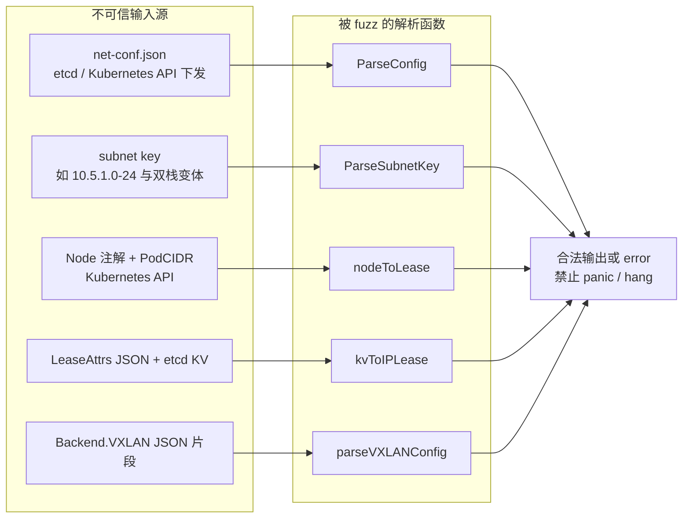
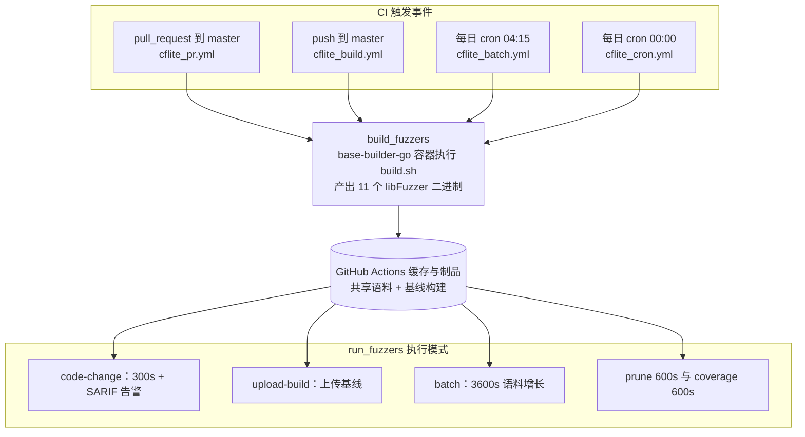

flannel 作为运行在 Kubernetes 数据面的网络插件，其控制平面的第一道防线是对**不可信输入**的解析：网络配置 JSON、etcd 中的子网键、Kubernetes Node 注解与 PodCIDR、以及后端配置片段。本页剖析 flannel 如何通过 ClusterFuzzLite 在 GitHub Actions 上构建一套闭环的持续模糊测试体系——从 `.clusterfuzzlite/` 构建集成、11 个 Go 原生 fuzz 目标的设计模式，到四个工作流（PR / 基线构建 / batch / cron）的编排分工，以及如何在本地运行并将崩溃样本固化为回归种子。

## 信任边界与威胁模型：为什么 fuzz 这些函数

flannel 的模糊测试对象被明确限定在"解码不可信输入"的代码路径上：网络配置 JSON 与从数据存储（etcd / Kubernetes API）读回的值。fuzz 的验收标准是发现 panic、挂起与崩溃，而非逻辑错误——合法格式的错误输入返回 error 是预期行为，解析函数在任意畸形数据上崩溃才是缺陷。这一定位直接写在项目文档中。

Sources: [fuzzing.md](Documentation/fuzzing.md#L3-L8), [fuzz_test.go](pkg/subnet/fuzz_test.go#L30-L34)

逐个审视被测函数，可以看到一条清晰的信任边界链：`ParseConfig` 消费 etcd 或 Kubernetes API 下发的 `net-conf.json`，先 `json.Unmarshal` 再探测 Backend 类型；`ParseSubnetKey` 解析形如 `10.5.1.0-24&fc00::-64` 的子网键——这些键在 etcd 模式下直接由存储读回；`nodeToLease` 解析 Node 注解中的 PublicIP 与 PodCIDR（经 `ParseIP4`/`net.ParseCIDR`）；`kvToIPLease` 将 etcd 的原始 key/value（内含自定义反序列化的 LeaseAttrs JSON）转为租约；`parseVXLANConfig` 则解析后端配置 JSON 片段。任何一环对畸形数据的 panic 都会击穿 flanneld 的控制循环。

Sources: [config.go](pkg/subnet/config.go#L56-L72), [subnet.go](pkg/subnet/subnet.go#L32-L60), [kube.go](pkg/subnet/kube/kube.go#L541-L575), [registry.go](pkg/subnet/etcd/registry.go#L514-L543), [vxlan.go](pkg/backend/vxlan/vxlan.go#L168-L180)



值得注意的是 `ParseSubnetKey` 的实现细节决定了 fuzz 的价值密度：它用一个锚定行尾的正则捕获四个捕获组，随后用 `strconv.ParseUint(parts[2], 10, 5)` 将 IPv4 前缀限制在 5 位（≤31）、IPv6 前缀限制在 7 位（≤127）。这种"正则粗筛 + 位宽截断 + `net.ParseIP` 精验"的三段式解析，正是位运算、类型转换与正则贪婪匹配交织出 bug 的高危区域，也是 fuzz 输入最能有效探索的组合空间。

Sources: [subnet.go](pkg/subnet/subnet.go#L32-L60), [fuzz_test.go](pkg/subnet/fuzz_test.go#L37-L49)

## ClusterFuzzLite 构建集成：.clusterfuzzlite 三件套

构建集成的入口是 `Dockerfile`：它基于 OSS-Fuzz 官方的 `base-builder-go` 镜像，并**按 digest 固定**（`@sha256:da01cf...`）以保证构建可复现——这是安全敏感项目的标准供应链实践。镜像将整个仓库拷贝到 `$SRC/flannel`，再把 `build.sh` 放到 `$SRC/build.sh` 这一 ClusterFuzzLite 约定的位置，由 base-builder 镜像内的构建流程调用。

Sources: [Dockerfile](.clusterfuzzlite/Dockerfile#L15-L22)

`project.yaml` 声明项目元数据：`language: go`、`main_repo` 指向官方仓库、sanitizer 仅启用 `address`、fuzzing 引擎仅启用 `libfuzzer`。对 Go 项目而言这个组合是经过权衡的：AddressSanitizer 通过插桩捕获越界与 use-after-free 类内存错误（Go 侧经由 libFuzzer 的崩溃检测），而省略 undefined-behavior 等 sanitizer 以控制构建与运行开销。

Sources: [project.yaml](.clusterfuzzlite/project.yaml#L15-L20)

`build.sh` 是真正的编译枢纽。脚本首先强制 `GOOS=linux`、`CGO_ENABLED=1`（flannel 是纯 Linux 项目，此设定防止工具链尝试其他平台），然后拉取 `github.com/AdamKorcz/go-118-fuzz-build/testing`——这是 `compile_native_go_fuzzer` 生成的 libFuzzer 包装器所依赖的辅助包。核心是 `targets` 数组：每行以 `包路径::Fuzz函数名::输出二进制名` 的三元组声明一个 fuzz 目标，循环体内逐个调用 base-builder 镜像提供的 `compile_native_go_fuzzer`，将 Go 原生 `func FuzzXxx(f *testing.F)` 编译为放入 `$OUT` 的 libFuzzer 二进制。

Sources: [build.sh](.clusterfuzzlite/build.sh#L23-L54)

```bash
# package_path::FuzzFuncName::output_name
targets=(
  "./pkg/subnet::FuzzParseConfig::fuzz_parse_config"
  "./pkg/subnet::FuzzParseSubnetKey::fuzz_parse_subnet_key"
  "./pkg/subnet/kube::FuzzNodeToLease::fuzz_node_to_lease"
  "./pkg/subnet/etcd::FuzzKvToIPLease::fuzz_kv_to_ip_lease"
  "./pkg/ip::FuzzParseIP4::fuzz_parse_ip4"
  "./pkg/ip::FuzzParseIP6::fuzz_parse_ip6"
  "./pkg/ip::FuzzIP4UnmarshalJSON::fuzz_ip4_unmarshal_json"
  "./pkg/ip::FuzzIP6UnmarshalJSON::fuzz_ip6_unmarshal_json"
  "./pkg/ip::FuzzIP4NetUnmarshalJSON::fuzz_ip4net_unmarshal_json"
  "./pkg/ip::FuzzIP6NetUnmarshalJSON::fuzz_ip6net_unmarshal_json"
  "./pkg/backend/vxlan::FuzzParseVXLANConfig::fuzz_parse_vxlan_config"
)
```

Sources: [build.sh](.clusterfuzzlite/build.sh#L32-L45)

## 模糊目标设计：11 个入口与两种不变量

11 个 fuzz 目标全部以标准 `*_test.go` 文件形式**紧邻被测代码**存放（`fuzz_test.go`），这意味着它们同时是可被常规 `go test` 执行的单元测试。目标设计遵循两种验证策略：一是**往返不变量**（round-trip property），二是**恐慌免疫**（panic-freedom）。两者共享一个硬约束——所有目标无副作用，不触碰 netlink、iptables/nftables 或网络，因此可在无特权环境下安全运行。

Sources: [fuzzing.md](Documentation/fuzzing.md#L12-L26)

**往返不变量**是 `FuzzParseIP4` / `FuzzParseIP6` 采用的强化断言：若 `ParseIP4(s)` 解析成功，则其 `String()` 输出必须能被再次解析成功。这比单纯的"不崩溃"强得多——它捕获序列化/反序列化不对称导致的格式漂移，例如规范化失败或分段丢失：

```go
f.Fuzz(func(t *testing.T, s string) {
    ip4, err := ParseIP4(s)
    if err != nil {
        return
    }
    // A successfully parsed address must round-trip back to a parseable
    // string representation.
    if _, err := ParseIP4(ip4.String()); err != nil {
        t.Fatalf("round-trip failed for %q -> %q: %v", s, ip4.String(), err)
    }
})
```

Sources: [fuzz_test.go](pkg/ip/fuzz_test.go#L20-L57)

**恐慌免疫**策略则更为务实：对 `ParseConfig`、`nodeToLease`、`kvToIPLease`、`parseVXLANConfig` 这类函数，fuzz 主体直接丢弃返回值与错误（`_, _ = ...`），仅要求函数在任意输入上不 panic、不挂起。种子输入刻意覆盖了有效、边界与明显畸形的组合——例如 `FuzzKvToIPLease` 的种子包含 `ttl = -1` 以探测 `time.Duration(ttl) * time.Second` 的负时长算术，`FuzzIP4NetUnmarshalJSON` 的种子包含超出 IPv4 语义的 `/33` 前缀。

Sources: [fuzz_test.go](pkg/subnet/etcd/fuzz_test.go#L29-L43), [fuzz_test.go](pkg/ip/fuzz_test.go#L84-L107), [fuzz_test.go](pkg/backend/vxlan/fuzz_test.go#L28-L36)

两个**结构化输入**目标最能体现工程深度。`FuzzNodeToLease` 并非喂原始字节，而是先用真实的 `newAnnotations("flannel.alpha.coreos.com")` 构建注解键映射，再由 6 个 fuzz 参数（publicIP、publicIPv6、podCIDR、backendType、enableIPv4、enableIPv6）组装出真实的 `v1.Node` 对象（依赖 `k8s.io/api` 类型），最后调用未导出方法 `ksm.nodeToLease(node)`——即 fuzz 可以穿透到未导出函数，同时保持与生产调用路径一致的类型系统。种子中刻意混入了 `not-an-ip` 与 IPv4/IPv6 互换的畸形组合，验证双栈分支的健壮性。

Sources: [fuzz_test.go](pkg/subnet/kube/fuzz_test.go#L24-L66), [annotations.go](pkg/subnet/kube/annotations.go#L36-L50)

`FuzzKvToIPLease` 则直接操作 etcd 的原生 protobuf 类型 `mvccpb.KeyValue`，将 fuzz 出的 key/value 字节与 ttl 打包后调用 `kvToIPLease`。这条路径的下游是 `ParseSubnetKey`（解析键）与 `json.Unmarshal` 到 `LeaseAttrs`（其中 PublicIP 字段走 `IP4.UnmarshalJSON` 自定义实现——注意其用 `bytes.Trim(j, "\"")` 做字节级去引号，fuzz 的非 JSON 字节能有效探索这个宽松裁剪的边界行为）。

Sources: [fuzz_test.go](pkg/subnet/etcd/fuzz_test.go#L23-L43), [registry.go](pkg/subnet/etcd/registry.go#L514-L543), [ipnet.go](pkg/ip/ipnet.go#L94-L103)

| 模糊目标 | 所在包 | 被测函数 | 验证策略 |
| --- | --- | --- | --- |
| `FuzzParseConfig` | pkg/subnet | `ParseConfig` | 恐慌/挂起免疫 |
| `FuzzParseSubnetKey` | pkg/subnet | `ParseSubnetKey` | 恐慌免疫（正则 + 位宽截断） |
| `FuzzNodeToLease` | pkg/subnet/kube | `nodeToLease` | 结构化 6 元组，恐慌免疫 |
| `FuzzKvToIPLease` | pkg/subnet/etcd | `kvToIPLease` | 原生 etcd KV 类型，恐慌免疫 |
| `FuzzParseIP4` / `FuzzParseIP6` | pkg/ip | `ParseIP4` / `ParseIP6` | 往返不变量 |
| `FuzzIP4UnmarshalJSON` / `FuzzIP6UnmarshalJSON` | pkg/ip | 自定义 `UnmarshalJSON` | 恐慌免疫 |
| `FuzzIP4NetUnmarshalJSON` / `FuzzIP6NetUnmarshalJSON` | pkg/ip | 自定义 `UnmarshalJSON` | 恐慌免疫 |
| `FuzzParseVXLANConfig` | pkg/backend/vxlan | `parseVXLANConfig` | 恐慌免疫（`!windows` 构建标签） |

Sources: [fuzzing.md](Documentation/fuzzing.md#L14-L23), [fuzz_test.go](pkg/backend/vxlan/fuzz_test.go#L15-L16)

## CI 编排：四个工作流的闭环

四个 `cflite_*.yml` 工作流构成一个分工明确的闭环，全部将 action 固定到同一 commit（`google/clusterfuzzlite/actions@884713a... # v1`）以锁定供应链。整体数据流如下：



Sources: [fuzzing.md](Documentation/fuzzing.md#L49-L61)

**PR 工作流**（`cflite_pr.yml`）是防御主闸门：在指向 master 的 pull request 上触发，以 `code-change` 模式运行——ClusterFuzzLite 会优先 fuzz 与本次变更相关的目标，每个 sanitizer 限时 300 秒，并以 `output-sarif: true` 将崩溃转为 SARIF 报告写入 GitHub 安全面板（因此 job 需要 `security-events: write` 权限）。`concurrency` 组按 ref 取消进行中的旧运行，避免排队堆积。

Sources: [cflite_pr.yml](.github/workflows/cflite_pr.yml#L6-L46)

**基线构建工作流**（`cflite_build.yml`）解决的是崩溃"新颖性"判定问题：每次 push 到 master 都以 `upload-build: true` 重建并上传 fuzzer 二进制。PR fuzzing 命中崩溃时，可将该崩溃与 master 的最近一次好构建比对，区分"本 PR 新引入"与"存量已存在"，避免归因误报。

Sources: [cflite_build.yml](.github/workflows/cflite_build.yml#L6-L9), [cflite_build.yml](.github/workflows/cflite_build.yml#L33-L39)

**batch 与 cron 工作流**负责语料生态的日常维护。`cflite_batch.yml` 每日 04:15（UTC）以 `batch` 模式运行 3600 秒，持续扩大共享语料的覆盖面；`cflite_cron.yml` 在每日 00:00（刻意排在 batch 之后、留出语料沉淀时间）执行两个 job——`prune` 模式以 600 秒修剪语料中因代码变更而失去覆盖价值的冗余条目，`coverage` job 则以 `coverage` sanitizer 重新构建并运行 600 秒生成覆盖率报告，让维护者能量化 fuzz 的代码触达情况。两个调度工作流均附带 `workflow_dispatch` 以支持手动触发。

Sources: [cflite_batch.yml](.github/workflows/cflite_batch.yml#L8-L42), [cflite_cron.yml](.github/workflows/cflite_cron.yml#L8-L57)

| 工作流 | 触发条件 | run_fuzzers 模式 | fuzz-seconds | sanitizer | 关键产出 / 权限 |
| --- | --- | --- | --- | --- | --- |
| `cflite_pr.yml` | pull_request → master | code-change | 300 | address | SARIF 安全告警（`security-events: write`） |
| `cflite_build.yml` | push → master | 不运行，仅构建 | — | address | 基线上传（`upload-build: true`） |
| `cflite_batch.yml` | 每日 cron + 手动 | batch | 3600 | address | 语料增长（`actions: write`） |
| `cflite_cron.yml` | 每日 cron + 手动 | prune / coverage | 600 / 600 | 默认 / coverage | 语料修剪 + 覆盖率报告 |

Sources: [cflite_pr.yml](.github/workflows/cflite_pr.yml#L25-L46), [cflite_batch.yml](.github/workflows/cflite_batch.yml#L23-L42), [cflite_cron.yml](.github/workflows/cflite_cron.yml#L18-L57), [cflite_build.yml](.github/workflows/cflite_build.yml#L20-L40)

语料与构建产物的持久化默认依赖 GitHub Actions 的缓存/制品存储；若需跨 fork 共享语料或延长保留期，文档指明了配置专用 storage repo（经 `storage-repo` 输入）的路径。

Sources: [fuzzing.md](Documentation/fuzzing.md#L62-L65)

## 本地运行与崩溃固化为回归种子

本地复现无需 ClusterFuzzLite：由于 flannel 仅支持 Linux，在原生 Linux 或 golang 容器中使用标准的 `go test -fuzz` 即可，一次只 target 一个函数，`-run '^$'` 用于跳过同包内的常规单元测试：

| 命令 | 目标包 | 说明 |
| --- | --- | --- |
| `go test -run '^$' -fuzz '^FuzzParseConfig$' -fuzztime 30s ./pkg/subnet/` | pkg/subnet | 网络配置解析器，30 秒 |
| `go test -run '^$' -fuzz '^FuzzParseIP4$' -fuzztime 30s ./pkg/ip/` | pkg/ip | IPv4 解析 |
| `go test -run '^$' -fuzz '^FuzzParseVXLANConfig$' -fuzztime 30s ./pkg/backend/vxlan/` | pkg/backend/vxlan | VXLAN 后端配置解析 |

Sources: [fuzzing.md](Documentation/fuzzing.md#L28-L47)

这套设计的精妙之处在于**崩溃样本的生命周期闭环**：`go test -fuzz` 发现的崩溃会被写入包内 `testdata/fuzz/<FuzzName>/` 目录，将该文件提交进仓库后，它就自动成为永久回归种子——此后每次常规 `go test`（包括 CI 中的单元测试）都会重放这个最小化复现用例。无需任何额外基础设施，fuzz 发现即转化为防退化资产。

Sources: [fuzzing.md](Documentation/fuzzing.md#L45-L47)

## 扩展路径：添加新的 fuzz 目标

新增目标的操作面被刻意压缩为三步：在被测包的 `*_test.go` 中添加 `FuzzXxx(f *testing.F)` 并用若干 `f.Add(...)` 播种（保持无副作用）；在 `.clusterfuzzlite/build.sh` 的 `targets` 数组追加一行 `"./pkg/your/pkg::FuzzXxx::fuzz_xxx"`；本地 `go test -fuzz` 验证可构建且无即时崩溃。由于 `build.sh` 的循环是数据驱动的，注册成本恒定为一行。

Sources: [fuzzing.md](Documentation/fuzzing.md#L67-L74), [build.sh](.clusterfuzzlite/build.sh#L47-L54)

新增目标时需遵守两条隐性约束。其一，目标必须无副作用（不触碰 netlink、防火墙、网络），这是"安全地跑在 CI 容器里"的前提；其二，若目标位于带平台构建标签的包中（如 vxlan 的 `//go:build !windows`），要注意 `build.sh` 强制的 `GOOS=linux` 已保证其可在 fuzz 容器中编译，但本地 Windows 开发机上无法直接验证。fuzz 目标覆盖的解析面（子网配置、Node 注解、etcd 租约）与 [net-conf.json 网络配置项逐项详解](13-net-conf-json-wang-luo-pei-zhi-xiang-zhu-xiang-xiang-jie)、[kube subnet manager：Node 注解、podCIDR 与 informer 机制](19-kube-subnet-manager-node-zhu-jie-podcidr-yu-informer-ji-zhi)、[etcd 存储模式：配置键设计与租约保留](20-etcd-cun-chu-mo-shi-pei-zhi-jian-she-ji-yu-zu-yue-bao-liu) 三页所述的运行时行为一一对应，可作为理解"为什么 fuzz 这个函数"的背景阅读。

Sources: [fuzz_test.go](pkg/backend/vxlan/fuzz_test.go#L15-L16), [build.sh](.clusterfuzzlite/build.sh#L25-L30)

## 小结

flannel 的模糊测试体系体现了"最小攻击面 + 自动化闭环"的工程哲学：11 个目标全部锚定不可信输入的解析边界，两种不变量（往返性质与恐慌免疫）将安全预期形式化为可执行断言；四个工作流以 PR 门控、基线比对、语料增长、修剪与覆盖率度量完成 fuzz 资产的持续运营；而 `testdata/fuzz` 机制让每一次崩溃发现都沉淀为永久回归防线。它与 [测试体系全景：单元测试、功能测试与 kind 端到端套件](22-ce-shi-ti-xi-quan-jing-dan-yuan-ce-shi-gong-neng-ce-shi-yu-kind-duan-duan-tao-jian) 中的单测/功能/E2E 三层互为补充——后者验证"正确输入下的正确行为"，fuzz 验证"任意输入下的不崩溃"。若需了解 fuzz 目标所保护的主程序如何消费这些解析结果，可继续阅读 [flanneld 架构总览：启动流程与组件协作全解](6-flanneld-jia-gou-zong-lan-qi-dong-liu-cheng-yu-zu-jian-xie-zuo-quan-jie)。