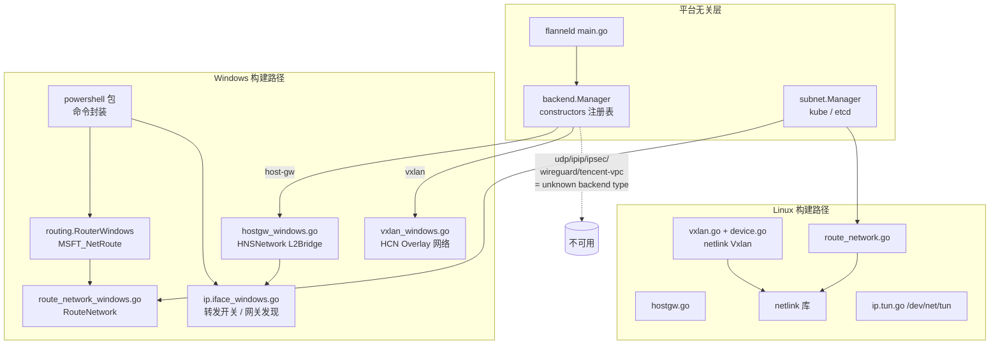
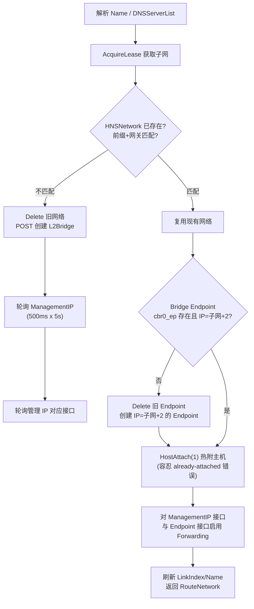
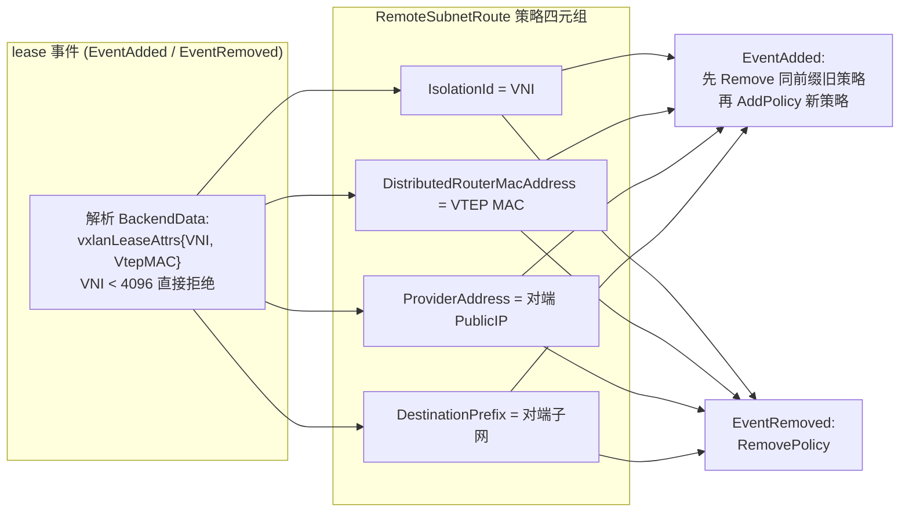

flannel 并非 Linux 专属项目——它维护着一套完整的 Windows 数据面实现。本页面向需要理解或参与 Windows 支持开发的工程师，从源码视角解剖三块基石：**构建期的平台隔离**（Go build tags 双轨制）、**运行期的 PowerShell 集成层**（路由表与接口转发的管控通道），以及**设备层的 HNS/HCN 集成**（host-gw 与 VXLAN 后端的 Windows 形态）。全部论述均以当前仓库源码为据。

## 平台隔离的总设计：build tags 双轨制

flannel 的跨平台策略是**文件级双轨**：同一包内，Linux 实现文件以 `//go:build !windows` 排除自身，Windows 实现文件以 `//go:build windows`（或依赖配对文件的排他性而省略标签）登场，二者通过同名类型实现"编译期多态"。以 `pkg/backend/vxlan` 为例，Linux 侧的 `vxlan.go`、`device.go`、`vxlan_network.go` 均标注 `!windows`，Windows 侧的 `vxlan_windows.go`、`device_windows.go`、`vxlan_network_windows.go` 则提供同名的 `VXLANBackend`、`vxlanDevice`、`newNetwork` 符号——两个世界共享包名与 API 形状，但底层机制完全分叉。

Sources: [vxlan.go](pkg/backend/vxlan/vxlan.go#L14-L15), [device.go](pkg/backend/vxlan/device.go#L1-L2), [vxlan_network.go](pkg/backend/vxlan/vxlan_network.go#L14-L15), [device_windows.go](pkg/backend/vxlan/device_windows.go#L14-L15)

这套机制最精妙的一处在 `hostgw` 包：Linux 版 `hostgw.go` 标注 `//go:build !windows && !windows`（条件重复，但语义不变），Windows 版 `hostgw_windows.go` **不带任何 build tag**，依靠配对文件的排他性完成互斥。`backend.RouteNetwork` 同理——`route_network.go` 带 `!windows`，`route_network_windows.go` 不带，两个同名 `RouteNetwork` 类型在不同平台各自编译。

Sources: [hostgw.go](pkg/backend/hostgw/hostgw.go#L1-L2), [hostgw_windows.go](pkg/backend/hostgw/hostgw_windows.go#L15-L16), [route_network.go](pkg/backend/route_network.go#L1-L2), [route_network_windows.go](pkg/backend/route_network_windows.go#L15-L16)

**空 stub 文件**是另一个值得注意的模式：`udp_windows.go`、`ipip_windows.go`、`ipsec_windows.go`、`tencentvpc_windows.go`、`wireguard_windows.go` 这些文件只包含 package 声明，不含任何 `init()`。由于后端注册依赖 `init()` 调用 `backend.Register()` 填充 `constructors` 映射，这些 stub 使对应后端在 Windows 构建中"从未存在"——运行时若配置了这些后端，`GetBackend` 会直接返回 `unknown backend type` 错误。换言之，**Windows 上只有 `vxlan`、`host-gw` 与 `alloc` 三种后端可用**。

Sources: [udp_windows.go](pkg/backend/udp/udp_windows.go#L14-L16), [ipip_windows.go](pkg/backend/ipip/ipip_windows.go#L14-L17), [wireguard_windows.go](pkg/backend/wireguard/wireguard_windows.go#L1-L17), [ipsec_windows.go](pkg/backend/ipsec/ipsec_windows.go#L14-L16), [manager.go](pkg/backend/manager.go#L26-L64)

整体架构如下：



## PowerShell 集成层：Windows 管控的统一出口

`pkg/powershell` 是 Windows 支持的最底层积木——flannel 不直接调用 Win32 API，而是通过 `powershell.exe` 子进程执行 PowerShell Cmdlet。入口是三个封装函数，全部基于同一个**命令包装器**：

```go
$ErrorActionPreference="Stop";try { %s } catch { Write-Host $_; os.Exit(-1) }
```

这个包装器解决了一个关键工程问题：PowerShell cmdlet 失败时默认不抛异常、进程退出码也不可靠。包装器将 `$ErrorActionPreference` 设为 `Stop` 强制任何错误进入 catch 分支，把异常写回 stdout 并以 `-1` 退出——Go 侧 `cmd.Output()` 捕获 stdout 后即可拼出含上下文的错误消息。

Sources: [powershell.go](pkg/powershell/powershell.go#L28-L48)

| 函数 | 签名要点 | 用途 |
|---|---|---|
| `RunCommand` | 返回 `[]byte` + error | 执行任意 cmdlet，捕获异常为 error |
| `RunCommandf` | `fmt.Sprintf` 风格参数 | 格式化拼装命令后委托 `RunCommand` |
| `RunCommandWithJsonResult` | `ConvertTo-Json` 包装 + `json.Unmarshal` | 把 cmdlet 结果反序列化为 Go 结构体 |

Sources: [powershell.go](pkg/powershell/powershell.go#L34-L78)

`RunCommandWithJsonResult` 有一个文档化的调用约定：调用方须用 `@(<cmd>)` 包裹命令以确保 JSON 输出是数组——这正是 `routing.RouterWindows` 中 `@(Get-NetRoute | ...)` 写法的由来。启动参数 `-NoLogo -NoProfile -NonInteractive` 保证子进程输出可预测、无配置文件干扰。

Sources: [powershell.go](pkg/powershell/powershell.go#L57-L63), [router_windows.go](pkg/routing/router_windows.go#L31-L37)

## 路由抽象：Router 接口与 MSFT_NetRoute 实现

`pkg/routing` 定义了平台无关的路由管理契约——`Router` 接口的四个方法覆盖路由全生命周期：枚举（`GetAllRoutes`）、定向查询（`GetRoutesFromInterfaceToSubnet`）、创建（`CreateRoute`）、删除（`DeleteRoute`），`Route` 结构体以"接口索引 + 目标网段 + 网关"三元组描述一条路由，`Equal` 方法用于幂等性判定。

Sources: [router.go](pkg/routing/router.go#L22-L46)

Windows 实现完全落在 PowerShell 的 NetRoute Cmdlet 家族上：查询走 `Get-NetRoute`（可带 `-InterfaceIndex`/`-DestinationPrefix` 过滤），创建走 `New-NetRoute`，删除走 `Remove-NetRoute -Confirm:$false`。查询结果经 `Select-Object -Property IfIndex,DestinationPrefix,NextHop` 投影后由 `RunCommandWithJsonResult` 反序列化为 `winNetRoute` 切片，再逐条 `net.ParseCIDR`/`net.ParseIP` 转换——解析失败的条目被静默跳过，保证部分脏数据不致阻断整表读取。

Sources: [router_windows.go](pkg/routing/router_windows.go#L27-L85)

| 操作 | Windows（RouterWindows） | Linux（route_network.go 内联） |
|---|---|---|
| 枚举路由 | `Get-NetRoute` + JSON 解析 | `netlink.RouteListFiltered` |
| 创建路由 | `New-NetRoute -InterfaceIndex … -DestinationPrefix … -NextHop …` | `netlink.RouteAdd` |
| 删除路由 | `Remove-NetRoute … -Confirm:$false` | `netlink.RouteDel` |
| 幂等判定 | `Route.Equal`（网段 IP + 掩码字节 + 网关） | `routeEqual` |

Sources: [router_windows.go](pkg/routing/router_windows.go#L31-L47), [route_network.go](pkg/backend/route_network.go#L142-L175)

这套接口的抽象价值在测试中体现得最直接：`router_windows_test.go` 的 `TestCreateAndRemoveRoute` 在真实 Windows 路由表上做"查→建→验→删→验"的全链路断言，属于只能在 Windows 节点上运行的环境依赖型测试。

Sources: [router_windows_test.go](pkg/routing/router_windows_test.go#L27-L96)

## 接口管理：转发开关、默认网关与平台空缺

`pkg/ip` 包同样双轨。Windows 版提供四个核心能力：**IPv4 地址提取**（走标准库 `iface.Addrs()` 过滤 `To4()`）、**默认网关接口发现**（PowerShell 查询 `DestinationPrefix -eq '0.0.0.0/0'` 的路由取 `ifIndex`）、**按 IP 反查接口**（遍历 `net.Interfaces()` 匹配），以及最重要的**接口转发开关**。

Sources: [iface_windows.go](pkg/ip/iface_windows.go#L29-L114)

转发开关直接对应 Linux 下写 `/proc/sys/net/ipv4/conf/*/forwarding` 的角色：`EnableForwardingForInterface`/`DisableForwardingForInterface` 执行 `Set-NetIPInterface -ifIndex <n> -AddressFamily IPv4 -Forwarding Enabled|Disabled`，`IsForwardingEnabledForInterface` 则以 JSON 结果中 `Forwarding == 1` 判定状态。文档明确标注该操作**需要管理员权限**，否则返回 Access Denied。host-gw 后端正是靠它打通 Windows 主机路由（详见下节第 7 步）。

Sources: [iface_windows.go](pkg/ip/iface_windows.go#L116-L153), [hostgw_windows.go](pkg/backend/hostgw/hostgw_windows.go#L246-L269)

同时必须注意 Windows 版的**能力空缺**：`GetInterfaceByIP6`、`GetInterfaceIP6Addrs`、`GetInterfaceBySpecificIPRouting`、`GetDefaultV6GatewayInterface`、`AddBlackholeV4Route`、`AddBlackholeV6Route` 六个函数全是返回 nil 的空实现——这解释了为何 IPv6-only 特性（如 `iface-can-reach`）在 Windows 上不可用（见下文流量管理一节）。对应的接口测试 `iface_windows_test.go` 覆盖了网关发现、按 IP 反查与转发开关的启用-复位闭环。

Sources: [iface_windows.go](pkg/ip/iface_windows.go#L155-L160), [iface_windows_test.go](pkg/ip/iface_windows_test.go#L24-L86)

## host-gw 的 Windows 形态：HNSNetwork 与 Bridge Endpoint

Linux 版 host-gw 只做一件事：往内核路由表里塞 `netlink.Route`。Windows 版则复杂得多——它必须构建 **HNS（Host Networking Service）网络拓扑**。注册流程共七步，每步都体现"幂等重建"哲学：

Sources: [hostgw_windows.go](pkg/backend/hostgw/hostgw_windows.go#L58-L107)

1. **解析配置**：Windows 特有 `Name`（默认 `cbr0`）与 `DNSServerList` 两个 JSON 配置项；
2. **获取租约**：与 Linux 一致走 `subnetMgr.AcquireLease`；
3. **检查既有网络**：按名称查 `hcsshim.GetHNSNetworkByName`，若其子网前缀与网关（子网 IP+1）均匹配预期则复用；
4. **创建 L2Bridge 网络**：不匹配则**先删后建**（`Type: "L2Bridge"`），随后轮询等待 HNS 分配 `ManagementIP`（500ms 间隔、5s 超时）；
5. **等待管理接口出现**：以 `ip.GetInterfaceByIP` 轮询确认 ManagementIP 对应的物理接口已就绪；
6. **创建 Bridge Endpoint**：名为 `<cbr0>_ep`、IP 固定为子网 IP+2（即 Pod 侧网关），并 `HostAttach(1)` 热附到主机网络 compartment——这里有一段针对性容错：hcsshim 对"已附加"错误缺乏校验，代码以错误消息 `"This endpoint is already attached to the switch."` 判定成功（注释引用 issue #1391）；
7. **启用转发**：对 ManagementIP 接口与 Bridge Endpoint 接口分别调用 `ip.EnableForwardingForInterface`，同时以 ManagementIP 接口**刷新 `n.LinkIndex` 与 `n.Name`**——因为新建 HNS 网络会改变接口的名字与索引。

Sources: [hostgw_windows.go](pkg/backend/hostgw/hostgw_windows.go#L109-L271)



此流程产出的 `RouteNetwork` 复用通用的 Windows 路由事件循环（见下文），其 `GetRoute` 回调返回 `routing.Route`（Windows 路由抽象），而非 Linux 版的 `netlink.Route`——这是两个 `RouteNetwork` 类型最直观的类型学分叉。

Sources: [hostgw_windows.go](pkg/backend/hostgw/hostgw_windows.go#L74-L89), [hostgw.go](pkg/backend/hostgw/hostgw.go#L53-L88)

## VXLAN 的 Windows 形态：Overlay 网络与 RemoteSubnetRoute 策略

Windows VXLAN 走的是 hcn（Host Compute Network，HNS 的下一代 API）路径，配置面有三个硬性约束，违反即启动失败：**VNI 必须 ≥ 4096**（Windows 保留低值段）、**端口必须为 4789**、**DirectRouting 与 GBP 均不支持**。此外 Windows 特有 `MacPrefix`（默认 `0E-2A`，格式 `xx-xx`）与 `Name`（默认 `flannel.<VNI>`）配置项，且创建前会调用 `hcn.RemoteSubnetSupported()` 探测平台是否具备远程子网路由能力。

Sources: [vxlan_windows.go](pkg/backend/vxlan/vxlan_windows.go#L87-L129), [backends.md](Documentation/backends.md#L22-L29)

| 配置项 | Windows 约束 | Linux 默认行为 |
|---|---|---|
| `VNI` | 必须 ≥ 4096（默认 4096） | 默认 1，任意值 |
| `Port` | 必须省略或为 4789 | 默认内核默认值 8472 |
| `GBP` / `DirectRouting` / `Learning` | GBP/DirectRouting 报错拒绝；Learning 不适用 | 均可启用 |
| `MacPrefix` | Windows 专属，默认 `0E-2A` | 不适用 |
| `Name` | Windows 专属，默认 `flannel.<VNI>` | 不适用（设备名 flannel.1） |
| `MTU` | 自动取物理接口 MTU − 50 字节封装开销 | 可显式配置 |

Sources: [vxlan_windows.go](pkg/backend/vxlan/vxlan_windows.go#L87-L127), [vxlan_network_windows.go](pkg/backend/vxlan/vxlan_network_windows.go#L43-L45)

设备创建（`newVXLANDevice`）不再是 Linux 那样创建一个 `netlink.Vxlan` 链路，而是声明一个 `Type: "Overlay"` 的 `hcn.HostComputeNetwork`：子网以静态 IPAM 描述，路由 0.0.0.0/0 指向子网网关；`VSID` 策略承载 VNI（Windows 对 VXLAN 段标识的称呼）；`NetAdapterName` 策略把 overlay 绑定到物理网卡；`EnableNonPersistent` 标记网络为非持久化（随主机重启消失，由 flannel 重建）。

Sources: [device_windows.go](pkg/backend/vxlan/device_windows.go#L32-L102), [vxlan.go](pkg/backend/vxlan/device.go#L49-L60)

`ensureNetwork` 延续 host-gw 的幂等重建模式（存在且前缀一致则复用，否则删除重建），但追加了两项 Windows 专属处理：其一是为网络追加 **HostRoute 策略**以打通"本地主机 → 本地 Pod"路径，失败时降级为日志告警（注释指明该策略要求 Windows 18321.1000.19h1 或更新版本）；其二是 `checkHostNetworkReady`——以 5 秒间隔、45 秒超时轮询，确认 ProviderAddress（管理 IP）对应的物理接口已就绪，**这一步刻意安排在联系租约服务器之前**，避免网络未就绪时向 kube-api 发起注定失败的请求。

Sources: [device_windows.go](pkg/backend/vxlan/device_windows.go#L104-L181), [device_windows.go](pkg/backend/vxlan/device_windows.go#L230-L253), [vxlan_windows.go](pkg/backend/vxlan/vxlan_windows.go#L194-L198)

运行期数据面的核心差异在于表项模型。`vxlan_windows.go` 顶部的注释点明本质：**Windows overlay 的解封装工作在 L2，且不暴露 L3Miss 回调接口**，因此所有远程 IP/MAC 对必须预先静态配置。Linux 的"1 路由 + 1 ARP + 1 FDB"三元组在 Windows 上坍缩为**每远程子网一条 RemoteSubnetRoute 网络策略**：

Sources: [vxlan_windows.go](pkg/backend/vxlan/vxlan_windows.go#L17-L26)



事件处理对 `EventAdded` 做了"先删同前缀旧策略、再加新策略"的替换语义，且仅当 `DistributedRouterMacAddress` 非空时才下发——DR MAC 的来源是注册流程中对 HNS 网络策略的回读（`DrMacAddress` 类型策略），解析后二次调用 `AcquireLease` 将含 VTEP MAC 的租约属性写回后端存储，供对端节点构建自己的 RemoteSubnetRoute。`hardwareAddr` 类型（对 `net.HardwareAddr` 的 JSON 可序列化包装）即为此服务。

Sources: [vxlan_network_windows.go](pkg/backend/vxlan/vxlan_network_windows.go#L90-L168), [vxlan_windows.go](pkg/backend/vxlan/vxlan_windows.go#L167-L206), [vxlan_windows.go](pkg/backend/vxlan/vxlan_windows.go#L208-L229)

## 路由事件循环与自愈检查：Windows 版 RouteNetwork

host-gw（Windows）的运行期完全由 `route_network_windows.go` 驱动，其骨架与 Linux 版同构：`Run` 启动 `subnet.WatchLeases` 订阅租约事件，同时拉起独立的 `routeCheck` 协程。Windows 版 `handleSubnetEvents` 的事件处理语义比 Linux 更谨慎——每次 `EventAdded` 前**先查询**该接口到目标网段的既有路由：完全一致则跳过（幂等），网关不同则记警告后先删后建（替换），不存在才直接创建。

Sources: [route_network_windows.go](pkg/backend/route_network_windows.go#L48-L142), [route_network.go](pkg/backend/route_network.go#L83-L140)

自愈机制 `routeCheck` 每 10 秒（`routeCheckRetries = 10`）执行一次 `checkSubnetExistInRoutes`：`GetAllRoutes` 拉取全表，遍历本机维护的期望路由列表，缺失者立即重建——对抗 HNS 网络重建、手工清理等导致的路由漂移。这一点上两个平台语义一致，但 Linux 版在 `routeAdd` 中以 `netlink.RouteListFiltered` 做三段式"查-比-建"，Windows 版则把判定逻辑前移到了 `handleSubnetEvents` 与 `checkSubnetExistInRoutes` 两处。

Sources: [route_network_windows.go](pkg/backend/route_network_windows.go#L163-L200), [route_network.go](pkg/backend/route_network.go#L142-L175)

## 流量管理器与平台差异杂项

Windows 上 flannel **不管理任何 masquerade/forward 规则**——iptables 与 nftables 两个流量管理器的 `_windows.go` 变体均为空实现：`Init` 仅打印 `"Starting flannel in windows mode..."`，`SetupAndEnsureMasqRules` 记录一条 `ErrUnimplemented` 警告后直接返回成功，NAT 职责让渡给 HNS/Windows 网络栈。主流程亦配合跳过 Linux 专属检查：`main.go` 仅在 `runtime.GOOS != "windows"` 时校验 `br_netfilter` 的 `/proc/sys/net/bridge/bridge-nf-call-iptables` 存在性。

Sources: [iptables_windows.go](pkg/trafficmngr/iptables/iptables_windows.go#L37-L56), [nftables_windows.go](pkg/trafficmngr/nftables/nftables_windows.go#L30-L50), [main.go](main.go#L288-L302)

三处"小而关键"的平台差异同样值得记录：

| 差异点 | Linux 行为 | Windows 行为 | 源码依据 |
|---|---|---|---|
| `subnet.env` 写入 | `renameio` 原子写（临时文件+重命名） | 回退 `os.WriteFile`（renameio 不支持 Windows 原子语义） | [writefile_windows.go](pkg/subnet/writefile_windows.go#L21-L23) / [writefile_other.go](pkg/subnet/writefile_other.go#L19-L27) |
| `--iface-can-reach` | 经 `GetInterfaceBySpecificIPRouting` 按策略路由选口 | 直接报错 `"ifcanreach is not supported on windows"` | [match.go](pkg/ipmatch/match.go#L202-L209) |
| TUN 设备 | `/dev/net/tun` + ioctl（`OpenTun`） | 整个 `tun.go` 标注 `!windows`，无 TUN 能力 | [tun.go](pkg/ip/tun.go#L14-L66) |

底层依赖方面，Windows 支持以 `github.com/Microsoft/hcsshim`（含 hcn 包）为一级依赖（v0.14.1），与 `vishvananda/netlink` 在 Linux 路径中的地位对等。

Sources: [go.mod](go.mod#L6-L7)

## Windows 能力矩阵与延伸阅读

| 能力 | host-gw (Windows) | VXLAN (Windows) | 说明 |
|---|---|---|---|
| 数据面机制 | HNS L2Bridge + `New-NetRoute` 静态路由 | HCN Overlay + RemoteSubnetRoute 策略 | 两套独立的 Windows 网络栈通道 |
| 路由管理 | `RouterWindows`（PowerShell NetRoute） | HCN 策略 API（无主机路由操作） | VXLAN 事件不触碰主机路由表 |
| 转发启用 | 需要（ManagementIP + Bridge Endpoint 双接口） | 不涉及 | `Set-NetIPInterface -Forwarding` |
| IPv6 | 不支持（接口层空实现） | 不支持 | `GetInterfaceIP6Addrs` 等返回 nil |
| 前置条件 | 管理员权限 | `hcn.RemoteSubnetSupported()` + Win 18321+（HostRoute 可选） | — |
| 可配置项 | `Name`、`DNSServerList` | `Name`、`MacPrefix`、`VNI≥4096`、`Port=4789` | GBP/DirectRouting 拒绝 |

Sources: [hostgw_windows.go](pkg/backend/hostgw/hostgw_windows.go#L58-L271), [vxlan_windows.go](pkg/backend/vxlan/vxlan_windows.go#L87-L206), [iface_windows.go](pkg/ip/iface_windows.go#L155-L160)

掌握本页内容后，建议按以下路径延伸：

- 理解租约事件（`WatchLeases`）如何驱动上述路由与策略更新，参见 [子网租约机制：从全局大网段到主机子网的分配与续约](7-zi-wang-zu-yue-ji-zhi-cong-quan-ju-da-wang-duan-dao-zhu-ji-zi-wang-de-fen-pei-yu-xu-yue)；
- 对比 Linux 侧 VXLAN 的 L2/L3Miss 演进史与静态表项模型，参见 [VXLAN 数据路径演进：从 L2/L3 miss 回调到纯静态表项](9-vxlan-shu-ju-lu-jing-yan-jin-cong-l2-l3-miss-hui-diao-dao-chun-jing-tai-biao-xiang)；
- 了解 `init()` 注册机制为何使空 stub 文件能"关停"后端，参见 [后端插件注册模式：基于 init() 与构造器映射的扩展点设计](8-hou-duan-cha-jian-zhu-ce-mo-shi-ji-yu-init-yu-gou-zao-qi-ying-she-de-kuo-zhan-dian-she-ji)；
- 配置层面的完整参数语义（含 `iface/iface-regex` 在 Windows 上的限制），参见 [命令行参数与环境变量（FLANNELD_）完整参考](14-ming-ling-xing-can-shu-yu-huan-jing-bian-liang-flanneld_-wan-zheng-can-kao) 与 [节点接口选择逻辑与公网 IP 判定（iface/iface-regex/iface-can-reach）](16-jie-dian-jie-kou-xuan-ze-luo-ji-yu-gong-wang-ip-pan-ding-iface-iface-regex-iface-can-reach)。