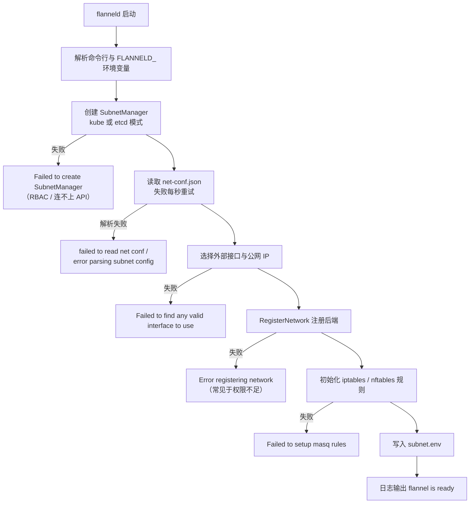
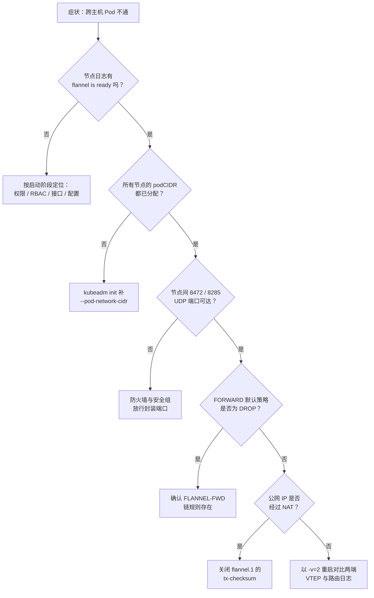

当 flannel 集群出现"Pod 跨主机不通"或"flanneld 反复重启"时，新手最容易陷入的误区是盲目重装。本页把官方排障文档与源码中的真实报错路径对应起来，围绕四个抓手展开：**先看日志、调对级别、分清权限、逐项排查连通性**。读完后，你应当能够把任何一条 flannel 报错日志定位到具体的代码阶段和修复方向。

## 排障总览：把报错映射到启动阶段

flannel 的启动是一条严格的串行流水线：解析参数 → 创建子网管理器 → 读取网络配置 → 选接口 → 注册后端 → 配置流量规则 → 写 subnet.env。**每一个阶段失败时输出的日志关键字都不同**，因此"看到什么日志"直接决定了"该查哪一类问题"。下图标注了每个阶段的典型失败输出：



值得注意的是最后一步的容错设计：只有 subnet.env 写入成功且流量规则就绪，flannel 才会把内部 `isReady` 标志置为 true 并打印 `flannel is ready`；写入失败则仅打印告警 `Failed to write subnet file` 并继续运行，不会中断进程。这意味着**如果你的 `/readyz` 一直返回 503，应优先检查这条告警日志**（就绪探针机制的完整细节见 [healthz 与 readyz：健康检查与就绪探针机制](18-healthz-yu-readyz-jian-kang-jian-cha-yu-jiu-xu-tan-zhen-ji-zhi)）。

Sources: [main.go](main.go#L244-L388), [main.go](main.go#L477-L485), [main.go](main.go#L109-L110)

## 日志从哪里看：三种运行形态

flannel 底层使用 `klog` 库，并且**只支持把日志输出到 stderr**——源码在初始化时强制设置了 `logtostderr=true`，同时把 stderr 的最低严重级阈值固定为 `INFO`，这一设计保证了无论以何种方式运行，日志总能流入 systemd journal 或容器运行时。据此，查看日志的方式取决于你的部署形态：

| 运行形态 | 查看命令 | 说明 |
| --- | --- | --- |
| systemd 服务 | `journalctl -u flanneld` | 日志经 stderr 流入 journald |
| Kubernetes Pod | `kubectl logs --namespace kube-flannel <POD_ID> -c kube-flannel` | 先用 `kubectl get pod --namespace kube-flannel -l app=flannel` 找到 Pod ID |
| 手动前台运行 | 直接观察终端 stderr 输出 | 适合初次调试与复现 |

Sources: [Documentation/troubleshooting.md](Documentation/troubleshooting.md#L11-L25), [main.go](main.go#L143-L162)

## 日志级别：severity 固定，verbosity 可调

初学者常混淆两个概念：**严重级别（severity）** 表示日志的紧急程度（I=Info、W=Warning、E=Error），flannel 不允许修改其输出行为；**详细级别（verbosity）** 则由 `-v` 参数控制，默认为 `0`，调大后会让代码中 `log.V(n)` 标记的日志显现出来。可调的参数共有三个：

| 参数 | 作用 | 典型用法 |
| --- | --- | --- |
| `-v` | 全局 V 日志级别 | `-v=2` 观察路由与后端细节 |
| `-vmodule` | 按文件名模式设置过滤级别，如 `vxlan*=4` | 只放大某个包的日志 |
| `-log_backtrace_at` | 命中 `file:N` 时打印堆栈 | 精确定位某行代码的调用链 |

这三个参数是从 klog "复制"进 flannel 自己的命令行参数集的，因此它们既可以写在命令行上，也可以通过 `FLANNELD_` 前缀的环境变量设置（例如 `FLANNELD_V=2`）——flannel 在解析完命令行后会调用 `flagutil.SetFlagsFromEnv(flannelFlags, "FLANNELD")` 统一从环境变量补齐配置。

调大 `-v` 后具体能多看到什么？源码中有大量分级埋点：`-v=1` 可见 VXLAN 设备已存在并复用旧设备的决策日志；`-v=2` 可见 `Adding direct route to subnet` 这类路由添加细节、iptables 规则清理失败原因以及 kube 模式下获取 Node 失败的细节；`-v=4` 则能深入到 `calling AddFDB` 这种转发表项操作级别。

Sources: [Documentation/troubleshooting.md](Documentation/troubleshooting.md#L11-L21), [main.go](main.go#L164-L167), [main.go](main.go#L223-L226), [pkg/backend/vxlan/device.go](pkg/backend/vxlan/device.go#L75-L85), [pkg/backend/vxlan/vxlan_network.go](pkg/backend/vxlan/vxlan_network.go#L346), [pkg/trafficmngr/iptables/iptables.go](pkg/trafficmngr/iptables/iptables.go#L66-L73), [pkg/subnet/kube/kube.go](pkg/subnet/kube/kube.go#L352-L368)

## 权限类故障：flannel 为什么需要特权

很多后端操作本质上是**内核网络管理操作**：创建 VXLAN 设备、把接口置 UP、写 FDB/ARP 表项、编程路由、修改 iptables——这些都需要 root 或等效的 `CAP_NET_ADMIN` 能力。官方文档列出了四个典型的"权限不足"报错，它们各自对应一条真实的内核调用路径：

| 报错关键字 | 对应的内核操作 | 源码位置 |
| --- | --- | --- |
| `Add L2 failed` / `AddARP failed` / `AddFDB failed` | 写 VXLAN 邻接表（ARP/FDB） | `netlink.NeighSet` |
| `Error adding route...` | 向路由表添加远端子网路由 | netlink route add |
| `Failed to set up IP Masquerade` | 创建/写入 FLANNEL-POSTRTG 等 iptables 链 | iptables chain 操作 |
| `Error registering network: operation not permitted` | RegisterNetwork 阶段的任何特权操作失败 | 后端注册入口 |

以 VXLAN 为例：`ensureLink` 通过 `netlink.LinkAdd` 创建设备，设备已存在时会校验配置兼容性，不兼容则删除重建，任何一步权限不足都会让整条注册链路以 `Error registering network` 收场。设备创建后还要完成地址配置与接口置 UP，同样需要特权。

遇到这类报错的处置很简单：**确认运行 flannel 的用户具备特权**——手动运行时加 `sudo`，以 Pod 运行时确认 DaemonSet 使用了特权 SecurityContext。另一个容易被忽略的权限相邻问题是 `br_netfilter` 内核模块：非 Windows 且未启用 nftables 时，flannel 启动会检查 `/proc/sys/net/bridge/bridge-nf-call-iptables` 是否存在，缺失则直接退出，此时应先加载模块再重启。

Sources: [Documentation/troubleshooting.md](Documentation/troubleshooting.md#L63-L68), [main.go](main.go#L382-L388), [main.go](main.go#L427-L432), [pkg/backend/vxlan/device.go](pkg/backend/vxlan/device.go#L73-L137), [main.go](main.go#L288-L302)

## Kubernetes 中的"权限"：RBAC 与 ServiceAccount

在 Kubernetes 模式下还有第二类权限——**API Server 的 RBAC 授权**。flannel 的 kube subnet manager 启动时需要读取自身 Pod 信息来反查所在节点名，若集群启用了 RBAC 而 flannel 的 ServiceAccount 未绑定角色，你会看到这条经典报错：`Failed to create SubnetManager: error retrieving pod spec for 'kube-system/kube-flannel-ds-xxx': the server does not allow access to the requested resource`。

修复方式是应用官方清单中的 RBAC 资源。理解它要求哪些权限也有助于你自检：源码对应的 ClusterRole 需要对 `pods`、`nodes`、`namespaces` 拥有 `get/list/watch`，并对 `nodes/status` 拥有 `patch`——后者正是 flannel 把后端 VTEP 信息回写到 Node 注解所必需的（Node 注解与 podCIDR 机制的完整分析见 [kube subnet manager：Node 注解、podCIDR 与 informer 机制](19-kube-subnet-manager-node-zhu-jie-podcidr-yu-informer-ji-zhi)）。启用 netpol 时还会追加 networkpolicies 相关权限。

Sources: [Documentation/troubleshooting.md](Documentation/troubleshooting.md#L111), [pkg/subnet/kube/kube.go](pkg/subnet/kube/kube.go#L103-L127), [chart/kube-flannel/templates/rbac.yaml](chart/kube-flannel/templates/rbac.yaml#L1-L29)

## 连通性故障逐项排查

### 场景一：跨主机容器互不通（Docker 1.13+）

Docker 从 v1.13 起把 FORWARD 链默认策略从 `ACCEPT` 改为 `DROP`，这会丢弃所有跨主机的容器转发流量。flannel 对此的对策是**无条件编程 FORWARD 规则**：在 filter 表创建 `FLANNEL-FWD` 链，并向 FORWARD 链插入跳转规则，放行出入整个 flannel 网段的流量，由 `-iptables-forward-rules` 参数控制（默认开启）。排查时在节点上执行 `iptables -L FORWARD` 与 `iptables -L FLANNEL-FWD`，确认规则存在；旧版本 flannel 用户升级即可解决。

Sources: [Documentation/troubleshooting.md](Documentation/troubleshooting.md#L5-L8), [pkg/trafficmngr/iptables/iptables.go](pkg/trafficmngr/iptables/iptables.go#L210-L231), [main.go](main.go#L435-L443)

### 场景二：防火墙未放行封装端口

封装后端依赖特定的 UDP 端口承载跨主机流量，中间任何一跳的防火墙（云安全组、主机 firewalld）都必须放行：

| 后端 | 端口 | 协议 |
| --- | --- | --- |
| `vxlan` | 8472 | UDP（内核收发） |
| `udp` | 8285 | UDP（flanneld 用户态收发） |

同时确认 Pod 网段到 Kubernetes master 的访问未被拦截。注意 `udp` 后端属于实验性实现，性能也显著低于 `vxlan`，后端选型的完整对比见 [性能调优：MTU 计算、后端选型与防火墙端口](26-xing-neng-diao-you-mtu-ji-suan-hou-duan-xuan-xing-yu-fang-huo-qiang-duan-kou)。

Sources: [Documentation/troubleshooting.md](Documentation/troubleshooting.md#L83-L90)

### 场景三：公网 IP 选错——Vagrant 多网卡陷阱

绝大多数后端要求每个节点拥有**唯一的公网 IP**，该地址在 flannel 启动时选定并写进租约——所以公网 IP 变化后必须重启 flannel，租约机制详见 [子网租约机制：从全局大网段到主机子网的分配与续约](7-zi-wang-zu-yue-ji-zhi-cong-quan-ju-da-wang-duan-dao-zhu-ji-zi-wang-de-fen-pei-yu-xu-yue)。判断 flannel 实际选了哪个接口，最直接的方法就是看启动日志：

```text
I0629 14:28:35.866793    5522 main.go:386] Determining IP address of default interface
I0629 14:28:35.866987    5522 main.go:399] Using interface with name enp62s0u1u2 and address 172.24.17.174
I0629 14:28:35.867000    5522 main.go:412] Using 10.10.10.10 as external address
```

这三行在当前源码中分别对应"探测默认路由接口""输出选定接口与地址""输出外部地址"。Vagrant 虚机的典型问题是给所有虚拟机的第一块网卡分配了相同的 NAT 地址 `10.0.2.15`，导致**所有节点以相同公网 IP 注册**、路由互相覆盖——解决办法是用 `--iface=eth1` 显式指定第二块网卡。接口选择的完整判定规则（含 `iface-regex` 与 `iface-can-reach`）见 [节点接口选择逻辑与公网 IP 判定（iface/iface-regex/iface-can-reach）](16-jie-dian-jie-kou-xuan-ze-luo-ji-yu-gong-wang-ip-pan-ding-iface-iface-regex-iface-can-reach)。

Sources: [Documentation/troubleshooting.md](Documentation/troubleshooting.md#L27-L40), [pkg/ipmatch/match.go](pkg/ipmatch/match.go#L210-L234), [pkg/ipmatch/match.go](pkg/ipmatch/match.go#L268-L293)

### 场景四：NAT 后 VXLAN 校验和损坏

当公网 IP 位于 NAT 之后时，VXLAN 报文的 UDP 校验和字段可能在转换中被破坏，表现为**部分跨主机流量神秘丢包**。官方解法是关闭 VXLAN 设备的发送端校验和计算：`/usr/sbin/ethtool -K flannel.1 tx-checksum-ip-generic off`；如需持久化，可创建 udev 规则 `/etc/udev/rules.d/90-flannel.rules` 在设备出现时自动执行该命令。

Sources: [Documentation/troubleshooting.md](Documentation/troubleshooting.md#L42-L54)

### 场景五：节点 podCIDR 未分配

kube 模式下 flannel 依赖每个 Node 对象已带 `podCIDR`，注册租约时若发现为空，会直接报 `node "<NODE_NAME>" pod cidr not assigned` 并失败。先用 `kubectl get nodes -o jsonpath='{.items[*].spec.podCIDR}'` 检查；若为空，kubeadm 集群在 `kubeadm init` 时传入 `--pod-network-cidr=10.244.0.0/16` 即可自动分配，非 kubeadm 环境可给 kubelet 配 `--pod-cidr` 或给 controller-manager 配 `--allocate-node-cidrs=true --cluster-cidr=<cidr>`。手动 `kubectl patch` 设置 podCIDR 虽然可行，但必须保证各节点子网不重叠，一般不推荐。

Sources: [Documentation/troubleshooting.md](Documentation/troubleshooting.md#L92-L104), [pkg/subnet/kube/kube.go](pkg/subnet/kube/kube.go#L350-L379)

## 常见错误信息速查表

下表把散落在各模块的高频日志串成一张"症状 → 病因 → 处方"的对照表，建议收藏备用：

| 日志关键字 | 根本原因 | 处置方向 |
| --- | --- | --- |
| `failed to read net conf` | 读不到 `/etc/kube-flannel/net-conf.json`（ConfigMap 未挂载） | 检查 kube-flannel-cfg ConfigMap 与挂载 |
| `error parsing subnet config` | net conf 不是合法 JSON | 校验配置内容 |
| `Couldn't fetch network config`（每秒重复） | 数据存储暂时不可达 | 等待自动重试，或检查 etcd / API 连通性 |
| `Failed to create SubnetManager: ... does not allow access` | RBAC 未授权 | 应用 flannel 的 RBAC 清单 |
| `env variables POD_NAME and POD_NAMESPACE must be set` | Pod 外运行 kube 模式缺少环境变量 | 设置 `NODE_NAME` 环境变量替代 |
| `Failed to find any valid interface to use` | 找不到默认路由接口 | 指定 `--iface` / `--public-ip` |
| `could not match pattern ... to any of the available network interfaces` | `--iface-regex` 无匹配 | 核对正则与实际接口名 |
| `Error registering network: operation not permitted` | 缺少 root / CAP_NET_ADMIN | 提权或使用特权容器 |
| `Failed to setup IPTables. iptables binary was not found` | 主机未安装 iptables | 安装 iptables 或改用 nftables 模式 |
| `no nftables support` / `nftables: couldn't initialise table` | 内核或工具不支持 nftables | 退回 iptables 模式 |
| `Error renewing lease (trying again in 1 min)` | 租约续期失败（可自动恢复） | 检查数据存储稳定性 |
| `Failed to write subnet file` | subnet.env 写入失败（仅告警不退出） | 检查挂载点与目录权限 |

其中"续期失败"值得多说一句：租约监控循环在续期出错时会打印该日志并在 1 分钟后重试，期间**不影响既有数据面流量**，只有租约被撤销才会触发整体关停，因此它通常只是数据存储短暂抖动的信号。而网络配置获取失败同样是可恢复的——主流程会每秒重试直到成功或收到退出信号。

Sources: [Documentation/troubleshooting.md](Documentation/troubleshooting.md#L106-L111), [pkg/subnet/kube/kube.go](pkg/subnet/kube/kube.go#L103-L126), [pkg/ipmatch/match.go](pkg/ipmatch/match.go#L199-L201), [pkg/trafficmngr/iptables/iptables.go](pkg/trafficmngr/iptables/iptables.go#L61-L65), [pkg/trafficmngr/nftables/nftables.go](pkg/trafficmngr/nftables/nftables.go#L49-L55), [pkg/subnet/etcd/local_manager.go](pkg/subnet/etcd/local_manager.go#L377-L385), [main.go](main.go#L531-L550), [main.go](main.go#L477-L479)

## 一条通用的排障决策路径

把前面所有场景串起来，就得到一条适合新手的**自上而下决策树**——永远先确认控制面（flannel 活着且 ready），再逐层检查数据面（CIDR、端口、转发策略、NAT）：



## 提交问题前：收集哪些信息

如果自查无果需要向社区报告，请按官方规范准备材料：附上 `flannel --version` 的版本输出、复现步骤，并获取堆栈——对 flannel 进程执行 `kill -QUIT $PID` 可触发带堆栈的退出日志。报告应做到具体、可复现、隔离、不重复、一次一个问题，完整的提交规范见官方文档。

Sources: [Documentation/reporting_bugs.md](Documentation/reporting_bugs.md#L18-L37)

## 延伸阅读

本页聚焦"定位与恢复"，以下相邻主题能帮你把排障能力延伸到预防层面：接口与公网 IP 的完整判定算法见 [节点接口选择逻辑与公网 IP 判定（iface/iface-regex/iface-can-reach）](16-jie-dian-jie-kou-xuan-ze-luo-ji-yu-gong-wang-ip-pan-ding-iface-iface-regex-iface-can-reach)；命令行与 `FLANNELD_` 环境变量的完整参考见 [命令行参数与环境变量（FLANNELD_）完整参考](14-ming-ling-xing-can-shu-yu-huan-jing-bian-liang-flanneld_-wan-zheng-can-kao)；MTU、后端选型与防火墙端口的前瞻性规划见 [性能调优：MTU 计算、后端选型与防火墙端口](26-xing-neng-diao-you-mtu-ji-suan-hou-duan-xuan-xing-yu-fang-huo-qiang-duan-kou)；重启与 subnet.env 持久化的边界语义见 [运行时限制、零停机重启与 subnet.env 持久化语义](27-yun-xing-shi-xian-zhi-ling-ting-ji-zhong-qi-yu-subnet-env-chi-ji-hua-yu-yi)。