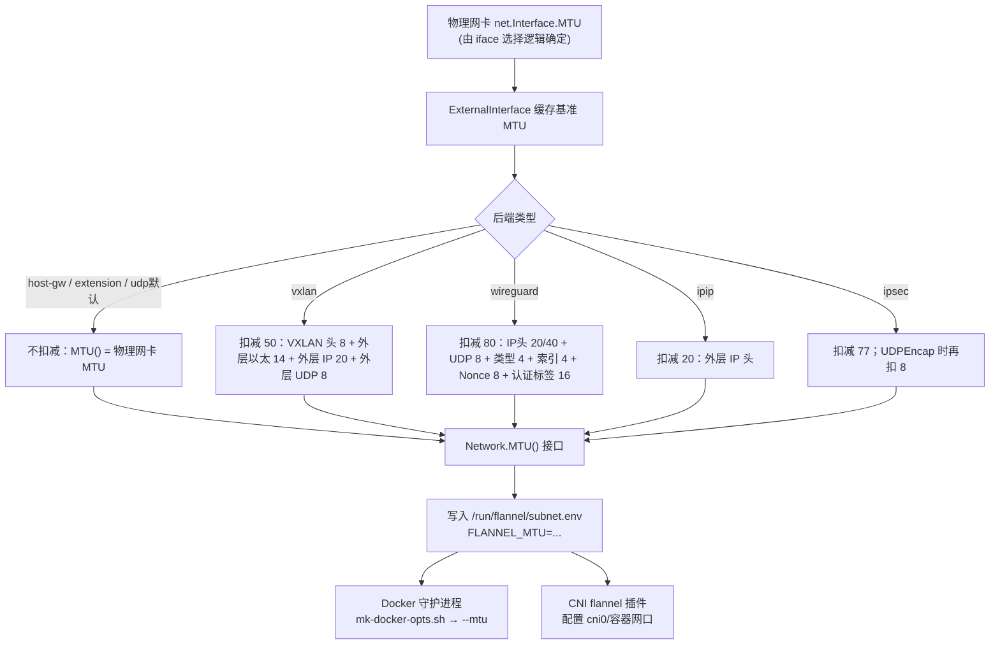
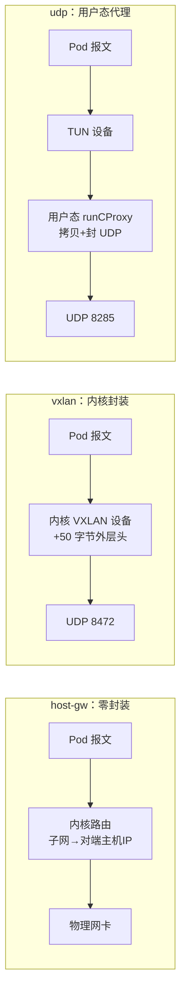
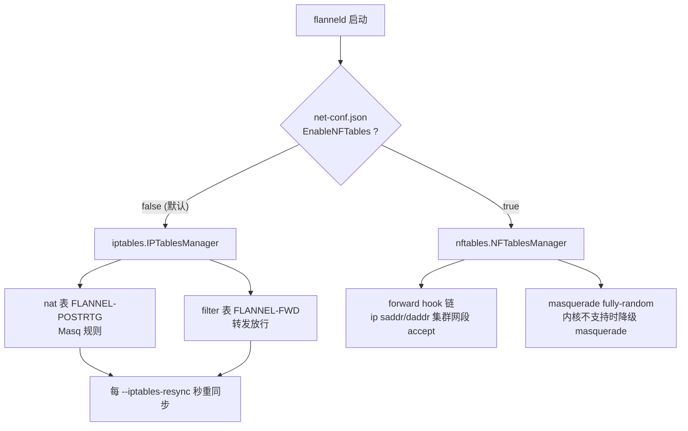

flannel 的数据面性能由三个相互耦合的变量决定：**MTU 的正确性**（决定会不会分片、黑洞与重传）、**后端数据路径**（决定封装开销发生在内核还是用户态）、**防火墙规则与端口**（决定流量能否以最短路径通过节点）。本页从源码出发，给出这三条调优轴的完整证据链：先解析 flannel 如何计算并向下游传递 MTU，再对比各后端的性能权衡与选型约束，最后梳理需要放行的端口以及 flannel 自己会在节点上维护的 iptables/nftables 规则。理解本页内容前，建议先阅读架构总览 [flanneld 架构总览：启动流程与组件协作全解](6-flanneld-jia-gou-zong-lan-qi-dong-liu-cheng-yu-zu-jian-xie-zuo-quan-jie)。

Sources: [Documentation/troubleshooting.md](Documentation/troubleshooting.md#L70-L81)

## 一条 MTU 的旅程：从物理网卡到 subnet.env

flannel 的 MTU 计算是一条"自底向上采集、自顶向下消费"的单向流水线。起点是节点上被选中的外部接口：flannel 在启动时通过接口选择逻辑（`--iface` 等，详见 [节点接口选择逻辑与公网 IP 判定](16-jie-dian-jie-kou-xuan-ze-luo-ji-yu-gong-wang-ip-pan-ding-iface-iface-regex-iface-can-reach)）得到一个 `*net.Interface`，其 `MTU` 字段就是物理网络的基准值，并被装入 `ExternalInterface` 结构缓存后传给各后端。

Sources: [pkg/backend/common.go](pkg/backend/common.go#L26-L48)

后端拿到基准 MTU 后有两种处理方式：一类后端直接透传（host-gw、extension 后端的 `MTU()` 就是原样返回 `ExtIface.Iface.MTU`）；另一类封装型后端会先扣减自己的封装头部开销，用它去创建隧道设备（如 VXLAN 设备以 `MTU-50` 创建、WireGuard 设备以 `MTU-overhead` 创建），同时把"扣减后的有效 MTU"通过 `Network.MTU()` 接口暴露出来。主流程随后调用 `bn.MTU()`，把结果写入 `subnet.env` 的 `FLANNEL_MTU` 字段——写完该文件 flannel 才标记自己 ready，这保证了下游消费者读到的 MTU 一定与数据面设备一致。

Sources: [pkg/backend/vxlan/device.go](pkg/backend/vxlan/device.go#L59-L71), [pkg/backend/wireguard/device.go](pkg/backend/wireguard/device.go#L129-L135), [main.go](main.go#L477-L485), [pkg/subnet/subnet.go](pkg/subnet/subnet.go#L70-L92)

下游消费者只有两种：Docker 守护进程（通过 `mk-docker-opts.sh` 把 `FLANNEL_MTU` 翻译成 `--mtu=$FLANNEL_MTU` 启动参数）和 CNI flannel 插件（读取同一文件为容器网络设备设置 MTU）。官方排障文档明确指出：**MTU 大小对原始带宽有巨大影响，追求最大吞吐应使用支持大 MTU 的底层网络**，而 flannel 正是通过 `subnet.env` 把这一设置传导给 Docker 或 CNI 插件的。

Sources: [dist/mk-docker-opts.sh](dist/mk-docker-opts.sh#L65-L66), [Documentation/troubleshooting.md](Documentation/troubleshooting.md#L78-L81), [Documentation/running.md](Documentation/running.md#L97-L105)

## 各后端的 MTU 扣减公式速查表

下表汇总了全部后端的固定封装开销，均取自源码中的常量或创建设备时的硬编码扣减值。基准值一律是"外部接口 MTU"或用户显式配置的 `Backend.MTU`。

| 后端 | 有效 MTU 公式 | 固定开销 | 开销构成（源码注释） |
|---|---|---|---|
| host-gw | `extIface.MTU` | 0 | 纯路由，无封装 |
| extension | `extIface.MTU` | 0 | 由外部脚本自担 |
| udp | `extIface.MTU − 28` | 28 | 20 字节 IP 头 + 8 字节 UDP 头 |
| vxlan | `Backend.MTU − 50` | 50 | 外层 IP/UDP/以太头 + VXLAN 头 |
| wireguard | `Backend.MTU − 80` | 80 | 见下方逐字节分解 |
| ipip | `extIface.MTU − 20` | 20 | 仅外层 IP 头，开销最低 |
| ipsec | `extIface.MTU − 77`（UDPEncap 时 −85） | 77 / 85 | ESP 头、IV、填充、ICV 等 |

Sources: [pkg/backend/hostgw/hostgw.go](pkg/backend/hostgw/hostgw.go#L53-L62), [pkg/backend/extension/extension_network.go](pkg/backend/extension/extension_network.go#L44-L46), [pkg/backend/udp/udp_network_amd64.go](pkg/backend/udp/udp_network_amd64.go#L35-L37), [pkg/backend/vxlan/device.go](pkg/backend/vxlan/device.go#L59-L71), [pkg/backend/wireguard/wireguard_network.go](pkg/backend/wireguard/wireguard_network.go#L33-L44), [pkg/backend/ipip/ipip.go](pkg/backend/ipip/ipip.go#L178-L183), [pkg/backend/ipsec/ipsec_network.go](pkg/backend/ipsec/ipsec_network.go#L33-L48)

两个值得展开的细节：WireGuard 的 80 字节开销在源码注释中有逐字节分解——20（IPv4）或 40（IPv6）字节外层 IP 头、8 字节 UDP 头、4 字节类型、4 字节 key index、8 字节 nonce、16 字节 Poly1305 认证标签；IPsec 的 77 字节则由隧道模式新 IP 头（20）、SPI（4）、序列号（4）、AES IV（16）、填充（0–15）、Pad 长度与 Next Header（各 1）、SHA-256 ICV（16）构成，启用 `UDPEncap`（NAT 穿透）时再叠加 8 字节 UDP 头。这两个加密后端的开销差意味着：同样是加密网络，WireGuard 每包比 IPsec 少占用约 3–11 字节有效载荷。

Sources: [pkg/backend/wireguard/wireguard_network.go](pkg/backend/wireguard/wireguard_network.go#L33-L44), [pkg/backend/ipsec/ipsec_network.go](pkg/backend/ipsec/ipsec_network.go#L34-L45)

VXLAN 是唯一允许通过配置覆盖默认 MTU 的推荐后端：`Backend` 段的 `MTU`（数字）指定"对外发送报文的期望 MTU"，未定义时取外部接口 MTU，且**仅 Linux 支持**该覆盖项；WireGuard 也提供同名选项，未定义时同样回退到外部接口 MTU。若外部接口 MTU 本身过小（例如 IPIP 模式下扣减后 ≤ 0），flannel 会直接拒绝启动并报 "MTU %d of iface %s is too small" 错误，这是一种防御性校验而非可调参数。

Sources: [Documentation/backends.md](Documentation/backends.md#L27), [Documentation/backends.md](Documentation/backends.md#L54), [pkg/backend/ipip/ipip.go](pkg/backend/ipip/ipip.go#L180-L183), [pkg/backend/vxlan/vxlan.go](pkg/backend/vxlan/vxlan.go#L159-L180)

## 动手调优 MTU

调 MTU 的标准操作路径有三步。**第一步**确认物理网络的真实上限：若底层网络支持巨型帧（如 MTU 9000），在 net-conf.json 的 `Backend` 段显式写 `"MTU": 8950`（VXLAN）或 `"MTU": 8920`（WireGuard），flannel 会以该值为基准创建设备并计算 `FLANNEL_MTU`；若底层是标准 1500，则无需配置，默认扣减值（如 VXLAN 1450）已经写进 `subnet.env`，文档示例中可见 `FLANNEL_MTU=1450` 正是 1500 − 50 的结果。

Sources: [Documentation/backends.md](Documentation/backends.md#L27), [Documentation/running.md](Documentation/running.md#L42-L48)

**第二步**让全集群生效：`FLANNEL_MTU` 是每台主机各自计算的，Docker 模式下由 `mk-docker-opts.sh` 生成 `--mtu` 参数传给守护进程，CNI 模式下由插件读取，因此只要所有节点的外部接口 MTU 一致，Pod 网络 MTU 就自动一致；混合 MTU 集群（例如部分节点走巨型帧专线）必须显式统一 `Backend.MTU`，否则跨节点大包会在路径最窄处被丢弃。**第三步**验证：直接 `cat /run/flannel/subnet.env` 核对 `FLANNEL_MTU`，再对比 VXLAN 设备（如 `flannel.1`）的实际 MTU 是否等于配置值减 50。

Sources: [dist/mk-docker-opts.sh](dist/mk-docker-opts.sh#L65-L66), [Documentation/troubleshooting.md](Documentation/troubleshooting.md#L78-L81)

常见 MTU 相关症状的定位思路如下表——核心判据是"小包通、大包断"：

| 症状 | 根因机制 | 处置方向 |
|---|---|---|
| 小包 ping 通、大传输/镜像拉取挂起 | 有效 MTU 大于路径最小 MTU，外层封装后超限且被静默丢弃 | 核对各节点 `FLANNEL_MTU` 与物理网卡 MTU，调低 `Backend.MTU` |
| 跨节点 TCP 吞吐远低于同节点 | 分片导致的 CPU 开销与重传 | 消除分片（正确 MTU）或改用开销更低的后端 |
| 云环境中 host-gw 起不来或 PublicIP 校验失败 | host-gw 要求外部接口 IP 与 PublicIP 相同（非 NAT） | 改用 vxlan 或更换 iface 选择（见接口选择页） |
| `subnet.env` 中 MTU 与预期不符 | 默认值来自外部接口而非配置 | 检查接口选择结果，或显式配置 `Backend.MTU` |

Sources: [Documentation/troubleshooting.md](Documentation/troubleshooting.md#L75-L81), [pkg/backend/hostgw/hostgw.go](pkg/backend/hostgw/hostgw.go#L41-L44)

## 后端选型：数据面性能的三档位

官方对推荐后端的表态非常明确：**VXLAN 是默认推荐**；host-gw 推荐给"想要性能提升、且基础设施支持"的有经验用户（典型云环境用不了）；UDP 只用于调试或极老内核。排障文档进一步量化了选型原则——若必须封装，vxlan 恒优于 udp；**追求极致数据面性能则应完全避免封装**。这三句话构成了选型决策的全部公理。

Sources: [Documentation/backends.md](Documentation/backends.md#L3-L5), [Documentation/troubleshooting.md](Documentation/troubleshooting.md#L78-L79)

从实现机制看，各后端的数据路径分为三档：**零封装档**的 host-gw 只往内核路由表写"目的子网 → 对端主机 IP"的条目（`RouteNetwork.GetRoute`），报文按普通三层转发，因此 MTU 无扣减、CPU 零封装开销，但前提是所有主机处于同一二层域，且节点 PublicIP 必须等于所选接口 IP（否则判定为 NAT 环境直接拒绝）；**内核封装档**的 vxlan/ipip/wireguard 封装与解封都发生在内核，VXLAN 每个远端主机只需维护 1 条路由 + 1 条静态 ARP + 1 条 FDB 表项（与主机数线性相关），WireGuard 在此之上叠加内核态加密；**用户态档**的 udp 后端则要把每个报文从 TUN 设备拷贝到用户态 C 代理（`runCProxy`）再通过 UDP socket 发出，这是它"仅用于调试"的根源。

Sources: [pkg/backend/hostgw/hostgw.go](pkg/backend/hostgw/hostgw.go#L41-L51), [pkg/backend/vxlan/vxlan.go](pkg/backend/vxlan/vxlan.go#L44-L54), [pkg/backend/udp/udp_network_amd64.go](pkg/backend/udp/udp_network_amd64.go#L105-L109), [Documentation/backends.md](Documentation/backends.md#L36-L43)

加密需求会把选型约束进一步收窄。WireGuard 是内核态实现（内核 ≥ 5.6 原生支持，更老内核需安装包），加密开销与 80 字节头共存，接口名固定为 `flannel-wg` / `flannel-wg-v6`，可用 `wg show` 调试；IPsec 实验性后端依赖用户态 Strongswan 作为 IKEv2 守护进程（数据面仍在内核 XFRM），配置更繁琐、开销常量也更大；IPIP 是开销最低的封装后端，但只能承载 IPv4 单播。各后端横向对比如下：

| 后端 | 封装开销/包 | 加密 | 数据面位置 | 关键约束 | 官方推荐度 |
|---|---|---|---|---|---|
| host-gw | 0 | 无 | 内核路由 | 需二层直连、非 NAT | 推荐（进阶） |
| vxlan | 50 | 无 | 内核 | 云环境友好，Windows 强制 4789 端口 | 默认推荐 |
| wireguard | 80 | ChaCha20 | 内核 | 内核 ≥ 5.6；密钥落盘 `/run/flannel/wgkey` | 推荐（需加密时） |
| ipip | 20 | 无 | 内核 | 仅 IPv4 单播 | 实验性 |
| ipsec | 77（+8 NAT） | ESP | 内核 XFRM + 用户态 IKE | 需 Strongswan | 实验性 |
| udp | 28 | 无 | **用户态代理** | 仅调试 | 不推荐生产 |

Sources: [Documentation/backends.md](Documentation/backends.md#L45-L68), [Documentation/backends.md](Documentation/backends.md#L106-L119), [Documentation/backends.md](Documentation/backends.md#L121-L134), [pkg/backend/wireguard/device.go](pkg/backend/wireguard/device.go#L83-L88)

一个常被忽视的混合档位是 **DirectRouting**：vxlan 与 ipip 后端均支持 `DirectRouting: true`，同一子网内的主机之间直接下发 host-gw 式路由（IPIP 的 `GetRoute` 会在判定可直连时把路由指向外部接口而非隧道设备），仅跨子网流量才走封装。这相当于自动获得"二层内零开销、跨二层走 VXLAN"的自适应路径，是云下同可用区、云上同子网部署时性价比最高的折中。

Sources: [Documentation/backends.md](Documentation/backends.md#L25), [pkg/backend/ipip/ipip.go](pkg/backend/ipip/ipip.go#L109-L120), [Documentation/backends.md](Documentation/backends.md#L114)

更完整的维度对比（VNI/端口/密钥等配置项级别）见 [推荐后端对比：VXLAN、host-gw 与 WireGuard 选型](10-tui-jian-hou-duan-dui-bi-vxlan-host-gw-yu-wireguard-xuan-xing) 与 [加密与实验性后端：IPsec、IPIP、UDP 与腾讯云 VPC](11-jia-mi-yu-shi-yan-xing-hou-duan-ipsec-ipip-udp-yu-teng-xun-yun-vpc)。

Sources: [Documentation/backends.md](Documentation/backends.md#L14-L30)

## 防火墙端口规划：按后端放行

节点间防火墙只需按"所选后端"放行对应端口，全部为 UDP（IPsec 额外含一个 IP 协议号）。官方要求**所有参与 overlay 的主机都要放行**，且 Pod 网段到 master 的流量也应放行：

| 后端 | 端口/协议 | 默认值来源 | 可配置性 |
|---|---|---|---|
| udp | UDP 8285 | 源码常量 `defaultPort` | `Backend.Port` 可改 |
| vxlan（Linux） | UDP 8472 | 内核默认端口 | `Backend.Port` 可改 |
| vxlan（Windows） | UDP 4789 | 源码常量 `vxlanPort` | **不可改，强制** |
| wireguard | UDP 51820（IPv4）/ 51821（IPv6） | 配置默认值 | `ListenPort` / `ListenPortV6` 可改 |
| ipsec | IP 协议 50（ESP）+ UDP 500（IKE）+ UDP 4500（NAT-T） | 官方文档端口提示 | `UDPEncap` 决定是否需要 4500 |

Sources: [pkg/backend/udp/udp_amd64.go](pkg/backend/udp/udp_amd64.go#L35-L37), [Documentation/backends.md](Documentation/backends.md#L23), [pkg/backend/vxlan/vxlan_windows.go](pkg/backend/vxlan/vxlan_windows.go#L47-L50), [Documentation/backends.md](Documentation/backends.md#L52-L53), [Documentation/backends.md](Documentation/backends.md#L134), [Documentation/troubleshooting.md](Documentation/troubleshooting.md#L83-L90)

值得注意的一个实现细节：Linux 上 VXLAN 的 `Port` 配置项在 Go 结构体里没有默认值（零值为 0），传给内核的 `netlink.Vxlan.Port` 为 0 时由内核使用默认端口 8472——这正是文档表述"defaults to kernel default, currently 8472"的原因；而 Windows 构建则把 4789 写死为常量，配置不生效。

Sources: [pkg/backend/vxlan/vxlan.go](pkg/backend/vxlan/vxlan.go#L159-L180), [pkg/backend/vxlan/device.go](pkg/backend/vxlan/device.go#L59-L71), [pkg/backend/vxlan/vxlan_windows.go](pkg/backend/vxlan/vxlan_windows.go#L47-L50)

节点启用了 firewalld 时，用如下命令放行后端端口（替换 `[port]` 为上表对应值）：`firewall-cmd --permanent --zone=public --add-port=[port]/udp`。若使用云厂商安全组，规则等价：放行对应 UDP 端口、源和目的均为全部 flannel 节点。

Sources: [Documentation/backends.md](Documentation/backends.md#L7-L10), [README.md](README.md#L67)

## flannel 自动维护的本机防火墙规则

放行端口只是防火墙工作的前半段；flannel 自身还会通过**流量管理器**在节点上持续维护两组规则。第一组是 NAT 伪装规则（`--ip-masq` 开启时）：iptables 模式下创建 `nat` 表自定义链 `FLANNEL-POSTRTG` 并把它挂在 `POSTROUTING` 最前，链内依次实现——跳过 kube-proxy 打过 `0x4000/0x4000` 标记的流量（规避部分内核的双 NAT bug）、集群 CIDR 内部互访不做 NAT、非集群来源访问 Pod 网段不做 NAT、其余出集群流量执行 `MASQUERADE`（内核支持时附加 `--random-fully`）。当网络或租约子网发生变化时，旧规则会被回收重建，并按 `--iptables-resync`（默认 5 秒）周期性确保规则存在。

Sources: [main.go](main.go#L411-L433), [pkg/trafficmngr/iptables/iptables.go](pkg/trafficmngr/iptables/iptables.go#L135-L169), [pkg/trafficmngr/trafficmngr.go](pkg/trafficmngr/trafficmngr.go#L36), [main.go](main.go#L137-L138)

第二组是转发放行规则：由于 Docker 1.13 起把 `FORWARD` 链默认策略改为 DROP，flannel 创建 `filter` 表 `FLANNEL-FWD` 链，无条件放行源或目的为集群网段的流量，由 `--iptables-forward-rules`（默认 true）控制开关。两组规则都以"跳转链 + 内容规则"的组合实现，flannel 退出清理时会删除这两个自定义链。

Sources: [main.go](main.go#L435-L443), [pkg/trafficmngr/iptables/iptables.go](pkg/trafficmngr/iptables/iptables.go#L210-L231), [pkg/trafficmngr/iptables/iptables.go](pkg/trafficmngr/iptables/iptables.go#L58-L90)

nftables 模式通过 net-conf.json 的 `"EnableNFTables": true` 启用，此时主流程切换为 `NFTablesManager`：转发规则挂在 forward hook 的自定义链上，按源/目的网段 accept；伪装规则优先使用 `masquerade fully-random`，内核不支持时降级为普通 `masquerade`。另一处隐藏前提是：iptables 模式要求 `br_netfilter` 生效（`/proc/sys/net/bridge/bridge-nf-call-iptables` 必须存在，IPv6 同理），缺失时 flannel 直接退出——Kubernetes 1.30 的 kubeadm 不再检查该模块，这是新版部署中最常见的启动失败点。

Sources: [pkg/subnet/config.go](pkg/subnet/config.go#L29), [main.go](main.go#L679-L685), [pkg/trafficmngr/nftables/nftables.go](pkg/trafficmngr/nftables/nftables.go#L77-L111), [pkg/trafficmngr/nftables/nftables.go](pkg/trafficmngr/nftables/nftables.go#L208-L214), [main.go](main.go#L288-L300)

两套防火墙后端的抽象层设计、规则生成细节与行为差异，属于独立主题，详见 [iptables 与 nftables 双实现的流量管理器抽象](17-iptables-yu-nftables-shuang-shi-xian-de-liu-liang-guan-li-qi-chou-xiang)；配置项逐条语义见 [net-conf.json 网络配置项逐项详解](13-net-conf-json-wang-luo-pei-zhi-xiang-zhu-xiang-xiang-jie)。

Sources: [pkg/trafficmngr/trafficmngr.go](pkg/trafficmngr/trafficmngr.go#L38-L60)

## 调优检查清单

把本页三条轴收敛成一张可执行清单，每项都对应可验证的代码或文档依据：

| 检查项 | 期望状态 | 验证方式 |
|---|---|---|
| MTU 链路一致 | `FLANNEL_MTU` = 物理 MTU − 后端开销，全集群一致 | 对比 `subnet.env`、`ip link` 设备 MTU、物理网卡 MTU |
| 后端档位 | 生产优先 host-gw（二层可达）或 vxlan（云/跨网段），避免 udp | 检查 net-conf.json `Backend.Type` 与节点拓扑 |
| 巨型帧利用 | 底层网络支持时显式配置 `Backend.MTU` | net-conf.json 配置 + 重启后核对设备 MTU |
| 节点间端口 | 按后端放行 8285 / 8472(4789) / 51820-51821 / 50+500+4500 | firewall-cmd、安全组、跨节点 `nc -u` 探测 |
| 伪装与转发规则 | `FLANNEL-POSTRTG`、`FLANNEL-FWD` 存在且周期重同步 | `iptables -nvL`；云环境确认未用 nftables 模式却检查 iptables |
| 加密开销预算 | WireGuard 留 80 字节、IPsec 留 77(85) 字节给应用层 | 用本页公式复核 `Backend.MTU` 设置 |

Sources: [Documentation/troubleshooting.md](Documentation/troubleshooting.md#L70-L90), [Documentation/backends.md](Documentation/backends.md#L3-L10)

若完成上述检查后仍有连通性或性能问题，按日志级别逐步定位的方法见 [常见故障排查：连通性、权限、日志与日志级别](25-chang-jian-gu-zhang-pai-cha-lian-tong-xing-quan-xian-ri-zhi-yu-ri-zhi-ji-bie)；`subnet.env` 在重启间的持久化语义（为什么 `FLANNEL_MTU` 每次启动都会重写而 `FLANNEL_SUBNET` 会被保留校验）见 [运行时限制、零停机重启与 subnet.env 持久化语义](27-yun-xing-shi-xian-zhi-ling-ting-ji-zhong-qi-yu-subnet-env-chi-jiu-hua-yu-yi)。