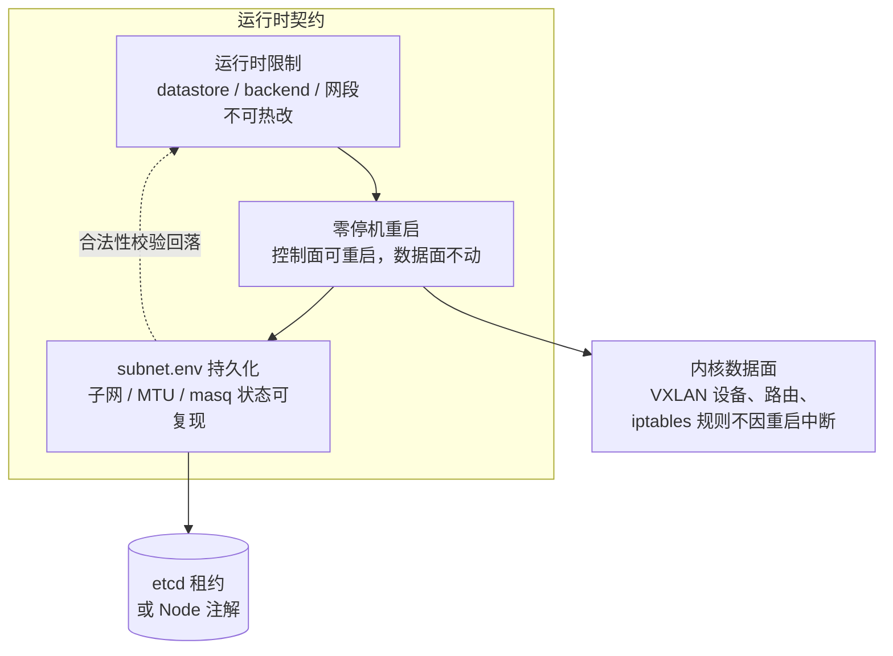
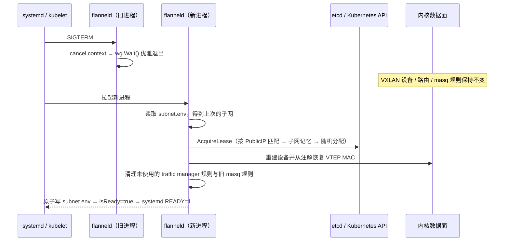
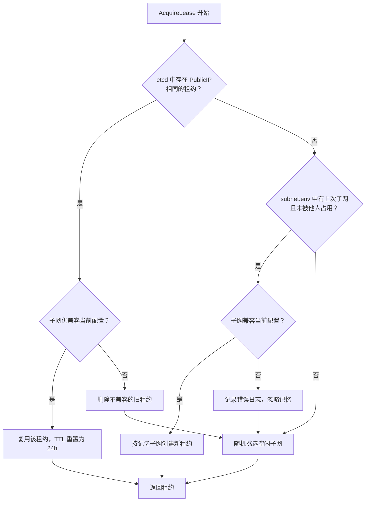

flannel 的运维模型建立在一个朴素的观察之上：**守护进程是可以随便重启的，网络状态才是必须保持稳定的**。本页聚焦三个相互咬合的主题——哪些配置属于"运行时不可变项"（运行时限制）、为什么重启 `flanneld` 可以不中断存量流量（零停机重启），以及 `subnet.env` 这个小文件如何同时充当**对外契约**（供 Docker/CNI 读取）、**租约记忆**（重启后复原子网）与**就绪门控**（`/readyz` 的判据）。理解这三者的因果关系，是从"会启动 flannel"进阶到"敢在生产环境滚动重启 flannel"的分水岭。

## 全局图景：三个主题如何相互咬合

三者的关系可以概括为一个闭环：运行时限制定义了重启时"什么不能变"；零停机重启依赖"数据面留在内核、控制面可随时替换"的分离；而 `subnet.env` 则是重启前后状态的锚点——它既是新进程恢复上下文的记忆，也是就绪探针判断"控制面已接管"的信号。下图给出了这一契约的总体结构：

`udp` 后端是唯一例外——它的数据路径穿越 flanneld 自身（用户态转发），因此不享受零停机重启；其余后端（vxlan、host-gw、wireguard 等）中内核才是真正的转发者，flanneld 只是控制平面。这也解释了为什么官方文档对 vxlan 给出"几秒内完成重启"的附加约束：ARP 表项可能开始超时，需要 daemon 回来刷新。

Sources: [running.md](Documentation/running.md#L116-L125), [main.go](main.go#L487-L498)

## 运行时限制：什么不能边跑边改

官方文档在 "Making changes at runtime" 一节划定了四条硬边界：**datastore 类型不可更换**；**后端类型不可热切换**（除非停掉所有工作负载并重启全部 flanneld）；`subnetlen/subnetmin/subnetmax` 可以随 daemon 重启调整，但必须谨慎——已有 Pod 的 IP 若落在新的取值范围之外就会失联；**集群级大网段在不停机的前提下不可变更**。这些限制并非随意的运维告诫，而是架构使然：租约记录、路由表项和 CNI 分配的容器 IP 都建立在旧配置之上，热改配置等于让控制面与数据面、IPAM 状态失去共同语言。

Sources: [running.md](Documentation/running.md#L81-L88)

从代码视角看，"后端不可热切"有着清晰的实现对应：`pkg/backend` 包中的 `constructors` 是一个在 `init()` 阶段填充完毕的静态注册表，`GetBackend` 只在启动时按 `net-conf.json` 中的 `BackendType` 解析一次并缓存，运行期不存在替换通道。同理，`--subnet-lease-renew-margin` 在启动时做硬校验——必须在 1 到 1439 分钟之间，否则直接退出——这类"启动期一次性决策"的参数正是运行时限制的代码化表达。

Sources: [pkg/backend/manager.go](pkg/backend/manager.go#L26-L70), [main.go](main.go#L232-L235)

另外两条常被忽视的限制值得单列。其一，**单个 flanneld 不支持同时运行多个网络**（该能力曾是实验特性后已移除），但允许同一主机运行多个 daemon，条件是用 `-subnet-file` 与 `-etcd-prefix` 为每个实例划出独立的命名空间，例如 `flanneld -subnet-file /vxlan.env -etcd-prefix=/vxlan/network`。其二，**公网 IP 与租约绑定**：其他节点靠租约中的 `PublicIP` 识别本节点，因此一旦公网 IP 变化（如 Vagrant 的 NAT 网卡场景），原租约作废、子网随之改变，必须重启 flanneld 重新注册。

Sources: [running.md](Documentation/running.md#L13-L20), [troubleshooting.md](Documentation/troubleshooting.md#L27-L31), [reservations.md](Documentation/reservations.md#L24-L27)

下表汇总了常见的运行时变更及其代价，可作为变更评审的速查表：

| 运行时变更 | 是否允许 | 约束与代价 | 依据 |
|---|---|---|---|
| 更换 datastore（etcd ↔ Kubernetes） | ✗ 不允许 | 需全集群重建 | [running.md](Documentation/running.md#L84) |
| 更换后端类型 | 仅限停机窗口 | 停止全部工作负载并重启所有 flanneld | [running.md](Documentation/running.md#L85) |
| subnetlen / subnetmin / subnetmax | 重启生效 | 已分配的 Pod IP 落在新范围外将失联 | [running.md](Documentation/running.md#L86) |
| 集群全局 Network 网段 | ✗（无零停机方案） | 必然产生停机 | [running.md](Documentation/running.md#L87) |
| 同主机多网络 | 单 daemon ✗，多 daemon ✓ | 用 `-subnet-file` + `-etcd-prefix` 隔离 | [running.md](Documentation/running.md#L15-L20) |
| public IP 变更 | 需重启 | 租约与 IP 绑定，子网随之改变 | [troubleshooting.md](Documentation/troubleshooting.md#L28) |
| `--subnet-lease-renew-margin` | 重启生效 | 合法区间 1–1439 分钟 | [main.go](main.go#L127) |

## 零停机重启：内核数据面与守护进程控制面的分离

零停机重启的成立依赖一个前提：**重启只发生在控制面**。对于 vxlan、host-gw 等后端，数据路径由内核提供（VXLAN 设备、路由表、iptables 规则都是内核对象），flanneld 崩溃或重启的瞬间，已经在转发的流量根本不经过它。官方文档据此给出三条操作守则：可以随时重启甚至升级 flanneld 而不扰动存量流；vxlan 场景必须在几秒内完成（ARP 表项可能超时）；重启期间**配置不得改变**——VNI、`--iface` 等取值变化会让新进程造出一个"逻辑上不同"的设备，破坏其他节点缓存的转发信息。

Sources: [running.md](Documentation/running.md#L116-L125)

优雅退出的实现是标准的 context 协作式取消：`main()` 在启动时注册 SIGINT/SIGTERM 处理器，收到信号后调用 `cancel()`，所有协程通过 `WaitGroup` 归位后进程以 `os.Exit(0)` 干净退出。healthz HTTP 服务器有独立的 3 秒优雅关闭窗口，避免探针端口被硬断。整个生命周期可以用下面的时序图概括：

Sources: [main.go](main.go#L257-L268), [main.go](main.go#L509-L529), [main.go](main.go#L593-L604)

重启的"最后一公里"由**就绪契约**收口。`isReady` 是一个原子布尔量，代码注释明确写道：只有在"subnet.env 已写入且流量规则就位"之后才置位；`/readyz` 直接读取该值，未就绪时返回 503。与此同时，进程通过 `daemon.SdNotify("READY=1")` 通知 systemd。这三个信号——文件落盘、`/readyz` 200、systemd `READY=1`——构成新进程完成控制面接管的可观测证明，也是滚动重启时判断"可以继续下一个节点"的依据。

Sources: [main.go](main.go#L109-L111), [main.go](main.go#L477-L485), [main.go](main.go#L495-L498), [main.go](main.go#L565-L579)

还有一个容易漏掉的细节支撑着 vxlan 的快速重启：**VTEP MAC 地址的跨重启复用**。以 kube 模式运行时，`GetStoredMacAddresses` 从 Node 注解（`backend-data`/`backend-v6-data`）中解析出上次使用的 MAC；`createVXLANDevice` 随后在创建 `flannel.1` 时把该 MAC 显式设置到新设备上。MAC 不变，意味着其他节点 ARP 缓存中的 VTEP 表项在重启后依然有效，这正是"几秒内重启即可无感"的物理基础。

Sources: [pkg/subnet/kube/kube.go](pkg/subnet/kube/kube.go#L697-L731), [pkg/backend/vxlan/vxlan.go](pkg/backend/vxlan/vxlan.go#L190-L249)

这套语义有端到端测试背书：`e2e/resilience_test.go` 中的用例先在两个节点上捕获 `FLANNEL_SUBNET` 行，然后触发 flannel DaemonSet 的滚动重启，断言重启后每个节点的子网**逐字符不变**，且跨节点 Pod 连通性恢复。测试注释也点明了边界——它刻意避开整机重启这类慢且不稳定的路径，只覆盖"现实的 flanneld 恢复路径（Pod 重新接线与租约持久化）"。

Sources: [e2e/resilience_test.go](e2e/resilience_test.go#L86-L136)

## subnet.env 持久化语义

### 文件内容与写入路径

`subnet.env` 的默认路径是 `/run/flannel/subnet.env`（`--subnet-file` 可覆盖），flag 帮助文本将其定义为"环境变量（子网、MTU 等）将被写入的文件"。写入统一收敛在 `WriteSubnetFile`：函数先创建目录，然后按配置的 IP 栈拼装键值——IPv4 时写入 `FLANNEL_NETWORK` 与 `FLANNEL_SUBNET`，双栈时追加 `FLANNEL_IPV6_NETWORK` 与 `FLANNEL_IPV6_SUBNET`，最后固定写入 `FLANNEL_MTU` 与 `FLANNEL_IPMASQ`。注意一个语义细节：`FLANNEL_SUBNET` 写入的是**子网首可用地址**（`IncrementIP()` 把网络地址加一后仍保留前缀，如 `10.1.74.0/24` 写成 `10.1.74.1/24`），这一格式与 Docker `--bip` 参数及 CNI 插件的消费习惯对齐。

Sources: [main.go](main.go#L124), [pkg/subnet/subnet.go](pkg/subnet/subnet.go#L70-L92), [dist/sample_subnet.env](dist/sample_subnet.env#L1-L4)

写入的触发点在 `main()` 的启动序列中：后端 `RegisterNetwork` 完成、流量规则就绪之后，通过 `Manager` 接口的 `HandleSubnetFile` 落盘。两种存储模式对此文件的态度不同——etcd 的 `LocalManager` 注释直言"文件永不变化，启动时写一次即可"；而 kube 模式的 `HandleSubnetFile` 会先把路径、ipMasq、子网、MTU 缓存进 `subnetFileInfo` 结构，以便将来（例如 clustercidr 资源出现时）重写文件。这个差异决定了 kube 模式下文件内容是"活的"，etcd 模式下是"冻结的"。

Sources: [main.go](main.go#L477-L485), [pkg/subnet/subnet.go](pkg/subnet/subnet.go#L94-L106), [pkg/subnet/etcd/local_manager.go](pkg/subnet/etcd/local_manager.go#L436-L439), [pkg/subnet/kube/kube.go](pkg/subnet/kube/kube.go#L683-L695)

### 原子替换与平台差异

在非 Windows 平台上，写入委托给 `google/renameio`：先写临时文件再原子 rename 到目标路径，并忽略 umask 以保证权限稳定。这意味着**读者永远不会读到半写状态**——这对消费者至关重要：systemd 单元可用 `EnvironmentFile=/run/flannel/subnet.env`，Docker 启动脚本可直接 `source /run/flannel/subnet.env` 后把 `FLANNEL_SUBNET`/`FLANNEL_MTU` 传给 `dockerd --bip/--mtu`。Windows 上因 renameio 不支持原子替换，回退为普通 `os.WriteFile`，代码注释引用了 renameio 的 README 作为依据。两个平台实现的差异被构建标签（`//go:build !windows` / `//go:build windows`）静默隔离，调用方无感知。

Sources: [pkg/subnet/writefile_other.go](pkg/subnet/writefile_other.go#L15-L27), [pkg/subnet/writefile_windows.go](pkg/subnet/writefile_windows.go#L15-L23), [running.md](Documentation/running.md#L94-L106)

### 读回：作为"最后一次租约的记忆"

`subnet.env` 的第二重身份是**本地租约存档**。使用 etcd 存储时，`newSubnetManager` 在启动时用 `godotenv` 读回文件中的 `FLANNEL_SUBNET`（及 IPv6 对应键）作为 `previousSubnet` 传给 `LocalManager`。`tryAcquireLease` 随后按三级优先级决策：先在 etcd 中按 public IP 匹配现有租约并复用；若无匹配，则检查记忆子网——未被他人占用且与当前 etcd 网络配置兼容（位于 SubnetMin/SubnetMax 区间内、前缀长度一致）时按记忆创建租约；否则才进入随机挑选空闲子网的分支。官方文档对有效性的表述与代码一致：`FLANNEL_SUBNET` 只有在"对当前 etcd 网络配置合法"时才被采纳，例如记忆为 `10.5.72.1/24` 而网段已改为 `10.6.0.0/16` 时，记忆作废、重新分配。

Sources: [main.go](main.go#L210-L215), [main.go](main.go#L607-L641), [pkg/subnet/etcd/local_manager.go](pkg/subnet/etcd/local_manager.go#L148-L223), [pkg/subnet/etcd/local_manager.go](pkg/subnet/etcd/local_manager.go#L409-L426), [running.md](Documentation/running.md#L49-L66), [reservations.md](Documentation/reservations.md#L29-L37)

这个机制解决的是一个具体的故障场景（文档原文）：主机因停机或重启错过了续约窗口、etcd 中的租约已经过期被回收——此时若没有本地记忆，flannel 会随机分一个新子网，主机上所有既有容器 IP 全部失效；有了记忆，它优先尝试恢复原子网，集群拓扑得以复原。不过要强调：这套"文件回读"逻辑**只存在于 etcd 模式**。kube 模式下子网恒取自 Node 的 `podCIDR`（由 Kubernetes 声明式管理），租约的 24 小时过期时间是合成的，`RenewLease` 干脆返回 `ErrUnimplemented`——podCIDR 不会到期，也就无需续约与本地兜底。

Sources: [pkg/subnet/kube/kube.go](pkg/subnet/kube/kube.go#L376-L379), [pkg/subnet/kube/kube.go](pkg/subnet/kube/kube.go#L494-L497), [pkg/subnet/kube/kube.go](pkg/subnet/kube/kube.go#L624-L627)

### 启动期的其他消费者：masq 规则与旧状态清理

`subnet.env` 在启动期还有第三重角色：**旧规则的清理依据**。启用 `--ip-masq` 时，`main()` 在设置新 masq 规则前，会先从文件读回 `FLANNEL_NETWORK/FLANNEL_SUBNET`（及 IPv6 对应键）并传入 `SetupAndEnsureMasqRules`——这些"上一次"的网段用于定位并删除指向旧网段的 iptables 规则，防止配置演进后在内核里积累陈旧规则。类似地，进程启动时还会用相反的 traffic manager 清理"当前未选中的那套"规则（iptables 或 nftables），代码注释明言这是为了"flannel 以不同选项重启后仍能保证干净状态"。可见重启语义的设计哲学是：**状态要么从文件/数据存储恢复，要么被显式清理，绝不允许静默残留**。

Sources: [main.go](main.go#L411-L433), [main.go](main.go#L390-L400)

### 失败语义：写不进去也要活着

一个体现设计取舍的细节：`HandleSubnetFile` 写入失败时，`main()` 只打一条 Warning 然后**继续运行**（注释原文是 "Continue, even though it failed"），但 `isReady` 不会被置位——即数据面照常工作，而 `/readyz` 持续 503。这个组合的语义是"降级服务但不欺骗调用方"：下游（如负载均衡、就绪探针）能把该节点从新流量中摘除，而已建立的流量不受影响。与之配套的还有启动期的另一个容错开关：`CONT_WHEN_CACHE_NOT_READY=true` 时，即便等待 Node 控制器同步超时也继续启动而非退出，为大规模集群控制面抖动提供缓冲。

Sources: [main.go](main.go#L477-L485), [main.go](main.go#L244-L254)

## 两种存储模式下的持久化语义对比

把上述散点收拢成一张对照表，便于在选型与排障时快速定位行为差异：

| 维度 | etcd LocalManager | kubeSubnetManager |
|---|---|---|
| 子网真相源 | etcd 租约记录 + 本地 `subnet.env` 记忆 | `Node.spec.podCIDR(s)`（Kubernetes 声明式管理） |
| 重启后的子网决策 | 三级回退：PublicIP 匹配 → 文件记忆（需兼容校验）→ 随机分配 | 直接取 podCIDR，文件不参与分配 |
| 租约时效 | 真实 24h TTL，默认提前 60 分钟续约，失败每分钟重试 | 合成 24h 过期时间戳；`RenewLease` 未实现、无需续约 |
| `subnet.env` 写入时机 | 启动时写入一次，此后内容冻结 | 启动写入并缓存参数，后续可重写 |
| 附加持久化 | 无 | VTEP MAC、public IP 存于 Node 注解，供重启复用 |
| 租约被回收的后果 | `CompleteLease` 收到 Removed 事件 → 整个 daemon 退出 | 不适用（podCIDR 不会"到期"） |

Sources: [pkg/subnet/etcd/local_manager.go](pkg/subnet/etcd/local_manager.go#L363-L407), [pkg/subnet/kube/kube.go](pkg/subnet/kube/kube.go#L637-L675), [main.go](main.go#L500-L507)

## 运维演练：一次"零事故"重启的核对清单

将本页语义转化为操作序列：变更前先确认变更落在运行时限制允许的集合内；重启后用日志与文件双重验证恢复。日志层面的就绪标志是 `Wrote subnet file to ...` 紧跟 `flannel is ready`；续约层面的周期性标志是 `Lease renewed, new expiration: ...`（etcd 模式，间隔约为 24h 减去续约提前量）；文件层面的恢复标志是 `FLANNEL_SUBNET` 与重启前逐字符一致——e2e 套件正是用 `cat /run/flannel/subnet.env` 加逐行比对来断言租约稳定性的。

Sources: [main.go](main.go#L477-L485), [pkg/subnet/etcd/local_manager.go](pkg/subnet/etcd/local_manager.go#L374-L388), [e2e/kube.go](e2e/kube.go#L113-L117)

升级场景下的两条路径与本页语义直接相关：`kubectl apply` 原地替换是低扰动方案（依赖上文的重启契约）；删除重建全部资源则被官方文档明确标注为"版本切换期间集群网络大规模中断"。若 etcd 模式下预期停机时间可能跨越租约到期点，可调大 `--subnet-lease-renew-margin`（合法区间 1–1439 分钟）改变续约提前量，或参照租约保留机制为节点做固定子网预留。最后再次强调两条红线：重启窗口内不得更改 VNI/`--iface` 等配置；vxlan 后端的重启应控制在秒级，避免 ARP 老化。

Sources: [Documentation/upgrade.md](Documentation/upgrade.md#L23-L38), [main.go](main.go#L127), [reservations.md](Documentation/reservations.md#L39-L52), [running.md](Documentation/running.md#L120-L124)

## 小结与延伸阅读

本页的三块拼图共同构成 flannel 的"重启哲学"：运行时限制把不可协商的状态固化在启动期；零停机重启把守护进程降级为可随时替换的控制面组件；`subnet.env` 则以原子写入的 env 文件形态，同时服务三个角色——供 Docker/CNI 消费的接口契约、供 etcd 模式恢复子网的本地记忆、供就绪探针判断接管的门控信号。若需继续深入，建议按以下路径延伸：租约分配与续约的完整算法见 [子网租约机制：从全局大网段到主机子网的分配与续约](7-zi-wang-zu-yue-ji-zhi-cong-quan-ju-da-wang-duan-dao-zhu-ji-zi-wang-de-fen-pei-yu-xu-yue)；kube 模式下 Node 注解与 informer 机制见 [kube subnet manager：Node 注解、podCIDR 与 informer 机制](19-kube-subnet-manager-node-zhu-jie-podcidr-yu-informer-ji-zhi)；etcd 键设计与租约保留见 [etcd 存储模式：配置键设计与租约保留](20-etcd-cun-chu-mo-shi-pei-zhi-jian-she-ji-yu-zu-yue-bao-liu)；`/readyz` 探针细节见 [healthz 与 readyz：健康检查与就绪探针机制](18-healthz-yu-readyz-jian-kang-jian-cha-yu-jiu-xu-tan-zhen-ji-zhi)；命令行参数全集见 [命令行参数与环境变量（FLANNELD_）完整参考](14-ming-ling-xing-can-shu-yu-huan-jing-bian-liang-flanneld_-wan-zheng-can-kao)；`FLANNEL_MTU` 的计算逻辑见 [性能调优：MTU 计算、后端选型与防火墙端口](26-xing-neng-diao-you-mtu-ji-suan-hou-duan-xuan-xing-yu-fang-huo-qiang-duan-kou)。