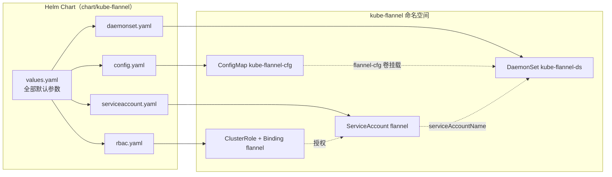
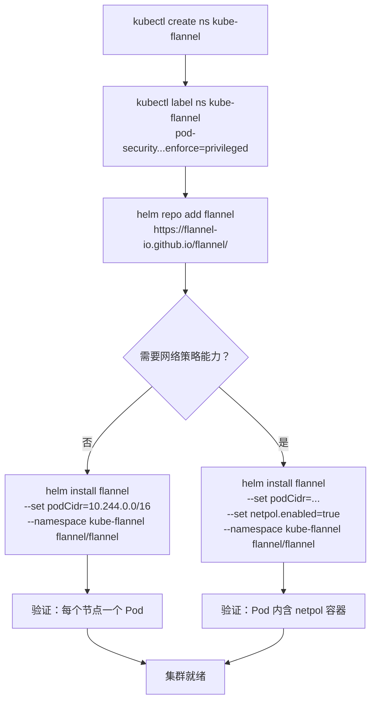
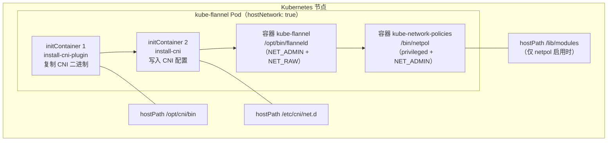

本页面向初次接触 flannel 的开发者，讲解两条主线：一是如何通过官方 Helm Chart 在 Kubernetes 集群中部署 flannel，以及 Chart 内部各模板渲染出哪些集群资源；二是如何通过 `netpol.enabled` 这一个开关，让 flannel 获得执行 Kubernetes NetworkPolicy 的能力。文中的每一步都对应仓库中的真实文件，读完本页你将能独立完成一次"带网络策略"的 flannel 安装。

## 为什么 flannel 需要"外挂"网络策略

先建立一个正确的预期：flanneld 的职责是**连通性**，不是**管控**。`flanneld` 这个单一二进制负责在每个主机上分配子网租约、建立隧道，保证任意节点上的 Pod 之间可以互相通信——但它的代码中并没有实现 NetworkPolicy 的执行引擎。官方 README 明确写道："While the `flanneld` binary does not natively enforce Network Policies, the Flannel project provides ways to add policy support to your cluster."

对于想要网络策略的用户，官方给出两条路线：其一，使用 **flannel Helm Chart 内置的集成控制器**——Chart 中的 `netpol.enabled` 选项会把 Kubernetes SIGs 官方的 [kube-network-policies](https://github.com/kubernetes-sigs/kube-network-policies) 控制器作为额外容器部署在 flannel Pod 旁边；其二，使用**第三方控制器**，例如让 Calico 以 Flannel 模式运行，或通过 CNI chaining 接入 Cilium。本页聚焦第一种官方集成方式，它从 flannel v0.25.5 开始可用，配置最简单、无需额外安装第三方组件。

Sources: [README.md](README.md#L23-L32)
Sources: [netpol.md](Documentation/netpol.md#L1-L12)

## Chart 里面有什么：一次安装渲染出的四类资源

Helm 可以理解为 Kubernetes 的"包管理器"，一个 Chart 就是一个安装包，`chart/kube-flannel/` 就是 flannel 的官方安装包。其中 `Chart.yaml` 声明了包名（`flannel`）与版本（当前 `v0.28.9`），`values.yaml` 是全部可调参数的默认值，而 `templates/` 目录下的四个模板文件会渲染出四类 Kubernetes 资源：

| 模板文件 | 渲染出的资源 | 作用 |
|---|---|---|
| `serviceaccount.yaml` | ServiceAccount `flannel` | Pod 访问 API Server 的身份 |
| `rbac.yaml` | ClusterRole + ClusterRoleBinding `flannel` | 授权该身份读取 pods/nodes/namespaces |
| `config.yaml` | ConfigMap `kube-flannel-cfg` | 存放 `cni-conf.json` 与 `net-conf.json` 两份网络配置 |
| `daemonset.yaml` | DaemonSet `kube-flannel-ds` | 保证**每个节点**上都运行一个 flannel Pod |

ConfigMap 与 DaemonSet 之间存在依赖：DaemonSet 把 ConfigMap 以 `flannel-cfg` 卷的形式挂载进容器（挂载点 `/etc/kube-flannel/`），flanneld 启动时从中读取网络配置。理解了这个渲染链路，后面排障时你就能定位"改了 values 但没生效"这类问题——本质是 values → 模板 → 资源的某一环没有重新渲染。



Sources: [Chart.yaml](chart/kube-flannel/Chart.yaml#L1-L10)
Sources: [config.yaml](chart/kube-flannel/templates/config.yaml#L1-L25)
Sources: [daemonset.yaml](chart/kube-flannel/templates/daemonset.yaml#L117-L121)
Sources: [serviceaccount.yaml](chart/kube-flannel/templates/serviceaccount.yaml#L1-L6)

## 快速上手：四条命令完成部署

官方推荐的标准安装流程只有四条命令。前两条准备工作环境，后两条真正安装：

```bash
# 1. 手动创建命名空间（避免 Helm 报错）
kubectl create ns kube-flannel
# 2. 给命名空间打上 privileged PSA 标签
kubectl label --overwrite ns kube-flannel pod-security.kubernetes.io/enforce=privileged
# 3. 添加 flannel 官方 Helm 仓库
helm repo add flannel https://flannel-io.github.io/flannel/
# 4. 安装（--set 可叠加 netpol.enabled=true）
helm install flannel --set podCidr="10.244.0.0/16" --namespace kube-flannel flannel/flannel
```

初学者最容易在第 2 步上踩坑，这里解释一下为什么必须打标签。Kubernetes v1.25 起的 Pod Security Admission（PSA）机制会按命名空间级别拦截"危险"的 Pod。flannel 需要 `hostNetwork: true`（直接使用宿主机网络栈）、hostPath 卷（读写 `/opt/cni/bin`、`/etc/cni/net.d` 等）以及 `NET_ADMIN`、`NET_RAW` 特权能力（操作路由表和 iptables 规则），任何一条都会被默认策略拒绝，错误形如：

```
Error creating: non-default capabilities (container "kube-flannel" must not include
"NET_ADMIN", "NET_RAW" in securityContext.capabilities.add), host namespaces
(hostNetwork=true), hostPath volumes (volumes "run", "cni-plugin", "cni", "xtables-lock")
```

因此安装前必须把 `kube-flannel` 命名空间的强制级别设为 `privileged`。这也带来一条安全提示：privileged 命名空间中的 Pod 权限极大，生产环境应限制能向该命名空间部署资源的主体。另外，主机侧还有一个前置条件——flannel 依赖 `br_netfilter` 内核模块，从 Kubernetes 1.30 起 kubeadm 不再检查该模块，缺失时 flannel 将无法正常启动。



Sources: [README.md](README.md#L54-L83)
Sources: [kubernetes.md](Documentation/kubernetes.md#L18-L27)

## 一行开关：netpol.enabled 如何注入策略控制器

官方文档对集成方式的描述只有一句话："it is enough to enable the `netpol.enabled` value"。这个开关在 `values.yaml` 中对应一个小配置块，默认关闭，包含三个字段——开关本身、传给控制器进程的启动参数、以及控制器镜像：

| 字段 | 默认值 | 含义 |
|---|---|---|
| `netpol.enabled` | `false` | 总开关 |
| `netpol.args` | `--hostname-override=$(MY_NODE_NAME)`、`--v=2` | 控制器启动参数：绑定到本节点、日志详细度 |
| `netpol.image` | `registry.k8s.io/networking/kube-network-policies:v1.0.0` | 控制器镜像 |

当你在 `helm install`（或 `helm upgrade`）时传入 `--set netpol.enabled=true`，Helm 会把该值注入模板引擎，`daemonset.yaml` 中三段被 `{{- if .Values.netpol.enabled }}` 包住的片段会被渲染出来，产生三处可见变化：

1. **新增一个容器**：Pod 中在 `kube-flannel` 容器之后追加名为 `kube-network-policies` 的容器，执行 `/bin/netpol`，环境变量 `MY_NODE_NAME` 通过 `fieldRef` 自动取自 Pod 所调度到的节点名；它还挂载宿主机的 `/lib/modules`（只读）以加载所需的内核模块，资源申请为 100m CPU / 50Mi 内存，安全上下文为 `privileged: true` 且具备 `NET_ADMIN` 能力。
2. **新增一个 hostPath 卷**：`lib-modules` 卷仅在开关打开时才会出现在 volumes 列表中。
3. **RBAC 权限扩展**（下一节详述）。

值得注意的是两个容器的权限设计差异：flannel 主容器本身是 `privileged: false`，仅靠 `NET_ADMIN` + `NET_RAW` 两个 Linux capabilities 工作；而 netpol 容器是全特权模式。对照官方说明——启用后"Flannel pod should start with an additional container"——部署成功的最直观验证方式就是查看 Pod 内的容器数量从 1 变为 2。

| 维度 | `netpol.enabled=false`（默认） | `netpol.enabled=true` |
|---|---|---|
| Pod 内容器数 | 1（kube-flannel） | 2（+ kube-network-policies） |
| NetworkPolicy 执行 | 不支持 | 支持（SIG 网络策略 + AdminNetworkPolicy API） |
| RBAC 范围 | pods/nodes/namespaces 基础权限 | 追加 networkpolicies 等只读权限 |
| `/lib/modules` 挂载 | 无 | hostPath 只读挂载 |
| netpol 容器权限 | — | privileged + NET_ADMIN |

Sources: [values.yaml](chart/kube-flannel/values.yaml#L107-L115)
Sources: [daemonset.yaml](chart/kube-flannel/templates/daemonset.yaml#L124-L155)
Sources: [daemonset.yaml](chart/kube-flannel/templates/daemonset.yaml#L100-L103)
Sources: [netpol.md](Documentation/netpol.md#L5-L10)

## 开关背后的授权：RBAC 的条件扩展

NetworkPolicy 是一种集群级 API 资源，网络策略控制器必须能持续监听（watch）它的变化才能生效。flannel 默认的 ClusterRole 只覆盖了 Pod/Node/namespace 的读取和 `nodes/status` 的 patch，并不包含策略资源。`rbac.yaml` 用与 DaemonSet 相同的条件渲染手法解决了这个问题：`netpol.enabled` 为真时，ClusterRole 追加两条规则——`networking.k8s.io` 组下 `networkpolicies` 的 `list`/`watch`，以及 `policy.networking.k8s.io` 组下 `adminnetworkpolicies`、`baselineadminnetworkpolicies` 的 `list`/`watch`（后两者属于较新的 AdminNetworkPolicy API）。

所有权限最终通过 ClusterRoleBinding 绑定到 `flannel` 这个 ServiceAccount 上。由于 flannel 与 netpol 容器运行在**同一个 Pod** 中，它们天然共享同一个身份——这就是为什么不需要为 netpol 单独创建 ServiceAccount。如果你在开启 netpol 后看到 API Server 返回 Forbidden（403）错误，几乎总意味着 RBAC 没有重新渲染，解决办法是用 `helm upgrade` 重新应用带 `--set netpol.enabled=true` 的完整参数集，让 ClusterRole 一并更新。

Sources: [rbac.yaml](chart/kube-flannel/templates/rbac.yaml#L1-L52)

## Pod 内部视角：双容器如何协作

下图把启用 netpol 后的单个 flannel Pod 内部结构画了出来。两个 initContainer（初始化容器）先于业务容器运行：`install-cni-plugin` 把 flannel CNI 二进制复制到宿主机 `/opt/cni/bin`，`install-cni` 把 ConfigMap 中的 CNI 配置写到宿主机 `/etc/cni/net.d/10-flannel.conflist` 供 kubelet 使用。随后两个业务容器共享同一网络命名空间（Pod 级别共享）分别守护：flanneld 维护子网与隧道，netpol 监听策略并下发规则。



Sources: [daemonset.yaml](chart/kube-flannel/templates/daemonset.yaml#L39-L64)
Sources: [daemonset.yaml](chart/kube-flannel/templates/daemonset.yaml#L65-L123)

## 常用自定义参数速查

`helm install` 时通过 `--set key=value` 或自定义 values 文件（`-f my-values.yaml`）覆盖默认值。下表汇总了初学者最常用的参数（完整清单见 `values.yaml`，逐项语义可延伸阅读 net-conf 详解页）：

| values 路径 | 默认值 | 说明 |
|---|---|---|
| `podCidr` | `10.244.0.0/16` | Pod 全局网段，**必须与 `kubeadm init --pod-network-cidr` 一致** |
| `podCidrv6` | 空（`""`） | 设置后自动开启 IPv6 双栈 |
| `flannel.image` | `ghcr.io/flannel-io/flannel:v0.28.9` | flanneld 镜像 |
| `flannel.flannel_cni.image` | `...flannel-cni-plugin:v1.9.1-flannel3` | CNI 插件镜像 |
| `flannel.backend` | `vxlan` | 数据面后端，可选 `host-gw`、`wireguard`、`udp` |
| `flannel.backendPort` | `0`（各后端默认值） | VXLAN 8472 / WireGuard 51821 / UDP 8285 |
| `flannel.args` | `--ip-masq`、`--kube-subnet-mgr` | flanneld 命令行参数 |
| `flannel.cniBinDir` / `cniConfDir` | `/opt/cni/bin`、`/etc/cni/net.d` | 宿主机 CNI 目录 |
| `flannel.enableNFTables` | `false` | 启用 nftables 替代 iptables |
| `flannel.skipCNIConfigInstallation` | `false` | 设为 `true` 时**跳过** install-cni 初始化容器，适用于 CNI 配置由外部提供的场景 |
| `flannel.healthz.port` | `8081` | 非 0 时启用 `/healthz` 与 `/readyz` 探针 |
| `netpol.enabled` | `false` | 网络策略开关（本页主角） |

Sources: [values.yaml](chart/kube-flannel/values.yaml#L6-L35)
Sources: [values.yaml](chart/kube-flannel/values.yaml#L63-L115)
Sources: [daemonset.yaml](chart/kube-flannel/templates/daemonset.yaml#L51-L64)
Sources: [config.yaml](chart/kube-flannel/templates/config.yaml#L11-L24)

## Helm 与 kubectl 清单：两种部署方式怎么选

flannel 官方同时维护两条部署路径：Helm Chart（`chart/kube-flannel/`）与静态清单（`Documentation/kube-flannel.yml`）。两者最终创建的资源大同小异——清单版本甚至自带 `kube-flannel` Namespace 定义并直接内置了 PSA 标签，而 Helm 版本需要你手动创建命名空间并打标签。真正的分野在于**可定制性与功能开关**：静态清单必须下载后手动编辑 YAML 才能改配置，且完全不支持 netpol 集成；Helm 则通过参数化 values 提供了后端切换、镜像替换、netpol 开关等能力。官方文档也点明了这一分工——想要网络策略，就走 Helm 这条路。

| 维度 | Helm Chart | kubectl 静态清单 |
|---|---|---|
| 安装命令 | `helm install flannel ... flannel/flannel` | `kubectl apply -f kube-flannel.yml` |
| 配置修改 | `--set` / `-f` 参数化覆盖 | 手动编辑 YAML 文件 |
| 命名空间 | 需手动创建并打 PSA 标签 | 清单自带（含 privileged 标签） |
| netpol 集成 | `--set netpol.enabled=true` 一行开启 | 不支持 |
| 升级 | `helm upgrade`（自 0.21.4 起仓库化） | 重新 apply 最新清单 |
| Chart 自带测试 | `tests/daemonset_test.yaml`（helm-unittest 格式，验证镜像、探针、参数渲染） | 无 |

Sources: [kube-flannel.yml](Documentation/kube-flannel.yml#L1-L60)
Sources: [kubernetes.md](Documentation/kubernetes.md#L9-L14)
Sources: [upgrade.md](Documentation/upgrade.md#L33-L38)
Sources: [daemonset_test.yaml](chart/kube-flannel/tests/daemonset_test.yaml#L1-L35)

## 部署后验证与常见问题

安装完成后，按下面顺序验证。第一步确认每个节点都有一个运行中的 Pod；第二步在开启 netpol 时确认容器数量为 2；第三步实际创建一条 NetworkPolicy 观察是否生效：

```bash
# 1. 所有节点的 Pod 应均为 Running（1/1 或 2/2）
kubectl -n kube-flannel get pods -o wide

# 2. 开启 netpol 后应看到两个容器
kubectl -n kube-flannel get pod <pod-name> -o jsonpath='{.spec.containers[*].name}'
# 输出应为：kube-flannel kube-network-policies

# 3. 确认 RBAC 已扩展（应能看到 networkpolicies 字样）
kubectl get clusterrole flannel -o yaml | findstr networkpolicies
```

初学者高频问题与对应排查路径如下：

| 现象 | 根因 | 处理方式 |
|---|---|---|
| Pod 报错 `non-default capabilities ... hostPath volumes` | 命名空间缺少 privileged PSA 标签 | 补执行 `kubectl label --overwrite ns kube-flannel pod-security.kubernetes.io/enforce=privileged` |
| Pod 始终只有 1 个容器，策略不生效 | `netpol.enabled` 未开启或未重新 upgrade | `helm upgrade flannel --set netpol.enabled=true ...` |
| netpol 容器日志出现 403 Forbidden | RBAC 未随开关一起渲染 | 重新执行完整参数的 `helm upgrade` |
| flannel 启动失败且无 CNI 日志 | 宿主机 `/opt/cni/bin` 缺少标准 CNI 插件二进制 | 按 README 下载 containernetworking/plugins 解压到 `/opt/cni/bin` |
| Kubernetes 1.30+ 节点 flannel 无法启动 | 缺少 `br_netfilter` 内核模块 | 主机上执行 `modprobe br_netfilter` 并持久化 |
| Pod 网段与预期不符 | `podCidr` 与 kubeadm 的 `--pod-network-cidr` 不一致 | 保持两者一致后 `helm upgrade` |

一个值得了解的质量保障细节：Chart 仓库自带 `tests/daemonset_test.yaml`，这是 helm-unittest 格式的模板单元测试，覆盖了镜像地址、命令行参数、健康探针渲染、initContainer 增删、nodeSelector 注入等断言——当你修改 Chart 模板做定制时，可以参照这些测试用例验证自己的改动。

Sources: [README.md](README.md#L69-L83)
Sources: [netpol.md](Documentation/netpol.md#L10-L12)
Sources: [daemonset_test.yaml](chart/kube-flannel/tests/daemonset_test.yaml#L50-L122)

## 小结与阅读路径

本页完成了三件事：理解 flannel "只管连通、不管策略"的边界，掌握 Helm Chart 从 values 到四类集群资源的渲染模型，以及用 `netpol.enabled` 单开关完成策略控制器（kube-network-policies 容器 + RBAC 扩展 + `/lib/modules` 卷）的一体化注入。若你希望继续深入，推荐按以下路径阅读：

- 回顾部署全景：[快速开始：在 Kubernetes 集群中一键部署 flannel](2-kuai-su-kai-shi-zai-kubernetes-ji-qun-zhong-jian-bu-shu-flannel)
- 深挖 net-conf.json 配置项语义：[net-conf.json 网络配置项逐项详解](13-net-conf-json-wang-luo-pei-zhi-xiang-zhu-xiang-xiang-jie)
- 了解 flanneld 命令行参数（`--ip-masq`、`--kube-subnet-mgr` 的来龙去脉）：[命令行参数与环境变量（FLANNELD_）完整参考](14-ming-ling-xing-can-shu-yu-huan-jing-bian-liang-flanneld_-wan-zheng-can-kao)
- 选择 vxlan 之外的后端：[推荐后端对比：VXLAN、host-gw 与 WireGuard 选型](10-tui-jian-hou-duan-dui-bi-vxlan-host-gw-yu-wireguard-xuan-xing)
- 理解默认开启的 8081 健康探针：[healthz 与 readyz：健康检查与就绪探针机制](18-healthz-yu-readyz-jian-kang-jian-cha-yu-jiu-xu-tan-zhen-ji-zhi)
- 后续版本管理：[版本升级：kubectl、Helm 与原地替换三种路径](5-ban-ben-sheng-ji-kubectl-helm-yu-yuan-di-ti-huan-san-chong-lu-jing)
- 遇到问题时：[常见故障排查：连通性、权限、日志与日志级别](25-chang-jian-gu-zhang-pai-cha-lian-tong-xing-quan-xian-ri-zhi-yu-ri-zhi-ji-bie)

Sources: [README.md](README.md#L23-L32)