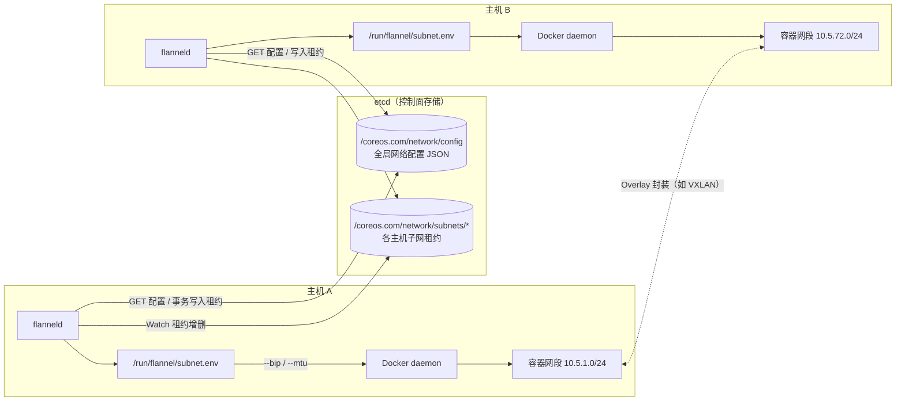
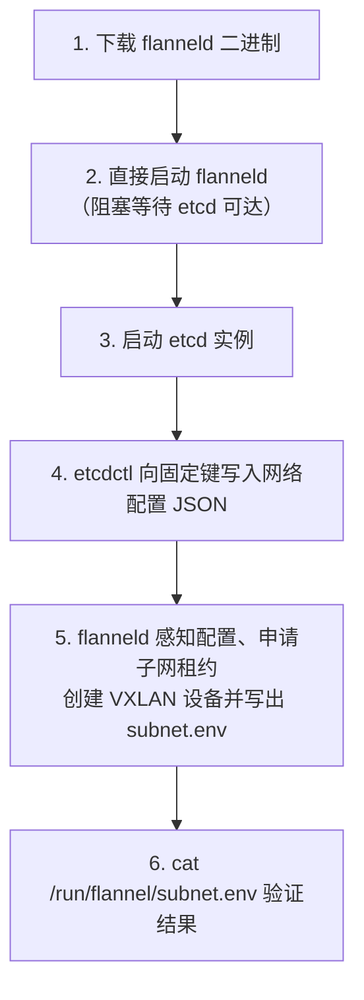
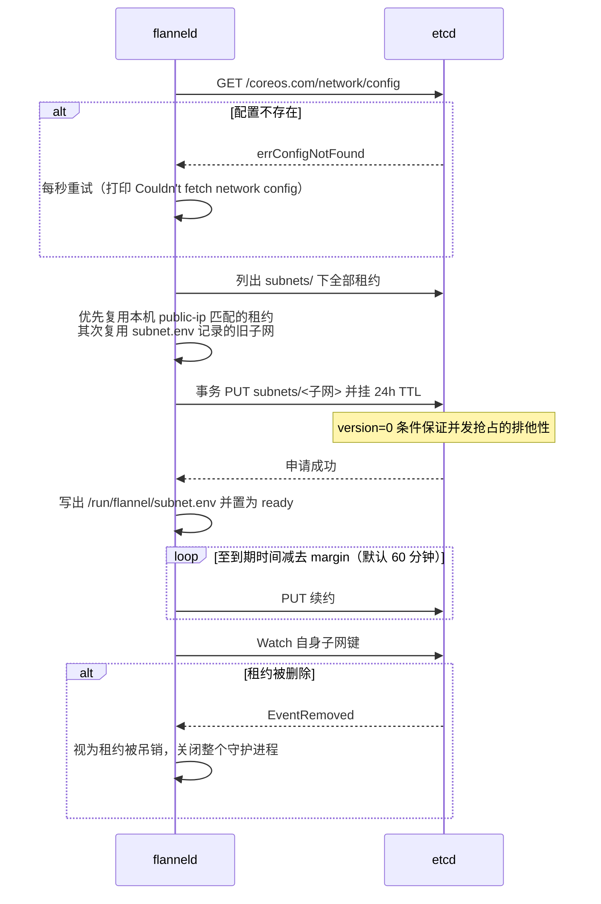

flannel 并非只能作为 Kubernetes 的 CNI 插件存在——它的设计原型就是一个独立的 overlay 网络守护进程：从 etcd 读取全局网络配置、为主机分配子网租约、写出环境变量文件供 Docker 守护进程消费。本页面向希望在无 Kubernetes 环境下手动部署 flannel 的中级开发者，覆盖：快速上手五步流程、etcd 连接参数、启动期 flanneld 与 etcd 的完整交互、TLS 加固、与 Docker daemon 的三种集成方式，以及重启语义与排障速查。所有步骤均以仓库内官方文档与功能测试代码为依据，可逐一复现。

Sources: [Documentation/running.md](Documentation/running.md#L1-L11)

## 适用场景与双存储设计

flannel 内部通过统一的 `subnet.Manager` 接口抽象"子网数据的来源"，`main.go` 中的 `newSubnetManager` 是分流点：只有显式传入 `-kube-subnet-mgr` 时才走 Kubernetes API；**默认路径（即不传任何参数）就是 etcd 模式**，此时会根据 `-etcd-endpoints`、`-etcd-prefix`、TLS 三件套等参数构造 `etcd.EtcdConfig` 并创建 `LocalManager`。这意味着"脱离 Kubernetes"不是阉割版，而是与 K8s 模式平级的原生运行形态。此外 etcd 模式在创建管理器之前，还会从 `-subnet-file` 指向的文件（默认 `/run/flannel/subnet.env`）读出上次的子网，作为重启后优先复用的租约——这是理解后文"子网复用语义"的关键伏笔。

Sources: [main.go](main.go#L190-L215)

典型适用场景包括：传统 Docker 多主机互联、与 systemd/裸机编排脚本配合、开发调试网络后端（仓库的 `functional` 测试套件正是以"etcd + 两个特权 flannel 容器"的方式验证所有后端的连通性）、以及希望在引入 Kubernetes 前先行规划 overlay 地址体系的场景。

Sources: [functional/etcd_test.go](functional/etcd_test.go#L44-L53)

### 整体架构

下图展示了 etcd 模式下的三角色协作：etcd 承担**控制面存储**（全局配置 + 各主机子网租约），flanneld 是每台主机上的**控制面代理**（申请/续约租约、监听变化、维护路由），`subnet.env` 则是连接控制面与数据面的**交接文件**——Docker daemon 从中读取 `--bip` 与 `--mtu`，使 docker0 网桥落入本主机的 flannel 子网：



配置键的物理位置由代码直接决定：全局配置读取自 `path.Join(prefix, "config")`，而租约列表通过 `path.Join(prefix, "subnets")` 前缀扫描获得——这就是为什么默认部署必须把配置 JSON 写到 `/coreos.com/network/config` 这个精确路径上。

Sources: [pkg/subnet/etcd/registry.go](pkg/subnet/etcd/registry.go#L155-L200)

## 快速开始：五步手动运行

官方文档给出的最小流程只需要一个 flanneld 二进制、一个 etcd 实例和一条 `etcdctl` 命令：



具体命令如下。第 2 步刻意先启动 flanneld：它会持续打印 `Couldn't fetch network config` 并**每秒重试**（`getConfig` 的循环逻辑），这本身就是对"控制面未就绪"的正常表现；第 3 步用 `--net=host` 跑 etcd，使其监听在 `127.0.0.1:2379`，恰好命中 flanneld 的默认端点列表 `http://127.0.0.1:4001,http://127.0.0.1:2379`，因此无需任何参数；第 4 步必须带 `ETCDCTL_API=3`，因为 flannel 使用 etcd v3 API 读写：

```bash
# 1. 下载二进制
wget https://github.com/flannel-io/flannel/releases/latest/download/flanneld-amd64 && chmod +x flanneld-amd64

# 2. 启动 flanneld（会挂起等待 etcd）
sudo ./flanneld-amd64

# 3. 另一个终端启动 etcd（已有 docker 时最简方式）
docker run --rm --net=host quay.io/coreos/etcd

# 4. 写入全局网络配置（键路径必须精确）
docker run --rm -e ETCDCTL_API=3 --net=host quay.io/coreos/etcd \
  etcdctl put /coreos.com/network/config \
  '{ "Network": "10.5.0.0/16", "Backend": {"Type": "vxlan"}}'

# 5. 观察结果
cat /run/flannel/subnet.env
```

配置 JSON 中的 `Backend` 决定数据面封装方式（上例选择官方推荐的 `vxlan`）；若 JSON 里完全不写 `Backend` 字段，解析器会回落到 `udp` 后端——这只适合调试。配置成功后 flanneld 会在主机上创建 VXLAN 隧道设备，并把分配结果写入环境变量文件。

Sources: [Documentation/running.md](Documentation/running.md#L22-L48)

Sources: [pkg/subnet/config.go](pkg/subnet/config.go#L42-L54)

## etcd 模式核心命令行参数

下表汇总手动运行时最常用的参数（完整参考见 [命令行参数与环境变量（FLANNELD_）完整参考](14-ming-ling-xing-can-shu-yu-huan-jing-bian-liang-flanneld_-wan-zheng-can-kao)）。所有参数也可以用 `FLANNELD_` 前缀的环境变量传入（如 `FLANNELD_ETCD_ENDPOINTS`），这是 systemd 部署的推荐做法：

| 参数 | 默认值 | 作用 |
| --- | --- | --- |
| `-etcd-endpoints` | `http://127.0.0.1:4001,http://127.0.0.1:2379` | etcd 端点列表，逗号分隔 |
| `-etcd-prefix` | `/coreos.com/network` | 配置与租约的键前缀，多网络隔离的关键 |
| `-etcd-cafile` / `-etcd-certfile` / `-etcd-keyfile` | 空 | TLS 双向认证三件套 |
| `-etcd-username` / `-etcd-password` | 空 | etcd BasicAuth 凭据 |
| `-subnet-file` | `/run/flannel/subnet.env` | 环境变量输出文件路径 |
| `-public-ip` | 自动探测 | 其他节点访问本机所用 IP |
| `-iface` | 默认路由接口 | 主机间通信网卡（IP 或名称，可多次指定按序匹配） |
| `-ip-masq` | `false` | 为离开 overlay 的流量设置 MASQUERADE 规则 |
| `-subnet-lease-renew-margin` | `60`（分钟） | 租约提前续约余量，合法范围 1–1439 |

Sources: [main.go](main.go#L113-L141)

Sources: [main.go](main.go#L223-L223)

## 深入解析：启动期 flanneld 与 etcd 的完整交互

理解下面这张时序图，就能把手动运行时看到的每条日志与代码行为一一对应：



几个值得展开的细节：

**租约申请是三层回退策略。** `tryAcquireLease` 先在现有租约中按 public IP 找本机旧租约（找到且与新配置兼容则直接续期复用）；否则检查 `subnet.env` 中记录的上次子网是否仍无人占用且落在配置范围内；最后才在 `SubnetMin` 到 `SubnetMax` 之间收集可用子网（最多 100 个候选）**随机**挑选。这种设计让主机 IP 稳定时子网也趋于稳定，同时避免多节点同时启动时都抢占同一地址。

Sources: [pkg/subnet/etcd/local_manager.go](pkg/subnet/etcd/local_manager.go#L148-L223)

Sources: [pkg/subnet/etcd/local_manager.go](pkg/subnet/etcd/local_manager.go#L225-L274)

**并发安全依赖 etcd 事务。** 创建租约使用 `Compare(etcd.Version(key), "=", 0)` 条件写入——只有键不存在时才落盘，失败则撤销已 Grant 的租约并整体重试（最多 10 次）。租约通过 `Grant(TTL)` 绑定 24 小时存活期，到期未续约会被 etcd 自动回收，这就是"主机失联后子网最终可被回收"的机制基础。

Sources: [pkg/subnet/etcd/registry.go](pkg/subnet/etcd/registry.go#L221-L254)

Sources: [pkg/subnet/etcd/local_manager.go](pkg/subnet/etcd/local_manager.go#L32-L35)

**subnet.env 写一次即止。** 与 kube 模式不同，etcd 模式的 `HandleSubnetFile` 只在启动时调用一次 `WriteSubnetFile`：文件内容包含 `FLANNEL_NETWORK`、`FLANNEL_SUBNET`（已跳过网络地址、指向第一个可用 IP）、`FLANNEL_MTU` 与 `FLANNEL_IPMASQ`。写入成功后 flanneld 置位 ready 状态并向 systemd 发送 `READY=1`。

Sources: [pkg/subnet/etcd/local_manager.go](pkg/subnet/etcd/local_manager.go#L436-L439)

Sources: [pkg/subnet/subnet.go](pkg/subnet/subnet.go#L70-L92)

Sources: [main.go](main.go#L477-L495)

关于全局配置 JSON 本身的字段（`Network`、`SubnetLen`、`SubnetMin/Max`、`Backend` 选项等），本页不展开，请参阅 [net-conf.json 网络配置项逐项详解](13-net-conf-json-wang-luo-pei-zhi-xiang-zhu-xiang-xiang-jie) 与 [etcd 存储模式：配置键设计与租约保留](20-etcd-cun-chu-mo-shi-pei-zhi-jian-she-ji-yu-zu-yue-bao-liu)。

## 多网络隔离：etcd-prefix 的命名空间用法

单个 flanneld 只服务一张网络，但同一台主机可以运行多个 flanneld 实例，各自服务不同的 overlay——方法是让它们使用**不同的输出文件与不同的 etcd 前缀**：

```bash
flanneld -subnet-file /vxlan.env   -etcd-prefix=/vxlan/network
flanneld -subnet-file /hostgw.env  -etcd-prefix=/hostgw/network
```

因为配置键实际路径是 `prefix + "/config"`、租约路径是 `prefix + "/subnets/*"`，改变前缀就等于在同一个 etcd 里划出了互不干扰的命名空间。仓库功能测试对这一形态做了端到端验证：向 `/vxlan/network/config` 与 `/hostgw/network/config` 分别写入不同网段（10.11.0.0/16 与 10.12.0.0/16）的配置，在两台"主机"容器内各起两个 flanneld，随后验证 vxlan 流量与 host-gw 流量各走各的路径、互不串扰。

Sources: [Documentation/running.md](Documentation/running.md#L13-L20)

Sources: [functional/etcd_test.go](functional/etcd_test.go#L200-L232)

## 生产强化：为 etcd 启用 TLS 客户端认证

裸 HTTP 的 etcd 在生产环境不可接受。flanneld 通过三个参数挂载客户端证书，etcd 侧则需要开启双向认证。仓库功能测试给出了可照抄的组合——先以服务端证书启动 etcd：

```bash
etcd --listen-client-urls http://0.0.0.0:2379 \
     --cert-file=/certs/server.pem \
     --key-file=/certs/server-key.pem \
     --client-cert-auth \
     --trusted-ca-file=/certs/ca.pem \
     --advertise-client-urls http://<主机IP>:2379
```

再让 flanneld 携带客户端证书接入：

```bash
flanneld --etcd-endpoints=https://<etcd主机>:2379 \
         --etcd-cafile=/certs/ca.pem \
         --etcd-certfile=/certs/client.pem \
         --etcd-keyfile=/certs/client-key.pem
```

两处代码值得注意：客户端配置校验要求 `MinVersion` 为 TLS 1.2；若 `etcd-keyfile`/`etcd-certfile` 任一缺失，flanneld 会打印 `no certificate provided: connecting to etcd with http. This is insecure` 警告后以明文 HTTP 继续运行——看到这条日志就意味着你的控制面流量未加密。仓库 `dist/test/` 目录保存了功能测试所用的 CA、服务端/客户端证书与私钥，本地复现 TLS 环境时可直接挂载使用。

Sources: [functional/etcd_test.go](functional/etcd_test.go#L56-L78)

Sources: [functional/etcd_test.go](functional/etcd_test.go#L107-L127)

Sources: [pkg/subnet/etcd/registry.go](pkg/subnet/etcd/registry.go#L79-L105)

Sources: [dist/test](dist/test)

## 集成 Docker：让 daemon 消费 subnet.env

flannel 本身不创建容器网络，它与 Docker 的衔接点就是 `subnet.env`。启动 Docker 时把本主机的子网与 MTU 传给 daemon，docker0 网桥便会落入 flannel 分配的子网，容器流量由此进入 overlay。三种集成方式对比如下：

| 集成方式 | 操作 | 适用场景 |
| --- | --- | --- |
| 直接 source | `source /run/flannel/subnet.env && docker daemon --bip=$FLANNEL_SUBNET --mtu=$FLANNEL_MTU &` | 自定义启动脚本 |
| systemd | 在 `.service` 中写 `EnvironmentFile=/run/flannel/subnet.env`，unit 内引用 `$FLANNEL_SUBNET` 等变量 | 标准化主机部署 |
| 独立自定义网络 | `docker network create --attachable=true --subnet=$FLANNEL_SUBNET -o "com.docker.network.driver.mtu"=$FLANNEL_MTU flannel` | 不动默认 docker0 |

Sources: [Documentation/running.md](Documentation/running.md#L89-L106)

`subnet.env` 的四个变量与 Docker 侧参数的映射关系：

| 变量 | 示例值 | 去向 |
| --- | --- | --- |
| `FLANNEL_NETWORK` | `10.5.0.0/16` | 全局大网段，供脚本参考与 ip-masq 规则 |
| `FLANNEL_SUBNET` | `10.5.72.1/24` | `dockerd --bip` / `docker network create --subnet` |
| `FLANNEL_MTU` | `1450` | `dockerd --mtu` / 网络驱动 `mtu` 选项 |
| `FLANNEL_IPMASQ` | `false` | 决定 Docker 的 `--ip-masq` 取值 |

Sources: [dist/sample_subnet.env](dist/sample_subnet.env#L1-L4)

注意 `FLANNEL_IPMASQ` 到 `--ip-masq` 的**取值反转**：flannel 已配置 masquerade 规则（`FLANNEL_IPMASQ=true`）时，Docker 应关闭自己的 `--ip-masq=false` 以避免双重 NAT；反之 flannel 未做伪装时，Docker 需要保持 `--ip-masq=true`。仓库提供的 [`dist/mk-docker-opts.sh`](dist/mk-docker-opts.sh) 封装了全部换算：它 source flannel 环境文件后，输出 `DOCKER_OPT_BIP`、`DOCKER_OPT_MTU`、`DOCKER_OPT_IPMASQ` 三个独立变量（`-i`）或合并的 `DOCKER_OPTS`（`-c`）到 `/run/docker_opts.env`，供 systemd 的 `EnvironmentFile` 直接使用。

Sources: [dist/mk-docker-opts.sh](dist/mk-docker-opts.sh#L57-L78)

Sources: [dist/mk-docker-opts.sh](dist/mk-docker-opts.sh#L105-L116)

**连通性验证**可以照抄功能测试的做法：在两台主机容器内分别 `source /run/flannel/subnet.env`，把 `$FLANNEL_SUBNET` 地址挂到 dummy 接口上模拟容器 IP，然后从对端 `ping -I` 本端该地址，双向通即证明 overlay 数据面正常——这正是仓库验证 vxlan、host-gw、ipip、ipsec、wireguard 等全部 etcd 后端的统一手段。

Sources: [functional/docker_test.go](functional/docker_test.go#L208-L234)

## 重启语义：subnet.env 持久化与子网复用

每次重启 flanneld 都会读取 `subnet.env` 中的 `FLANNEL_SUBNET` 并尝试续用该子网，这样即使主机在租约到期前未能续约（例如重启过程中错过了续约窗口），重新上线后仍拿回原子网，容器网络配置无需变更。但复用有**兼容性闸门**：只有旧子网仍落在 etcd 配置的 `Network` 范围内且掩码长度一致时才会复用——例如文件里记录 `10.5.72.1/24`，而 etcd 配置已改为 `10.6.0.0/16`，flanneld 会放弃旧值重新分配。改配置前务必评估这一点。

Sources: [Documentation/running.md](Documentation/running.md#L49-L66)

Sources: [pkg/subnet/etcd/local_manager.go](pkg/subnet/etcd/local_manager.go#L409-L415)

运行期变更有硬性边界：数据存储类型与后端类型不可热切换（后者需停掉全部工作负载并重启所有 flanneld）；`subnetlen/subnetmin/subnetmax` 可随重启调整但须谨慎（已分配出界的容器 IP 会失效）；全局大网段不可无停机变更。由于 vxlan 等后端的数据路径由内核承载、flanneld 仅是控制面，日常重启不影响存量流量，但需在数秒内完成（ARP 表项会老化），且 VNI、`--iface` 等配置不得变更。该主题的完整展开见 [运行时限制、零停机重启与 subnet.env 持久化语义](27-yun-xing-shi-xian-zhi-ling-ting-ji-zhong-qi-yu-subnet-env-chi-jiu-hua-yu-yi)。

Sources: [Documentation/running.md](Documentation/running.md#L81-L87)

Sources: [Documentation/running.md](Documentation/running.md#L116-L124)

## 排障速查

| 症状 | 根因 | 处置 |
| --- | --- | --- |
| 启动后反复打印 `Couldn't fetch network config` | etcd 未就绪，或配置未写到 `<prefix>/config` | 确认 `etcdctl get /coreos.com/network/config` 有值；核对 `-etcd-prefix` |
| 报错 `flannel config not found in etcd store. Did you create your config using etcdv3 API?` | 用 etcd v2 API 写入了配置 | 带 `ETCDCTL_API=3` 重写配置键 |
| 日志 `no certificate provided: connecting to etcd with http` | 未提供客户端证书 | 配齐 `-etcd-cafile/-etcd-certfile/-etcd-keyfile` |
| `Lease has been revoked. Shutting down daemon.` | 自身子网租约被删除（被他机抢占或手工清理） | 检查多节点 `-public-ip` 是否冲突、etcd 中 subnets 键状态 |
| `mk-docker-opts.sh` 退出并提示路由表已含该子网 | 目标 Docker 网段与既有路由冲突 | 清理旧路由或调整 `Network` 规划 |
| Vagrant 等环境下多节点注册同一 IP | 默认路由接口 IP 不唯一（常见 10.0.2.15） | 用 `--iface` 指定拥有唯一 IP 的网卡 |
| 租约续约失败反复重试 | 到期前 `margin`（默认 60 分钟）内 etcd 不可达 | 恢复 etcd 可达性；必要时调小 `-subnet-lease-renew-margin` |

Sources: [pkg/subnet/etcd/registry.go](pkg/subnet/etcd/registry.go#L38-L44)

Sources: [pkg/subnet/etcd/registry.go](pkg/subnet/etcd/registry.go#L84-L86)

Sources: [pkg/subnet/etcd/local_manager.go](pkg/subnet/etcd/local_manager.go#L374-L406)

Sources: [Documentation/running.md](Documentation/running.md#L108-L114)

Sources: [main.go](main.go#L531-L550)

更系统化的排查手册（含日志级别 `-v` 调节——功能测试即以 `-v 10` 获取详尽输出）请参阅 [常见故障排查：连通性、权限、日志与日志级别](25-chang-jian-gu-zhang-pai-cha-lian-tong-xing-quan-xian-ri-zhi-yu-ri-zhi-ji-bie)。

Sources: [functional/etcd_test.go](functional/etcd_test.go#L112-L126)

## 扩展阅读与导航

- 回顾 flannel 在 Kubernetes 场景下的标准部署：[快速开始：在 Kubernetes 集群中一键部署 flannel](2-kuai-su-kai-shi-zai-kubernetes-ji-qun-zhong-jian-bu-shu-flannel)
- 深入本页涉及的租约机制原理：[子网租约机制：从全局大网段到主机子网的分配与续约](7-zi-wang-zu-yue-ji-zhi-cong-quan-ju-da-wang-duan-dao-zhu-ji-zi-wang-de-fen-pei-yu-xu-yue) 与 [etcd 存储模式：配置键设计与租约保留](20-etcd-cun-chu-mo-shi-pei-zhi-jian-she-ji-yu-zu-yue-bao-liu)
- 为手动部署挑选数据面封装：[推荐后端对比：VXLAN、host-gw 与 WireGuard 选型](10-tui-jian-hou-duan-dui-bi-vxlan-host-gw-yu-wireguard-xuan-tyxuan-xing)（后端 JSON 选项详见 [net-conf.json 网络配置项逐项详解](13-net-conf-json-wang-luo-pei-zhi-xiang-zhu-xiang-xiang-jie)）
- 生产化前的参数调优与端口规划：[命令行参数与环境变量（FLANNELD_）完整参考](14-ming-ling-xing-can-shu-yu-huan-jing-bian-liang-flanneld_-wan-zheng-can-kao)、[性能调优：MTU 计算、后端选型与防火墙端口](26-xing-neng-diao-you-mtu-ji-suan-hou-duan-xuan-xing-yu-fang-huo-qiang-duan-kou)
- 下一篇：[版本升级：kubectl、Helm 与原地替换三种路径](5-ban-ben-sheng-ji-kubectl-helm-yu-yuan-di-ti-huan-san-chong-lu-jing)