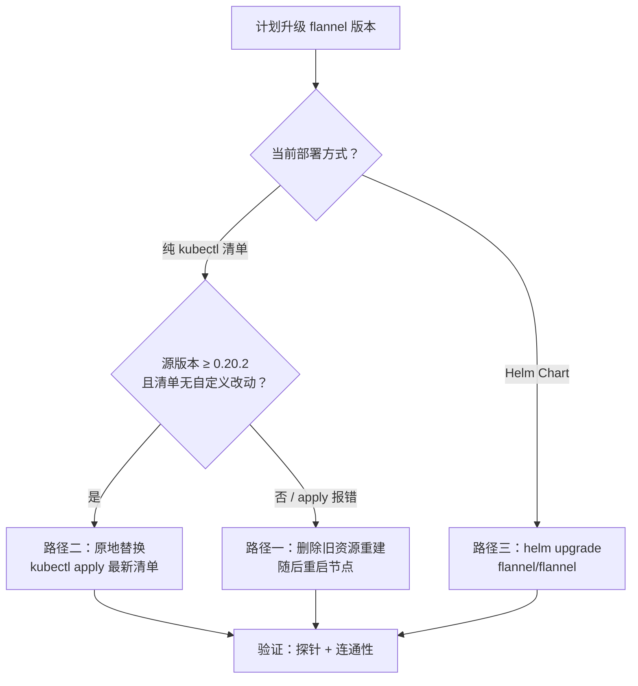
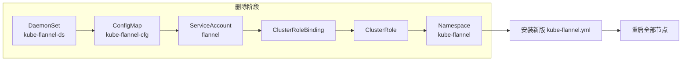
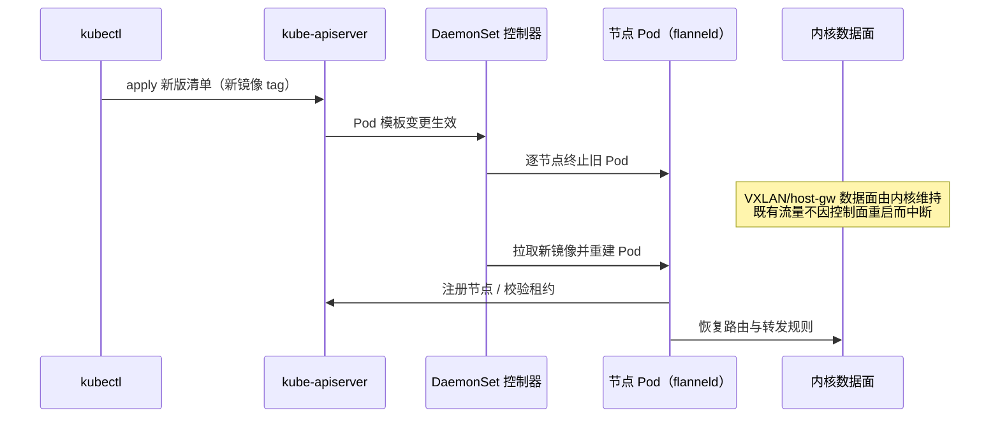

flannel 作为运行在集群每个节点上的 CNI 守护进程，其升级操作直接影响全部节点的 Pod 网络数据面，因此升级路径的选择本质上是在"环境干净度"与"网络中断窗口"之间做权衡。官方升级文档将版本变更归纳为三种方式：删除旧资源后重建（kubectl）、原地替换（on-the-fly apply）以及基于 Helm 仓库的滚动升级。本文将逐一拆解这三种路径的操作步骤、底层机制与适用边界，并说明升级后如何借助 healthz/readyz 探针完成验证。

## 三种升级路径总览与选型

升级方式的第一分叉点是"集群最初如何部署 flannel"。官方文档明确指出存在三种变更 flannel 版本的方法，各有明确的优缺点边界：删除重建方式最干净但会带来集群级网络中断；原地替换中断最小，但要求人工比对资源差异；Helm 方式自 v0.21.4 起可用，通过仓库直接管理版本演进。



| 维度 | 路径一：删除重建 | 路径二：原地替换 | 路径三：Helm 升级 |
|---|---|---|---|
| 优点 | 资源管理最干净，无需人工校验 | 中断最小，操作简单 | 版本管理交给 Helm，可追踪 release |
| 缺点 | 升级期间集群网络大面积中断 | 部分版本变更需清理/重命名资源，需人工比对 | 需保证 values 配置与现网一致 |
| 前提条件 | 任意版本 | 升级源版本不低于 0.20.2 | 自 v0.21.4 起发布的 Helm 仓库 |
| 中断窗口 | 全集群中断 + 节点重启 | DaemonSet 滚动更新 | DaemonSet 滚动更新 |

Sources: [upgrade.md](Documentation/upgrade.md#L1-L39)

## 路径一：删除旧资源后重建

这是官方定义的"最干净"路径：彻底删除 flannel 在集群中的全部资源定义，再安装新版本。其优点在于部署资源管理干净、且只要管理员没有额外创建过相关资源就无需人工校验；代价则是版本变更期间集群内会出现大范围网络中断，因此官方流程中明确要求在安装新版本后**重启节点**。

删除阶段需要按依赖顺序清理六类资源：DaemonSet、ConfigMap、ServiceAccount、ClusterRoleBinding、ClusterRole，最后是 `kube-flannel` 命名空间本身：

```bash
kubectl -n kube-flannel delete daemonset kube-flannel-ds
kubectl -n kube-flannel delete configmap kube-flannel-cfg
kubectl -n kube-flannel delete serviceaccount flannel
kubectl delete clusterrolebinding.rbac.authorization.k8s.io flannel
kubectl delete clusterrole.rbac.authorization.k8s.io flannel
kubectl delete namespace kube-flannel
```

之所以要精确覆盖这六类对象，是因为 flannel 的清单文件本身就由五个部分构成：设置了 `privileged` PodSecurity 级别的 `kube-flannel` 命名空间、用于 RBAC 的 ClusterRole 与 ClusterRoleBinding、`flannel` 服务账号、同时承载 CNI 配置与 flannel 配置的 ConfigMap，以及面向每种架构的 DaemonSet。删除清单即按此清单反向回收，保证新版安装时不会残留旧字段定义的冲突。



Sources: [upgrade.md](Documentation/upgrade.md#L8-L24), [kubernetes.md](Documentation/kubernetes.md#L9-L15)

## 路径二：原地替换（on-the-fly apply）

当升级源版本不低于 0.20.2 时，官方推荐直接向集群应用最新发布的清单文件，一条命令即可完成：

```bash
kubectl apply -f https://github.com/flannel-io/flannel/releases/latest/download/kube-flannel.yml
```

理解这条命令为何"够用"，需要看清单中镜像的定义方式：DaemonSet 的三个容器（CNI 插件安装 initContainer、CNI 配置安装 initContainer、flanneld 主容器）引用的都是**固定版本标签**，例如 `ghcr.io/flannel-io/flannel:v0.28.9` 与 `ghcr.io/flannel-io/flannel-cni-plugin:v1.9.1-flannel3`。因此，当上游发布新版本时，`releases/latest` 指向的清单中镜像标签随之更新，`kubectl apply` 会将新的 Pod 模板提交给 DaemonSet 控制器，触发逐节点滚动重建——这就是"原地替换"的完整机制。清单中并未显式声明 `updateStrategy`，因此采用 Kubernetes DaemonSet 的默认滚动更新策略。



原地替换路径的风险点在官方文档中有明确提示：如果 apply 过程中在标签上出现错误，应回退到路径一的删除重建方式。此外，滚动重启 flanneld 并非完全无代价——官方运行文档指出，在非 `udp` 后端下内核承担数据面、flanneld 仅作为控制面，因此重启（乃至升级）flanneld 不会扰动既有流；但对 `vxlan` 后端而言，操作必须**在几秒内完成**，因为 ARP 表项会开始超时，需要 flanneld 及时刷新；同时重启期间**配置不得变更**（例如 VNI、`--iface` 等值必须保持原样）。这正是原地替换与删除重建在体验上的本质差异来源：前者让每个节点的 flanneld 短暂离线并由内核兜底，后者则连同数据面一起拆除。

值得一提的是重启后子网信息的复用语义：flanneld 每次重启都会尝试读取节点上已写入的 `/run/flannel/subnet.env` 中的 `FLANNEL_SUBNET` 值，以避免主机来不及续租时网络信息被刷新；但该值只有在与数据存储中的网络配置兼容时才会被采用——例如旧值 `10.5.72.1/24` 落在 etcd 配置的 `10.6.0.0/16` 之外时，flannel 会重新分配租约。这意味着一次纯粹的版本升级（网络配置不变）会平滑继承原子网，而升级中若误改了全局网段，节点将获得新租约，Pod IP 漂移。

Sources: [upgrade.md](Documentation/upgrade.md#L21-L30), [kube-flannel.yml](Documentation/kube-flannel.yml#L134-L166), [running.md](Documentation/running.md#L116-L124), [running.md](Documentation/running.md#L49-L66)

## 路径三：Helm 仓库升级

自 v0.21.4 起，flannel 正式发布到 Helm 仓库 `https://flannel-io.github.io/flannel/`，使版本升级可以直接交给 Helm 管理：

```bash
helm upgrade flannel --set podCidr="10.244.0.0/16" --namespace kube-flannel flannel/flannel
```

命令中 `flannel/flannel` 的格式为"仓库名/Chart 名"，即先以标准 Helm 流程将官方仓库地址注册为名为 `flannel` 的本地仓库。Chart 的版本与所含应用版本严格同步——当前 Chart 文件中 `version` 与 `appVersion` 均为 `v0.28.9`，每次发版提交都会同步推进这两个字段，因此 `helm upgrade` 拉取新 Chart 即等于升级到对应版本的 flannel 与 flannel-cni-plugin。

Chart 将所有可调项集中在 values 中，升级时需要重点关注以下参数，确保它们与现网状态一致：

| values 键 | 默认值 | 升级时的意义 |
|---|---|---|
| `podCidr` | `10.244.0.0/16` | 全局 Pod 网段，运行时不可变更 |
| `flannel.image.tag` | `v0.28.9` | 主容器镜像版本，随 Chart 同步更新 |
| `flannel.flannel_cni.image.tag` | `v1.9.1-flannel3` | CNI 插件镜像版本，随 Chart 同步更新 |
| `flannel.backend` | `vxlan` | values 中明确注释：运行时不得更改后端类型 |
| `flannel.healthz.port` | `8081` | 升级后验证所依赖的健康检查端口 |
| `netpol.enabled` | `false` | 是否追加 kube-network-policies 边车容器 |

模板在渲染 DaemonSet 时从 values 直接注入镜像引用（`{{ .Values.flannel.image.repository }}:{{ .Values.flannel.image.tag }}`），与路径二同理，镜像标签变化即触发滚动更新。Chart 的模板还内置了与官方清单一致的健康探针定义——`/healthz` 存活探针与 `/readyz` 就绪探针，这为升级后的自动化验证提供了抓手。

Sources: [upgrade.md](Documentation/upgrade.md#L33-L39), [Chart.yaml](chart/kube-flannel/Chart.yaml#L1-L10), [values.yaml](chart/kube-flannel/values.yaml#L16-L35), [daemonset.yaml](chart/kube-flannel/templates/daemonset.yaml#L65-L99)

## 升级的不变量：哪些配置不能在升级中顺手改掉

三种路径共享同一组运行时约束，官方运行文档将其归纳为四条"运行时限制"，升级操作前必须核对这些不变量：数据存储类型不可更改；后端类型不可更改（除非停止全部工作负载并重启所有 flannel 守护进程）；`subnetlen`/`subnetmin`/`subnetmax` 可通过守护进程重启变更，但需谨慎——若有 Pod 已使用新范围之外的 IP，它们将停止工作；集群全局网段无法在不停机的情况下更改。Chart 的 values 注释与这条约束形成呼应：后端字段旁明确标注"不应在运行时更改"。

| 配置项 | 升级时能否变更 | 后果 |
|---|---|---|
| 数据存储类型（etcd/kube） | 否 | 守护进程直接不支持运行时切换 |
| 后端类型 | 否（除非停空工作负载） | 需停止全部工作负载并重启所有 flanneld |
| subnetlen/min/max | 重启时可改 | 范围外 Pod IP 失效 |
| 集群全局网段 | 否 | 无停机路径 |
| VNI / `--iface` 等重启敏感项 | 重启期间否 | 原地替换的零中断前提被破坏 |

这条约束矩阵解释了一个常见误区：升级是变更版本的机会窗口，但**不是**变更网络拓扑的机会窗口。若确需更换后端或网段，官方给出的路径是停空工作负载后的完整重建，而非搭升级便车。

Sources: [running.md](Documentation/running.md#L81-L87), [values.yaml](chart/kube-flannel/values.yaml#L32-L34)

## 升级后验证：healthz 与 readyz 探针

无论选择哪条路径，滚动更新完成后都应确认每个节点上的 flanneld 完成了两件事：写出 `subnet.env` 并就位流量规则。当前版本的代码将就绪状态实现为一个原子布尔量——只有当 `subnet.env` 已写入且流量规则生效后 `isReady` 才置位，对应清单中预配置的两个 HTTP 探针：`/healthz` 存活探针（初始延迟 10 秒、周期 30 秒）与 `/readyz` 就绪探针（初始延迟 5 秒、周期 10 秒），端口为 `--healthz-port=8081`。

```bash
kubectl -n kube-flannel get pods -o wide   # 确认所有 Pod 就绪
kubectl -n kube-flannel get daemonset kube-flannel-ds   # 确认 DESIRED = READY
```

这一探针机制使得三条升级路径的验收标准收敛为同一形式：DaemonSet 的期望副本数与就绪副本数一致、每个节点上 `/readyz` 返回成功。若某节点长期不就绪，通常意味着新版本在该节点上未能完成子网租约或流量规则配置，应结合日志按删除重建路径回退。

Sources: [kube-flannel.yml](Documentation/kube-flannel.yml#L166-L182), [main.go](main.go#L104-L111)

## 小结与延伸阅读

三种升级路径构成一个清晰的光谱：删除重建以全集群中断换取最干净的资源状态；原地替换以固定镜像标签 + DaemonSet 滚动更新实现最小中断，适用于 v0.20.2 之后的版本演进；Helm 路径则将版本管理与 values 配置治理交给包管理器，是 v0.21.4 之后新部署形态的首选。它们的共同前提是尊重升级不变量——数据存储、后端类型与全局网段不在升级中变更，并以 healthz/readyz 探针作为统一验收标准。

建议按以下路径继续深入：

- 若尚未部署 flannel，先阅读 [快速开始：在 Kubernetes 集群中一键部署 flannel](2-kuai-su-kai-shi-zai-kubernetes-ji-qun-zhong-jian-bu-shu-flannel) 与 [Helm Chart 部署与网络策略（netpol）集成](3-helm-chart-bu-shu-yu-wang-luo-ce-lue-netpol-ji-cheng)；
- 想理解为什么 flanneld 重启不中断数据面，请继续阅读 [flanneld 架构总览：启动流程与组件协作全解](6-flanneld-jia-gou-zong-lan-qi-dong-liu-cheng-yu-zu-jian-xie-zuo-quan-jie) 与 [子网租约机制：从全局大网段到主机子网的分配与续约](7-zi-wang-zu-yue-ji-zhi-cong-quan-ju-da-wang-duan-dao-zhu-ji-zi-wang-de-fen-pei-yu-xu-yue)；
- 升级失败需要排障时，可参考 [常见故障排查：连通性、权限、日志与日志级别](25-chang-jian-gu-zhang-pai-cha-lian-tong-xing-quan-xian-ri-zhi-yu-ri-zhi-ji-bie) 与 [运行时限制、零停机重启与 subnet.env 持久化语义](27-yun-xing-shi-xian-zhi-ling-ting-ji-zhong-qi-yu-subnet-env-chi-jiu-hua-yu-yi)。