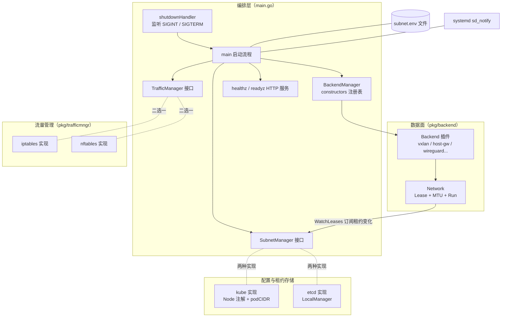
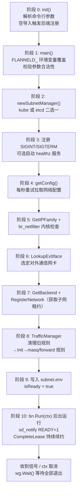

flanneld 是 flannel 的核心守护进程，它负责为每个节点申请一个 Pod 子网、维护节点间的网络可达性，并配置宿主机上的转发与伪装规则。本页面向初学者，从 `main.go` 入口出发，完整拆解 flanneld 的启动时序、五大核心组件（SubnetManager、BackendManager、Backend 插件、TrafficManager、healthz 服务）的职责边界与协作方式，并给出并发模型与优雅退出机制的说明。读完本页，你将能够对照源码追踪每一次 flannel 启动日志背后的代码路径。

Sources: [main.go](main.go#L217-L514)

## 全局架构：一张图看懂 flanneld

flanneld 的整体架构遵循"**编排层与数据面解耦**"的原则：`main.go` 作为编排层，串联起配置获取、组件装配与生命周期管理；真正的数据面工作则交给可插拔的 Backend 插件完成。整个进程围绕一个全局 `context` 组织，所有 goroutine 都监听它的取消信号，从而实现一键优雅退出。



图中三个关键抽象值得先记住：**SubnetManager** 屏蔽了"租约存在哪里"（Kubernetes API 还是 etcd）；**Backend** 决定了"数据包如何跨主机传输"；**TrafficManager** 则负责"宿主机防火墙规则"的安装与周期性重同步。三者通过 `pkg` 下的 Go 接口定义协作，彼此不依赖具体实现。

Sources: [main.go](main.go#L37-L59), [pkg/subnet/subnet.go](pkg/subnet/subnet.go#L94-L106), [pkg/backend/manager.go](pkg/backend/manager.go#L28-L30), [pkg/trafficmngr/trafficmngr.go](pkg/trafficmngr/trafficmngr.go#L38-L60)

## 启动流程逐步分解

flanneld 的启动可以划分为 10 个阶段，理解这条主线是阅读源码的最佳路径。下面的流程图对应 `main()` 函数的执行顺序，每一步之后都标注了源码位置：



**阶段 0：`init()` 与插件注册。** Go 程序在执行 `main()` 之前会先运行所有包的 `init()`。flannel 利用这一特性，在 `main.go` 中以空导入（`_ "github.com/flannel-io/flannel/pkg/backend/vxlan"` 等形式）引入全部 9 个后端包，使每个后端的 `init()` 有机会把自己注册进全局 `constructors` 映射表。这是整个插件体系的基石。

Sources: [main.go](main.go#L48-L60), [pkg/backend/hostgw/hostgw.go](pkg/backend/hostgw/hostgw.go#L32-L34)

**阶段 1：参数解析与校验。** `init()` 中完成了所有命令行 flag 的定义与解析，`main()` 紧接着用 `flagutil.SetFlagsFromEnv(flannelFlags, "FLANNELD")` 允许环境变量覆盖同名 flag（如 `FLANNELD_IFACE`），随后校验 `--subnet-lease-renew-margin` 必须在 1 到 1439 分钟之间。

Sources: [main.go](main.go#L113-L178), [main.go](main.go#L223-L235)

**阶段 2：创建 SubnetManager。** `newSubnetManager()` 是一个工厂函数：若指定了 `--kube-subnet-mgr`，则创建 kube 实现（从 Kubernetes API 读取 Node 的 podCIDR）；否则创建 etcd 的 `LocalManager`，并先从旧的 `subnet.env` 文件中读出上次的子网（`prevSubnet`），以便重启时续租同一个子网而不是重新分配。

Sources: [main.go](main.go#L190-L215)

**阶段 3：信号与健康检查。** 进程为 `SIGINT` 和 `SIGTERM` 安装处理器，交给独立的 `shutdownHandler` goroutine 监听；同时若 `--healthz-port` 大于 0 则启动 HTTP 健康服务。该服务暴露两个端点：`/healthz` 在进程存活期间始终返回 200，而 `/readyz` 只有在 `subnet.env` 写入成功且流量规则就位（`isReady` 原子变量为真）后才返回 200。

Sources: [main.go](main.go#L257-L272), [main.go](main.go#L552-L605)

**阶段 4：拉取网络配置。** `getConfig()` 内部是一个无限重试循环：每秒调用一次 `sm.GetNetworkConfig(ctx)`，直到成功拿到包含 `BackendType` 的 `subnet.Config` 才返回。这意味着即使配置尚未就绪（例如 ConfigMap 还没挂载完成），flanneld 也会耐心等待而不是崩溃退出。

Sources: [main.go](main.go#L275-L279), [main.go](main.go#L531-L550)

**阶段 5：IP 栈与内核环境检查。** `ipmatch.GetIPFamily()` 根据 `net-conf.json` 中 `EnableIPv4`/`EnableIPv6` 的组合判定当前运行在 IPv4、IPv6 还是双栈模式；随后（在 Linux 且未启用 nftables 时）检查 `/proc/sys/net/bridge/bridge-nf-call-iptables` 是否存在，以提前发现 `br_netfilter` 模块缺失的问题——这是 Kubernetes 1.30 之后的 kubeadm 环境中一个已知的踩坑点。

Sources: [main.go](main.go#L281-L302), [pkg/ipmatch/match.go](pkg/ipmatch/match.go#L42-L51)

**阶段 6：选择对外网卡。** 首先询问 SubnetManager 是否存有注解的公网 IP（`sm.GetStoredPublicIP`），然后按优先级依次尝试 `--iface`（精确 IP 或网卡名）、`--iface-regex`（正则匹配）和 `--iface-can-reach`（可达性探测），三者都未命中时直接退出。选出的结果封装为 `ExternalInterface` 结构，其中同时记录网卡对象、内部地址（IfaceAddr/IfaceV6Addr）与对外地址（ExtAddr/ExtV6Addr）。

Sources: [main.go](main.go#L304-L370), [pkg/backend/common.go](pkg/backend/common.go#L26-L33)

**阶段 7：装配后端并获取租约。** `backend.NewManager(ctx, sm, extIface)` 创建后端管理器，`bm.GetBackend(config.BackendType)` 从注册表中查找构造函数并实例化后端。随后调用 `be.RegisterNetwork(ctx, &wg, config)`——这一步是各后端与租约体系的交汇点：以 host-gw 为例，它会构建 `LeaseAttrs`（携带 BackendType 和 PublicIP），然后调用 `sm.AcquireLease(ctx, &attrs)` 为本节点申请子网租约。

Sources: [main.go](main.go#L372-L388), [pkg/backend/hostgw/hostgw.go](pkg/backend/hostgw/hostgw.go#L53-L103)

**阶段 8：流量规则编排。** 这里有个精巧的设计：flannel 先实例化一个"与当前选择相反"的 TrafficManager 执行 `CleanUp()`，确保上一次以不同模式（iptables vs nftables）运行时遗留的规则被清空；随后创建真正的 TrafficManager 执行 `Init()`，再按需安装 MASQUERADE 伪装规则（`--ip-masq`）和 FORWARD 转发规则（`--iptables-forward-rules`），以及可选的黑洞路由 goroutine。

Sources: [main.go](main.go#L390-L443), [main.go](main.go#L679-L686)

**阶段 9：就绪判定。** `sm.HandleSubnetFile()` 把分配到的子网、MTU、IPMASQ 标志等写入 `subnet.env` 文件（默认路径 `/run/flannel/subnet.env`，供 kubelet 和 Docker 读取）。写入成功后设置 `isReady = true` 并打出 "flannel is ready" 日志——这正是 `/readyz` 从 503 翻转为 200 的时刻。

Sources: [main.go](main.go#L477-L485), [pkg/subnet/subnet.go](pkg/subnet/subnet.go#L70-L92)

**阶段 10：进入稳态运行。** `bn.Run(ctx)` 在独立 goroutine 中阻塞运行后端网络（例如 host-gw 会在此监听租约增删事件并同步路由表）；`daemon.SdNotify(false, "READY=1")` 通知 systemd 服务已就绪；最后主 goroutine 进入 `sm.CompleteLease()`，它内部会周期性续租并阻塞直到 ctx 取消或租约被吊销。`wg.Wait()` 等待所有 goroutine 退出后进程干净结束。

Sources: [main.go](main.go#L487-L513)

## 核心组件一：SubnetManager——租约的统一入口

`subnet.Manager` 接口是 flanneld 与存储层之间唯一的契约，共 10 个方法，覆盖了配置读取、租约申请/续约/监视/完成、以及 `subnet.env` 写入等全部存储操作。初学者只需抓住其中四个核心方法：`GetNetworkConfig`（启动时读配置）、`AcquireLease`（申请本节点子网）、`WatchLeases`（订阅全集群租约变化）、`CompleteLease`（阻塞续租直到退出）。

Sources: [pkg/subnet/subnet.go](pkg/subnet/subnet.go#L94-L106)

两个实现的差异对比：

| 维度 | kube 实现 | etcd 实现 |
| --- | --- | --- |
| 标识符 | `Kubernetes Subnet Manager - <节点名>` | `Etcd Local Manager with Previous Subnet: <子网>` |
| 子网来源 | Node 对象的 `spec.podCIDR(s)` | 从全局网段中自动分配，etcd 键存储 |
| 变更感知 | Node Informer 的 Add/Update/Delete 回调 | etcd watch 机制 |
| 典型场景 | Kubernetes 集群内 DaemonSet 部署 | 裸 Docker + etcd 环境 |

Sources: [pkg/subnet/kube/kube.go](pkg/subnet/kube/kube.go#L633-L635), [pkg/subnet/etcd/local_manager.go](pkg/subnet/etcd/local_manager.go#L428-L439)

kube 实现内部维持着一个 Node 资源的 Informer：任何节点的新增、更新或删除都会被转换成租约事件放入一个容量可配（环境变量 `EVENT_QUEUE_DEPTH`，默认 5000）的队列中。一个有趣的细节是：当后端类型为 `alloc` 时会禁用 Informer，因为路由由云控制器管理器等外部组件负责。

Sources: [pkg/subnet/kube/kube.go](pkg/subnet/kube/kube.go#L171-L248)

## 核心组件二：BackendManager 与 Backend 插件体系

`backend.Manager` 接口只有一个方法 `GetBackend(backendType string)`，但其内部维护着两份状态：包级别的 `constructors` 注册表（存放所有后端的构造函数），以及 manager 实例上的 `active` 缓存（避免重复创建同一后端）。`GetBackend` 的查找逻辑是：先把类型名转为小写 → 查活跃缓存 → 未命中则查注册表并调用构造函数 → 缓存结果，同时启动一个 goroutine 监听 ctx 取消以便清理缓存项。

Sources: [pkg/backend/manager.go](pkg/backend/manager.go#L26-L89)

所有后端都实现极简的两个接口。`Backend` 只要求实现 `RegisterNetwork`；返回的 `Network` 则要求提供 `Lease()`（本节点租约）、`MTU()`（计算后的传输单元大小）和 `Run(ctx)`（阻塞式运行循环）。这种窄接口设计使得新增一种数据面实现（如腾讯云 VPC）不需要触碰任何编排层代码。

| 接口 | 方法集 | 语义 |
| --- | --- | --- |
| `Backend` | `RegisterNetwork(ctx, wg, config)` | 创建并开始管理一个网络，完成租约申请 |
| `Network` | `Lease()` / `MTU()` / `Run(ctx)` | 暴露租约与 MTU，阻塞运行数据面循环 |
| `BackendCtor` | `func(sm, ei) (Backend, error)` | 统一的构造函数签名 |

Sources: [pkg/backend/common.go](pkg/backend/common.go#L39-L51)

为避免各后端重复造轮子，公共包提供了两个可嵌入的基座：`SimpleNetwork` 直接实现了 `Lease()` 和 `MTU()`（MTU 取自外部网卡的 MTU），其 `Run()` 仅阻塞等待 ctx 结束，适合无需持续同步的后端；`RouteNetwork` 在其上扩展出完整的"监听租约事件 → 增删路由表项"循环，host-gw 和 ipip 等基于路由的后端都复用它，只需注入各自的 `GetRoute` 回调函数即可。

Sources: [pkg/backend/simple_network.go](pkg/backend/simple_network.go#L23-L38), [pkg/backend/route_network.go](pkg/backend/route_network.go#L37-L103)

`RouteNetwork.handleSubnetEvents` 展示了典型的数据面反应模式：收到 `EventAdded` 时先校验事件的 `BackendType` 是否与自身匹配（过滤掉其他后端的节点），再调用 `netlink.RouteAdd` 写入内核路由；收到 `EventRemoved` 时对称地删除路由。这个"声明式同步"循环正是 flannel 保持集群路由一致性的核心机制。

Sources: [pkg/backend/route_network.go](pkg/backend/route_network.go#L83-L130)

## 核心组件三：TrafficManager——iptables 与 nftables 的双实现

`TrafficManager` 接口定义了四个方法：`Init`（初始化）、`CleanUp`（清理已有规则）、`SetupAndEnsureForwardRules`（安装转发规则并周期重同步）和 `SetupAndEnsureMasqRules`（安装 NAT 伪装规则并周期重同步）。接口中的 `prevSubnet`/`prevNetwork` 系列参数用于检测"配置是否发生变化"，从而决定是否替换宿主机上已存在的旧规则。

Sources: [pkg/trafficmngr/trafficmngr.go](pkg/trafficmngr/trafficmngr.go#L38-L60)

工厂函数 `newTrafficManager(useNftables bool)` 依据 `net-conf.json` 中的 `EnableNFTables` 字段在两个实现间选择。值得注意的是 main 流程中会创建**两个**实例：一个反向实例专司清理（保证后端切换后不留脏规则），一个正向实例负责实际安装——这个"先擦黑板再写字"的模式对运维排障很有启发。

Sources: [main.go](main.go#L390-L409), [main.go](main.go#L679-L686)

## 关键数据结构：Lease 与 Config

租约（Lease）是贯穿所有组件的数据主线，理解它的字段就理解了 flannel 的"世界模型"：

| 字段 | 含义 |
| --- | --- |
| `Subnet` / `IPv6Subnet` | 本节点被分配的 IPv4/IPv6 Pod 子网 |
| `Attrs.PublicIP` / `PublicIPv6` | 其他节点访问本机应使用的地址 |
| `Attrs.BackendType` | 声明该节点使用的后端类型，用于跨节点过滤 |
| `Attrs.BackendData` | 后端自定义的附加数据（如 VXLAN 的 VTEP MAC） |
| `Expiration` | 租约到期时间，由续约机制刷新 |

Sources: [pkg/lease/lease.go](pkg/lease/lease.go#L42-L60)

而 `subnet.Config` 是 `net-conf.json` 解析后的内存表示：`Network`（全局大网段）、`SubnetLen`（每个主机子网的掩码长度）、`SubnetMin/Max`（可分配范围）、`BackendType` 等。`ParseConfig` 的默认行为有两条值得记住：IPv4 默认开启；若配置中未指定 `Backend` 字段，则回落到最保守的 `udp` 后端。

Sources: [pkg/subnet/config.go](pkg/subnet/config.go#L26-L72)

## 并发模型与优雅退出

flanneld 的并发模型围绕"**一个 context + 一个 WaitGroup**"构建：`main()` 创建的 `ctx` 被传递给每一个 goroutine，`wg` 则精确记录每个需要等待的执行体。下表列出了运行期的主要 goroutine 及其退出条件：

| goroutine | 启动位置 | 退出条件 |
| --- | --- | --- |
| `shutdownHandler` | main.go | 收到信号后调用 `cancel()` 即返回 |
| healthz HTTP 服务（×2） | `mustRunHealthz` | ctx 取消后 3 秒超时优雅关闭 |
| `bn.Run(ctx)` 后端主循环 | main.go | ctx 取消，WatchLeases 通道关闭 |
| 黑洞路由维持（×2） | main.go | `select` 监听到 `ctx.Done()` |
| 后端缓存清理 | BackendManager | `bm.ctx.Done()` 触发后删除 active 表项 |

Sources: [main.go](main.go#L237-L268), [main.go](main.go#L495-L513), [pkg/backend/manager.go](pkg/backend/manager.go#L72-L86)

退出链路值得完整走一遍：用户按下 Ctrl+C → `shutdownHandler` 收到信号调用 `cancel()` → 所有 goroutine 的 `ctx.Done()` 被触发陆续返回 → 主 goroutine 的 `CompleteLease` 返回 → `wg.Wait()` 归零 → 打印 "Exiting cleanly..." 并以 0 状态码退出。若 `CompleteLease` 返回的是"租约被吊销"错误（`errInterrupted`），则会主动 `cancel()` 触发全进程关停，防止用一个已被回收的子网继续运行。

Sources: [main.go](main.go#L500-L513), [main.go](main.go#L516-L529)

## 目录结构导览

结合上述组件，仓库中与本页直接相关的代码分布在以下位置（省略无关目录）：

```
├── main.go                      # 入口：参数解析、启动编排、shutdownHandler、healthz
├── pkg/
│   ├── backend/
│   │   ├── manager.go           # BackendManager + constructors 注册表
│   │   ├── common.go            # Backend/Network/ExternalInterface 接口定义
│   │   ├── simple_network.go    # 可嵌入基座：Lease/MTU/空 Run
│   │   ├── route_network.go     # 路由型后端基座：监听租约→增删路由
│   │   ├── hostgw/ vxlan/ wireguard/ ...   # 9 个具体后端插件
│   ├── subnet/
│   │   ├── subnet.go            # Manager 接口、WatchLeases 助手、WriteSubnetFile
│   │   ├── config.go            # net-conf.json → subnet.Config
│   │   ├── kube/kube.go         # kube SubnetManager（Node Informer）
│   │   └── etcd/local_manager.go# etcd LocalManager
│   ├── trafficmngr/
│   │   ├── trafficmngr.go       # TrafficManager 接口
│   │   ├── iptables/ nftables/  # 两个实现
│   ├── ipmatch/match.go         # GetIPFamily 与 LookupExtIface
│   └── lease/lease.go           # Lease/LeaseAttrs/事件类型定义
```

Sources: [main.go](main.go#L1-L60), [pkg/backend/manager.go](pkg/backend/manager.go#L15-L48)

## 推荐阅读路线

本页建立了 flanneld 的骨架认知，接下来的深入方向建议按依赖顺序推进：理解启动流程后，最先要弄清租约如何分配与续约，请阅读 [子网租约机制：从全局大网段到主机子网的分配与续约](7-zi-wang-zu-yue-ji-zhi-cong-quan-ju-da-wang-duan-dao-zhu-ji-zi-wang-de-fen-pei-yu-xu-yue)；然后补全本页刻意略过的插件注册细节，参见 [后端插件注册模式：基于 init() 与构造器映射的扩展点设计](8-hou-duan-cha-jian-zhu-ce-mo-shi-ji-yu-init-yu-gou-zao-qi-ying-she-de-kuo-zhan-dian-she-j i)。若你想对比各数据面的取舍，[推荐后端对比：VXLAN、host-gw 与 WireGuard 选型](10-tui-jian-hou-duan-dui-bi-vxlan-host-gw-yu-wireguard-xuan-xing) 提供了选型矩阵；而 kube SubnetManager 的 Informer 机制在 [kube subnet manager：Node 注解、podCIDR 与 informer 机制](19-kube-subnet-manager-node-zhu-jie-podcidr-yu-informer-ji-zhi) 中有专文展开。配置层面的细节可后续查阅 [net-conf.json 网络配置项逐项详解](13-net-conf-json-wang-luo-pei-zhi-xiang-zhu-xiang-xiang-jie) 与 [命令行参数与环境变量（FLANNELD_）完整参考](14-ming-ling-xing-can-shu-yu-huan-jing-bian-liang-flanneld_-wan-zheng-can-kao)。