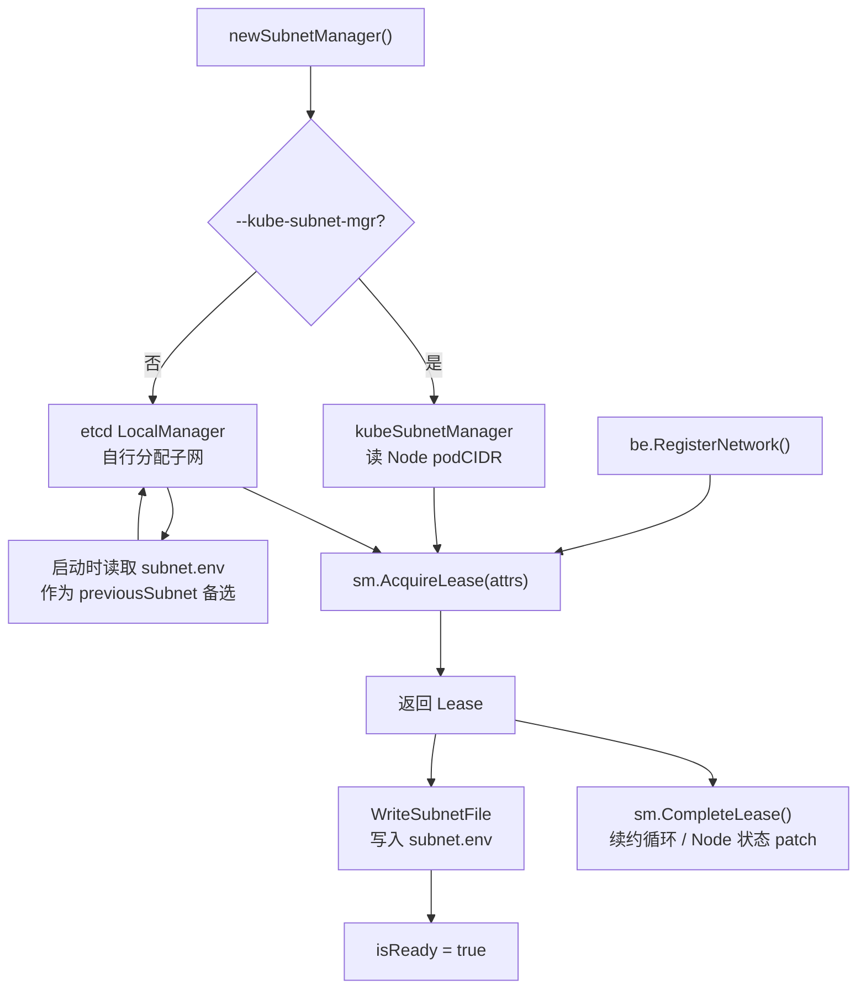
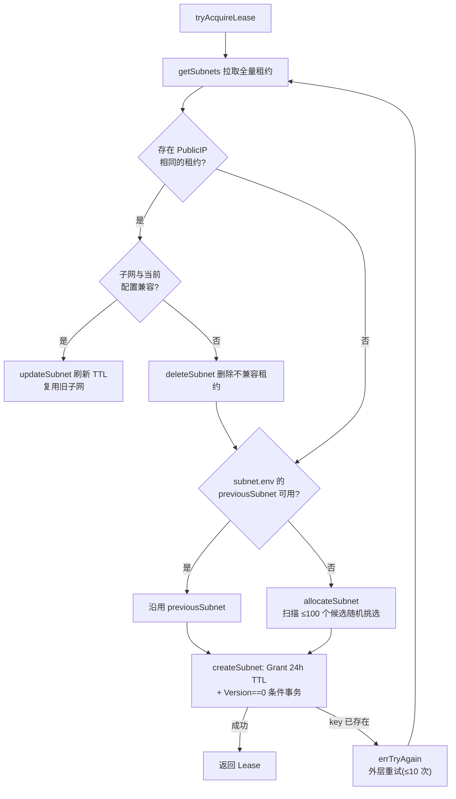
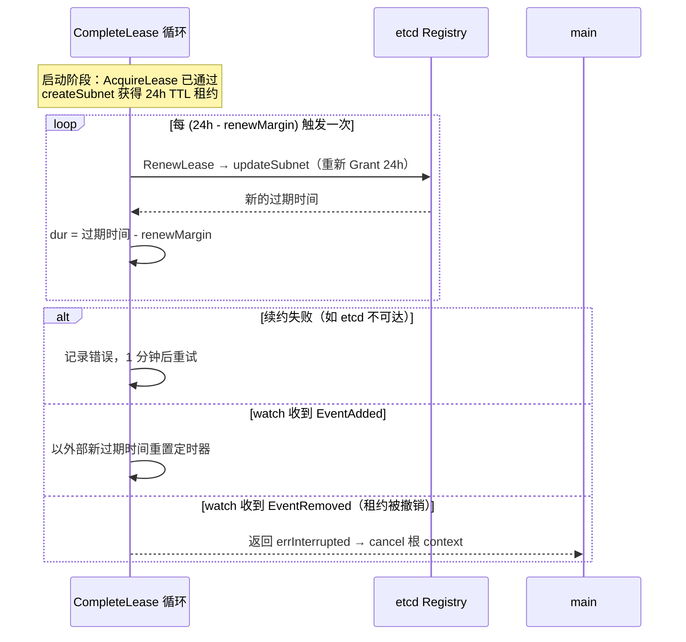

flannel 的核心承诺是"给每个节点一段互不冲突的 Pod 子网"，而兑现这一承诺的正是**子网租约机制**：flanneld 启动时从全局大网段中为自己"租"一小段子网，之后周期性续约以维持所有权，租约一旦被撤销则整个守护进程退出。本文沿着"切分规则 → 获取 → 续约 → 落盘复用 → 失效场景"的主线，剖析 etcd 与 Kubernetes 两种存储后端下的完整实现。阅读本文前建议先了解 [flanneld 架构总览：启动流程与组件协作全解](6-flanneld-jia-gou-zong-lan-qi-dong-liu-cheng-yu-zu-jian-xie-zuo-quan-jie) 中的启动流程。

## 租约：flannel 的地址所有权抽象

**Lease** 是整个机制的核心数据结构，由四部分组成：持有的子网（`Subnet` / `IPv6Subnet`，双栈场景两者并存）、附加属性 `LeaseAttrs`（对外可达的 `PublicIP`、后端类型 `BackendType` 以及后端自定义数据如 VXLAN 的 VNI 与 VtepMAC）、过期时间 `Expiration`，以及仅供 etcd 模式使用的游标字段 `Asof`。本质上，租约 = "一段子网 + 谁在用它 + 用到什么时候"的三元组契约。

Sources: [lease.go](pkg/lease/lease.go#L41-L60)

对租约的所有操作被收敛到 `subnet.Manager` 接口中：`AcquireLease` 负责获取、`RenewLease` 负责续约、`CompleteLease` 负责启动租约的最终守护循环，`WatchLease(s)` 提供变更订阅。flannel 在启动时依据 `--kube-subnet-mgr` 参数在两个实现之间二选一——etcd 的 `LocalManager` 或 `kubeSubnetManager`——后续所有组件（包括各网络后端）只面向该接口编程。

Sources: [subnet.go](pkg/subnet/subnet.go#L94-L106), [main.go](main.go#L190-L215)

理解这条链路的关键在于：**租约的获取并不发生在 `main()` 中，而是发生在后端注册阶段**。`main()` 创建 backend manager 并调用 `be.RegisterNetwork(ctx, &wg, config)`，后端（如 host-gw、vxlan）在其中构造携带自身 `PublicIP` 的 `LeaseAttrs`，再调用 `sm.AcquireLease()` 换回租约并存入 `SimpleNetwork` 结构，供后续 `bn.Lease()` 随时取用。

Sources: [main.go](main.go#L372-L388), [hostgw.go](pkg/backend/hostgw/hostgw.go#L64-L100), [simple_network.go](pkg/backend/simple_network.go#L23-L38)

## 前提：全局大网段如何切分成主机子网

etcd 模式下，flannel 自己承担"地址池管理员"角色，切分规则由 `CheckNetworkConfig` 统一裁定。以 IPv4 为例：若用户未指定 `SubnetLen`，当 `Network` 前缀不超过 /22 时默认给每个主机切 /24；网段更小时则退化为 `前缀 + 2`（保证每个子网至少 4 个可用地址）。校验层强制三条硬约束——子网长度必须小于 /31（给隧道与网桥设备留设备位）、大网段至少能容纳 4 个子网、以及网段前缀不得大于 /28，否则直接报错拒绝启动。

Sources: [config.go](pkg/subnet/config.go#L76-L108)

两个容易忽略的**边界细节**是：默认的 `SubnetMin` 并非 `Network` 的起始地址，而是跳过第一个子网（`Network.IP + subnetSize`），避免主机子网地址与大网段网络地址冲突；`SubnetMax` 则取大网段下一个网段的起始地址再回退一个子网大小。此外 `SubnetMin`/`SubnetMax` 必须按 `SubnetLen` 边界对齐，防止出现"半截子网"。IPv6 侧遵循完全同构的规则（默认 /64、最小 /124 网段），仅数值细节不同。

Sources: [config.go](pkg/subnet/config.go#L110-L135), [config.go](pkg/subnet/config.go#L137-L196)

| 配置项 | IPv4 默认值 | 语义 |
| --- | --- | --- |
| `SubnetLen` | Network 前缀 ≤ /22 时取 24，否则取 `前缀+2` | 每个主机子网的掩码长度 |
| `SubnetMin` | `Network.IP + 子网大小`（跳过第一个子网） | 可分配子网的起始边界 |
| `SubnetMax` | `Network.Next().IP - 子网大小` | 可分配子网的结束边界 |
| 对齐约束 | 必须 2^n 对齐到 SubnetLen | 防止子网跨界 |
| IPv6 `IPv6SubnetLen` | Network 前缀 ≤ /62 时取 64 | 双栈时独立切分 |

Sources: [config.go](pkg/subnet/config.go#L96-L135), [config.go](pkg/subnet/config.go#L152-L195)

## etcd 模式：AcquireLease 的三级匹配与事务抢占

etcd 模式的 `AcquireLease` 外层是一个最多 `raceRetries = 10` 次的重试循环，内层 `tryAcquireLease` 按**三级优先级**决策：先看集群里是否已存在与本机 `PublicIP` 相同的租约（公网 IP 是复用凭据）；再看本地 `subnet.env` 中记录的上次子网（`previousSubnet`）是否仍无人占用且与当前配置兼容；都落空才进入随机分配。

Sources: [local_manager.go](pkg/subnet/etcd/local_manager.go#L32-L35), [local_manager.go](pkg/subnet/etcd/local_manager.go#L107-L126)

第一级复用有明确的**兼容性守卫**：只有当旧租约的子网仍落在当前 `SubnetMin~SubnetMax` 范围内且掩码长度一致时才复用（复用即调用 `updateSubnet` 刷新 TTL 与属性）；否则该租约会被直接删除，流程落入下一级。第二级中 `previousSubnet` 来自启动时对 `subnet.env` 的 `FLANNEL_SUBNET` 解析——这正是 `Documentation/reservations.md` 描述的"重启后尽力找回旧子网"语义的实现现场。值得注意的是，`findLeaseBySubnet` 确认目标子网已被他人占用时会静默放弃，绝不抢占。

Sources: [local_manager.go](pkg/subnet/etcd/local_manager.go#L154-L196), [main.go](main.go#L210-L215), [main.go](main.go#L607-L641)

第三级 `allocateSubnet` 的实现颇有工程趣味：它从 `SubnetMin` 起顺序扫描，跳过所有与现存租约重叠的子网，**只收集最多 100 个候选**，然后用 `randInt` 随机选中一个。这样做既避免了多节点同时启动时全部涌向第一个空闲子网的"踩踏"，又保证了扫描成本有上界。候选耗尽则返回 `out of subnets`——这就是大规模集群需要提前规划 `Network` 大小的直接原因。

Sources: [local_manager.go](pkg/subnet/etcd/local_manager.go#L225-L274)

选中子网后的落库是**条件事务**：`createSubnet` 先通过 etcd 的 `Grant` 申请一个 `subnetTTL = 24h` 的租期对象，再以 `Version(key) == 0` 为前提条件执行 Put——若两个 flanneld 同时争抢同一子网，只有一个事务能成功，失败方收到 `errSubnetAlreadyexists` 并被翻译为 `errTryAgain`，驱动外层循环重新分配。整个"扫表 → 选址 → 条件写入 → 失败重试"的设计，是无锁环境下解决分布式资源竞争的经典范式。

Sources: [local_manager.go](pkg/subnet/etcd/local_manager.go#L198-L223), [registry.go](pkg/subnet/etcd/registry.go#L221-L254)

落库后的 etcd 键格式为 `<prefix>/subnets/<子网IP>-<掩码长度>`（如 `/coreos.com/network/subnets/10.5.52.0-24`，双栈追加 `&<IPv6>-<len>`），值是 `LeaseAttrs` 的 JSON 序列化；TTL 则附加在 etcd 原生 lease 对象上，读取时通过 `TimeToLive` 换算回 `Expiration` 时间戳。

Sources: [subnet.go](pkg/subnet/subnet.go#L36-L68), [registry.go](pkg/subnet/etcd/registry.go#L202-L219), [registry.go](pkg/subnet/etcd/registry.go#L514-L531), [reservations.md](Documentation/reservations.md#L8-L27)

## Kubernetes 模式：租约的"声明式化"

Kubernetes 模式下，**子网分配的主导权移交给了 kube-controller-manager 的节点 IPAM**：flannel 不再选址，而是消费 `Node.Spec.PodCIDR` / `PodCIDRs` 中已分配的结果。`AcquireLease` 首先通过 informer 缓存（或直连 API）轮询获取本 Node 对象（3 秒间隔、30 秒超时），若 podCIDR 尚未分配则报错退出——这也是 kube 模式要求先等 node controller 同步、集群需启用节点 IPAM 分配的根本原因。

Sources: [kube.go](pkg/subnet/kube/kube.go#L50-L53), [kube.go](pkg/subnet/kube/kube.go#L136-L164), [kube.go](pkg/subnet/kube/kube.go#L347-L379)

拿到 Node 后，flannel 的"获取租约"动作转化为两件事。其一是**校验**：解析 `PodCIDRs`（单栈取对应族的一个 CIDR，双栈各取一个，超过两个则报错），并用 `containsCIDR` 确认该 CIDR 确实落在 net-conf.json 声明的 `Network`/`IPv6Network` 之内——防止管理员改了 net-conf 却忘了改集群 CIDR。其二是**回写注解**：将 `BackendType`、`PublicIP`、后端数据（如 VtepMAC）等写入 Node annotations，并打上 `kube-subnet-managed=true` 标记；若检测到注解与期望值有差异，才构造 strategic merge patch 提交（3 秒间隔、30 秒超时的重试包裹），无差异则跳过写入，避免无谓的 API 压力。

Sources: [kube.go](pkg/subnet/kube/kube.go#L392-L517), [kube.go](pkg/subnet/kube/kube.go#L677-L681)

| 注解（默认前缀 `flannel.alpha.coreos.com/`） | 内容 |
| --- | --- |
| `kube-subnet-managed` | 固定 `true`，标记该 Node 的网络由 flannel 托管 |
| `backend-type` | 后端类型，如 `vxlan`、`host-gw` |
| `backend-data` / `backend-v6-data` | 后端自定义数据（VXLAN 的 VNI/VtepMAC 等） |
| `public-ip` / `public-ipv6` | 本节点对外可达地址 |
| `public-ip-overwrite` / `public-ipv6-overwrite` | 人工指定公网 IP，覆盖自动探测值 |

Sources: [annotations.go](pkg/subnet/kube/annotations.go#L62-L73), [kube.go](pkg/subnet/kube/kube.go#L436-L462)

一个体现两套存储语义差异的细节是：kube 模式构造的 Lease 虽然也填了 `Expiration: now + 24h`，但 `RenewLease` 直接返回 `ErrUnimplemented`——因为 Kubernetes 中租约不依赖 TTL 存活，**只要 Node 对象存在、podCIDR 未变，租约就永久有效**；子网回收等价于删除 Node 对象，这会经 informer 触发 `EventRemoved` 广播给其他节点。flannel 在此角色从"租客兼管理员"退化为纯"租客"，续约义务随之消失。

Sources: [kube.go](pkg/subnet/kube/kube.go#L494-L517), [kube.go](pkg/subnet/kube/kube.go#L624-L627), [kube.go](pkg/subnet/kube/kube.go#L542-L622)

## 续约与撤销：CompleteLease 的双重职责

etcd 模式的 `CompleteLease` 在 `main()` 尾部被调用，承担**续约定时器**与**自身租约监视**双重职责。续约节奏由提前量参数控制：`--subnet-lease-renew-margin` 默认 60 分钟（合法范围 1~1439），实际定时长度为 `距过期时间 - margin`，即默认在 24 小时租期的第 23 小时发起续约。续约通过 `RenewLease` → `updateSubnet` 重新 `Grant` 一个全新的 24h TTL 完成；失败时不放弃，而是 1 分钟后重试，为 etcd 短暂不可用留出恢复窗口。

Sources: [main.go](main.go#L127), [main.go](main.go#L227-L235), [local_manager.go](pkg/subnet/etcd/local_manager.go#L362-L388), [registry.go](pkg/subnet/etcd/registry.go#L256-L280)

监视循环同时 watch 自己子网对应的键。收到 `EventAdded`（例如管理员手工改写了 etcd 中的租约，或将其转换为无 TTL 的预留）时会以新过期时间重置定时器，避免外部变更与本地定时器打架；收到 `EventRemoved` 则意味着租约已被撤销（TTL 过期或人为删除），`CompleteLease` 返回 `errInterrupted`，`main()` 据此 cancel 根 context，**整个 flanneld 及其所有后端协程有序退出**——宁可停机也不无地址运行，这是网络组件的正确姿势。

Sources: [local_manager.go](pkg/subnet/etcd/local_manager.go#L390-L407), [main.go](main.go#L500-L513)

kube 模式的 `CompleteLease` 则完全去掉了续约语义，转而承担**就绪宣告**：在 clusterCIDR 控制器同步完成后，向本 Node patch `NodeNetworkUnavailable=False` 条件（Reason 为 `FlannelIsUp`），告知调度器本节点网络已就绪，可通过 `--set-node-network-unavailable=false` 关闭该行为。

Sources: [kube.go](pkg/subnet/kube/kube.go#L637-L675)

## subnet.env：租约结果的落盘、复用与就绪门控

租约敲定后，`HandleSubnetFile` 调用 `WriteSubnetFile` 将结果写入 `--subnet-file` 指定的文件（默认 `/run/flannel/subnet.env`），内容包含 `FLANNEL_NETWORK`、`FLANNEL_SUBNET`（注意写入前会 `IncrementIP()`，输出的是**第一个可用 IP** 起始的子网）、`FLANNEL_IPV6_*`（双栈时）、`FLANNEL_MTU` 与 `FLANNEL_IPMASQ`。该文件是 flannel 与 CNI 插件、kubelet 及 Docker 之间的交付契约，例如 mk-docker-opts.sh 会将其转写为 Docker 的 `--bip` 参数。

Sources: [subnet.go](pkg/subnet/subnet.go#L70-L92), [main.go](main.go#L477-L485)

写入采用 `renameio` 实现**原子替换**（先写临时文件再 rename），保证读方永远不会读到半截文件；写成功后 `isReady` 原子变量置位，`/readyz` 探针才开始返回 200——租约落盘被显式建模为"flannel 就绪"的先决条件之一。

Sources: [writefile_other.go](pkg/subnet/writefile_other.go#L25-L27), [main.go](main.go#L108-L111), [main.go](main.go#L477-L485)

这个文件还是 etcd 模式下的**跨重启记忆**：`newSubnetManager` 在创建 `LocalManager` 前先用 `ReadCIDRFromSubnetFile` 解析出上次的 IPv4/IPv6 子网，注入为 `previousSubnet`，构成前文三级匹配的第二级；kube 模式的 `HandleSubnetFile` 则额外把参数快照存入 `snFileInfo`，供 clusterCIDR 资源创建后重写文件使用。此外，ip-masq 规则清理也依赖从旧 subnet.env 读出的网段，确保网络变更后残留的 iptables 规则能被精准删除。

Sources: [main.go](main.go#L210-L215), [main.go](main.go#L411-L433), [kube.go](pkg/subnet/kube/kube.go#L683-L695)

## 两种存储后端的租约语义对比

| 维度 | etcd（LocalManager） | Kubernetes（kubeSubnetManager） |
| --- | --- | --- |
| 全局网段来源 | etcd `<prefix>/config` 键 | net-conf.json + 校验 podCIDR 包含关系 |
| 子网分配者 | flannel 自己（随机候选 + 条件事务抢占） | kube-controller-manager 节点 IPAM |
| 租约存放位置 | `subnets/<ip>-<len>` 键，值为 LeaseAttrs JSON | `Node.Spec.PodCIDR` + 一组注解 |
| 存活机制 | etcd lease TTL（24h），必须续约 | 无 TTL，Node 对象存续即有效 |
| 续约 | `RenewLease` + renew-margin 定时器 | 未实现（`ErrUnimplemented`） |
| 撤销后果 | watch 到删除事件 → flanneld 退出 | 删除 Node → informer 广播 EventRemoved |
| 重启复用凭据 | PublicIP 匹配 → subnet.env previousSubnet | Node 名称不变则 podCIDR 不变 |
| 获取完成后的附加动作 | 启动自身租约 watch | patch `NodeNetworkUnavailable=False` |

Sources: [local_manager.go](pkg/subnet/etcd/local_manager.go#L362-L407), [kube.go](pkg/subnet/kube/kube.go#L624-L675), [reservations.md](Documentation/reservations.md#L39-L52)

## 失效场景：过期、预留与公网 IP 变更

当节点停机时间超过剩余租期（例如停机恰好跨过续约时点且持续超过 24 小时），etcd 会自动回收该键，租约随之蒸发。此时重启的 flannel 会按前述三级匹配尽力挽回：PublicIP 若未变但租约已消失，则退而求其次尝试 `subnet.env` 中的旧子网，仅当该子网仍空闲且与当前 etcd 配置兼容时才能找回，否则接受重新分配——**节点公网 IP 变更或长期停机都可能导致 Pod 子网漂移**，这是运维上必须知晓的语义。

Sources: [reservations.md](Documentation/reservations.md#L24-L45), [local_manager.go](pkg/subnet/etcd/local_manager.go#L154-L196)

针对"子网必须钉死"的场景，flannel 官方支持**预留**：租约与预留的唯一区别就是 etcd TTL——用 `etcdctl put`（不带 `--lease` 选项）重写该键即可剥离 TTL，使其变为永久占用，续约逻辑会通过 `Expiration.IsZero()` 识别预留身份并在复用时保持其无 TTL 状态。这套机制让"动态租约"与"静态规划"在同一存储模型下共存。

Sources: [reservations.md](Documentation/reservations.md#L44-L52), [local_manager.go](pkg/subnet/etcd/local_manager.go#L160-L164)

## 小结

子网租约机制的本质是一条**所有权生命周期**：`CheckNetworkConfig` 定义切分语义 → `AcquireLease` 以"复用优先、抢占兜底"策略取得子网 → `CompleteLease` 以"提前量续约 + 删除即自杀"的守卫维持所有权 → subnet.env 提供跨重启的记忆与就绪门控。etcd 与 Kubernetes 两种后端分别是"租借制"与"声明制"的两种范式实现，但它们共享同一个 `subnet.Manager` 接口，因而对上层后端插件完全透明。

若想继续深入，建议按以下路径阅读：etcd 键空间与租约保留的完整设计见 [etcd 存储模式：配置键设计与租约保留](20-etcd-cun-chu-mo-shi-pei-zhi-jian-she-ji-yu-zu-yue-bao-liu)；Node 注解与 informer 事件管线见 [kube subnet manager：Node 注解、podCIDR 与 informer 机制](19-kube-subnet-manager-node-zhu-jie-podcidr-yu-informer-ji-zhi)；net-conf.json 中 `SubnetLen`/`SubnetMin` 等参数的配置实践见 [net-conf.json 网络配置项逐项详解](13-net-conf-json-wang-luo-pei-zhi-xiang-zhu-xiang-xiang-jie)；零停机重启下 subnet.env 的更多持久化语义见 [运行时限制、零停机重启与 subnet.env 持久化语义](27-yun-xing-shi-xian-zhi-ling-ting-ji-zhong-qi-yu-subnet-env-chi-jiu-hua-yu-yi)。