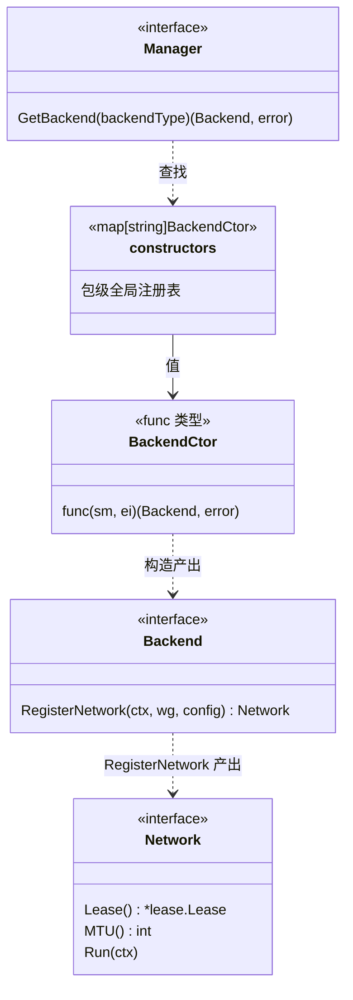
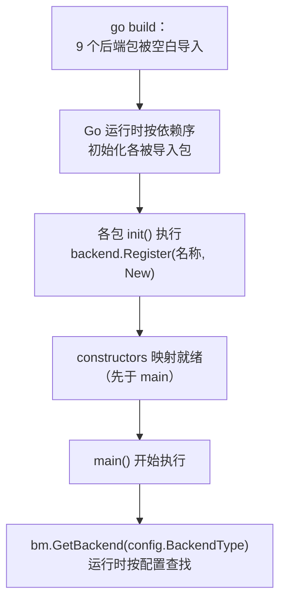
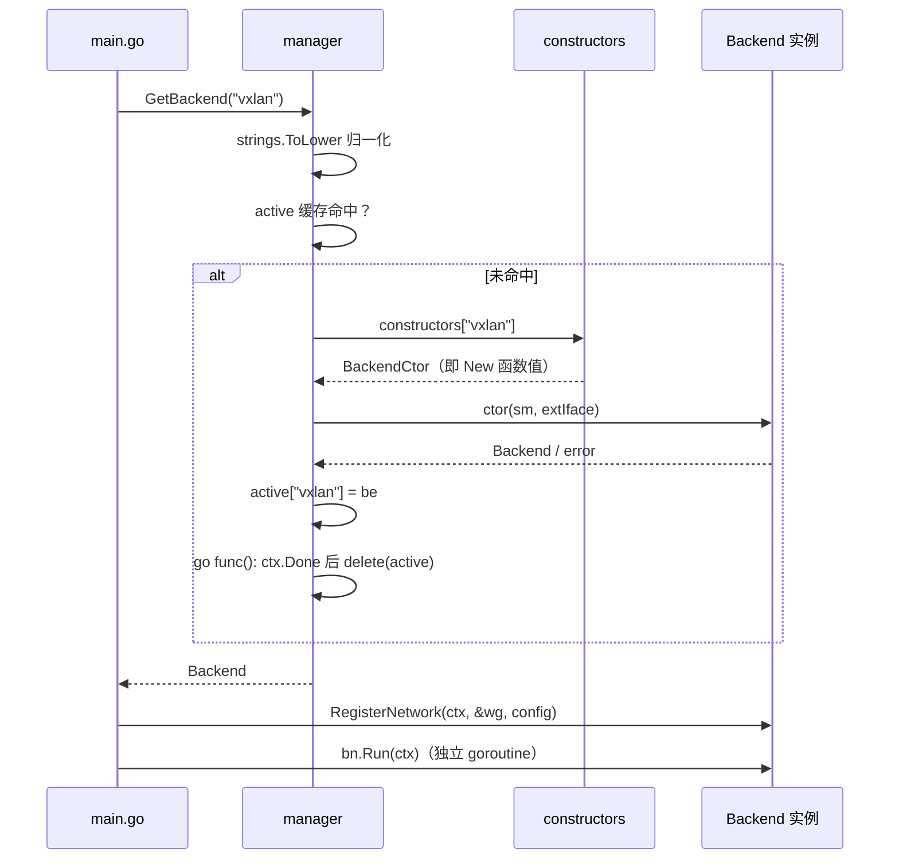
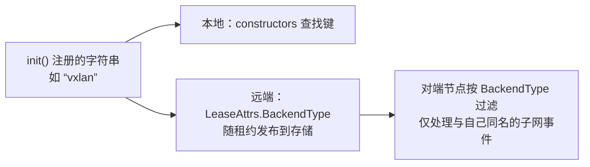

flannel 支持 vxlan、host-gw、wireguard 等九种网络后端，但核心框架为容纳它们只用了不到一百行代码。本文聚焦这套扩展点的三个组成部分：**包级 `init()` 自注册**、**全局构造器映射**（`constructors`）与**运行时惰性实例化**（`Manager.GetBackend`）。我们将从接口契约、注册时序、并发语义、平台差异，一直剖析到"注册名"在跨节点租约协议中的第二重身份，并给出评价与新增后端的操作指引。

## 核心抽象：三个类型撑起的契约面

扩展点的全部契约集中在 `pkg/backend/common.go` 中，只有三个类型定义。`BackendCtor` 是构造器签名——接收 `subnet.Manager` 与 `ExternalInterface`，返回 `Backend`；`Backend` 接口只有一个方法 `RegisterNetwork`，表示"接管一个网络"；`Network` 接口则定义了运行期行为（`Lease`/`MTU`/`Run`）。值得注意的是 `ExternalInterface` 被设计为**静态快照**：接口对象、内外 IPv4/IPv6 地址在构造时一次性注入，注释明确说明后端应缓存这些信息供后续使用，而非在数据面反复查询。

Sources: [common.go](pkg/backend/common.go#L26-L51)

这个契约面的精妙之处在于**关注点分离**：`Backend` 负责"创建网络"（一次性动作），`Network` 负责"运行网络"（长期循环）。构造器与网络运行分别对应两个接口，使得一个后端进程内可以同时管理多个 Network 实例，而构造逻辑只执行一次。单一方法的 `Backend` 接口也让实现门槛降到最低——任何能返回 `Network` 的结构体都能成为后端。

Sources: [common.go](pkg/backend/common.go#L39-L48)

## 注册侧：包级 init() 中的 backend.Register

每个后端包在其主文件里以完全相同的四行完成自注册。以 vxlan 为例，`init()` 中调用 `backend.Register("vxlan", New)`，其中 `New` 是包内定义的构造器**函数值**——不是调用结果，而是函数本身，这正是惰性实例化的关键。host-gw 注册名为 `"host-gw"`（带连字符，与用户配置字符串一致），wireguard 注册 `"wireguard"`，ipip 则复用了包内常量 `backendType` 作为注册名。

Sources: [vxlan.go](pkg/backend/vxlan/vxlan.go#L70-L72), [hostgw.go](pkg/backend/hostgw/hostgw.go#L32-L34), [wireguard.go](pkg/backend/wireguard/wireguard.go#L42-L44), [ipip.go](pkg/backend/ipip/ipip.go#L35-L42)

构造器并非只会"成功构造"——它同样是**平台与环境校验的关卡**。host-gw 的 `New` 在入口处检查 `PublicIP` 与接口地址是否一致，不一致（即处于 NAT 之后）直接拒绝构造并返回错误，此时后端根本不会进入运行阶段。这意味着注册模式把"该后端在此节点是否可用"的判断时机精确地推迟到了构造调用，而把"该后端是否存在于该平台"的判断留给了编译期（见下文平台矩阵），形成两层过滤。

Sources: [hostgw.go](pkg/backend/hostgw/hostgw.go#L41-L51)

## 装配侧：main.go 的空白导入与 Go 初始化时序

注册机制的另一半在 `main.go`：九个后端包全部以空白导入符 `_` 引入，源码注释直接点明了意图——"Backends need to be imported for their init() to get executed and them to register"。空白导入放弃了包的全部导出符号，只为触发其副作用；这是 Go 生态中 `database/sql` 驱动注册等场景的同款惯例。

Sources: [main.go](main.go#L48-L59)

从编译到可服务的完整时序如下图所示。依据 Go 语言规范，**被导入包的初始化（含 `init()`）先于 `main()` 执行**，因此九次 `Register` 调用在任何业务逻辑运行之前就已完成，`constructors` 映射在 `main()` 第一行代码执行时即处于就绪状态：

Sources: [main.go](main.go#L48-L60), [manager.go](pkg/backend/manager.go#L26-L26)

## 注册表本身：包级 map 的写入与并发语义

注册表就是一个包级变量：`var constructors = make(map[string]BackendCtor)`，配套的 `Register(name, ctor)` 函数只有一行赋值。这里有一个值得高级读者注意的**并发语义细节**：`Register` 没有加任何锁，但这是安全的——Go 规范保证所有包的初始化在单个 goroutine 中顺序完成，写入只发生在 `init()` 阶段；而运行期对 `constructors` 的读取全部位于持有互斥锁的 `GetBackend` 内部。写入期无并发、读取期有锁，两侧安全性各自成立。

Sources: [manager.go](pkg/backend/manager.go#L26-L26), [manager.go](pkg/backend/manager.go#L91-L93)

这套机制的代价是**没有重复注册保护**：`Register` 不检查键是否已存在，后注册者会静默覆盖先注册者，不会 panic 也不会告警。在 flannel 的实践中这依赖于一条隐性纪律——同一注册名在同一平台的两个实现文件（如 `vxlan.go` 与 `vxlan_windows.go`）由 build tag 互斥，保证每个平台二进制中每个名字只有一个 `init()` 注册者。一旦新贡献者遗漏 build tag，冲突将在编译期报重复声明错误而被拦下，而非运行期静默覆盖，这算是 Go 编译器对该模式缺陷的天然补偿。

Sources: [manager.go](pkg/backend/manager.go#L91-L93), [vxlan.go](pkg/backend/vxlan/vxlan.go#L14-L15), [vxlan_windows.go](pkg/backend/vxlan/vxlan_windows.go#L43-L45)

## 消费侧：GetBackend 的惰性单例与生命周期管理

`GetBackend` 是注册表的唯一运行期消费者，其流程包含五个步骤：注册名经 `strings.ToLower` 归一化（因此配置写 `"VXLAN"` 亦可通过）；先查 `active` 缓存，命中说明该类型后端已在运行，直接复用——这实现了**每类型单例**；未命中则在 `constructors` 中查找，找不到即返回 `unknown backend type` 错误；找到则调用构造器并写入 `active`；最后启动一个 goroutine 监听 `ctx.Done()`，在进程关闭时把实例从 `active` 中摘除，并纳入 `WaitGroup` 协调退出。

Sources: [manager.go](pkg/backend/manager.go#L50-L89), [main.go](main.go#L372-L388), [main.go](main.go#L487-L493)

`main.go` 中的调用序列完整展示了这条流水线：`backend.NewManager(ctx, sm, extIface)` 注入子网管理器与外部接口 → `GetBackend(config.BackendType)` 完成查找与构造 → `be.RegisterNetwork(ctx, &wg, config)` 产出 `Network` → 写好 `subnet.env` 后在独立 goroutine 中调用 `bn.Run(ctx)` 进入长期运行。源码中遗留的 TODO 注释（"this obviosly introduces a race"）坦承了关闭路径上 `delete(active)` 与 `GetBackend` 之间的竞态，但作者论证了在实际场景中后端仅在关停时退出，该竞态不可达——这是理解此代码库"实用主义并发设计"的典型样本。

Sources: [manager.go](pkg/backend/manager.go#L72-L86), [main.go](main.go#L372-L388), [main.go](main.go#L500-L500)

## 平台矩阵：build tag 决定"谁有资格注册"

由于注册发生在 `init()`，一个后端在特定平台是否可用，完全取决于**该平台上哪个文件被编译进包**。flannel 的惯用手法是同名双实现（`vxlan.go` 标记 `!windows`，`vxlan_windows.go` 标记 `windows`）各自注册同一个名字；而对于不支持的后端，Windows 侧的 `_windows.go` 往往是只有十几行的**空壳包**——仅保留 `package` 声明、不含任何 `init()`，于是 Windows 二进制的注册表中根本没有对应键，配置这类后端会命中 `unknown backend type` 错误。

| 注册名 | Linux/macOS 注册点 | Windows 注册点 | Windows 可用 | 说明 |
|---|---|---|---|---|
| `vxlan` | [vxlan.go](pkg/backend/vxlan/vxlan.go#L70-L72) | [vxlan_windows.go](pkg/backend/vxlan/vxlan_windows.go#L43-L45) | ✓ | 双实现各自注册同名，默认 VNI 亦不同（1 vs 4096） |
| `host-gw` | [hostgw.go](pkg/backend/hostgw/hostgw.go#L32-L34) | [hostgw_windows.go](pkg/backend/hostgw/hostgw_windows.go#L36-L38) | ✓ | 基于 HNS/HCS 的独立实现 |
| `alloc` | [alloc.go](pkg/backend/alloc/alloc.go#L28-L30) | 同左（无 build tag） | ✓ | 仅分配子网，全平台通用 |
| `extension` | [extension.go](pkg/backend/extension/extension.go#L34-L36) | 同左（无 build tag） | ✓ | Shell 原型后端，全平台通用 |
| `wireguard` | [wireguard.go](pkg/backend/wireguard/wireguard.go#L42-L44) | 无（[空壳包](pkg/backend/wireguard/wireguard_windows.go#L17-L18)） | ✗ | 未注册 → unknown backend type |
| `udp` | [udp_amd64.go](pkg/backend/udp/udp_amd64.go#L31-L33)（amd64）/ [udp.go](pkg/backend/udp/udp.go#L26-L28)（其他架构） | 无（[空壳包](pkg/backend/udp/udp_windows.go#L15-L16)） | ✗ | 两层降级，见下文 |
| `ipip` | [ipip.go](pkg/backend/ipip/ipip.go#L40-L42) | 无（[空壳包](pkg/backend/ipip/ipip_windows.go#L17-L18)） | ✗ | 注册名复用常量 `backendType` |
| `ipsec` | [ipsec.go](pkg/backend/ipsec/ipsec.go#L54-L56) | 无（[空壳包](pkg/backend/ipsec/ipsec_windows.go#L15-L16)） | ✗ | 依赖 StrongSwan/charon |
| `tencent-vpc` | [tencentvpc.go](pkg/backend/tencentvpc/tencentvpc.go#L38-L40) | 无（[空壳包](pkg/backend/tencentvpc/tencentvpc_windows.go#L15-L16)） | ✗ | 腾讯云元数据专用后端 |

Sources: [vxlan_windows.go](pkg/backend/vxlan/vxlan_windows.go#L43-L50), [hostgw_windows.go](pkg/backend/hostgw/hostgw_windows.go#L36-L38), [udp_windows.go](pkg/backend/udp/udp_windows.go#L15-L16), [wireguard_windows.go](pkg/backend/wireguard/wireguard_windows.go#L17-L18), [ipsec_windows.go](pkg/backend/ipsec/ipsec_windows.go#L15-L16), [tencentvpc_windows.go](pkg/backend/tencentvpc/tencentvpc_windows.go#L15-L16), [ipip_windows.go](pkg/backend/ipip/ipip_windows.go#L17-L18)

`udp` 后端展示了一种更细粒度的**双层降级**：在非 amd64 的 Linux 上，`udp.go`（build tag `!amd64 && !windows`）依然注册 `"udp"`，但其 `New` 无条件返回 "UDP backend is not supported on this architecture" 错误——查找成功、构造失败。对比空壳包"根本不注册"的第一层降级，第二层把不可用信息从注册表推迟到了构造阶段，错误信息因此可以更具体（指明架构原因）。设计新后端时，这两种不可用表达方式各有适用场景：依赖缺失用空壳包，架构限制用报错构造器。

Sources: [udp.go](pkg/backend/udp/udp.go#L14-L32), [udp_amd64.go](pkg/backend/udp/udp_amd64.go#L14-L33)

## 注册名的第二重身份：跨节点租约协议字段

注册名的意义不止于本地查找键。配置解析阶段，`net-conf.json` 中 `Backend.Type` 字段被提取为 `Config.BackendType`（该字段带 `json:"-"` 标签，不回写序列化）；若配置未指定后端，`parseBackendType` 默认返回 `"udp"`——这个默认值正是与注册表中的键精确匹配的。

Sources: [config.go](pkg/subnet/config.go#L38-L54), [config.go](pkg/subnet/config.go#L65-L69)

更重要的是，注册名会随租约进入**数据存储**并在节点间传播：`LeaseAttrs` 中的 `BackendType` 字段与两个不透明的 `BackendData`/`BackendV6Data` JSON 字段一起构成跨节点契约。运行期，各后端在处理远端子网事件时会校验对端租约的 `BackendType`——vxlan 忽略所有 `!= "vxlan"` 的子网并打警告日志，wireguard 同样只接受 `"wireguard"` 类型的对端。换言之，**init() 里注册的那个字符串同时是本地路由键与集群范围内的协议判别字段**，修改注册名等同于破坏线上一致性协议，其影响远超单机配置解析。

Sources: [lease.go](pkg/lease/lease.go#L42-L48), [vxlan_network.go](pkg/backend/vxlan/vxlan_network.go#L271-L272), [wireguard_network.go](pkg/backend/wireguard/wireguard_network.go#L136-L137)

## 复用基类：降低新后端实现成本的嵌入模式

为压缩后端实现成本，框架提供了两级可嵌入基类。`SimpleNetwork` 直接实现 `Network` 接口的三个方法，其中 `Run` 的默认行为是阻塞直至 ctx 取消——即"无数据面工作"的语义；最简单的 `alloc` 后端拿到租约后直接返回一个 `SimpleNetwork` 字面量，整个后端仅 65 行。而基于路由的后端（host-gw、ipip）则使用 `RouteNetwork`：它嵌入 `SimpleNetwork`，额外持有 `GetRoute`/`GetV6Route` 两个**函数字段**作为定制钩子——host-gw 只需提供一个"把租约翻译成 netlink.Route"的闭包，路由的增删与周期校验全部由基类的 `Run` 事件循环代办。

Sources: [simple_network.go](pkg/backend/simple_network.go#L23-L38), [alloc.go](pkg/backend/alloc/alloc.go#L45-L64), [route_network.go](pkg/backend/route_network.go#L37-L53), [hostgw.go](pkg/backend/hostgw/hostgw.go#L53-L88)

这是 Go **结构体嵌入表达"部分接口实现"** 的教科书案例：`RouteNetwork` 通过内嵌获得 `Lease`/`MTU`/`Run` 中的基础实现，再用自己的 `MTU`/`Run` 覆盖其中两个，调用方 `RegisterNetwork` 返回的仍是一个满足 `Network` 的完整值。对新后端作者而言，实现成本被分解为"选择基类 + 填充钩子"而非"从零实现三个方法"。

Sources: [route_network.go](pkg/backend/route_network.go#L37-L47), [hostgw.go](pkg/backend/hostgw/hostgw.go#L54-L62)

## 模式评价：init() 注册制的收益与代价

与其他扩展点方案横向对比，可以更清晰地定位 flannel 的取舍。init() 注册制在**编译期耦合**与**运行期扩展性**之间取了中间点：比显式注册少了样板调用，比插件进程少了分发与通信复杂度，代价则是注册点分散、依赖约定而非编译器强制。

| 维度 | init() + 空白导入（flannel） | 显式注册表（初始化代码中逐一调用 Register） | 独立插件进程（exec/gRPC） |
|---|---|---|---|
| 编译产物 | 后端与核心同二进制 | 同左 | 运行时解耦，可独立分发与升级 |
| 注册点可发现性 | 分散在各包，需检索空白导入区 | 集中于初始化代码，一目了然 | 目录/配置扫描发现 |
| 同名冲突防护 | 无检查，依赖 build tag + 编译器重复声明兜底 | 可自行加冲突检测 | 天然进程隔离 |
| 平台差异表达 | build tag 互斥实现 + 空壳包 | 同左 | 平台无关 |
| 新增后端改动面 | 新包 + main.go 加一行导入 | 新包 + 注册代码一处 | 独立仓库与生命周期管理 |
| 失败定位 | unknown backend type / 构造报错两级 | 注册缺失即编译或启动失败 | 拉起失败即报错 |

Sources: [manager.go](pkg/backend/manager.go#L91-L93), [main.go](main.go#L48-L60)

落到操作层面，为 flannel 新增一个后端只需四步：其一，在 `pkg/backend/<name>` 新建包，实现 `New(sm, ei)` 构造器与 `RegisterNetwork` 方法（优先考虑复用 `SimpleNetwork`/`RouteNetwork` 基类）；其二，包内写 `func init() { backend.Register("<name>", New) }`，注册名一旦选定即成为租约协议字段，需慎重命名；其三，若平台实现有差异，为非目标平台准备空壳 `_windows.go` 等文件并正确书写 build tag；其四，在 `main.go` 空白导入区追加一行 import。此后用户即可通过 `net-conf.json` 的 `Backend.Type` 字段选用它。若目标是以最低成本验证全新数据面想法，可以先用官方内置的 extension 后端以 Shell 命令原型化，再决定是否固化为编译期插件。

Sources: [common.go](pkg/backend/common.go#L39-L51), [hostgw_windows.go](pkg/backend/hostgw/hostgw_windows.go#L15-L38), [main.go](main.go#L48-L59), [config.go](pkg/subnet/config.go#L42-L54)

## 延伸阅读

理解注册模式后，建议沿以下路径继续深入：想看清 `NewManager` 之前发生了什么（子网管理器与外部接口如何就绪），请阅读 [flanneld 架构总览：启动流程与组件协作全解](6-flanneld-jia-gou-zong-lan-qi-dong-liu-cheng-yu-zu-jian-xie-zuo-quan-jie)；构造器接收的 `subnet.Manager` 与租约机制详见 [子网租约机制：从全局大网段到主机子网的分配与续约](7-zi-wang-zu-yue-ji-zhi-cong-quan-ju-da-wang-duan-dao-zhu-ji-zi-wang-de-fen-pei-yu-xu-yue)。若关注具体后端的运行期行为，vxlan 从 miss 回调到静态表项的演进见 [VXLAN 数据路径演进：从 L2/L3 miss 回调到纯静态表项](9-vxlan-shu-ju-lu-jing-yan-jin-cong-l2-l3-miss-hui-diao-dao-chun-jing-tai-biao-xiang)，选型对比见 [推荐后端对比：VXLAN、host-gw 与 WireGuard 选型](10-tui-jian-hou-duan-dui-bi-vxlan-host-gw-yu-wireguard-xuan-xing) 与 [加密与实验性后端：IPsec、IPIP、UDP 与腾讯云 VPC](11-jia-mi-yu-shi-yan-xing-hou-duan-ipsec-ipip-udp-yu-teng-xun-yun-vpc)；extension 后端的命令协议细节见 [extension 后端：用 Shell 命令原型化全新数据面](12-extension-hou-duan-yong-shell-ming-ling-yuan-xing-hua-quan-xin-shu-ju-mian)，而 `Backend.Type` 及各后端私有配置项的完整清单见 [net-conf.json 网络配置项逐项详解](13-net-conf-json-wang-luo-pei-zhi-xiang-zhu-xiang-xiang-jie)。