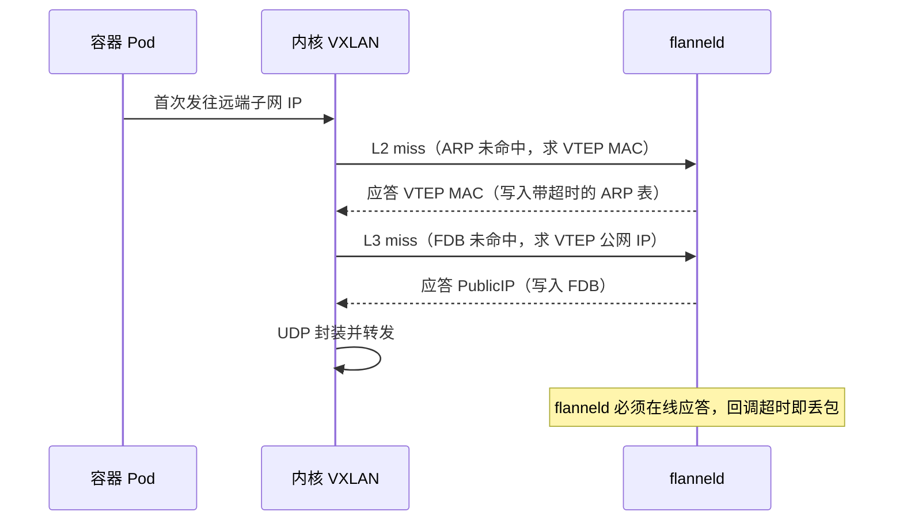
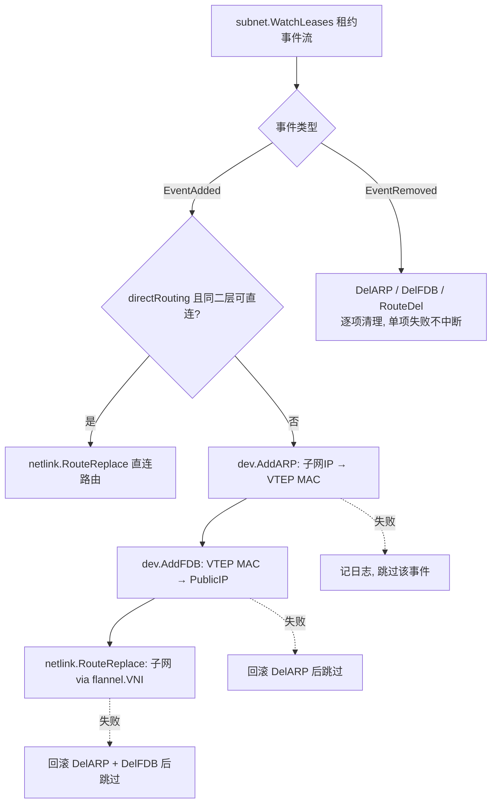

VXLAN 是 flannel 当前推荐的默认后端，而它的数据路径在项目历史上经历了一次深刻的架构迁移：从"内核遇到未命中就回调 flanneld"的应答式设计，演进为"flanneld 主动向内核预写下全部转发依据"的声明式设计。本页以源码为证据，完整复盘这三代数据路径的演进动机、实现差异与工程收益。本文聚焦 Linux 数据面；Windows 实现请参阅 [Windows 跨平台支持：设备、路由与 PowerShell 集成](24-windows-kua-ping-tai-zhi-chi-she-bei-lu-you-yu-powershell-ji-cheng)。

Sources: [backends.md](Documentation/backends.md#L5)

## 阅读前提：内核 VXLAN 设备依赖的三张表

理解这次演进，先要明白一个 VXLAN 设备（flannel 创建的 `flannel.<VNI>`）完成一次跨主机封装，内核需要依次查询三张表。**路由表**决定"去远端子网的流量走哪个设备"；**ARP/邻居表**决定"该设备的下一跳（VTEP）MAC 是什么"；**FDB（转发数据库）**决定"这个 VTEP MAC 的 UDP 封装应该发往哪个公网 IP"。三张表中任何一张缺失答案，内核都必须向用户态求助——这正是早期 miss 回调机制的由来。flannel 源码中以注释形式保留的官方设计史，明确记录了这三代方案的完整演进逻辑。

Sources: [vxlan.go](pkg/backend/vxlan/vxlan.go#L19-L51), [device.go](pkg/backend/vxlan/device.go#L44-L47)

## 第一代：L2/L3 miss 双回调架构

初代方案中，flanneld 将自己注册为 VXLAN 设备的 **L2 miss** 与 **L3 miss** 事件的处理器：当容器首次向其他主机子网发包时，内核因 ARP 未命中产生 L2 miss，flanneld 应答远端 VTEP 的 MAC 并写入带超时的 ARP 表；随后内核在封装时又因 FDB 未命中产生 L3 miss，flanneld 再次被调用以提供远端 VTEP 的公网 IP。这意味着 flanneld 必须**常驻监听 netlink 消息**，任何一次回调无人应答（如 flanneld 崩溃或重启窗口期）都会直接导致丢包。其表项规模也较庞大：全网一条路由、每个近期联系过的远端**容器**各一条 ARP 表项、每个远端**主机**一条 FDB 表项。

下图使用时序图表示对象间按时间顺序的消息交互：纵向生命线代表参与者，箭头为调用方向。

Sources: [vxlan.go](pkg/backend/vxlan/vxlan.go#L21-L35)

## 第二代：预下发 FDB，消灭 L3 miss

第二版重构移除了 L3 miss 回调：每当 flanneld 在启动扫描或租约监听中发现新的远端主机时，**不再等内核来问，而是直接把 FDB 表项写好**，使封装所需的公网 IP 映射在流量到来之前就已就位。这一步把"FDB 由内核数据面动态生成"变成了"FDB 由控制面声明式下发"，是从应答式走向声明式的关键过渡。

Sources: [vxlan.go](pkg/backend/vxlan/vxlan.go#L36-L38)

## 第三代（现行）：纯静态表项与租约事件调和

现行版本的终态更为彻底：**L2 miss 回调也被移除，flanneld 不再监听任何 netlink miss 消息**。设备创建时不注册任何 miss 处理器；每当发现一个远端主机（启动时或运行中），flannel 依次完成三件事——(1) 为远端子网写一条经 VXLAN 设备并指定下一跳的路由；(2) 为远端 flannel 主机 IP 写一条静态 ARP 表项（IP → VTEP MAC）；(3) 写一条 FDB 表项（VTEP MAC → 远端 flanneld 公网 IP）。表项规模由此收敛为**严格线性于主机数**：每主机恰好 1 条路由 + 1 条 ARP + 1 条 FDB。官方注释将收益归结为两点：可靠性提升（flanneld 崩溃或重启不再产生回调超时问题）与升级简化。

Sources: [vxlan.go](pkg/backend/vxlan/vxlan.go#L40-L55)

### 控制面信息从哪里来：LeaseAttrs 中的 VtepMAC

纯静态方案的前提是 flannel 提前知道每个远端主机的 VTEP MAC。答案在租约属性中：本机在 `AcquireLease` 时通过 `newSubnetAttrs` 把自己的 VNI 与 VTEP MAC 序列化为 JSON 写入 `BackendData`（IPv6 对应 `BackendV6Data`），远端通过租约监听即可读到。这就是 [kube subnet manager：Node 注解、podCIDR 与 informer 机制](19-kube-subnet-manager-node-zhu-jie-podcidr-yu-informer-ji-zhi) 中 Node 注解里 `flannel.alpha.coreos.com/backend-data` 的由来——**租约属性取代了内核回调，成为 VTEP 信息的交换协议**。

Sources: [vxlan.go](pkg/backend/vxlan/vxlan.go#L92-L120), [lease.go](pkg/lease/lease.go#L42-L48)

### 事件处理主循环：先 ARP、再 FDB、最后路由

`network.Run` 是调和循环的入口：一个 goroutine 通过 `subnet.WatchLeases` 长轮询租约事件（`EventAdded`/`EventRemoved`），另一个 goroutine 监视 VXLAN 设备本身的存亡。对每个 `EventAdded`，`handleSubnetEvents` 先构造两条候选路由——经 `flannel.<VNI>` 设备、网关为远端子网 IP、带 `RTNH_F_ONLINK` 标志的 `vxlanRoute`，以及 directRouting 开启且判定可直连时使用的 `directRoute`——随后按 **AddARP → AddFDB → RouteReplace** 的固定顺序下发。这个顺序是刻意的：源码注释明确说明路由必须最后设置，否则内核会因网关 MAC 尚未就绪而发起真实 ARP 请求。

下图使用流程图表示事件驱动的决策与回滚路径：菱形为判断节点，实线为正常流，虚线为失败分支。

每次下发都包裹在 `retry.Do` 中——该封装默认最多重试 10 次且间隔递增，用于吸收 netlink 操作的瞬时失败。若 FDB 写入失败则回滚已写入的 ARP；若最后路由写入失败则 ARP 与 FDB 一并回滚，保证内核中不残留半成品表项。directRouting 的直连判定由 `ip.DirectRouting` 完成：仅当内核查询到的到远端 PublicIP 的路由是"单条且无网关"（即同二层直连）时才启用，此时流量完全绕过 VXLAN 封装，行为等同 host-gw。

Sources: [vxlan_network.go](pkg/backend/vxlan/vxlan_network.go#L65-L112), [vxlan_network.go](pkg/backend/vxlan/vxlan_network.go#L289-L309), [vxlan_network.go](pkg/backend/vxlan/vxlan_network.go#L342-L396), [vxlan_network.go](pkg/backend/vxlan/vxlan_network.go#L378-L395), [retry.go](pkg/retry/retry.go#L23-L33), [iface.go](pkg/ip/iface.go#L232-L242), [subnet.go](pkg/subnet/subnet.go#L108-L121)

### 删除路径的容忍性

`EventRemoved` 的处理哲学与添加路径不同：注释明确写着"尽量删除所有表项，某一项失败不要中断"——DelARP、DelFDB、RouteDel 三者彼此独立执行、各自记录错误。这与节点缩容场景吻合：移除一台故障主机时不应该因为一条 netlink 删除操作的失败而让其余表项滞留内核。

Sources: [vxlan_network.go](pkg/backend/vxlan/vxlan_network.go#L454-L484)

## 静态表项的 netlink 解剖

静态化的本质体现在写入原语的标志位上。ARP 与 FDB 均通过 `netlink.NeighSet` 写入，且 State 统一为 **`NUD_PERMANENT`**——永久表项不参与内核的邻居老化与垃圾回收，这正是"flanneld 崩溃也不影响转发"的技术根基。两者的家族标志则决定表项落入哪张表：FDB 用 `AF_BRIDGE` + `NTF_SELF` 作用于设备级转发数据库，ARP 用 `RTN_UNICAST` 作用于三层邻居表。IPv6 侧提供完全对称的 `AddV6ARP`/`AddV6FDB` 四件套，支撑双栈集群（参见 [双栈与 IPv6-only 集群配置实战](15-shuang-zhan-yu-ipv6-only-ji-qun-pei-zhi-shi-zhan)）。

| 表项 | 写入函数 | netlink 调用 | 关键标志 | 映射语义 |
| --- | --- | --- | --- | --- |
| ARP（邻居） | `AddARP` / `AddV6ARP` | `NeighSet` | `NUD_PERMANENT` + `RTN_UNICAST` | 远端子网 IP → 远端 VTEP MAC |
| FDB | `AddFDB` / `AddV6FDB` | `NeighSet` | `NUD_PERMANENT` + `AF_BRIDGE` + `NTF_SELF` | 远端 VTEP MAC → 远端 PublicIP |
| 路由 | 直接构造 `netlink.Route` | `RouteReplace` | `SCOPE_UNIVERSE` + `RTNH_F_ONLINK` | 远端子网 via `flannel.<VNI>`，网关为远端子网 IP |

Sources: [device.go](pkg/backend/vxlan/device.go#L185-L195), [device.go](pkg/backend/vxlan/device.go#L231-L240), [device.go](pkg/backend/vxlan/device.go#L197-L273)

## Learning 化石：设备兼容性检查中的 L2miss 残留

VXLAN 设备创建时，`Learning` 字段由配置直传内核链接属性，而 flannel 的默认值为 **false**（关闭内核 MAC 动态学习）——这与纯静态方案互为印证：学习如果开着，内核会动态插入 FDB 表项，与声明式管理产生竞争。一个耐人寻味的细节是，`vxlanLinksIncompat`（判断已存在设备与新配置是否兼容、是否需要删除重建）至今仍在比较 `L2miss` 字段——这是 netlink 库 `Vxlan` 结构体上的遗留属性，flannel 自身已不再设置它，但为了识别**旧版本 flannel 创建的设备**（它们曾带着 L2miss 标志运行），这个化石字段被保留了下来，成为三代演进在代码中留下的直接物证。

| 数据面相关配置项 | 默认值 | 对数据路径的影响 |
| --- | --- | --- |
| `Learning` | `false` | 关闭内核动态 FDB 学习，表项完全由 flanneld 声明 |
| `DirectRouting` | `false` | 同二层主机间绕过封装，直连路由替代 VXLAN 路径 |
| `VNI` | `1`（Linux） | 决定设备名 `flannel.<VNI>` 与封装标识 |
| `Port` | `8472`（Linux）/ `4789`（Windows） | UDP 封装端口 |

Sources: [device.go](pkg/backend/vxlan/device.go#L59-L71), [device.go](pkg/backend/vxlan/device.go#L299-L301), [backends.md](Documentation/backends.md#L22-L28), [vxlan.go](pkg/backend/vxlan/vxlan.go#L159-L180)

## 韧性接力：从 miss 监听到设备监视与持久化 MAC

miss 回调监听被移除后，flanneld 对 netlink 的唯一订阅变成了**设备存亡监视**：`watchVXLANDevice` 通过 `LinkSubscribe` 监听链接事件，一旦捕获到 flannel VXLAN 设备的 `RTM_DELLINK`（例如外部网卡被删导致设备消失），就向带缓冲的通道投递信号，由独立的 goroutine 以指数退避（1s 起、上限 30s）等待外部接口恢复后**重建设备并重新配置地址**。重建期间主循环不被阻塞，租约事件的调和照常进行。与之配套的两个稳定性设计：flannel 重启时从存储中读回上次的 VTEP MAC（避免 MAC 漂移导致全网静态表项失效）；设备地址配置为 `/32`（IPv6 为 `/128`）——确保内核不会为该设备生成广播类路由，它的地址仅作为主机到工作负载流量的源地址使用。

| 机制 | 第一/二代（miss 监听时代） | 第三代（现行） |
| --- | --- | --- |
| netlink 订阅内容 | L2/L3 miss 请求 | 仅 `RTM_DELLINK` 设备删除事件 |
| flanneld 宕机影响 | 回调无人应答，新流建立失败 | 无影响，静态表项驻留内核持续转发 |
| 设备丢失恢复 | 依赖重新注册 miss 回调 | 设备监视 + 指数退避自动重建 |
| VTEP MAC 稳定性 | 设备重建后随机新 MAC | 从存储读回持久化 MAC，避免表项失效 |

Sources: [vxlan_network.go](pkg/backend/vxlan/vxlan_network.go#L114-L152), [vxlan_network.go](pkg/backend/vxlan/vxlan_network.go#L154-L246), [vxlan.go](pkg/backend/vxlan/vxlan.go#L190-L200), [vxlan.go](pkg/backend/vxlan/vxlan.go#L149-L154)

## 现行转发路径串讲

将三张静态表在一次跨主机发包中的协作串起来：Pod 发往远端子网 IP 后，内核先查路由表命中"远端子网 via `flannel.<VNI>`"，再查 ARP 表得到网关（远端子网 IP）对应的静态 VTEP MAC，最后查 FDB 得到该 VTEP MAC 对应的远端 PublicIP，完成 UDP 封装（默认端口 8472）。整个链条中没有任何一次内核到用户态的求助——每个环节的答案都在租约事件发生时被预先写死。值得一提的工程细节是封装开销：flannel 将 VXLAN 的 MTU 开销固定按 50 字节计算（`encapOverhead = 50`），容器侧可用 MTU 由此推导，这一话题的调优延伸见 [性能调优：MTU 计算、后端选型与防火墙端口](26-xing-neng-diao-you-mtu-ji-suan-hou-duan-xuan-xing-yu-fang-huo-qiang-duan-kou)。

Sources: [vxlan_network.go](pkg/backend/vxlan/vxlan_network.go#L46-L48), [vxlan_network.go](pkg/backend/vxlan/vxlan_network.go#L256-L258), [device.go](pkg/backend/vxlan/device.go#L63)

## 演进总结与延伸阅读

| 维度 | 第一代：L2+L3 miss | 第二代：预下发 FDB | 第三代：纯静态表项 |
| --- | --- | --- | --- |
| flanneld 是否应答内核 | 双回调常驻应答 | 仅应答 L2 miss | 完全不应答 |
| ARP 表项 | 每远端容器一条、带超时 | 静态（每主机） | 静态 `NUD_PERMANENT`（每主机） |
| FDB 表项 | miss 时动态生成 | 静态（每主机） | 静态（每主机） |
| 表项规模 | O(近期容器数) + O(主机数) | O(主机数) | O(主机数) |
| flanneld 重启窗口 | 新流建立丢包 | ARP 应答缺失致建流失败 | 转发不受影响 |
| 升级/重建复杂度 | 需重新注册回调 | 需重新注册回调 | 租约事件全量调和即可 |

这次演进的深层逻辑，是 flannel 反复出现的架构母题——**用存储中的声明式状态取代运行时的隐式协作**：VTEP 信息从"内核按需询问"变为"租约属性携带、事件驱动下发"。理解这一点后，建议按以下路径继续深入：先通过 [后端插件注册模式：基于 init() 与构造器映射的扩展点设计](8-hou-duan-cha-jian-zhu-ce-mo-shi-ji-yu-init-yu-gou-zao-qi-ying-she-de-kuo-zhan-dian-she-ji) 了解 vxlan 后端是如何被注册进 `backend.Register("vxlan", New)` 这条扩展点的，再在 [推荐后端对比：VXLAN、host-gw 与 WireGuard 选型](10-tui-jian-hou-duan-dui-bi-vxlan-host-gw-yu-wireguard-xuan-xing) 中横向比较各后端的数据面取舍；配置项的权威清单见 [net-conf.json 网络配置项逐项详解](13-net-conf-json-wang-luo-pei-zhi-xiang-zhu-xiang-xiang-jie)，而静态表项失效引发的连通性问题排查则见 [常见故障排查：连通性、权限、日志与日志级别](25-chang-jian-gu-zhang-pai-cha-lian-tong-xing-quan-xian-ri-zhi-yu-ri-zhi-ji-bie)。